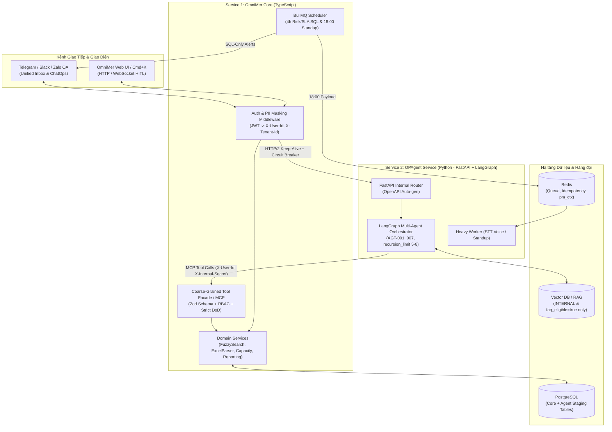

<!--
  name: 01_SRS_OPAGENT_MULTI_AGENT_ECOSYSTEM.md
  description: IEEE Std 830-1998 Software Requirements Specification for the OPAgent Multi-Agent Ecosystem (FR-AGT-001 to FR-AGT-007), covering dual-service architecture (TypeScript Core + Python LangGraph), Coarse-Grained MCP Tool Facade, Data Dictionary, NFRs, REST/Internal APIs, and Phased Implementation Plan.
-->

# Software Requirements Specification (SRS) — Phân hệ Agent Project (`OPAgent` Multi-Agent Ecosystem)

> **Reference Standard:** IEEE Std 830-1998  
> **Project:** OmniMer Enterprise PMIS — Phase 1 (`OPAgent` Service & TypeScript Tool Facade)  
> **Scope:** `FR-AGT-001` $\rightarrow$ `FR-AGT-007` (3 Giai đoạn Triển khai)  
> **Solution Architecture:** [sa.md](./sa.md)  
> **RTM:** [02_RTM_OPAGENT_MULTI_AGENT_ECOSYSTEM.csv](./02_RTM_OPAGENT_MULTI_AGENT_ECOSYSTEM.csv)

> [!NOTE]
> **Cập nhật kiến trúc (2026-11-23):** Một số quyết định kỹ thuật tại §2, §3.2, §4 và `NFR-AGT-02` đã được cập nhật theo [`02_opagent_technology_evaluation_adr.md`](../../../../../backend_otm/opagent_service/docs/architecture/02_opagent_technology_evaluation_adr.md) (`pgvector` thay Qdrant, ADT `EdDSA` thay header tĩnh, HTTP/1.1 Keep-Alive + SSE thay HTTP/2, Postgres `opagent_runtime` checkpointer thay Redis `pm_ctx`, và 20 Agent Tools `READ`/`STAGE`). Bản SRS này sẽ được đồng bộ chi tiết ở Bước 11.

---

## 1. Introduction

### 1.1 Purpose
Đặc tả toàn bộ yêu cầu kỹ thuật, kiến trúc tích hợp, hợp đồng dữ liệu (Contract-First OpenAPI/Zod), ngưỡng phi chức năng (NFR) và chốt chặn bảo mật cho **Hệ sinh thái Multi-Agent `OPAgent`** của OmniMer Team. Tài liệu hợp nhất đầy đủ 7 bộ đặc tả chức năng từ `FR-AGT-001` đến `FR-AGT-007` nhằm làm chuẩn duy nhất cho đội ngũ Backend (TypeScript Core & Python LangGraph), Frontend (Web UI / Command Bar) và QA-QC.

### 1.2 Product Scope & Phased Alignment
Hệ thống được chia làm **2 dịch vụ tách biệt** (**OmniMer Core** bằng TypeScript và **OPAgent Service** bằng Python FastAPI + LangGraph) giao tiếp qua mạng nội bộ, triển khai theo **3 giai đoạn**:

1. **Giai đoạn 1 — Nền tảng & Trợ lý Nhập liệu / Giám sát Chủ động (`FR-AGT-001`, `FR-AGT-002`):**
   - **`FR-AGT-001` (NLP Text/Voice-to-Task):** Bóc tách câu lệnh tự nhiên (Text & Voice STT) theo múi giờ Việt Nam (`UTC+7`), che PII bằng Regex tất định (`BR-CHN-007`), ánh xạ `assignee_name_hint` qua Fuzzy Search tại TS Core, lưu nháp `draft_tasks` (Human-in-the-Loop) và bảo vệ bởi Circuit Breaker (`5s` Text / `15s` Voice).
   - **`FR-AGT-002` (Proactive Health Monitor):** Quét rủi ro Task `< 48h` mỗi 4h hoàn toàn bằng SQL thuần (Zero-LLM), quét cảnh báo SLA hội thoại & cửa sổ 48h Zalo OA (`>= 42h`), tổng hợp Standup lúc `18:00` qua Redis Queue (`queue:agent:standup`), chống spam bằng Redis Idempotency và Radar Đường găng / WIP Bottleneck.
2. **Giai đoạn 2 — CSKH Đa kênh, PM Copilot & Điều phối Dev (`FR-AGT-003`, `FR-AGT-004`, `FR-AGT-006`):**
   - **`FR-AGT-003` (Omnichannel Ticket Bot & Support Copilot):** Auto-Triage phân loại tin nhắn (`FAQ`, `FEATURE_REQUEST`, `BUG_INCIDENT` mức `P1..P4`), định tuyến tất định theo danh sách khách hàng chuyên trách đa kênh (`channel_contact_owners` cho Telegram/Slack/Zalo OA), RAG FAQ chỉ truy xuất tài liệu `INTERNAL` (`faq_eligible = true`), bôi chọn tin nhắn tạo Ticket `SUPPORT` (`FR-SUP-000`), leo thang sang Task `DELIVERY` (`BR-001`) và tóm tắt bàn giao ca dưới dạng `INTERNAL_NOTE`.
   - **`FR-AGT-004` (PM Bot & Full Task Lifecycle Copilot):** Tìm kiếm NL/OQL, CRUD đa lượt có thẻ xác nhận `agent_action_drafts` (TTL `15 phút`, kiểm tra `occ_versions`), bộ nhớ hội thoại ngắn hạn trên Redis (`pm_ctx:{tenant_id}:{user_id}`, tối đa 5 lượt, TTL `900s`), bảo vệ cổng Strict DoD (`FR-PRJ-008`), chống tự lùi deadline (`FR-PRJ-007.4`), rã WBS và đánh giá tiến độ EVM / SPI / Burndown tất định.
   - **`FR-AGT-006` (Smart Developer Dispatcher):** Chấm điểm ứng viên theo công thức `40% Capacity Availability + 35% Skill & Tag Match + 25% Historical Module Ownership`, chặn cứng người quá tải `> 100%` hoặc đang nghỉ phép `ON_LEAVE`, hỗ trợ `RECOMMEND_HITL` và `AUTO_DISPATCH_P1` (`dispatch_score >= 70`, `workload_pct <= 90%`).
3. **Giai đoạn 3 — Tự động hóa Khởi tạo & Tuân thủ Tài sản (`FR-AGT-005`, `FR-AGT-007`):**
   - **`FR-AGT-005` (Project Architect & Account Onboarding Agent):** Hội thoại khởi tạo Project Blueprint (`setup_blueprint_drafts`), mời thành viên hàng loạt có kiểm tra Subscription Seat (`FR-ORG-001.3`) + sinh QR ChatOps (`FR-CHN-012`), soạn Onboarding Briefing (`INTERNAL` only) và kiểm toán cấu hình bảo mật Workspace.
   - **`FR-AGT-007` (Asset Governance & Remediation Guardian):** Gom nhóm Finding `FAIL/CRITICAL` đã được `ExcelPlanParserService` parse tất định thành `draft_tasks` vá lỗi (`asset_remediation_links`), kiểm tra điều kiện Pre-Release & Quorum (`ALL_REQUIRED` / `ANY_ONE`, chống Self-Approval), và soạn `00_HANDOVER_MANIFEST.md` kèm RBAC Redaction khi xuất gói ZIP cho khách ngoài.

### 1.3 References
- [sa.md](./sa.md) — Kiến trúc Giải pháp OPAgent (Database-per-Service, Coarse-Grained MCP, Zero-Trust)
- [FR-AGT-001](./FR-AGT-001_nlp_text_to_task.md) | [FR-AGT-002](./FR-AGT-002_proactive_health_monitor.md) | [FR-AGT-003](./FR-AGT-003_omnichannel_ticket_bot.md) | [FR-AGT-004](./FR-AGT-004_pm_copilot_full_task_lifecycle.md) | [FR-AGT-005](./FR-AGT-005_project_setup_and_account_onboarding_agent.md) | [FR-AGT-006](./FR-AGT-006_smart_developer_dispatcher.md) | [FR-AGT-007](./FR-AGT-007_asset_governance_and_remediation_agent.md)
- [FR-CHN-004](../omnichannel/phase_2/FR-CHN-004_conversation_triage_and_rbac.md) — Multi-Channel Sticky Customer Portfolio & RBAC

---

## 2. Overall Architecture & Cross-Service Flow

---

## 3. Data Dictionary & Staging Entities (PostgreSQL & Redis)

Toàn bộ dữ liệu nghiệp vụ và bảng nháp HITL được lưu tại PostgreSQL của **OmniMer Core** (`OPAgent` chạy stateless):

### 3.1. PostgreSQL Tables (Mới / Mở rộng cho `OPAgent`)

| Table / Prisma Model | Key Columns & Types | Purpose & Invariants |
| :--- | :--- | :--- |
| **`draft_tasks`** (`DraftTask`) | `id` (UUID), `tenant_id`, `project_id`, `input_mode` (`TEXT \| VOICE \| OMNICHANNEL_MSG`), `raw_input_text`, `task_title`, `description` (giữ nguyên PII gốc trên Server), `assignee_candidates` (`JSONB`), `suggested_deadline` (`TIMESTAMPTZ`), `extracted_subtasks` (`JSONB`), `ai_status` (`DRAFT_READY \| FALLBACK_MANUAL \| CONFIRMED \| DISCARDED`), `created_by`, `created_at`. | Lưu bản nháp bóc tách từ `FR-AGT-001`, `FR-AGT-003.3`, `FR-AGT-007.1`. Không bao giờ ghi thẳng vào `tasks` trước khi User xác nhận. |
| **`proactive_alert_logs`** (`ProactiveAlertLog`) | `id`, `tenant_id`, `project_id?`, `task_id?`, `conversation_id?`, `alert_type` (`RISK_48H_DM \| DAILY_STANDUP \| CRITICAL_PATH_BLOCK \| WIP_BOTTLENECK \| CONVERSATION_SLA_48H`), `recipient_id`, `delivery_status` (`SENT \| SKIPPED_UNBOUND \| FAILED`), `sent_at`. | Nhật ký gửi cảnh báo tự động (`FR-AGT-002`). |
| **`ticket_triage_logs`** (`TicketTriageLog`) | `id`, `tenant_id`, `conversation_id`, `predicted_intent` (`FAQ \| FEATURE_REQUEST \| BUG_INCIDENT \| GENERAL_CHAT`), `predicted_severity` (`P1_CRITICAL .. P4_LOW`), `sentiment_score` (`Float?`), `routed_cskh_user_id?`, `routing_reason` (`STICKY_PORTFOLIO_OWNER \| BACKUP_ON_LEAVE \| NEW_CONTACT_LEAST_ACTIVE \| MANUAL_CLAIM`), `auto_created_ticket_id?`, `escalation_task_id?`, `created_at`. | Nhật ký phân loại tin nhắn, định tuyến CSKH chuyên trách và leo thang Dev (`FR-AGT-003`). |
| **`agent_action_drafts`** (`AgentActionDraft`) | `id`, `tenant_id`, `user_id`, `action_type` (`CREATE_TASK \| UPDATE_TASK \| BULK_RESCHEDULE \| CREATE_WBS_TREE`), `target_project_id`, `payload_json` (`JSONB` validated by Zod), `occ_versions` (`JSONB`), `status` (`PENDING_CONFIRM \| EXECUTED \| EXPIRED \| CANCELLED`), `expires_at` (`NOW() + 15m`). | Hàng đợi xác nhận HITL cho các thao tác ghi của PM Bot (`FR-AGT-004`). |
| **`setup_blueprint_drafts`** (`SetupBlueprintDraft`) | `id`, `tenant_id`, `blueprint_type` (`PROJECT_SETUP \| MEMBER_PROVISIONING \| SECURITY_REMEDIATION`), `proposed_config` (`JSONB`), `validation_report` (`JSONB`), `status` (`DRAFT_PREVIEW \| APPLIED \| FAILED \| DISCARDED`), `created_by`, `applied_at?`. | Lưu bản xem trước cấu hình Project/Onboarding nguyên khối trước khi chạy Transaction (`FR-AGT-005`). |
| **`dispatch_recommendations`** (`DispatchRecommendation`) | `id`, `tenant_id`, `task_id?`, `required_skills` (`JSONB`), `candidates_snapshot` (`JSONB`), `dispatch_mode` (`RECOMMEND_HITL \| AUTO_DISPATCH_P1`), `selected_user_id?`, `created_at`. | Lưu lịch sử chấm điểm gợi ý Dev và vòng phản hồi chọn thực tế của PM (`FR-AGT-006`). |

### 3.2. Redis Keys (Idempotency, Queues & Short-Term Memory)

| Key Pattern | TTL | Purpose |
| :--- | :---: | :--- |
| `alert:{task_id}` | `12h` | Chống gửi trùng Telegram DM cảnh báo Task sắp trễ hạn `< 48h` (`FR-AGT-002.1`). |
| `sla_alert:{conversation_id}` | `6h` | Chống gửi trùng cảnh báo SLA hội thoại / Zalo OA sắp hết cửa sổ 48h (`FR-AGT-002.5`). |
| `standup:{project_id}:{YYYY-MM-DD}` | `24h` | Đảm bảo mỗi Project chỉ gửi tối đa 1 báo cáo Standup/ngày lúc `18:00` (`FR-AGT-002.2`). |
| `pm_ctx:{tenant_id}:{user_id}` | `900s` | Bộ nhớ ngắn hạn đa lượt của PM Bot, tối đa 5 lượt gần nhất (`FR-AGT-004`). |

---

## 4. Coarse-Grained MCP Tool Contracts (TypeScript Facade $\leftrightarrow$ LangGraph)

Mọi Tool đều tiêm cứng tham số xác thực (`tenant_id`, `X-User-Id`, `X-Internal-Secret`) từ Server, LLM không được phép tự truyền các trường định danh bảo mật:

| Module | Tool / Endpoint Name | Purpose & Core Guardrail |
| :--- | :--- | :--- |
| **AGT-001** | `POST /internal/v1/agent/extract-task` | Core gửi `masked_input` + `current_datetime` (`UTC+7`) sang Python; trả `TaskExtractionResult`. |
| **AGT-001** | `resolve_assignee_candidates` | Fuzzy Search nội bộ TS Core map `assignee_name_hint` $\rightarrow$ `user_id[]`. |
| **AGT-002** | `get_daily_standup_payload` | Gom số liệu `DELIVERY` vs `SUPPORT` tách biệt (`BR-005`) cho Standup Worker. |
| **AGT-002** | `get_project_health_snapshot` | Trả về Health Score (`0–100`), WIP violations, Critical Path delays, Workload. |
| **AGT-003** | `resolve_cskh_portfolio_routing` | Tra cứu `channel_contact_owners` tất định + Leave Calendar để chia về đúng CSKH chuyên trách. |
| **AGT-003** | `search_faq_knowledge` | Vector search bị khóa cứng `allowed_classifications = ['INTERNAL']`, `faq_eligible = true`. |
| **AGT-003** | `create_ticket_draft_from_messages` | Sinh `draft_tasks` (`task_type = TICKET`, `parent_fr_id = FR-SUP-000`). |
| **AGT-003** | `prepare_delivery_escalation` | Sinh Draft `TASK` (`DELIVERY`) + `candidate_frs[]` + gọi `FR-AGT-006` tìm Top Dev. |
| **AGT-004** | `query_tasks_by_nl_filters` | Truy vấn Task trong phạm vi `allowed_project_ids[]`, tối đa 10 mục/lượt + Disambiguation. |
| **AGT-004** | `stage_task_mutation` | Kiểm tra Anti-Gaming (`FR-PRJ-007.4`) & lưu `agent_action_drafts` chờ Confirm. |
| **AGT-004** | `transition_task_status_checked` | Kiểm tra cổng Strict DoD (`FR-PRJ-008`), `BR-001`, WIP Limit trước khi chuyển `DONE`. |
| **AGT-004** | `get_sprint_evm_assessment` | Tính toán SQL tất định Velocity, SPI, Burndown Gap (loại trừ `TICKET`). |
| **AGT-005** | `generate_project_setup_blueprint` | Kiểm tra quyền Admin/PM, tạo `setup_blueprint_drafts` (`PROJECT_SETUP`). |
| **AGT-005** | `stage_bulk_member_provisioning` | Kiểm tra Subscription Seat Quota (`FR-ORG-001.3`), tạo Blueprint mời & QR Binding. |
| **AGT-005** | `audit_workspace_governance_posture` | Kiểm toán SSO, Auto-Lock, Quorum `ALL_REQUIRED` cho `RESTRICTED_SECURITY`, NĐ 13. |
| **AGT-006** | `get_dispatch_candidates_snapshot` | Gom Cross-Project Workload, Skills, Leave Calendar, 90d Ownership trong 1 lần gọi. |
| **AGT-006** | `commit_task_assignment` | Gán Task kèm kiểm tra `AUTO_DISPATCH_P1` safeguards & ghi Activity Log. |
| **AGT-007** | `get_asset_findings_for_remediation` | Kiểm tra AuthZ độ mật (`INTERNAL` / `CONFIDENTIAL` / `RESTRICTED_SECURITY`) trước khi trả Findings. |
| **AGT-007** | `stage_remediation_draft_tasks` | Tạo `draft_tasks` vá lỗi giữ liên kết `asset_remediation_links` & `parent_fr_id`. |
| **AGT-007** | `check_release_handover_readiness` | Kiểm tra Strict DoD, Quorum Reviews, Critical Findings chưa đóng. |
| **AGT-007** | `build_handover_manifest_preview` | Soạn `00_HANDOVER_MANIFEST.md` & thực thi RBAC Redaction khi `EXTERNAL_CLIENT`. |

---

## 5. Non-Functional Requirements (NFRs)

| NFR ID | Metric / Constraint | Target Threshold |
| :--- | :--- | :--- |
| **NFR-AGT-01** | **NLP Extraction Timeout & Fallback (`FR-AGT-001`)** | Text Extract `<= 5,000ms`; Voice STT + Extract `<= 15,000ms` (file `<= 10MB`, `<= 120s`). Circuit Breaker mở `30s` khi tỷ lệ lỗi `> 50%` trong `10` request liên tiếp $\rightarrow$ tự động chuyển `FALLBACK_MANUAL`. |
| **NFR-AGT-02** | **LangGraph Loop & Recursion Guard (`sa.md`)** | `recursion_limit` tối đa `5–8` bước; kết nối nội bộ dùng `httpx.AsyncClient(http2=True)` Keep-Alive với độ trễ mạng `1–5ms`. |
| **NFR-AGT-03** | **Rate Limiting (`FR-AGT-004`)** | PM Bot giới hạn `20 req/phút` cho truy vấn đọc và `10 mutation/phút` cho mỗi `user_id`. |
| **NFR-AGT-04** | **Zero-Trust & PII Privacy (`BR-CHN-007`, `BL-AGT-007.1`)** | `100%` SĐT, Email, CCCD, STK bị che bằng Regex tất định trước khi gửi External LLM; `0%` tài liệu `CONFIDENTIAL` / `RESTRICTED_SECURITY` lọt vào Vector RAG công cộng hoặc gói bàn giao `EXTERNAL_CLIENT`. |
| **NFR-AGT-05** | **Zero-LLM Deterministic Cost (`FR-AGT-002`, `FR-AGT-003.6`)** | `100%` tác vụ quét rủi ro 4h, quét SLA hội thoại 48h Zalo OA và định tuyến Sticky CSKH chạy bằng SQL thuần không tiêu tốn token LLM. |

---

## 6. Phased Model Allocation & Delivery Plan

| Giai đoạn | Hạng mục Công việc | Model Đề xuất |
| :--- | :--- | :--- |
| **Phase 1** (`FR-AGT-001`, `002`, `sa.md`) | Kiến trúc `OPAgent` FastAPI + LangGraph, `openapi-typescript` / MCP Adapter, PII Masking Middleware, `draft_tasks`, Fuzzy Search, BullMQ SQL 4h Risk & SLA 48h, Standup Worker | **Claude Opus** (AuthZ/PII/MCP Core), **Gemini 4 Hydrogen** (LangGraph & BullMQ Workers), **Gemini 4 Argon** (HITL Popup UI & API Spec) |
| **Phase 2** (`FR-AGT-003`, `004`, `006`) | Auto-Triage, Sticky Portfolio Router, FAQ RAG (`INTERNAL` Filter), PM Copilot CRUD + Strict DoD Guard + EVM, Smart Dev Dispatcher Scoring & Overload Guard | **Claude Opus** (RBAC/DoD/Anti-Gaming Guards), **Neon** (Dispatcher Scoring & Portfolio Routing), **Gemini 4 Hydrogen** (LangGraph Multi-turn & Escalation), **Gemini 4 Argon** (Command Bar `Cmd+K` & Draft Cards) |
| **Phase 3** (`FR-AGT-005`, `007`) | Conversational Project Setup Blueprint, Bulk Provisioning + Seat Guard, Asset Finding Remediation Sync, Pre-Release Readiness Audit & Handover RBAC Redaction | **Claude Opus** (Classification AuthZ & RBAC Redaction), **Gemini 4 Hydrogen** (Blueprint Transaction & Remediation Sync), **Gemini 4 Argon** (Setup Wizard Dry-Run UI & Manifest Preview), **Gemini Flash** (`tsc --noEmit`, Pytest/Ruff & Contract checks) |
