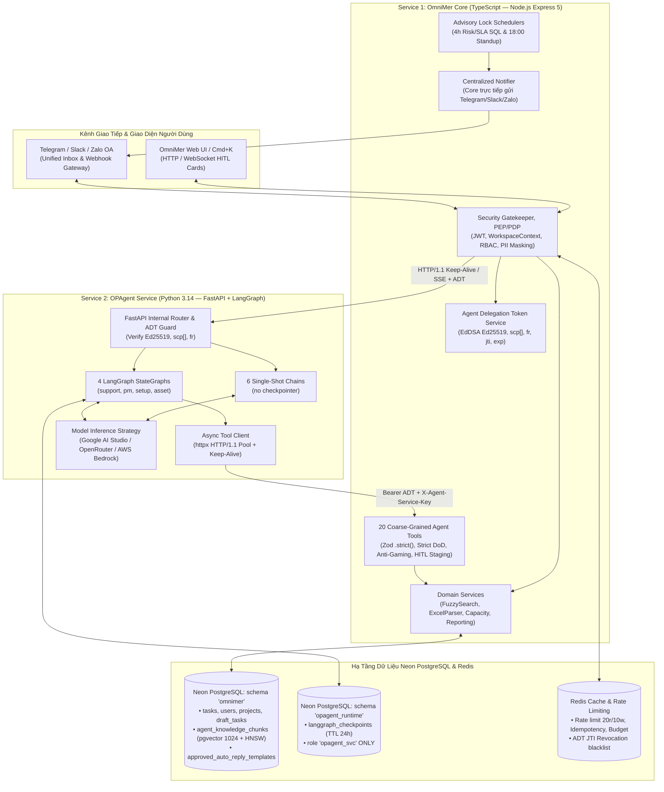
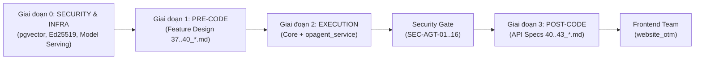

<!--
  name: 01_SRS_OPAGENT_MULTI_AGENT_ECOSYSTEM.md
  description: IEEE Std 830-1998 Software Requirements Specification for the OPAgent Multi-Agent Ecosystem (FR-AGT-001 to FR-AGT-007), covering dual-service architecture (TypeScript project_core PEP/PDP + Python opagent_service Reasoning Engine), Coarse-Grained 20 Agent Tools (READ/STAGE, 0 COMMIT), Data Dictionary (Neon pgvector vector(1024), Staging tables, ApprovedAutoReplyTemplate), NFRs, REST/Internal APIs, SEC-AGT-01..16 Security Verification Gate, and Model Serving Strategy (Google AI Studio, OpenRouter, AWS Bedrock).
-->

# Software Requirements Specification (SRS) — Phân hệ Agent Project (`OPAgent` Multi-Agent Ecosystem)

> **Reference Standard:** IEEE Std 830-1998  
> **Project:** OmniMer Enterprise PMIS — Phase 1 (`OPAgent` Service & TypeScript Tool Facade)  
> **Scope:** `FR-AGT-001` $\rightarrow$ `FR-AGT-007` (3 Giai đoạn Triển khai + Giai đoạn 0 Security & Infra)  
> **Solution Architecture:** [sa.md](./sa.md)  
> **RTM:** [02_RTM_OPAGENT_MULTI_AGENT_ECOSYSTEM.csv](./02_RTM_OPAGENT_MULTI_AGENT_ECOSYSTEM.csv) (32 Functional + 16 Security Test Cases)

> [!NOTE]
> **Trạng thái tài liệu:** `v2.0.0` (Đã đồng bộ toàn diện với bộ 5 tài liệu kiến trúc kỹ thuật tại `backend_otm/opagent_service/docs/architecture/` và Changelog `v2.0.0`).
> *Các cập nhật chính:* `pgvector (vector(1024))` thay cho Qdrant; Agent Delegation Token (`EdDSA Ed25519`) thay cho static headers; giao tiếp HTTP/1.1 Keep-Alive + SSE thay cho HTTP/2; PostgreSQL schema `opagent_runtime` checkpointer thay cho Redis `pm_ctx`; rút quyền commit của LLM (chỉ giữ 20 tools `READ`/`STAGE`); bổ sung bảng `approved_auto_reply_templates` cho phản hồi ngoài giờ tất định; bộ nhớ ngắn hạn 2 kênh (`WorkingState` vs `History`), `User/Workspace AgentPreferences` JSONB, khóa đồng thời `thread_id`, `HITL Edit-Diff Telemetry`, `PromptRegistry` và chiến lược model serving đa tầng.

---

## 1. Introduction

### 1.1 Purpose
Đặc tả toàn bộ yêu cầu kỹ thuật, kiến trúc tích hợp, hợp đồng dữ liệu (Contract-First OpenAPI/Zod), ngưỡng phi chức năng (NFR) và chốt chặn bảo mật cho **Hệ sinh thái Multi-Agent `OPAgent`** của OmniMer Team. Tài liệu hợp nhất đầy đủ 7 bộ đặc tả chức năng từ `FR-AGT-001` đến `FR-AGT-007` và 16 ca kiểm thử an toàn thông tin chuyên sâu (`SEC-AGT-01..16`) nhằm làm chuẩn duy nhất cho đội ngũ Backend (TypeScript Core & Python OPAgent), Frontend (Web UI / Command Bar) và QA-QC.

### 1.2 Product Scope & Phased Alignment
Hệ thống được chia làm **2 dịch vụ tách biệt**: **OmniMer Core** (`backend_otm/project_core` — TypeScript / Express 5 / Prisma) đóng vai trò System of Record và PEP/PDP duy nhất; và **OPAgent Service** (`backend_otm/opagent_service` — Python 3.14 + FastAPI + LangGraph) đóng vai trò Reasoning Engine nội bộ chạy dưới dạng Render Private Service (`pserv`).

Toàn bộ lộ trình triển khai gồm **Giai đoạn 0 và 3 Giai đoạn Tính năng**:

0. **Giai đoạn 0 — Nền tảng Bảo mật, Phân quyền & Chuẩn Bị Hạ Tầng:**
   - Hoàn thiện Threat Model (STRIDE, OWASP LLM Top 10), ma trận RBAC theo vai trò, chốt 4 quyết định nghiệp vụ/bảo mật.
   - Bật extension `pgvector 0.8.7` trong Neon PostgreSQL, tạo schema cô lập `opagent_runtime` với role `opagent_svc`, sinh cặp khóa `Ed25519 (kid_v1)`, cấu hình Render Environment Groups và xác thực Model Serving qua Google AI Studio (1500 RPD).
1. **Giai đoạn 1 — Nền tảng & Trợ lý Nhập liệu / Giám sát Chủ động (`FR-AGT-001`, `FR-AGT-002`):**
   - **`FR-AGT-001` (NLP Text/Voice-to-Task):** Bóc tách câu lệnh tự nhiên (Text & Voice STT) theo múi giờ Việt Nam (`UTC+7`), che PII bằng Regex tất định (`BR-CHN-007`), ánh xạ `assignee_name_hint` qua Fuzzy Search tại TS Core, lưu nháp `draft_tasks` (Human-in-the-Loop, `conversationId` nullable) và bảo vệ bởi Circuit Breaker (`5s` Text / `15s` Voice).
   - **`FR-AGT-002` (Proactive Health Monitor):** Quét rủi ro Task `< 48h` và đường găng mỗi 4h hoàn toàn bằng SQL thuần (Zero-LLM), quét cảnh báo SLA hội thoại & cửa sổ 48h Zalo OA (`>= 42h`), tổng hợp Daily Standup lúc `18:00` gọi đồng bộ chain lấy văn bản và Core trực tiếp gửi Telegram, chống spam bằng Redis Idempotency.
2. **Giai đoạn 2 — CSKH Đa kênh, PM Copilot & Điều phối Dev (`FR-AGT-003`, `FR-AGT-004`, `FR-AGT-006`):**
   - **`FR-AGT-003` (Omnichannel Ticket Bot & Support Copilot):** Auto-Triage phân loại tin nhắn (`FAQ`, `FEATURE_REQUEST`, `BUG_INCIDENT` mức `P1..P4`), định tuyến tất định theo danh sách khách hàng chuyên trách đa kênh (`channel_contact_owners`), RAG FAQ chỉ truy xuất tài liệu `INTERNAL` (`faq_eligible = true`) qua `pgvector`, bôi chọn tin nhắn tạo Ticket `SUPPORT` (`FR-SUP-000`), leo thang sang Task `DELIVERY` (`BR-001`), tóm tắt bàn giao ca dưới dạng `INTERNAL_NOTE`, và phản hồi ngoài giờ bằng mẫu duyệt sẵn `ApprovedAutoReplyTemplate`.
   - **`FR-AGT-004` (PM Bot & Full Task Lifecycle Copilot):** Tìm kiếm NL/OQL, CRUD đa lượt có thẻ xác nhận `agent_action_drafts` (TTL `15 phút`, kiểm tra `occ_versions`), bộ nhớ hội thoại LangGraph lưu tại PostgreSQL schema `opagent_runtime` (TTL 24h), bảo vệ cổng Strict DoD (`FR-PRJ-008`), chống tự lùi deadline (`FR-PRJ-007.4`), rã WBS và đánh giá tiến độ EVM / SPI / Burndown tất định.
   - **`FR-AGT-006` (Smart Developer Dispatcher):** Chấm điểm ứng viên theo công thức `40% Capacity Availability + 35% Skill & Tag Match + 25% Historical Module Ownership`, chặn cứng người quá tải `> 100%` hoặc đang nghỉ phép `ON_LEAVE`, hỗ trợ `RECOMMEND_HITL` và `AUTO_DISPATCH_P1` (`dispatch_score >= 70`, `workload_pct <= 90%`).
3. **Giai đoạn 3 — Tự động hóa Khởi tạo & Tuân thủ Tài sản (`FR-AGT-005`, `FR-AGT-007`):**
   - **`FR-AGT-005` (Project Architect & Account Onboarding Agent):** Hội thoại khởi tạo Project Blueprint (`setup_blueprint_drafts`), mời thành viên hàng loạt có kiểm tra Subscription Seat (`FR-ORG-001.3`) + sinh QR ChatOps (`FR-CHN-012`), soạn Onboarding Briefing (`INTERNAL` only) và kiểm toán cấu hình bảo mật Workspace.
   - **`FR-AGT-007` (Asset Governance & Remediation Guardian):** Gom nhóm Finding `FAIL/CRITICAL` đã được `ExcelPlanParserService` parse tất định thành `draft_tasks` vá lỗi (`asset_remediation_links`), kiểm tra điều kiện Pre-Release & Quorum (`ALL_REQUIRED` / `ANY_ONE`, chống Self-Approval), và soạn `00_HANDOVER_MANIFEST.md` kèm RBAC Redaction khi xuất gói ZIP cho khách ngoài.

### 1.3 References
- [sa.md](./sa.md) — Kiến trúc Giải pháp OPAgent Dual-Service (System of Record PEP/PDP + Reasoning Engine)
- [01_opagent_source_architecture.md](file:///Users/macbookair/Downloads/source/omnimer_team/backend_otm/opagent_service/docs/architecture/01_opagent_source_architecture.md) — Cấu trúc mã nguồn & phân tách Event / State
- [02_opagent_technology_evaluation_adr.md](file:///Users/macbookair/Downloads/source/omnimer_team/backend_otm/opagent_service/docs/architecture/02_opagent_technology_evaluation_adr.md) — Bộ quyết định kiến trúc ADR-OPA-001..007
- [03_opagent_security_authorization_architecture.md](file:///Users/macbookair/Downloads/source/omnimer_team/backend_otm/opagent_service/docs/architecture/03_opagent_security_authorization_architecture.md) — Kiến trúc An toàn Thông tin, RBAC Matrix & 16 Red-Team Tests
- [04_opagent_memory_context_management_architecture.md](file:///Users/macbookair/Downloads/source/omnimer_team/backend_otm/opagent_service/docs/architecture/04_opagent_memory_context_management_architecture.md) — Kiến trúc Bộ nhớ (`WorkingState`), Pre-Model Compaction, Progressive Disclosure & Payload Offloading
- [05_opagent_reliability_eval_and_ops_architecture.md](file:///Users/macbookair/Downloads/source/omnimer_team/backend_otm/opagent_service/docs/architecture/05_opagent_reliability_eval_and_ops_architecture.md) — Khóa đồng thời `thread_id`, Self-Repair, HITL Edit-Diff Telemetry, Prompt Versioning & AI Eval Harness
- [06_opagent_admin_observability_and_trace_monitor_architecture.md](file:///Users/macbookair/Downloads/source/omnimer_team/backend_otm/opagent_service/docs/architecture/06_opagent_admin_observability_and_trace_monitor_architecture.md) — Hệ thống Admin Agent Monitor, Bảng tính Context Window, Waterfall Trace Inspector & Chẩn đoán điểm gãy 7 tầng
- [07_opagent_multimodal_io_and_ui_interaction_architecture.md](file:///Users/macbookair/Downloads/source/omnimer_team/backend_otm/opagent_service/docs/architecture/07_opagent_multimodal_io_and_ui_interaction_architecture.md) — Đặc tả 6 loại Đầu vào Đa phương thức (`Text`, `Voice`, `Image`, `Doc`, `XLSX`, `Omnichannel`) & 6 nhóm Đầu ra Giao diện HITL / Deep-Links
- [FR-AGT-001](./FR-AGT-001_nlp_text_to_task.md) | [FR-AGT-002](./FR-AGT-002_proactive_health_monitor.md) | [FR-AGT-003](./FR-AGT-003_omnichannel_ticket_bot.md) | [FR-AGT-004](./FR-AGT-004_pm_copilot_full_task_lifecycle.md) | [FR-AGT-005](./FR-AGT-005_project_setup_and_account_onboarding_agent.md) | [FR-AGT-006](./FR-AGT-006_smart_developer_dispatcher.md) | [FR-AGT-007](./FR-AGT-007_asset_governance_and_remediation_agent.md)
- [02_RTM_OPAGENT_MULTI_AGENT_ECOSYSTEM.csv](./02_RTM_OPAGENT_MULTI_AGENT_ECOSYSTEM.csv) — Ma trận Truy xuất Yêu cầu & Test Cases

---

## 2. Overall Architecture & Cross-Service Flow

---

## 3. Data Dictionary & Staging Entities (PostgreSQL & Redis)

### 3.1. PostgreSQL Tables (Mới / Mở rộng cho `OPAgent` tại schema `omnimer`)

| Table / Prisma Model | Key Columns & Types | Purpose & Invariants |
| :--- | :--- | :--- |
| **`draft_tasks`** (`DraftTask`) | `id` (UUID), `workspace_id`, `project_id`, `conversation_id` (`String?` — nullable), `input_mode` (`TEXT \| VOICE \| OMNICHANNEL_MSG \| SECURITY_FINDING`), `raw_input_text`, `task_title`, `description` (giữ nguyên PII gốc trên Server), `assignee_candidates` (`JSONB`), `suggested_deadline` (`TIMESTAMPTZ`), `extracted_subtasks` (`JSONB`), `ai_status` (`DRAFT_READY \| FALLBACK_MANUAL \| CONFIRMED \| DISCARDED`), `prompt_version` (`String?`), `model_id` (`String?`), `ai_original_snapshot` (`JSONB?`), `created_by`, `created_at`. | Lưu bản nháp bóc tách từ `FR-AGT-001`, `FR-AGT-003.3`, `FR-AGT-007.1`. Không bao giờ ghi thẳng vào `tasks` trước khi User xác nhận; `ai_original_snapshot` phục vụ tính HITL Edit-Diff Telemetry (`0` PII). |
| **`proactive_alert_logs`** (`ProactiveAlertLog`) | `id`, `workspace_id`, `project_id?`, `task_id?`, `conversation_id?`, `alert_type` (`RISK_48H_DM \| DAILY_STANDUP \| CRITICAL_PATH_BLOCK \| WIP_BOTTLENECK \| CONVERSATION_SLA_48H`), `recipient_id`, `delivery_status` (`SENT \| SKIPPED_UNBOUND \| FAILED`), `sent_at`. | Nhật ký gửi cảnh báo tự động (`FR-AGT-002`). |
| **`ticket_triage_logs`** (`TicketTriageLog`) | `id`, `workspace_id`, `conversation_id`, `predicted_intent` (`FAQ \| FEATURE_REQUEST \| BUG_INCIDENT \| GENERAL_CHAT`), `predicted_severity` (`P1_CRITICAL .. P4_LOW`), `sentiment_score` (`Float?`), `routed_cskh_user_id?`, `routing_reason` (`STICKY_PORTFOLIO_OWNER \| BACKUP_ON_LEAVE \| NEW_CONTACT_LEAST_ACTIVE \| MANUAL_CLAIM`), `auto_created_ticket_id?`, `escalation_task_id?`, `created_at`. | Nhật ký phân loại tin nhắn, định tuyến CSKH chuyên trách và leo thang Dev (`FR-AGT-003`). |
| **`agent_action_drafts`** (`AgentActionDraft`) | `id`, `workspace_id`, `user_id`, `action_type` (`CREATE_TASK \| UPDATE_TASK \| BULK_RESCHEDULE \| CREATE_WBS_TREE`), `target_project_id`, `payload_json` (`JSONB` validated by Zod), `occ_versions` (`JSONB`), `prompt_version` (`String?`), `model_id` (`String?`), `ai_original_snapshot` (`JSONB?`), `status` (`PENDING_CONFIRM \| EXECUTED \| EXPIRED \| CANCELLED`), `expires_at` (`NOW() + 15m`). | Hàng đợi xác nhận HITL cho các thao tác ghi của PM Bot (`FR-AGT-004`). |
| **`setup_blueprint_drafts`** (`SetupBlueprintDraft`) | `id`, `workspace_id`, `blueprint_type` (`PROJECT_SETUP \| MEMBER_PROVISIONING \| SECURITY_REMEDIATION`), `proposed_config` (`JSONB`), `validation_report` (`JSONB`), `status` (`DRAFT_PREVIEW \| APPLIED \| FAILED \| DISCARDED`), `created_by`, `applied_at?`. | Lưu bản xem trước cấu hình Project/Onboarding nguyên khối trước khi chạy Transaction (`FR-AGT-005`). |
| **`dispatch_recommendations`** (`DispatchRecommendation`) | `id`, `workspace_id`, `task_id?`, `required_skills` (`JSONB`), `candidates_snapshot` (`JSONB`), `dispatch_mode` (`RECOMMEND_HITL \| AUTO_DISPATCH_P1`), `selected_user_id?`, `created_at`. | Lưu lịch sử chấm điểm gợi ý Dev (`40/35/25`) và quyết định gán việc (`FR-AGT-006`). |
| **`approved_auto_reply_templates`** (`ApprovedAutoReplyTemplate`) | `id`, `workspace_id`, `channel_id?`, `title` (`String`), `intent_tag` (`String`), `language` (`String`), `template_body` (`Text`), `status` (`DRAFT \| APPROVED \| ARCHIVED`), `approved_by_id?`, `approved_at?`, `created_at`, `updated_at`. | Kho câu trả lời mẫu ngoài giờ đã được duyệt nội bộ (`FR-AGT-003.1`). Core chỉ gửi nguyên văn nội dung template này, cấm LLM sinh văn bản tự do. |
| **`agent_knowledge_chunks`** (`AgentKnowledgeChunk`) | `id`, `workspace_id`, `project_id?`, `source_asset_id` (FK `project_assets` `ON DELETE CASCADE`), `chunk_index`, `content`, `content_tsv` (`tsvector`), `embedding` (`vector(1024)`), `embedding_model` (`VarChar`), `content_hash` (`VarChar(64)`), `classification` (`INTERNAL \| CONFIDENTIAL \| RESTRICTED_SECURITY`), `faq_eligible` (`Boolean`), `created_at`. | Kho vector RAG nhúng trong PostgreSQL Core; đánh chỉ mục HNSW cosine (`m=16, ef_construction=64`), GIN trên `content_tsv`. Xóa cùng transaction khi đổi độ mật. |

* **Cờ cấu hình & Tùy chọn cấp Workspace / Thành viên (`workspaces` & `workspace_members`):**
  - `workspaces.allow_confidential_llm_processing`: Boolean (mặc định `false`). Khóa cứng không gửi dữ liệu `CONFIDENTIAL` ra LLM nếu chưa bật.
  - `workspaces.after_hours_auto_reply_enabled`: Boolean (mặc định `false`). Bật/tắt chế độ phản hồi tự động ngoài giờ bằng template đã duyệt.
  - `workspaces.business_hours_json`: JSONB (định nghĩa khung giờ hành chính theo ngày trong tuần, ví dụ `08:00 - 17:30`, múi giờ `Asia/Ho_Chi_Minh`).
  - `workspaces.agent_preferences`: JSONB? (`WorkspaceAgentPreferences` — allowlisted keys: `default_methodology`, `sprint_duration_days`, `wbs_estimation_unit`, ...).
  - `workspace_members.agent_preferences`: JSONB? (`UserAgentPreferences` — allowlisted keys: `preferred_language`, `response_verbosity`, `preferred_format`, `default_active_project_id`, ...).

### 3.2. Redis Keys & PostgreSQL `opagent_runtime` (State & Caching)

| Key Pattern / Schema Location | TTL / Retention | Purpose |
| :--- | :---: | :--- |
| `alert:{task_id}` | `12h` | Chống gửi trùng Telegram DM cảnh báo Task sắp trễ hạn `< 48h` (`FR-AGT-002.1`). |
| `sla_alert:{conversation_id}` | `6h` | Chống gửi trùng cảnh báo SLA hội thoại / Zalo OA sắp hết cửa sổ 48h (`FR-AGT-002.5`). |
| `standup:{project_id}:{YYYY-MM-DD}` | `24h` | Đảm bảo mỗi Project chỉ gửi tối đa 1 báo cáo Standup/ngày lúc `18:00` (`FR-AGT-002.2`). |
| `opa:budget:{workspace_id}:{YYYY-MM-DD}` | `48h` | Kiểm soát ngân sách token LLM hàng ngày 3 vùng (Green / Yellow 80% hạ cấp / Red 100%). |
| `opa:revoked_jti:{jti}` | Theo `exp` token | Danh sách đen thu hồi tức thời Agent Delegation Token (`SEC-AGT-09`). |
| `opa:pref:{wid}:{uid}` | `24h` | Cache `EffectivePrefs` (hợp nhất Workspace & User `agent_preferences` JSONB $\le 1\text{ KB}$). |
| `opa:payload:{wid}:{thr}:{ref_id}` | `15m` | Lưu tạm raw payload tool lớn (`> 2 KB`) cho dữ liệu `INTERNAL` (RAM-only nếu `> INTERNAL`). |
| `opa:lock:thread:{thr}` | `25s` | Khóa đồng thời theo `thread_id` gắn fencing token `run_id` chống ghi đè checkpoint. |
| **`opagent_runtime.checkpoints`** *(PostgreSQL)* | `24h` | Bảng lưu checkpoint hội thoại của LangGraph StateGraphs; dọn dẹp định kỳ sau 24h, xóa lập tức nếu phiên xử lý tài liệu `> INTERNAL`. |

---

## 4. Danh mục 20 Coarse-Grained Agent Tools (Zod `.strict()` & ADT Guard)

Mọi Tool đều yêu cầu xác thực qua Header `Authorization: Bearer <ADT>` mang chữ ký `EdDSA Ed25519` + Header `X-Agent-Service-Key`. Core tiêm cứng danh tính (`workspace_id`, `user_id`, `role`) từ DB, cấm LLM tự truyền các trường định danh:

| STT | Tên Tool | Loại | Mục Đích Nghiệp Vụ & Ràng Buộc Bảo Mật |
| :---: | :--- | :---: | :--- |
| 1 | `resolve_assignee_candidates` | `READ` | Fuzzy Search tại Core map `assignee_name_hint` sang danh sách nhân sự ứng viên (`FR-AGT-001`). |
| 2 | `get_daily_standup_payload` | `READ` | Gom số liệu Standup tách biệt `DELIVERY` vs `SUPPORT` (`BR-005`) cho Standup summary (`FR-AGT-002`). |
| 3 | `get_project_health_snapshot` | `READ` | Tính toán tất định Health Score (0-100), WIP violations, Blocker đường găng (`FR-AGT-002`). |
| 4 | `resolve_cskh_portfolio_routing` | `READ` | Tra cứu danh bạ `channel_contact_owners` + lịch nghỉ phép để chia khách cho CSKH (`FR-AGT-003`). |
| 5 | `search_faq_knowledge` | `READ` | Tìm kiếm vector RAG trên `pgvector` khóa cứng `classification = 'INTERNAL'` & `faq_eligible = true`. |
| 6 | `query_tasks_by_nl_filters` | `READ` | Dịch filter an toàn sang SQL tham số hóa, giới hạn 10 kết quả/lượt trong phạm vi RBAC (`FR-AGT-004`). |
| 7 | `get_sprint_evm_assessment` | `READ` | Tính toán SQL tất định chỉ số SPI, Burndown Gap, Velocity (loại trừ `TICKET`) (`FR-AGT-004`). |
| 8 | `get_dispatch_candidates_snapshot` | `READ` | Tính điểm ứng viên Dev `40/35/25` (Capacity, Skills, 90d Ownership) trong 1 lần gọi (`FR-AGT-006`). |
| 9 | `get_asset_findings_for_remediation` | `READ` | Lọc Finding lỗi `FAIL/CRITICAL` có kiểm tra độ mật `INTERNAL/CONFIDENTIAL/RESTRICTED` (`FR-AGT-007`). |
| 10 | `check_release_handover_readiness` | `READ` | Kiểm tra điều kiện bàn giao: Quorum reviews, Strict DoD, và Finding blocker chưa đóng (`FR-AGT-007`). |
| 11 | `build_handover_manifest_preview` | `READ` | Soạn `00_HANDOVER_MANIFEST.md` và thực thi RBAC Redaction khi xuất cho `EXTERNAL_CLIENT`. |
| 12 | `audit_workspace_governance_posture` | `READ` | Kiểm toán cấu hình bảo mật Workspace (SSO, Auto-Lock, Quorum, NĐ 13) — **Khóa cứng ADMIN only**. |
| 13 | `create_ticket_draft_from_messages` | `STAGE` | Tạo bản nháp Ticket `SUPPORT` (`FR-SUP-000`, `output_contract_type = NONE`) vào `draft_tasks`. |
| 14 | `prepare_delivery_escalation` | `STAGE` | Tạo bản nháp Task `DELIVERY` leo thang từ Ticket (`parent_fr_id != FR-SUP-000`, `BR-001`). |
| 15 | `stage_task_mutation` | `STAGE` | Kiểm tra Anti-Gaming (`FR-PRJ-007.4`), lưu nháp thay đổi vào `agent_action_drafts` (TTL 15m, OCC). |
| 16 | `transition_task_status_checked` | `STAGE` | Kiểm tra cổng Strict DoD (`FR-PRJ-008`), WIP limit trước khi stage chuyển trạng thái `DONE`. |
| 17 | `generate_project_setup_blueprint` | `STAGE` | Soạn bản nháp cấu hình dự án (`setup_blueprint_drafts`) cho Admin/PM xem Dry-Run. |
| 18 | `stage_bulk_member_provisioning` | `STAGE` | Kiểm tra Subscription Seat Quota, tạo nháp mời thành viên hàng loạt — **Khóa cứng ADMIN only**. |
| 19 | `stage_remediation_draft_tasks` | `STAGE` | Gom Finding lỗi thành bản nháp `draft_tasks` vá lỗi giữ liên kết `asset_remediation_links`. |
| 20 | `post_internal_handover_note_draft` | `STAGE` | Ghi nháp tóm tắt bàn giao ca `INTERNAL_NOTE` trên hội thoại Omnichannel (`FR-AGT-003.6`). |

*(Ghi chú: Đối với luồng After-Hours Auto-Reply, Core truy vấn trực tiếp `approved_auto_reply_templates` (`APPROVED`) và truyền danh sách template rút gọn vào input của chain `inbound-triage`, không cần expose thêm tool đọc template cho LLM).*

---

## 5. Non-Functional Requirements (NFRs) & Security Gate

| NFR ID | Metric / Constraint | Target Threshold & Implementation |
| :--- | :--- | :--- |
| **NFR-AGT-01** | **NLP Extraction Latency & Circuit Breaker (`FR-AGT-001`)** | Text Extract `<= 4,000ms` (Google AI Studio thực tế đạt ~`2.1s`); Voice STT + Extract `<= 15,000ms` (file `<= 10MB`, `<= 120s`). Circuit Breaker mở `30s` khi lỗi `> 50%` trong `10` requests $\rightarrow$ chuyển `FALLBACK_MANUAL`. |
| **NFR-AGT-02** | **Inter-Service Protocol & RAG Latency (`sa.md`)** | Core $\leftrightarrow$ OPAgent dùng **HTTP/1.1 Keep-Alive + SSE** (`undici.Agent` + `httpx`) với độ trễ mạng nội bộ `<= 5ms`. Truy vấn `pgvector` HNSW cosine `<= 100ms` (p95) cho tập dữ liệu `< 1,000,000` vectors. |
| **NFR-AGT-03** | **Rate Limiting & Token Budget (`FR-AGT-004`)** | Áp dụng giới hạn theo tuple `(workspace_id, user_id, kind)`: `20 read/phút` và `10 mutation/phút`; chặn `HTTP 429` kèm `Retry-After` khi vượt ngưỡng hoặc cạn ngân sách ngày `opa:budget:*`. |
| **NFR-AGT-04** | **Zero-Trust PII Redaction (`BR-CHN-007`)** | `100%` SĐT, Email, CCCD, STK bị che bằng Regex tất định trước khi gửi External LLM; `0%` tài liệu `CONFIDENTIAL` / `RESTRICTED_SECURITY` lọt vào RAG chung hoặc gói bàn giao `EXTERNAL_CLIENT`. |
| **NFR-AGT-05** | **Zero-LLM Deterministic First Cost** | `100%` tác vụ quét rủi ro 4h, quét SLA 48h Zalo OA, định tuyến Sticky CSKH, tính điểm điều phối Dev `40/35/25`, tính EVM Sprint, và phản hồi ngoài giờ bằng template đã duyệt chạy bằng SQL thuần `0 token`. |
| **NFR-AGT-06** | **Security Verification Gate (`SEC-AGT-01..16`)** | Mọi Sub-Phase bắt buộc vượt qua 100% 16 ca kiểm thử bảo mật tự động (chống Prompt Injection, BOLA/IDOR, ADT signature forgery, Replay, Stale token, RAG drift, Loop DoS) trước khi commit code. |

---

## 6. Phân Công 5 AI Models & Quy Trình Triad Mở Rộng

Mọi Sub-Phase tính năng bắt buộc tuân thủ quy trình **Pre-Code $\rightarrow$ Execution & Security Gate $\rightarrow$ Post-Code**:

| Model | Vai Trò Kỹ Thuật | Trách Nhiệm Chuyên Sâu Trong Phase 9 |
| :--- | :--- | :--- |
| **Claude Opus** | **Lead Security Architect & Security Gatekeeper** | Thiết kế `AgentDelegationTokenService` (`EdDSA`), `agentDelegation.middleware.ts`, `pii_guard.py`, `prompt_guard.py`, bảo vệ Strict DoD (`FR-PRJ-008`), Anti-Gaming (`FR-PRJ-007.4`), khóa cứng `pgvector` `INTERNAL`, thực thi **Security Verification Gate (`SEC-AGT-01..16`)**. |
| **Gemini 4 Hydrogen** | **Python `opagent_service` Lead & Core Client** | Khởi tạo source `opagent_service/` (FastAPI `lifespan`, `httpx` pool, SSE, 6 Chains, 4 StateGraphs với `context_schema` & `AsyncPostgresSaver`), `OpAgentServiceClient.ts` (`undici.Agent`), `ProactiveHealthMonitorCron.ts`. |
| **Neon** | **Prisma Schema, `pgvector` RAG & Strict Repos** | Migration Prisma (`DraftTask` nullable + `aiStatus` mapping, 6 bảng Staging/Template/Log, `AgentKnowledgeChunk` `vector(1024)` + HNSW + `content_tsv` GIN), 4 Concrete Repositories (`OpAgentStagingRepo`, `OpAgentToolFacadeRepo`, `OpAgentDispatchRepo`, `AgentKnowledgeRepo`), thuật toán `40/35/25`, EVM/SPI. |
| **Gemini 4 Argon** | **Zod DTOs, Controllers, FE UI & API Specs** | Xây dựng Zod `.strict()` DTOs cho 20 Agent Tools & `AgentToolRegistry.ts` xuất `/manifest`, routes `/api/v1/opagent/*`, WebSocket HITL Cards, `Cmd+K` Drawer, Setup Modal, biên soạn **4 API Specifications (`docs/api_design/40..43_*.md`)**. |
| **Gemini Flash** | **Contract Sync, CI Gatekeeper & Memory** | Tự động hóa `sync_tool_contracts.py` và `npm run sync:opagent-types`, kiểm tra `npx tsc --noEmit` (Exit 0), `ruff`, `mypy --strict`, `pytest`, `triad_delivery_checker.py`, cập nhật `docs/api_design/README.md` và ghi memory theo [`write_memory.md`](../../../../.agents/rules/write_memory.md). |
