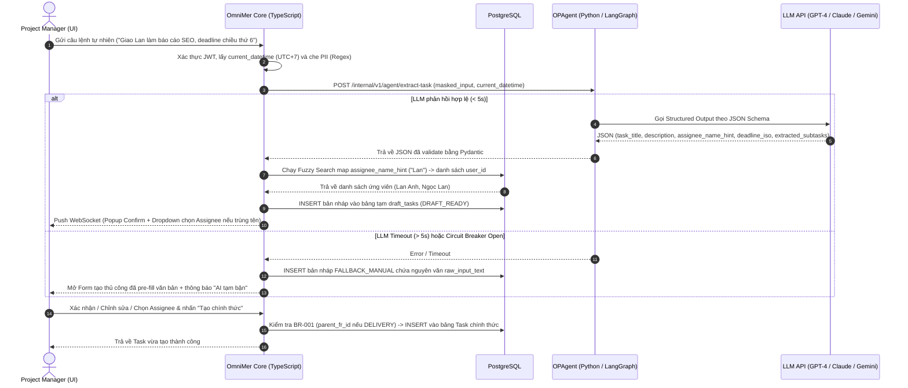

<!--
  name: FR-AGT-001_nlp_text_to_task.md
  description: Functional Requirements specification for OPAgent NLP Text/Voice-to-Task extraction with Human-in-the-Loop draft confirmation, Vietnamese temporal anchoring, PII masking, and Fuzzy Search assignee resolution.
-->

# Feature: OPAgent NLP Text/Voice-to-Task (FR-AGT-001)

**Mô tả:** Phân tích câu lệnh ngôn ngữ tự nhiên (văn bản hoặc giọng nói tiếng Việt/Anh) bằng LLM thông qua **OPAgent Service (Python/LangGraph)** để bóc tách có cấu trúc thành bản nháp Task (bao gồm Tiêu đề, Mô tả, Người phụ trách gợi ý, Deadline, Subtasks) với cơ chế **Human-in-the-Loop (`draft_tasks`)** và khả năng fallback an toàn khi dịch vụ AI gặp sự cố.

**Kiến trúc cốt lõi (tham chiếu [`sa.md`](./sa.md)):**
- **Tách biệt ranh giới dữ liệu (Database-per-Service):** OPAgent Service chạy phi trạng thái (stateless), không ghi trực tiếp vào bảng `tasks`. Mọi dữ liệu tạo mới đều đi qua **OmniMer Core (TypeScript)** và bảng tạm `draft_tasks`.
- **Coarse-Grained Tool Facade & Zero-Trust Auth:** OmniMer Core trích xuất danh tính từ JWT (`X-User-Id`, `X-Team-Id`, `X-Internal-Secret`) và tự thực thi Fuzzy Search nội bộ thay vì để LLM tự đoán `user_id`.
- **Deterministic Regex PII Masking (`BR-CHN-007`):** Trước khi gọi External LLM, văn bản đầu vào được che các thông tin nhạy cảm (`[PHONE]`, `[EMAIL]`, `[ID_NUM]`), đồng thời lưu giữ bản gốc tại Core Server để khôi phục chính xác.
- **Circuit Breaker & Graceful Fallback:** Timeout tối đa `5000ms` cho Text (`15000ms` cho Voice STT + Extract); nếu lỗi hoặc quá tải, mở ngay Form tạo Task thủ công đã pre-fill văn bản gốc.

---

## 1. Functional Requirements List

| FR ID | Requirement Description | Input | Output | Associated Business Rule | Priority |
|---|---|---|---|---|---|
| **FR-AGT-001.1** | **NLP Text-to-Task Structured Extraction:** Phân tích chuỗi lệnh tự nhiên tiếng Việt/Anh thành JSON Schema chuẩn bằng LLM Structured Output / Pydantic validation. | `raw_input`, `current_datetime` (`UTC+7`), `project_id` | JSON `{ task_title, description, assignee_name_hint, deadline_iso, extracted_subtasks[] }` | `BL-AGT-001.1`, `BL-AGT-001.3`, `BR-CHN-007` | Must-have |
| **FR-AGT-001.2** | **Voice-to-Task (Speech-to-Text Pipeline):** Tiếp nhận file ghi âm ngắn (`.webm`, `.ogg`, `.mp3`, tối đa `120s` / `10MB`) qua Redis Heavy-Processing Worker, chuyển đổi thành văn bản qua STT rồi chạy luồng bóc tách Task. | `audio_file`, `tenant_timezone`, `project_id` | `transcript_text` + JSON Task Draft | `BL-AGT-001.4`, `BL-AGT-001.1` | Should-have |
| **FR-AGT-001.3** | **Fuzzy Search Assignee Resolution:** Ánh xạ `assignee_name_hint` sang danh sách ứng viên `user_id` thực tế trong phạm vi thành viên Project bằng Fuzzy Search / Trigram tại TS Core. | `assignee_name_hint`, `project_id` | `assignee_candidates[]` (`user_id`, `full_name`, `score`) | `BL-AGT-001.2` | Must-have |
| **FR-AGT-001.4** | **Human-in-the-Loop Draft & WebSocket Confirm:** Lưu bản nháp vào `draft_tasks`, đẩy sự kiện WebSocket tới UI để PM kiểm tra, chọn đúng người nếu trùng tên, chỉnh sửa và nhấn *"Tạo chính thức"*. | Draft payload, `X-User-Id` | Bản ghi `draft_tasks` (`DRAFT_READY`) + Push WebSocket Popup | `BL-AGT-001.1`, `BR-001` | Must-have |
| **FR-AGT-001.5** | **Circuit Breaker & Graceful Fallback:** Khi LLM API timeout (`> 5s` với Text) hoặc trả lỗi schema, trả về fallback `FALLBACK_MANUAL` kèm nguyên văn input vào Form tạo tay. | Timeout / Provider Error | Form tạo thủ công pre-filled + thông báo nhẹ | `BL-AGT-001.5` | Must-have |

---

## 2. Business Rules

| BR ID | Rule Description | Applies to FR |
|---|---|---|
| **BL-AGT-001.1** | **Human-in-the-Loop (`Zero Auto-Commit`):** Không bao giờ INSERT trực tiếp JSON từ AI vào bảng `tasks`. Phải lưu vào bảng tạm `draft_tasks` và push WebSocket tới User để xác nhận (`Accept / Edit / Reject`). Khi User xác nhận mới tạo Task chính thức (và gắn `parent_fr_id` theo `BR-001` nếu thuộc Project `DELIVERY`). | FR-AGT-001.1, FR-AGT-001.2, FR-AGT-001.4 |
| **BL-AGT-001.2** | **Server-Side Assignee Resolution:** AI chỉ trả về `assignee_name_hint` (ví dụ: `"Lan"`), tuyệt đối không tự sinh `user_id`. TS Core dùng Fuzzy Search ánh xạ `"Lan"` với danh sách thành viên thuộc `project_id`. Nếu trùng nhiều tên (ví dụ: *Lan Anh*, *Ngọc Lan*), hiển thị Dropdown cho PM chọn. | FR-AGT-001.3, FR-AGT-001.4 |
| **BL-AGT-001.3** | **Vietnamese Temporal Anchoring:** OmniMer Core luôn truyền `current_datetime` theo múi giờ Tenant (mặc định `Asia/Ho_Chi_Minh`, `UTC+7`). Các cụm từ tương đối như *"chiều thứ 6"*, *"cuối tuần"*, *"mai"* được quy đổi về ISO8601; nếu thiếu giờ cụ thể, quy ước mặc định `17:00` (hoặc `17:30` theo cấu hình giờ làm việc Tenant). | FR-AGT-001.1 |
| **BL-AGT-001.4** | **Voice Payload & Async Isolation:** File ghi âm phải qua kiểm tra định dạng/dung lượng (`<= 10MB`, `<= 120s`) tại API Gateway và xử lý trên Python Worker tách biệt với API đồng bộ để tránh nghẽn Uvicorn event loop. | FR-AGT-001.2 |
| **BL-AGT-001.5** | **Non-Blocking Circuit Breaker:** Lỗi từ dịch vụ OPAgent hoặc External LLM không bao giờ được chặn quy trình tạo Task. Ngưỡng ngắt mạch (Circuit Breaker) mở trong `30s` nếu tỷ lệ lỗi vượt `50%` trong `10` request liên tiếp, tự động chuyển sang chế độ `FALLBACK_MANUAL`. | FR-AGT-001.5 |
| **BL-AGT-001.6** | **PII Masking trước External LLM (`BR-CHN-007`):** Mọi SĐT, Email, CCCD/CMND, Số tài khoản trong `raw_input` đều bị che bằng Regex tất định trước khi gửi ra External LLM và khôi phục lại từ bản gốc trên Server khi hiển thị trong `draft_tasks`. | FR-AGT-001.1, FR-AGT-001.2 |

---

## 3. Data Structure & Coarse-Grained Tool Contracts

### 3.1. AI Extraction Schema (Output từ LLM — Pydantic Model)

```json
{
  "task_title": "string",
  "description": "string (markdown)",
  "assignee_name_hint": "string | null",
  "deadline_iso": "ISO8601 | null",
  "extracted_subtasks": ["string", "string"]
}
```

### 3.2. Entity: `draft_tasks` (PostgreSQL — OmniMer Core)

| Field | Data Type | Required | Constraints |
|---|---|---|---|
| `id` | `UUID` | Yes | Primary Key |
| `tenant_id` | `UUID` | Yes | FK -> `tenants.id`, Indexed |
| `project_id` | `UUID` | Yes | FK -> `projects.id`, Indexed |
| `input_mode` | `ENUM` | Yes | `TEXT` \| `VOICE` \| `OMNICHANNEL_MSG` |
| `raw_input_text` | `TEXT` | Yes | Lưu nguyên văn hoặc transcript gốc |
| `task_title` | `VARCHAR(255)` | Yes | Tiêu đề trích xuất |
| `description` | `TEXT` | Yes | Nội dung Markdown (đã giữ nguyên PII gốc trên server) |
| `assignee_candidates` | `JSONB` | No | Mảng `[{ "user_id": "uuid", "full_name": "string", "score": 0.92 }]` |
| `suggested_deadline` | `TIMESTAMPTZ` | No | ISO8601 theo múi giờ Tenant |
| `extracted_subtasks` | `JSONB` | No | Mảng string danh sách subtask gợi ý |
| `ai_status` | `ENUM` | Yes | `DRAFT_READY` \| `FALLBACK_MANUAL` \| `CONFIRMED` \| `DISCARDED` |
| `created_by` | `UUID` | Yes | FK -> `users.id` |
| `created_at` | `TIMESTAMPTZ` | Yes | Default `NOW()` |

### 3.3. Coarse-Grained Contracts (Contract-First Sync)

| Endpoint / Tool Name | Direction | Locked Auth / Context Params | Payload / LLM Params | Output DTO |
|---|---|---|---|---|
| `POST /internal/v1/agent/extract-task` | Core -> OPAgent | `X-Internal-Secret`, `X-Tenant-Id` | `masked_input`, `current_datetime`, `tenant_timezone` | Pydantic `TaskExtractionResult` |
| `resolve_assignee_candidates` | Core Internal | `tenant_id`, `project_id`, `X-User-Id` | `assignee_name_hint` | `[{ user_id, full_name, avatar_url, match_score }]` |
| `POST /api/v1/draft-tasks/:id/confirm` | UI -> Core | JWT (`X-User-Id`, `RBAC`) | `title`, `description`, `assignee_id`, `due_date`, `parent_fr_id`, `subtasks[]` | Created `Task` entity (`tasks` table) |

---

## 4. Sequence Diagram: NLP Text/Voice-to-Task (Human-in-the-Loop)



---

## 5. Pre/Post-Conditions & Acceptance Criteria

### FR-AGT-001.1, 001.3 & 001.4: NLP Extraction, Assignee Resolution & Human-in-the-Loop
- **Pre-condition:** Người dùng đã đăng nhập với quyền tạo Task trong Project (`PM` hoặc `Team Member` có quyền `CREATE_TASK`), múi giờ Tenant đã được cấu hình (mặc định `UTC+7`).
- **Post-condition:** Bản nháp `draft_tasks` được sinh ra và hiển thị trên Popup Confirm để người dùng kiểm tra/sửa đổi trước khi ghi vào bảng `tasks` chính thức; tên người trùng khớp được hiển thị qua Dropdown.
- **Exception / Error case:**
  - `assignee_name_hint` khớp `> 1` người trong Project -> hiển thị Dropdown danh sách ứng viên sắp xếp theo `match_score` giảm dần.
  - `assignee_name_hint` không khớp ai trong Project -> để trống ô Assignee và highlight yêu cầu PM chọn thủ công.
  - LLM Timeout (`> 5s`) hoặc lỗi API -> mở Form tạo Task thủ công có điền sẵn câu lệnh gốc, không làm mất dữ liệu nhập của người dùng.

**Acceptance Criteria (Gherkin):**
```gherkin
Scenario: Trích xuất Task thành công từ câu lệnh tiếng Việt và xác nhận Human-in-the-Loop
  Given tôi là Project Manager thuộc Project "Marketing Core" có múi giờ UTC+7
  And trong Project có 2 thành viên tên "Lan" là "Nguyễn Lan Anh" và "Trần Ngọc Lan"
  When tôi gõ "Giao Lan làm báo cáo SEO, deadline chiều thứ 6" vào thanh tạo task nhanh
  Then OPAgent xử lý và hệ thống tạo bản nháp trong bảng draft_tasks với ai_status = "DRAFT_READY"
  And hệ thống hiện popup Confirm qua WebSocket với các thông tin đã bóc tách:
    | Field | Extracted Value |
    | Title | Làm báo cáo SEO |
    | Assignee Dropdown | Nguyễn Lan Anh, Trần Ngọc Lan |
    | Deadline | Ngày thứ 6 tuần này lúc 17:00 (UTC+7) |
  And hệ thống CHƯA tạo bản ghi trong bảng tasks chính thức
  When tôi chọn "Nguyễn Lan Anh", giữ nguyên deadline và nhấn "Tạo chính thức"
  Then hệ thống chuyển bản nháp sang CONFIRMED và INSERT Task mới vào bảng tasks chính thức

Scenario: Fallback an toàn khi OPAgent gặp sự cố timeout
  Given OPAgent hoặc LLM API đang quá tải và không phản hồi trong 5 giây
  When tôi gõ "Fix lỗi thanh toán VNPAY trước 17h mai"
  Then Circuit Breaker kích hoạt fallback ngay lập tức
  And giao diện mở Form tạo Task thủ công đã điền sẵn văn bản "Fix lỗi thanh toán VNPAY trước 17h mai" vào ô mô tả
```
