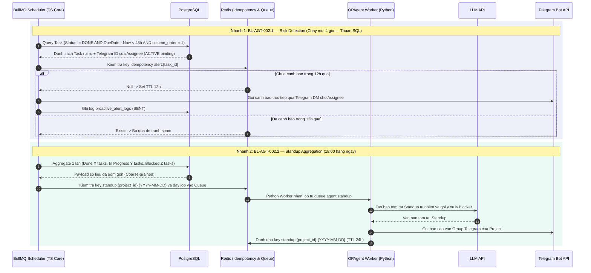

<!--
  name: FR-AGT-002_proactive_health_monitor.md
  description: Functional Requirements specification for OPAgent Proactive Health Monitor including deterministic 4h SQL risk scanning, daily 18:00 standup aggregation, Redis idempotency, and predictive Critical Path/WIP bottleneck radar.
-->

# Feature: Proactive Health Monitor (FR-AGT-002)

**Mô tả:** Hệ thống chủ động giám sát sức khỏe dự án theo thời gian thực và định kỳ, kết hợp giữa **quét rủi ro tất định bằng SQL (Zero-LLM Cost)** và **tổng hợp báo cáo Standup / Cảnh báo nghẽn cổ chai bằng OPAgent (Python Worker)** gửi trực tiếp qua Telegram DM/Group hoặc Notification Center.

**Kiến trúc cốt lõi (tham chiếu [`sa.md`](./sa.md)):**
- **Ưu tiên mã nguồn tất định (Deterministic First):** Các tác vụ phát hiện rủi ro có quy tắc rõ ràng (hạn chót `< 48h`, vi phạm WIP limit) được thực thi 100% bằng truy vấn SQL tại **BullMQ Scheduler (TypeScript Core)** — không tiêu tốn token LLM.
- **Coarse-Grained Payload Aggregation:** Với luồng tổng hợp Standup lúc `18:00`, TS Core gom toàn bộ chỉ số (`done_count`, `in_progress_count`, `blocked_count`, `critical_path_risks`) thành một payload gọn duy nhất trước khi đẩy qua Redis Queue sang OPAgent Python Worker.
- **Chống spam thông báo (Idempotency):** Toàn bộ cảnh báo định kỳ sử dụng khóa định danh trên Redis (`alert:{task_id}` TTL `12h` và `standup:{project_id}:{YYYY-MM-DD}` TTL `24h`) để đảm bảo an toàn khi worker retry.
- **Cô lập chỉ số Support vs Delivery (`BR-CHN-002` / `BR-005`):** Báo cáo sức khỏe và tốc độ xử lý tách bạch `project_type = DELIVERY` và `project_type = SUPPORT`.

---

## 1. Functional Requirements List

| FR ID | Requirement Description | Input | Output | Associated Business Rule | Priority |
|---|---|---|---|---|---|
| **FR-AGT-002.1** | **Deterministic 4h Risk Detection (Zero-LLM):** BullMQ Cron chạy mỗi 4 giờ quét các Task chưa `DONE` có hạn chót `< 48h` nhưng vẫn nằm ở cột đầu tiên (`To Do / Backlog`), gửi cảnh báo trực tiếp qua Telegram DM cho Assignee. | Scheduled Cron Trigger (`*/4h`) | Telegram DM Alert tới Assignee + Notification log | `BL-AGT-002.1`, `BL-AGT-002.3` | Must-have |
| **FR-AGT-002.2** | **Daily Standup Aggregation (18:00):** Lúc `18:00` hàng ngày theo múi giờ Tenant, TS Core tổng hợp số liệu `Done`, `In Progress`, `Blocked` và đẩy sang OPAgent Worker để sinh bản tóm tắt tự nhiên gửi vào Group Telegram của Project. | Scheduled Cron (`18:00`), `project_id` | Bản tin Standup tiếng Việt gửi vào Group Telegram | `BL-AGT-002.2`, `BL-AGT-002.3`, `BR-005` | Must-have |
| **FR-AGT-002.3** | **Critical Path & WIP Bottleneck Radar:** Theo dõi các Task nằm trên Đường găng (`Total Float = 0` từ `FR-PRJ-003.4`) có nguy cơ trễ hạn và các cột Kanban chạm ngưỡng WIP Limit (`FR-PRJ-002.3`) liên tục `> 24h`, cảnh báo sớm cho Project Manager. | Project Snapshot (`tasks`, `dependencies`, `wip_limits`) | Cảnh báo Bottleneck + danh sách Task nghẽn gửi PM | `BL-AGT-002.4` | Should-have |
| **FR-AGT-002.4** | **Predictive Project Health Snapshot (On-Demand):** Cho phép PM gọi đánh giá sức khỏe tức thì dựa trên Health Score (`FR-PRJ-010.4`), tỷ lệ Task quá hạn, tiến độ Sprint Burndown và đề xuất hành động khắc phục. | `project_id`, `X-User-Id` (RBAC verified) | JSON Health Score (`0–100`) + Phân tích rủi ro bằng ngôn ngữ tự nhiên | `BL-AGT-002.5` | Should-have |
| **FR-AGT-002.5** | **Deterministic Conversation SLA & Zalo 48h Window Alert (Zero-LLM):** Cron Job định kỳ quét bảng `conversations` đang `OPEN` mà khách hàng nhắn cuối chưa được CSKH phản hồi (`last_customer_message_at > last_staff_reply_at`), đặc biệt cảnh báo khẩn khi cửa sổ miễn phí 48h của Zalo OA chỉ còn `< 6 giờ` (đã trôi qua `>= 42h`), gửi trực tiếp cho **CSKH chuyên trách (`assignee_id` / `dedicated_owner_id`)** và **`SUPERVISOR`**. | Scheduled Cron (`*/1h` hoặc `*/4h`), `conversations` | Cảnh báo SLA / sắp hết hạn 48h Zalo OA qua In-App / Telegram DM | `BL-AGT-002.6`, `BL-AGT-002.3` | Must-have |

---

## 2. Business Rules

| BR ID | Rule Description | Applies to FR |
|---|---|---|
| **BL-AGT-002.1** | **4h SQL-Only Risk Detection Rule:** Hệ thống chạy Cron Job mỗi `4 giờ` quét toàn bộ Task có `Status != DONE` VÀ `DueDate - CurrentDate < 48h` VÀ đang nằm ở cột trạng thái khởi tạo (`column_order = 1`, ví dụ *To Do / Backlog*). Khi thỏa mãn $\rightarrow$ lấy `telegram_id` từ `channel_account_bindings` (`ACTIVE`) của Assignee và gửi Telegram DM (không gọi LLM). | FR-AGT-002.1 |
| **BL-AGT-002.2** | **18:00 Standup Aggregation & Natural Summary:** Lúc `18:00` (theo `tenant_timezone`, mặc định `UTC+7`) các ngày làm việc, TS Core tổng hợp 1 lần từ DB: *"Đã Done X tasks, Đang làm Y tasks, Bị Block Z tasks"* cùng danh sách task nổi bật, đẩy qua Redis Queue tới OPAgent Python Worker để định dạng bản tóm tắt và gửi vào Group Telegram đã liên kết của Project. | FR-AGT-002.2 |
| **BL-AGT-002.3** | **Redis Idempotency Anti-Spam:** Trước khi gửi DM cảnh báo task, kiểm tra khóa Redis `alert:{task_id}` (TTL `43200s` = `12 giờ`); nếu đã tồn tại thì bỏ qua. Trước khi gửi Standup, kiểm tra khóa `standup:{project_id}:{YYYY-MM-DD}` (TTL `86400s` = `24 giờ`) để đảm bảo mỗi ngày mỗi Project chỉ gửi tối đa 1 bản tin Standup dù Worker có retry. | FR-AGT-002.1, FR-AGT-002.2 |
| **BL-AGT-002.4** | **Critical Path & WIP Priority Escalation:** Mọi Task thuộc Đường găng (`is_critical_path = true`) hoặc Task đang chặn nhiều task hậu nhiệm (`FS`) bị quá hạn hoặc kẹt ở cột `Blocked > 24h` phải được gắn nhãn `[CRITICAL BLOCKER]` và gửi cảnh báo cho cả `Assignee` lẫn `Owner / PM` (`FR-PRJ-007.1`). | FR-AGT-002.3 |
| **BL-AGT-002.5** | **Support vs Delivery Metric Isolation (`BR-CHN-002`):** Bản tin Standup của dự án `DELIVERY` chỉ thống kê `task_type = 'TASK'` (loại trừ `TICKET`); dự án `SUPPORT` thống kê riêng số Ticket tiếp nhận mới, đã giải quyết và cảnh báo vi phạm SLA phản hồi. | FR-AGT-002.2, FR-AGT-002.4 |
| **BL-AGT-002.6** | **Conversation SLA & Zalo 48h Window Guard (Zero-LLM):** Truy vấn SQL tất định quét các hội thoại `status = 'OPEN'` có khách hàng nhắn cuối chưa được trả lời: (a) Với kênh `ZALO_OA`, khi `NOW() - last_customer_message_at` đạt ngưỡng `>= 42 giờ` (còn `< 6 giờ` trước khi đóng cửa sổ 48h miễn phí), hệ thống bắn cảnh báo khẩn cho `assignee_id` (CSKH chuyên trách hoặc CSKH dự phòng) và `SUPERVISOR`; (b) Với `TELEGRAM` / `SLACK`, cảnh báo nếu quá ngưỡng SLA phản hồi cấu hình của Tenant (mặc định `4 giờ`). Dùng khóa Redis `sla_alert:{conversation_id}` (TTL `6h`) để tránh gửi lặp. | FR-AGT-002.5 |

---

## 3. Data Structure & Coarse-Grained Tool Contracts

### 3.1. Redis Idempotency & Queue Payloads

| Key / Channel Pattern | TTL | Value / Payload Structure | Purpose |
|---|---|---|---|
| `alert:{task_id}` | `12h` | `{ "sent_at": "ISO8601", "user_id": "uuid", "channel": "TELEGRAM" }` | Ngăn gửi lặp DM cảnh báo task < 48h |
| `sla_alert:{conversation_id}` | `6h` | `{ "sent_at": "ISO8601", "cskh_id": "uuid", "channel": "ZALO_OA" }` | Ngăn gửi lặp cảnh báo SLA hội thoại / Zalo sắp hết 48h |
| `standup:{project_id}:{YYYY-MM-DD}` | `24h` | `{ "status": "DISPATCHED", "message_id": "string" }` | Đảm bảo mỗi ngày gửi 1 báo cáo Standup |
| `queue:agent:standup` | N/A | `{ "project_id", "project_type", "done_count", "in_progress_count", "blocked_tasks[]", "overdue_count", "target_chat_id" }` | Payload hạt thô gửi sang OPAgent Worker |

### 3.2. Entity: `proactive_alert_logs` (PostgreSQL — Audit Trail)

| Field | Data Type | Required | Constraints |
|---|---|---|---|
| `id` | `UUID` | Yes | Primary Key |
| `tenant_id` | `UUID` | Yes | FK -> `tenants.id` |
| `project_id` | `UUID` | No | FK -> `projects.id` (Null nếu là cảnh báo hội thoại cấp kênh) |
| `task_id` | `UUID` | No | FK -> `tasks.id` (Null nếu là Standup hoặc SLA hội thoại) |
| `conversation_id` | `UUID` | No | FK -> `conversations.id` (Dùng cho cảnh báo SLA hội thoại) |
| `alert_type` | `ENUM` | Yes | `RISK_48H_DM` \| `DAILY_STANDUP` \| `CRITICAL_PATH_BLOCK` \| `WIP_BOTTLENECK` \| `CONVERSATION_SLA_48H` |
| `recipient_id` | `VARCHAR(100)` | Yes | User ID hoặc External Group Chat ID |
| `delivery_status` | `ENUM` | Yes | `SENT` \| `SKIPPED_UNBOUND` \| `FAILED` |
| `sent_at` | `TIMESTAMPTZ` | Yes | Default `NOW()` |

### 3.3. Coarse-Grained Tool Contracts (TS Facade / MCP)

| Tool Name | Server-Injected Locked Params | LLM / Worker Params | Output DTO |
|---|---|---|---|
| `get_daily_standup_payload` | `tenant_id`, `project_id` | `date_iso` | `{ project_name, project_type, done_tasks[], in_progress_count, blocked_tasks[{ code, title, assignee, hours_blocked }], critical_risks[] }` |
| `get_project_health_snapshot` | `tenant_id`, `X-User-Id` (RBAC check) | `project_id` | `{ health_score, on_track_pct, overdue_count, wip_violations[], critical_path_delays[], active_members_workload[] }` |

---

## 4. Sequence Diagram: Risk Detection (SQL) & Standup Aggregation (OPAgent)



---

## 5. Pre/Post-Conditions & Acceptance Criteria

### FR-AGT-002.1 & FR-AGT-002.2: 4h Risk Alert & 18:00 Daily Standup
- **Pre-condition:** Project đang ở trạng thái `ACTIVE`; Assignee có liên kết tài khoản Telegram trạng thái `ACTIVE` (`FR-CHN-012`) đối với thông báo DM; Group Telegram của Project đã được cấu hình webhook/chat_id hợp lệ (`FR-CHN-001`).
- **Post-condition:** Cảnh báo DM gửi đúng người đúng hạn mà không tốn chi phí LLM và không gửi trùng trong 12h; bản tin Standup gửi đúng Group lúc 18:00 mỗi ngày.
- **Exception / Error case:**
  - Assignee chưa liên kết Telegram (`channel_account_bindings` không có hoặc bị `REVOKED`) -> hệ thống ghi nhận `SKIPPED_UNBOUND` và fallback đẩy thông báo qua In-App Notification Center (`FR-PRJ-013`).
  - Worker bị restart hoặc retry khi gửi Standup -> Redis key `standup:{project_id}:{date}` chặn gửi lặp lần thứ 2.

**Acceptance Criteria (Gherkin):**
```gherkin
Scenario: Cảnh báo Telegram DM bằng truy vấn SQL cho Task sắp hết hạn chưa bắt đầu
  Given Task "#PRJ-45" có trạng thái ở cột đầu tiên ("To Do"), hạn chót còn 30 giờ nữa
  And Assignee "Minh" đã liên kết tài khoản Telegram ở trạng thái ACTIVE
  And Redis chưa tồn tại khóa "alert:PRJ-45"
  When BullMQ Cron Job quét rủi ro 4 giờ/lần chạy
  Then hệ thống KHÔNG gọi sang OPAgent LLM Service
  And hệ thống gửi tin nhắn Telegram DM trực tiếp tới "Minh" cảnh báo Task "#PRJ-45" sắp quá hạn
  And hệ thống lưu khóa "alert:PRJ-45" vào Redis với TTL 12 giờ để không cảnh báo lặp lại ở chu kỳ sau

Scenario: Tổng hợp báo cáo Standup hàng ngày lúc 18:00 và chống trùng lặp
  Given Project "OmniMer App" (project_type = DELIVERY) có cấu hình múi giờ UTC+7
  And trong ngày hôm nay có 5 Task chuyển DONE, 8 Task đang IN_PROGRESS và 2 Task bị BLOCKED
  When đồng hồ điểm 18:00 (UTC+7)
  Then TS Core gom số liệu thành 1 payload duy nhất (loại trừ Card loại TICKET) và đẩy vào Redis Queue
  And OPAgent Python Worker sinh văn bản tóm tắt Standup tự nhiên và gửi vào Group Telegram của Project
  And nếu job bị retry lại trong cùng ngày, khóa Redis "standup:{project_id}:{date}" ngăn không cho gửi tin nhắn thứ 2

Scenario: Cảnh báo tự động bằng SQL khi hội thoại Zalo OA sắp hết cửa sổ 48h mà CSKH chuyên trách chưa trả lời
  Given hội thoại "#CONV-88" trên kênh ZALO_OA đang ở trạng thái "OPEN" và được gán cho "CSKH 1"
  And khách hàng đã gửi tin nhắn cuối cách đây 43 giờ (còn 5 giờ trước khi hết hạn 48h) và CSKH chưa phản hồi
  And Redis chưa tồn tại khóa "sla_alert:CONV-88"
  When Cron Job quét SLA hội thoại chạy
  Then hệ thống KHÔNG gọi sang OPAgent LLM Service
  And gửi cảnh báo khẩn trực tiếp cho "CSKH 1" (và SUPERVISOR) nhắc phản hồi trước khi hết cửa sổ miễn phí 48h
  And lưu khóa "sla_alert:CONV-88" vào Redis với TTL 6 giờ để tránh spam
```
