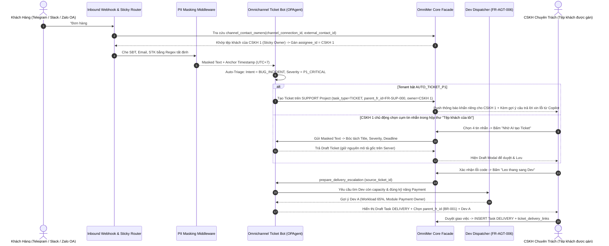

<!--
  name: FR-AGT-003_omnichannel_ticket_bot.md
  description: Functional Requirements specification for OPAgent Omnichannel Ticket Bot & Support Copilot covering zero-touch inbound triage, multi-channel sticky customer portfolio routing per CSKH across shared Telegram Bot, Slack Workspace, and Zalo OA connections, FAQ RAG grounded in INTERNAL assets, selected-message-to-ticket conversion, smart escalation to DELIVERY tasks, and shift handover summaries.
-->

# Feature: Omnichannel Ticket Bot & Support Copilot (FR-AGT-003)

**Mô tả:** Trợ lý AI tích hợp trực tiếp vào **OmniChannel Unified Inbox** (Telegram, Slack, Zalo OA,...) thực hiện hai nhiệm vụ song song: (1) Tự động phân loại tin nhắn đến từ khách hàng, **định tuyến thông minh về đúng nhân viên CSKH chuyên trách nắm danh sách khách hàng đó trên mọi kênh dùng chung (1 Telegram Bot, 1 Slack Workspace, 1 Zalo OA,... theo `FR-CHN-004.6`)**, giải đáp FAQ chuẩn xác và hỗ trợ tạo Ticket/leo thang giao Dev khi có sự cố; (2) Làm **Copilot cho nhân viên CSKH/Support** bằng cách chọn cụm tin nhắn để AI bóc tách tạo Ticket ngay lập tức và tóm tắt bàn giao ca theo đúng tệp khách của từng CSKH.

**Kiến trúc cốt lõi (tham chiếu [`sa.md`](./sa.md), [`FR-CHN-004`](../omnichannel/phase_2/FR-CHN-004_conversation_triage_and_rbac.md), [`FR-CHN-007`](../omnichannel/phase_3/FR-CHN-007_support_vs_delivery_conversion.md), [`FR-CHN-008`](../omnichannel/phase_3/FR-CHN-008_opagent_draft_and_pii_masking.md)):**
- **Multi-Channel Sticky Customer Portfolio & Smart CSKH Routing (`FR-CHN-004.6`):** Trên bất kỳ kết nối kênh dùng chung nào (Telegram Bot, Slack Workspace, Zalo OA,...), hệ thống tra cứu tất định danh bạ `channel_contact_owners` để gán hội thoại về đúng CSKH chuyên trách (`dedicated_owner_id`). Nếu là khách mới chưa có trong danh bạ, Bot kết hợp phân loại Intent/Tag với bộ chia tải **Least-Active / Round-Robin** giữa các CSKH đang trực trên kênh đó (hoặc tự động chuyển sang `backup_owner_id` nếu CSKH chuyên trách đang nghỉ phép `ON_LEAVE`).
- **Dual-Project Classification & Traceability Isolation (`FR-CHN-007`):** Mọi khiếu nại/sự cố từ kênh ngoài mặc định tạo Card `task_type = TICKET` trên Project `SUPPORT` (gắn mã `FR-SUP-000`, `output_contract_type = NONE`). Chỉ khi cần Dev sửa mã nguồn mới leo thang (Escalate) thành `TASK` sang Project `DELIVERY` gắn `parent_fr_id` thật (`BR-001`) và tách khỏi Dev Velocity (`BR-005`).
- **Deterministic PII Masking & Zero-Unmasking (`BR-CHN-007`):** Regex middleware che toàn bộ SĐT, Email, CCCD, Số tài khoản trước khi đẩy nội dung hội thoại tới LLM; phần mô tả Ticket luôn dùng văn bản gộp gốc trên Server để không bị sai lệch thông tin khách hàng.
- **Classification-Aware RAG (`FR-DOC-001.5`):** Khi tra cứu tri thức để gợi ý câu trả lời cho khách, Bot chỉ được phép truy xuất tài liệu có độ mật `INTERNAL` (hoặc tài liệu FAQ công khai), tuyệt đối chặn index/truy xuất các tài liệu `CONFIDENTIAL` hoặc `RESTRICTED_SECURITY`.

---

## 1. Functional Requirements List

| FR ID | Requirement Description | Input | Output | Associated Business Rule | Priority |
|---|---|---|---|---|---|
| **FR-AGT-003.1** | **Zero-Touch Inbound Auto-Triage & Severity Classification:** Tự động phân tích tin nhắn mới từ khách hàng (sau PII Masking) để gán Intent (`FAQ`, `FEATURE_REQUEST`, `BUG_INCIDENT`) và mức độ khẩn cấp (`P1_CRITICAL` -> `P4_LOW`). | `conversation_id`, `inbound_messages[]`, `tenant_id` | Triage label, Severity (`P1..P4`), đề xuất hành động hoặc auto-draft Ticket | `BL-AGT-003.1`, `BR-CHN-007` | Must-have |
| **FR-AGT-003.2** | **Support Copilot FAQ RAG & Canned Response:** Khi khách hỏi thông tin/hướng dẫn hoặc Support đang chat, Agent tra cứu kho tri thức `asset_governance` (chỉ mức `INTERNAL`/Public FAQ) và các Ticket đã đóng để gợi ý câu trả lời cho CSKH (hoặc tự trả lời nếu Tenant bật Auto-Reply cho FAQ). | Masked query, `tenant_id`, `channel_type` | Top-3 câu trả lời gợi ý kèm trích dẫn nguồn tài liệu | `BL-AGT-003.2`, `FR-CHN-015` | Should-have |
| **FR-AGT-003.3** | **One-Click Selected-Message-to-Ticket (`FR-CHN-006` / `008`):** Trong Unified Inbox, Support quét chọn cụm tin nhắn -> nhờ AI tóm tắt Tiêu đề, gán nhãn lỗi, neo múi giờ `UTC+7` và lưu bản nháp `TICKET` vào Project `SUPPORT` (`FR-SUP-000`). | `message_ids[]`, `support_project_id`, `X-User-Id` | `draft_tasks` (`task_type = TICKET`, `parent_fr_id = FR-SUP-000`) | `BL-AGT-003.3`, `BL-AGT-001.1` | Must-have |
| **FR-AGT-003.4** | **Smart Escalation to DELIVERY Task & Dev Dispatch:** Từ một Ticket `SUPPORT` (hoặc sự cố `P1` cần sửa code), Support/PM bấm *"Leo thang sang Dev"*, Bot tự động tạo bản nháp `TASK` ở Project `DELIVERY`, gợi ý `parent_fr_id` phù hợp và gọi **Developer Dispatcher (`FR-AGT-006`)** đề xuất Dev còn capacity xử lý. | `ticket_id`, `delivery_project_id`, `X-User-Id` | Draft `TASK` (`DELIVERY`) + `ticket_delivery_links` + Top Dev Candidates | `BL-AGT-003.4`, `BR-001`, `BR-005` | Must-have |
| **FR-AGT-003.5** | **Automated Shift Handover Summary:** Vào cuối ca trực hoặc theo lệnh, Agent tóm tắt toàn bộ các hội thoại chưa đóng (`OPEN / PENDING`) trong tệp khách được phân quyền, tình trạng SLA (đặc biệt cảnh báo các hội thoại Zalo OA sắp hết cửa sổ 48h), mức độ bức xúc của khách hàng (Sentiment) và các Ticket đang chờ Dev phản hồi. | `team_id` / `cskh_user_id` / `shift_window`, `X-User-Id` | Báo cáo bàn giao ca có cấu trúc gửi vào Internal Note / Kênh nội bộ | `BL-AGT-003.5`, `BL-AGT-003.6` | Could-have |
| **FR-AGT-003.6** | **Multi-Channel Sticky Portfolio Routing & New Contact Load-Balancing (`FR-CHN-004.6`):** Khi có tin nhắn vào bất kỳ kênh dùng chung nào (Telegram Bot, Slack Workspace, Zalo OA,...) cho đội ngũ CSKH: (1) Nếu khách/nhóm chat đã thuộc danh sách của CSKH nào (`channel_contact_owners`), định tuyến thẳng về CSKH đó (hoặc `backup_owner_id` nếu CSKH chính đang `ON_LEAVE`); (2) Nếu là khách mới chưa có chủ, tự động chia cho CSKH phù hợp đang có ít hội thoại `OPEN` nhất (Least-Active) và gắn vào danh sách chuyên trách của CSKH đó. | `channel_connection_id`, `external_contact_id`, `predicted_intent` | Cập nhật `dedicated_owner_id`, `assignee_id` + thông báo đúng CSKH phụ trách | `BL-AGT-003.6`, `BL-CHN-004.7`, `BL-CHN-004.8` | Must-have |

---

## 2. Business Rules

| BR ID | Rule Description | Applies to FR |
|---|---|---|
| **BL-AGT-003.1** | **Auto-Draft vs Auto-Commit Boundary:** Đối với tin nhắn khách hàng mới được phân loại `P1_CRITICAL` (ví dụ: sập hệ thống, lỗi thanh toán diện rộng), nếu Tenant bật chính sách `AUTO_TICKET_P1`, hệ thống được phép tạo trực tiếp `TICKET` trên Project `SUPPORT` (kèm tag `[AUTO-TRIAGE-P1]` và thông báo khẩn cho PM/CSKH Lead cùng CSKH chuyên trách của khách đó). Với `P2..P4`, Agent chỉ tạo bản nháp hoặc gắn nhãn gợi ý chờ Support xác nhận. | FR-AGT-003.1, FR-AGT-003.6 |
| **BL-AGT-003.2** | **Strict Classification Isolation in Customer RAG (`FR-DOC-001.5` & `FR-CHN-015`):** Knowledge Base dùng cho Support Copilot / Customer Auto-Reply chỉ được phép lập chỉ mục (index) các tài liệu thuộc độ mật `INTERNAL` đã được gắn cờ `faq_eligible = true`. Mọi tài liệu `CONFIDENTIAL` và `RESTRICTED_SECURITY` (như `PENTEST_PLAN`, `INCIDENT_RESPONSE_PLAN`) bị chặn tuyệt đối ở tầng Vector DB Metadata Filter. | FR-AGT-003.2 |
| **BL-AGT-003.3** | **Support Ticket Invariants (`BR-CHN-001` & `BL-CHN-007.5`):** Mọi Ticket sinh ra từ Omnichannel thuộc Project `SUPPORT` đều tự động gán `task_type = TICKET`, `parent_fr_id = 'FR-SUP-000'`, `is_traceability_exception = true` và `output_contract_type = 'NONE'`, đồng thời tự động gán `reporter_id / cskh_owner_id` là nhân viên CSKH chuyên trách của khách hàng đó. | FR-AGT-003.3 |
| **BL-AGT-003.4** | **Escalation Traceability, No Double Counting & Channel Reply Policy (`BR-001` & `BR-CHN-002`):** Khi leo thang Ticket sang Project `DELIVERY`, Task kỹ thuật mới bắt buộc chọn `parent_fr_id` hợp lệ (khác `FR-SUP-000`) trước khi chuyển sang `IN_PROGRESS`. Hệ thống tạo bản ghi `ticket_delivery_links` và khi Delivery Task chuyển `DONE`, Bot tự động thông báo cho đúng CSKH chuyên trách của khách đó kèm gợi ý tin nhắn phản hồi về đúng thread gốc trên Telegram / Slack / Zalo OA (riêng với Zalo OA nếu đã quá cửa sổ 48h thì tự động gợi ý chọn **Mẫu ZNS** theo `FR-CHN-003.4`). | FR-AGT-003.4 |
| **BL-AGT-003.5** | **Internal Note Isolation (`FR-CHN-005`):** Mọi tóm tắt bàn giao ca, phân tích tâm lý khách hàng hay gợi ý của AI dành cho nhân viên CSKH đều được lưu dưới dạng `INTERNAL_NOTE` — không bao giờ phát ngược ra kênh Public Chat tới khách hàng. | FR-AGT-003.2, FR-AGT-003.5 |
| **BL-AGT-003.6** | **Deterministic Multi-Channel Sticky Portfolio Priority & Visibility Isolation (`BL-CHN-004.7` & `BL-CHN-004.8`):** Bước kiểm tra danh sách khách hàng chuyên trách (`channel_contact_owners`) trên các kênh dùng chung (Telegram Bot, Slack Workspace, Zalo OA,...) luôn thực thi bằng **truy vấn SQL tất định trước khi gọi LLM**: (a) Nếu khách/nhóm chat đã có `dedicated_owner_id` và CSKH đó đang hoạt động, gán 100% về CSKH đó; (b) Nếu CSKH đó đang `ON_LEAVE`, tự động chuyển `assignee_id` tạm thời sang `backup_owner_id` và tạo bản tóm tắt ngữ cảnh 3 câu (`INTERNAL_NOTE`) để CSKH dự phòng nắm tình hình ngay; (c) Khi kênh bật chế độ `STRICT_ASSIGNED_ONLY`, Support Copilot chỉ tóm tắt và tra cứu trong phạm vi tệp khách hàng mà `X-User-Id` đó được phân quyền trên từng kênh. | FR-AGT-003.5, FR-AGT-003.6 |

---

## 3. Data Structure & Coarse-Grained Tool Contracts

### 3.1. Entity: `ticket_triage_logs` (PostgreSQL — OmniMer Core)

| Field | Data Type | Required | Constraints |
|---|---|---|---|
| `id` | `UUID` | Yes | Primary Key |
| `tenant_id` | `UUID` | Yes | FK -> `tenants.id`, Indexed |
| `conversation_id` | `UUID` | Yes | FK -> `conversations.id`, Indexed |
| `predicted_intent` | `ENUM` | Yes | `FAQ` \| `FEATURE_REQUEST` \| `BUG_INCIDENT` \| `GENERAL_CHAT` |
| `predicted_severity` | `ENUM` | Yes | `P1_CRITICAL` \| `P2_HIGH` \| `P3_MEDIUM` \| `P4_LOW` |
| `sentiment_score` | `FLOAT` | No | `-1.0` (Rất tiêu cực) đến `1.0` (Tích cực) |
| `routed_cskh_user_id` | `UUID` | No | FK -> `users.id` (CSKH nhận hội thoại qua Sticky Owner hoặc Least-Active) |
| `routing_reason` | `ENUM` | Yes | `STICKY_PORTFOLIO_OWNER` \| `BACKUP_ON_LEAVE` \| `NEW_CONTACT_LEAST_ACTIVE` \| `MANUAL_CLAIM` |
| `auto_created_ticket_id` | `UUID` | No | FK -> `tasks.id` (nếu áp dụng `AUTO_TICKET_P1`) |
| `escalation_task_id` | `UUID` | No | FK -> `tasks.id` (Task `DELIVERY` nếu đã leo thang) |
| `created_at` | `TIMESTAMPTZ` | Yes | Default `NOW()` |

### 3.2. Coarse-Grained Tool Contracts (TS Facade / MCP)

| Tool Name | Server-Injected Locked Params | LLM / Agent Params | Output DTO |
|---|---|---|---|
| `resolve_cskh_portfolio_routing` | `tenant_id`, `channel_connection_id` | `external_contact_id`, `predicted_intent`, `predicted_severity` | `{ routed_cskh_id, dedicated_owner_id, routing_reason, is_backup_handover, remaining_zalo_window_hours }` |
| `search_faq_knowledge` | `tenant_id`, `allowed_classifications = ['INTERNAL']`, `faq_eligible = true` | `masked_query`, `top_k` | `[{ asset_id, title, excerpt, version }]` |
| `create_ticket_draft_from_messages` | `tenant_id`, `X-User-Id`, `conversation_id` | `message_ids[]`, `suggested_title`, `severity`, `deadline_iso` | `draft_tasks` record (`task_type = TICKET`, `parent_fr_id = FR-SUP-000`) |
| `prepare_delivery_escalation` | `tenant_id`, `X-User-Id`, `source_ticket_id` | `delivery_project_id`, `problem_summary`, `required_skills[]` | `{ candidate_frs[], top_dev_candidates[] (from FR-AGT-006), draft_task_id }` |

---

## 4. Sequence Diagram: Sticky CSKH Routing Đa Kênh (Telegram / Slack / Zalo OA), Support Copilot & Smart Dev Escalation



---

## 5. Pre/Post-Conditions & Acceptance Criteria

### FR-AGT-003.1, 003.3, 003.4 & 003.6: Multi-Channel Sticky Portfolio Routing, Auto-Triage, Ticket Creation & Dev Escalation
- **Pre-condition:** Kênh Omnichannel (Telegram Bot, Slack Workspace, Zalo OA,...) đang kết nối trạng thái `ACTIVE` (`FR-CHN-001`); danh sách khách hàng chuyên trách (`channel_contact_owners`) đã được cấu hình cho các nhân viên CSKH (`FR-CHN-004.6`); Project `SUPPORT` và Project `DELIVERY` đã được thiết lập trong Tenant.
- **Post-condition:** Tin nhắn gửi vào bất kỳ kênh dùng chung nào (Telegram / Slack / Zalo OA) đều được định tuyến đúng về CSKH nắm khách hàng/nhóm chat đó (hoặc CSKH dự phòng nếu nghỉ phép); PII được che trước khi qua LLM ngoài; Ticket tạo trên `SUPPORT` gắn `FR-SUP-000`; và khi leo thang sang `DELIVERY` đảm bảo liên kết `ticket_delivery_links` + chọn `parent_fr_id` hợp lệ + gợi ý đúng Dev còn capacity.
- **Exception / Error case:**
  - Hội thoại có câu hỏi trùng với tài liệu `RESTRICTED_SECURITY` (như lỗ hổng Pentest) -> Vector filter chặn không trả nội dung nhạy cảm ra gợi ý trả lời khách hàng.
  - Support cố tình chuyển Ticket leo thang vào Project `DELIVERY` nhưng chưa chọn `parent_fr_id` -> Core chặn kéo sang `IN_PROGRESS` với mã `HTTP 422` theo `BR-001`.
  - CSKH 2 (trong chế độ `STRICT_ASSIGNED_ONLY`) yêu cầu Bot tóm tắt bàn giao ca hoặc truy xuất hội thoại Telegram/Slack/Zalo thuộc danh sách khách của CSKH 1 -> Tool Facade lọc theo `X-User-Id` và chỉ trả về dữ liệu tệp khách của CSKH 2.

**Acceptance Criteria (Gherkin):**
```gherkin
Scenario: Định tuyến tự động theo danh sách khách của từng CSKH trên Telegram, Slack và Zalo OA dùng chung, AI tạo Ticket và Leo thang cho Dev
  Given Tenant kết nối 1 Telegram Bot, 1 Slack Workspace và 1 tài khoản Zalo OA dùng chung cho 5 nhân viên CSKH và bật chế độ cô lập tệp khách "STRICT_ASSIGNED_ONLY"
  And khách hàng "Công ty Minh Phát" (có tài khoản/nhóm chat trên cả Telegram, Slack và Zalo OA với SĐT "0909123456") thuộc danh sách khách chuyên trách của "CSKH 1"
  And Tenant đang cấu hình Project "CSKH Support" (SUPPORT) và Project "Billing Core" (DELIVERY)
  When khách hàng nhắn tin qua Telegram, Slack hoặc Zalo OA báo lỗi không xuất được hóa đơn VAT kèm SĐT "0909123456"
  Then hệ thống tự động định tuyến hội thoại vào hộp thư "Tệp khách của tôi" của "CSKH 1" (4 CSKH còn lại không bị làm phiền và không thấy hội thoại này)
  When "CSKH 1" quét chọn 3 tin nhắn và bấm "AI Tạo Ticket hộ"
  Then PII Middleware che "0909123456" thành "[PHONE_1]" trước khi gọi LLM
  And OPAgent trả về bản nháp Ticket với mô tả giữ nguyên SĐT "0909123456" tại Server và parent_fr_id = "FR-SUP-000"
  When "CSKH 1" lưu Ticket và bấm "Leo thang sang Dev" vào Project "Billing Core"
  Then hệ thống đề xuất danh sách Dev phù hợp còn capacity dưới 100% từ Dev Dispatcher
  And yêu cầu chọn parent_fr_id nghiệp vụ (khác FR-SUP-000) trước khi tạo Task DELIVERY liên kết với Ticket gốc
  And Ticket gốc trên SUPPORT không bị tính vào Dev Velocity của Sprint
```
