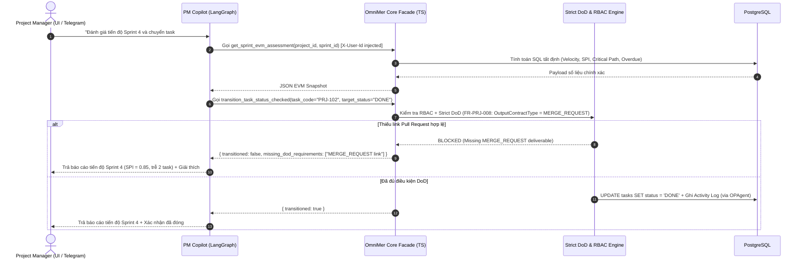

<!--
  name: FR-AGT-004_pm_copilot_full_task_lifecycle.md
  description: Functional Requirements specification for OPAgent PM Bot & Full Task Lifecycle Copilot covering NL search/OQL translation, multi-turn CRUD with HITL confirmation, Strict DoD gate enforcement, AI WBS decomposition, and EVM progress assessment.
-->

# Feature: PM Bot & Full Task Lifecycle Copilot (FR-AGT-004)

**Mô tả:** Mở rộng từ tính năng ChatOps chỉ đọc (`FR-CHN-014`) thành **Trợ lý Quản trị Dự án Toàn diện (PM Copilot)** hoạt động đồng nhất trên cả Web UI Command Bar (`Cmd+K`) và các kênh ChatOps nội bộ đã liên kết (`Telegram / Slack / Zalo`). PM Bot hỗ trợ tìm kiếm thông minh, quản lý đầy đủ vòng đời Task (Tạo/Sửa/Giao việc/Cập nhật trạng thái/Thêm Subtask), rã cấu trúc công việc (WBS) từ tài liệu nghiệp vụ và đánh giá tiến độ dự án định lượng (EVM / Burndown / Critical Path).

**Kiến trúc cốt lõi (tham chiếu [`sa.md`](./sa.md), [`FR-PRJ-008`](../omniproject_core/phase_4/FR-PRJ-008_strict_dod_output.md), [`FR-CHN-014`](../omnichannel/phase_5/FR-CHN-014_internal_ai_chatops_readonly.md)):**
- **Phân quyền Zero-Trust Tiêm cứng từ Server:** Mọi Tool đọc và ghi do LangGraph gọi sang TypeScript Facade đều bắt buộc mang theo `X-User-Id`, `tenant_id` và `allowed_project_ids[]` lấy từ JWT hoặc `channel_account_bindings` (`ACTIVE`) — LLM không bao giờ tự truyền danh tính hay vượt quyền RBAC.
- **Governed Write Operations (HITL + Anti-Gaming + Strict DoD):** Khác với `FR-CHN-014` (không có write tool), PM Bot đăng ký các Write Tool có kiểm soát (`agent_action_drafts`). Mọi thao tác làm thay đổi dữ liệu quan trọng (đổi deadline hàng loạt, xóa, giao việc mới) đều hiển thị thẻ xác nhận (Inline Interactive Confirm Card); mọi lệnh đổi trạng thái sang `DONE` đều phải vượt qua cổng **Strict DoD (`FR-PRJ-008`)** của Core Service.
- **Bounded Short-Term Memory:** Lưu ngữ cảnh hội thoại đa lượt trên Redis (`pm_ctx:{tenant_id}:{user_id}`, tối đa 5 lượt gần nhất, TTL `900s`) để hiểu các câu nối tiếp như *"Chuyển task đó sang tuần sau"*.

---

## 1. Functional Requirements List

| FR ID | Requirement Description | Input | Output | Associated Business Rule | Priority |
|---|---|---|---|---|---|
| **FR-AGT-004.1** | **Natural Language Search & OQL Translation (`FR-PRJ-019`):** Chuyển câu hỏi tự nhiên (VD: *"Lấy danh sách task quá hạn của team Backend tuần này"*) thành truy vấn OQL / RBAC SQL chuẩn xác và trả về danh sách có phân trang/làm rõ nếu trùng tên. | `query_text`, `X-User-Id` (RBAC injected) | OQL query + Danh sách Task (tối đa 10 mục/lượt) hoặc danh sách Disambiguation | `BL-AGT-004.1`, `BL-CHN-014.3` | Must-have |
| **FR-AGT-004.2** | **Multi-Turn Conversational Task CRUD:** Hỗ trợ tạo task mới, cập nhật mô tả/ưu tiên/deadline, gán/chuyển assignee và thêm subtask qua hội thoại tự nhiên; tạo thẻ xác nhận trước khi commit. | `user_intent`, `context_history`, `X-User-Id` | Thẻ xác nhận `agent_action_drafts` -> Cập nhật DB khi Confirm | `BL-AGT-004.2`, `FR-PRJ-007.4` | Must-have |
| **FR-AGT-004.3** | **Strict DoD & BR-001 Transition Enforcement:** Khi người dùng ra lệnh chuyển trạng thái Task (VD: *"Đánh dấu task #PRJ-102 là Done"*), Bot gọi qua Workflow Engine của Core để kiểm tra điều kiện `OutputContractType` (`FR-PRJ-008`) và `parent_fr_id` (`BR-001`). Nếu thiếu, từ chối và liệt kê chính xác thứ còn thiếu. | `task_id`, `target_status`, `deliverable_url` (tùy chọn) | Trạng thái mới hoặc thông báo chặn kèm lý do chi tiết | `BL-AGT-004.3`, `BL-PRJ-008`, `BR-001` | Must-have |
| **FR-AGT-004.4** | **AI WBS Decomposition & Effort Estimation:** Nhận đầu vào là mô tả Feature Requirement (FR) hoặc User Story, tự động rã thành cây Task/Subtask theo vai trò (BE, FE, QA), đề xuất phụ thuộc `FS` (`FR-PRJ-003`) và ước lượng Story Points dựa trên Velocity lịch sử (`FR-PRJ-012`). | `feature_spec_text`, `project_id`, `X-User-Id` | Cây WBS bản nháp (Tasks + Subtasks + Estimate + Dependencies) chờ PM duyệt | `BL-AGT-004.4` | Should-have |
| **FR-AGT-004.5** | **Quantitative Progress & EVM Assessment:** Đánh giá tiến độ Project/Sprint theo số liệu thực tế: % hoàn thành, Velocity trung bình 3 Sprint, chỉ số SPI (Schedule Performance Index), Cycle Time trung bình và các điểm nghẽn trên Đường găng. | `project_id` / `sprint_id`, `X-User-Id` | Báo cáo đánh giá tiến độ + Dự báo ngày hoàn thành + Đề xuất hành động | `BL-AGT-004.5`, `BR-005` | Must-have |

---

## 2. Business Rules

| BR ID | Rule Description | Applies to FR |
|---|---|---|
| **BL-AGT-004.1** | **Read-Only vs Write Rate Limit & Audit (`chatops_audit_logs`):** Giới hạn mặc định `20 req/phút` cho truy vấn đọc và `10 mutation/phút` cho mỗi `user_id`. Mọi thao tác ghi qua PM Bot đều phải ghi log vào `chatops_audit_logs` và `Activity Log` (`FR-PRJ-005.4`) kèm thẻ `via OPAgent`. | FR-AGT-004.1, FR-AGT-004.2 |
| **BL-AGT-004.2** | **Anti-Gaming Deadline & RBAC Role Guard (`FR-PRJ-007.4`):** Khi người dùng yêu cầu Bot đổi `due_date` của Task, TS Core kiểm tra quyền: nếu người dùng chỉ là `Assignee` (không phải `Owner` hoặc `PM`), lệnh đổi Deadline bị từ chối theo luật Anti-Gaming `FR-PRJ-007.4`. Các thao tác cập nhật ảnh hưởng `>= 2` task cùng lúc hoặc tạo WBS bắt buộc qua bước Confirm HITL. | FR-AGT-004.2, FR-AGT-004.4 |
| **BL-AGT-004.3** | **Zero-Bypass Strict DoD & WIP Limit (`FR-PRJ-008` & `FR-PRJ-002`):** PM Bot tuyệt đối không có quyền bỏ qua `OutputContractType` (`URL_LINK`, `FILE_UPLOAD`, `MERGE_REQUEST`, `STRUCTURED_PLAN`) để ép Task sang `DONE`. Nếu cột đích chạm WIP Limit, Bot thông báo cảnh báo và chỉ cho phép Override nếu `X-User-Id` có quyền `PM / Admin` và xác nhận `wip_override = true`. | FR-AGT-004.3 |
| **BL-AGT-004.4** | **WBS Traceability Binding (`BR-001`):** Khi PM Bot sinh cây WBS cho một Project `DELIVERY`, các Task sinh ra phải tự động liên kết `parent_fr_id` của Requirement đầu vào (nếu người dùng chưa cung cấp FR ID thì gắn ở trạng thái `BACKLOG / TODO` và nhắc PM gắn FR trước khi chạy). | FR-AGT-004.4 |
| **BL-AGT-004.5** | **Deterministic Metrics First (`sa.md` & `BR-005`):** Toàn bộ số liệu SPI, Burndown, Velocity, Overdue count phải được tính bằng SQL/Code tất định tại TS Core (`ReportingService`), loại trừ `task_type = TICKET` khỏi Dev Velocity. LLM chỉ đóng vai trò diễn giải số liệu và đưa ra khuyến nghị quản trị. | FR-AGT-004.5 |

---

## 3. Data Structure & Coarse-Grained Tool Contracts

### 3.1. Entity: `agent_action_drafts` (PostgreSQL — Governed Write Staging)

| Field | Data Type | Required | Constraints |
|---|---|---|---|
| `id` | `UUID` | Yes | Primary Key |
| `tenant_id` | `UUID` | Yes | FK -> `tenants.id` |
| `user_id` | `UUID` | Yes | FK -> `users.id` |
| `action_type` | `ENUM` | Yes | `CREATE_TASK` \| `UPDATE_TASK` \| `BULK_RESCHEDULE` \| `CREATE_WBS_TREE` |
| `target_project_id` | `UUID` | Yes | FK -> `projects.id` |
| `payload_json` | `JSONB` | Yes | Dữ liệu thay đổi đã chuẩn hóa và validate bằng Zod |
| `occ_versions` | `JSONB` | No | Map `{ task_id: version }` để chống ghi đè OCC khi confirm |
| `status` | `ENUM` | Yes | `PENDING_CONFIRM` \| `EXECUTED` \| `EXPIRED` \| `CANCELLED` |
| `expires_at` | `TIMESTAMPTZ` | Yes | Default `NOW() + INTERVAL '15 minutes'` |

### 3.2. Coarse-Grained Tool Contracts (TS Facade / MCP)

| Tool Name | Server-Injected Locked Params | LLM-Supplied Params | Output DTO |
|---|---|---|---|
| `query_tasks_by_nl_filters` | `tenant_id`, `X-User-Id`, `allowed_project_ids[]` | `project_hint`, `assignee_hint`, `status_filter`, `overdue_only`, `sprint_scope` | `{ total_count, tasks[{ id, code, title, status, assignee, due_date, priority }], disambiguation_needed }` |
| `stage_task_mutation` | `tenant_id`, `X-User-Id` | `action_type`, `task_code`, `changes_json` | `{ action_draft_id, validation_warnings[], requires_confirm: true, preview_summary }` |
| `transition_task_status_checked` | `tenant_id`, `X-User-Id` | `task_code`, `target_status`, `deliverable_payload` (optional), `wip_override` (optional) | `{ transitioned: boolean, blocked_reason, missing_dod_requirements[] }` |
| `get_sprint_evm_assessment` | `tenant_id`, `X-User-Id`, `allowed_project_ids[]` | `project_id`, `sprint_id` (optional) | `{ velocity_avg_3, spi_index, burndown_gap, critical_path_blockers[], overdue_tasks_count }` |

---

## 4. Sequence Diagram: PM Bot CRUD, Strict DoD Check & Progress Assessment



---

## 5. Pre/Post-Conditions & Acceptance Criteria

### FR-AGT-004.1, 004.3 & 004.5: Task Listing, Strict DoD Guard & EVM Assessment
- **Pre-condition:** Người dùng nội bộ có tài khoản hợp lệ trên Web UI hoặc đã liên kết ChatOps (`FR-CHN-012` trạng thái `ACTIVE`) và có quyền truy cập vào Project mục tiêu.
- **Post-condition:** Chỉ dữ liệu trong phạm vi RBAC của người dùng được trả về; các thay đổi dữ liệu đều qua kiểm tra `Anti-Gaming`, `BR-001`, `Strict DoD` và được ghi dấu vết `Activity Log`.
- **Exception / Error case:**
  - `Assignee` bình thường ra lệnh cho Bot lùi deadline của Task do mình thực hiện -> bị chặn theo `FR-PRJ-007.4` với thông báo *"Chỉ Owner hoặc PM mới có quyền thay đổi Due Date"*.
  - `action_drafts` quá 15 phút chưa xác nhận hoặc Task bị người khác sửa trước (lệch OCC `version`) -> thông báo hết hạn/xung đột dữ liệu và yêu cầu tải lại bản mới.

**Acceptance Criteria (Gherkin):**
```gherkin
Scenario: Đánh giá tiến độ dự án bằng số liệu thực tế và rã WBS có xác nhận HITL
  Given tôi là PM của Project "OmniMer Mobile" (DELIVERY) đang chạy Sprint 5
  When tôi hỏi PM Bot: "Đánh giá tiến độ Sprint 5 hiện tại giúp tôi"
  Then PM Bot gọi get_sprint_evm_assessment để lấy số liệu SQL tất định (không đếm nhầm Ticket CSKH)
  And Bot trả lời tóm tắt tỷ lệ hoàn thành, chỉ số SPI, Velocity trung bình 3 sprint và cảnh báo 2 Task đang nằm trên Đường găng bị trễ

Scenario: Chặn PM Bot ép chuyển trạng thái DONE khi vi phạm Strict DoD
  Given Task "#MOB-88" có cấu hình Output Contract là "MERGE_REQUEST" và hiện chưa có link PR nào được đính kèm
  When tôi nhắn cho PM Bot: "Chuyển task #MOB-88 sang Done"
  Then Core Workflow Engine chặn thao tác với quy tắc BL-PRJ-008
  And PM Bot trả lời: "Không thể chuyển #MOB-88 sang Done vì Task yêu cầu nộp Link Pull Request theo quy định Strict DoD. Vui lòng gửi link PR hoặc cập nhật trên hệ thống."
```
