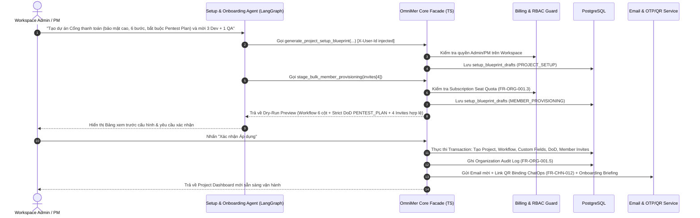

<!--
  name: FR-AGT-005_project_setup_and_account_onboarding_agent.md
  description: Functional Requirements specification for OPAgent Project Architect & Account/Workspace Onboarding Agent covering conversational project setup wizard, bulk member provisioning, personalized onboarding briefing, and security/governance policy auditing.
-->

# Feature: Project Architect & Account Onboarding Agent (FR-AGT-005)

**Mô tả:** Trợ lý AI chuyên trách khởi tạo, cấu hình dự án và vận hành tài khoản/tổ chức (**Project & Account Setup Agent**). Thay vì người dùng phải thao tác qua hàng chục màn hình cấu hình phức tạp (Workflow, WIP Limit, Custom Fields EAV, Strict DoD, RBAC, SSO, Channel Webhook), Agent dẫn dắt qua hội thoại ngắn để sinh ra bản thiết kế cấu hình hoàn chỉnh (`setup_blueprint_drafts`), hiển thị bản xem trước (Dry-Run Preview) và áp dụng hàng loạt sau khi Admin/PM xác nhận.

**Kiến trúc cốt lõi (tham chiếu [`sa.md`](./sa.md), [`FR-PRJ-018`](../omniproject_core/phase_2/FR-PRJ-018_project_lifecycle_templates.md), [`FR-ORG-001`](../omniproject_core/phase_1/FR-ORG-001_workspace_organization_management.md), [`FR-ORG-002`](../omniproject_core/phase_1/FR-ORG-002_identity_access_management.md)):**
- **Admin/PM RBAC Gate:** Chỉ những người dùng có vai trò `Org Owner`, `Workspace Admin` hoặc `PM` (tùy phạm vi thao tác) mới được kích hoạt Tool cấu hình Workspace/Project. Mọi hành động đều ghi vào **Organization Audit Log (`FR-ORG-001.5`)**.
- **Dry-Run Blueprint Staging:** Agent không gọi rời rạc từng API tạo cột, tạo Custom Field hay gửi email mời thành viên. Toàn bộ cấu hình được gom thành một JSON Blueprint (`setup_blueprint_drafts`), kiểm tra tính hợp lệ bằng Zod tại TypeScript Facade, và chỉ thực thi nguyên khối (Transaction) khi người dùng bấm *"Xác nhận Áp dụng"*.
- **Cross-Module Integration:** Tự động liên kết cấu hình giữa `omniproject_core` (Templates, Workflows, DoD), `asset_governance` (`STRUCTURED_PLAN`, Classification), và `omnichannel` (Channel Bindings, OTP/QR Account Binding, NĐ 13 Retention).

---

## 1. Functional Requirements List

| FR ID | Requirement Description | Input | Output | Associated Business Rule | Priority |
|---|---|---|---|---|---|
| **FR-AGT-005.1** | **Conversational Project Setup Wizard:** Thu thập yêu cầu qua hội thoại (Lĩnh vực, loại dự án `DELIVERY/SUPPORT`, quy mô đội ngũ, mức bảo mật) -> Đề xuất Project Template (`FR-PRJ-018`), Custom Workflow & WIP Limits (`FR-PRJ-002`), Custom Fields (`FR-PRJ-004`), Strict DoD `STRUCTURED_PLAN` (`FR-PRJ-008`, `FR-DOC-001`) và kênh thông báo Telegram/Slack (`FR-CHN-001`). | `project_brief_prompt`, `workspace_id`, `X-User-Id` | Bản thiết kế `setup_blueprint_drafts` (Dry-Run Preview) -> Tạo Project hoàn chỉnh khi Confirm | `BL-AGT-005.1`, `BL-AGT-005.2` | Must-have |
| **FR-AGT-005.2** | **Bulk Member Provisioning & IAM/RACI Setup:** Tiếp nhận danh sách nhân sự (văn bản tự nhiên hoặc CSV/Excel), kiểm tra seat còn trống (`FR-ORG-001.3`), sinh lời mời email (`FR-ORG-002.1`), gán RBAC Role & User Groups (`FR-ORG-002.3`), đồng thời kích hoạt luồng OTP/QR liên kết Telegram/Zalo ChatOps (`FR-CHN-012`). | `member_list_input`, `workspace_id`, `X-User-Id` | Blueprint mời & phân quyền -> Gửi Invite + QR Binding Links | `BL-AGT-005.2`, `BL-AGT-005.3` | Must-have |
| **FR-AGT-005.3** | **Personalized Member Onboarding Briefing:** Ngay khi thành viên mới gia nhập Project/Workspace, Agent tự động biên soạn cẩm nang chào mừng cá nhân hóa gồm: checklist tuần đầu, danh sách tài liệu kiến trúc mức `INTERNAL` từ `asset_governance`, và các Task khởi đầu được giao. | `new_user_id`, `project_id` | Onboarding Checklist & Briefing Card gửi qua In-App / Telegram DM | `BL-AGT-005.4` | Should-have |
| **FR-AGT-005.4** | **Workspace Security & Governance Policy Audit:** Rà soát định kỳ hoặc theo yêu cầu cấu hình Workspace: kiểm tra SSO/SAML (`FR-ORG-002.4`), chính sách Auto-Lock (`FR-ORG-002.5`), Quorum duyệt `ALL_REQUIRED` cho dự án chứa tài sản `RESTRICTED_SECURITY`, và chính sách lưu trữ NĐ 13 (`FR-CHN-016`). | `workspace_id`, `X-User-Id` (`Admin` only) | Báo cáo điểm rủi ro cấu hình + Nút bấm *"Khắc phục nhanh"* (1-click Fix) | `BL-AGT-005.5` | Should-have |

---

## 2. Business Rules

| BR ID | Rule Description | Applies to FR |
|---|---|---|
| **BL-AGT-005.1** | **RBAC Scope Enforcement:** Thao tác tạo Project/Template yêu cầu `Workspace Admin` hoặc `PM`; thao tác mời thành viên, thay đổi Role cấp Workspace, cấu hình SSO hoặc sửa Retention Policy bắt buộc phải là `Workspace Admin` / `Org Owner`. Agent từ chối ngay tại Tool Facade nếu `X-User-Id` thiếu quyền (`HTTP 403`). | FR-AGT-005.1, FR-AGT-005.2, FR-AGT-005.4 |
| **BL-AGT-005.2** | **Atomic Blueprint Dry-Run & Org Audit Trail:** Mọi cấu hình sinh bởi Agent phải lưu tạm vào `setup_blueprint_drafts` để hiển thị Diff/Preview cho Admin kiểm tra (tên cột Kanban, WIP limit, danh sách email mời, role từng người). Khi xác nhận, TS Core thực thi trong 1 Database Transaction và ghi đầy đủ vào `org_audit_logs` (`FR-ORG-001.5`). | FR-AGT-005.1, FR-AGT-005.2 |
| **BL-AGT-005.3** | **Subscription Seat & Security Boundary Guard:** Trước khi gửi lời mời hàng loạt, Core Engine kiểm tra hạn mức seat còn lại theo gói cước (`Free / Pro / Enterprise` — `FR-ORG-001.3`). Nếu vượt quá seat cho phép, Agent thông báo số lượng vượt ngưỡng để Admin nâng cấp hoặc lọc bớt. Tuyệt đối không gửi OTP/QR binding qua email công khai nếu chưa xác thực tài khoản nội bộ. | FR-AGT-005.2 |
| **BL-AGT-005.4** | **Classification Filter on Onboarding Docs:** Cẩm nang Onboarding chỉ được đính kèm liên kết các tài liệu trong `asset_governance` có mức độ mật `INTERNAL` mà thành viên mới có quyền đọc theo RBAC. Tuyệt đối không tự động chia sẻ tài liệu `CONFIDENTIAL` hoặc `RESTRICTED_SECURITY` trong gói chào mừng mặc định. | FR-AGT-005.3 |
| **BL-AGT-005.5** | **Compliance Baseline Verification:** Khi phát hiện dự án có gắn nhãn bảo mật cao hoặc chứa `PENTEST_PLAN` nhưng `handover_approval_policy` vẫn để `NONE` hoặc `ANY_ONE`, Policy Auditor phải gắn cảnh báo mức `HIGH` và đề xuất nâng lên `ALL_REQUIRED` kèm `designated_reviewer_ids[]`. | FR-AGT-005.1, FR-AGT-005.4 |

---

## 3. Data Structure & Coarse-Grained Tool Contracts

### 3.1. Entity: `setup_blueprint_drafts` (PostgreSQL — OmniMer Core)

| Field | Data Type | Required | Constraints |
|---|---|---|---|
| `id` | `UUID` | Yes | Primary Key |
| `tenant_id` | `UUID` | Yes | FK -> `tenants.id` |
| `blueprint_type` | `ENUM` | Yes | `PROJECT_SETUP` \| `MEMBER_PROVISIONING` \| `SECURITY_REMEDIATION` |
| `proposed_config` | `JSONB` | Yes | Chứa cấu trúc Workflow, WIP, Custom Fields, DoD, Role Map |
| `validation_report` | `JSONB` | No | Kết quả kiểm tra seat, tên trùng, tuân thủ bảo mật |
| `status` | `ENUM` | Yes | `DRAFT_PREVIEW` \| `APPLIED` \| `FAILED` \| `DISCARDED` |
| `created_by` | `UUID` | Yes | FK -> `users.id` |
| `applied_at` | `TIMESTAMPTZ` | No | Thời điểm Transaction hoàn tất |

### 3.2. Coarse-Grained Tool Contracts (TS Facade / MCP)

| Tool Name | Server-Injected Locked Params | LLM / Agent Params | Output DTO |
|---|---|---|---|
| `generate_project_setup_blueprint` | `tenant_id`, `workspace_id`, `X-User-Id` | `project_name`, `project_type`, `domain_tags[]`, `workflow_columns[]`, `custom_fields[]`, `required_dod_plans[]` | `{ blueprint_id, preview_summary, template_matched, warnings[] }` |
| `stage_bulk_member_provisioning` | `tenant_id`, `workspace_id`, `X-User-Id` | `invites[{ email, full_name, workspace_role, user_group_names[], project_assignments[] }]`, `generate_chatops_qr` | `{ blueprint_id, available_seats, valid_invites_count, conflicts[] }` |
| `audit_workspace_governance_posture` | `tenant_id`, `workspace_id`, `X-User-Id` | `audit_scope` (`ALL` \| `IAM` \| `ASSET_SECURITY` \| `ND13_RETENTION`) | `{ posture_score, findings[{ severity, code, description, auto_fix_available }] }` |

---

## 4. Sequence Diagram: Conversational Project Setup & Bulk Onboarding



---

## 5. Pre/Post-Conditions & Acceptance Criteria

### FR-AGT-005.1 & FR-AGT-005.2: Project Setup Wizard & Bulk Provisioning
- **Pre-condition:** Người dùng thực hiện phải có quyền `Workspace Admin` (với mời thành viên/SSO) hoặc `PM` (với tạo Project); Workspace đang ở trạng thái hoạt động bình thường.
- **Post-condition:** Cấu hình dự án (Workflow, WIP, Custom Fields, Strict DoD) và tài khoản thành viên mới được tạo nguyên khối trong 1 Transaction sau khi Admin duyệt Preview; Audit Log lưu vết đầy đủ.
- **Exception / Error case:**
  - Số lượng thành viên mời vượt quá Seat giới hạn của gói cước -> hệ thống dừng lưu Blueprint ở bước kiểm tra và thông báo rõ số Seat còn thiếu.
  - Thành viên có Role `Team Member` cố tình dùng Agent để tạo mời nhân sự hoặc audit SSO -> TS Core chặn với lỗi `HTTP 403 Forbidden`.

**Acceptance Criteria (Gherkin):**
```gherkin
Scenario: Khởi tạo Project bảo mật cao và thiết lập DoD tự động qua hội thoại
  Given tôi là Workspace Admin của tổ chức "FinTech Corp" (còn trống 10 seats)
  When tôi yêu cầu Onboarding Agent: "Tạo dự án Ví Điện Tử chuẩn bảo mật cao, quy trình gồm Backlog, Dev, Review, Pentest, Done; bắt buộc nộp Pentest Plan mới được Done"
  Then Agent gọi generate_project_setup_blueprint tạo bản nháp hiển thị bảng Preview gồm 5 cột Workflow, Strict DoD loại STRUCTURED_PLAN (PENTEST_PLAN) và chính sách duyệt ALL_REQUIRED
  And hệ thống CHƯA tạo Project vào database cho đến khi tôi xác nhận
  When tôi bấm "Xác nhận Áp dụng"
  Then hệ thống tạo hoàn chỉnh Project "Ví Điện Tử", các cột Workflow, cấu hình Strict DoD và ghi vết vào Organization Audit Log

Scenario: Chặn mời thành viên vượt quá gói cước Subscription
  Given Workspace đang ở gói Pro với giới hạn 20 seats và đã sử dụng 19 seats
  When Workspace Admin yêu cầu Agent mời cùng lúc 5 thành viên mới
  Then Core Guard phát hiện thiếu 4 seats và cảnh báo Admin trên màn hình Preview trước khi gửi bất kỳ email mời nào
```
