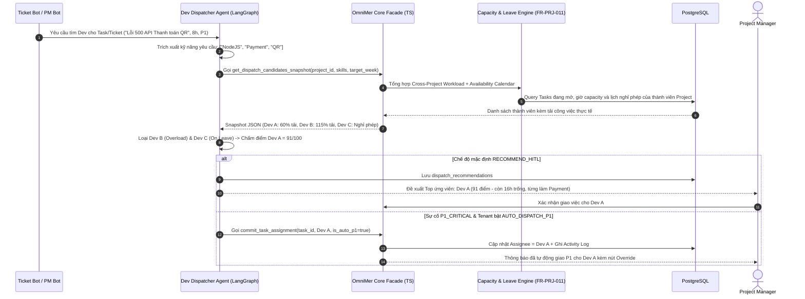

<!--
  name: FR-AGT-006_smart_developer_dispatcher.md
  description: Functional Requirements specification for OPAgent Smart Developer Dispatcher covering multi-factor candidate scoring (skills, module ownership, cross-project workload, availability calendar), overload guard, and dual-mode HITL vs P1 auto-dispatching.
-->

# Feature: Smart Developer Dispatcher (FR-AGT-006)

**Mô tả:** Chuyên viên AI điều phối nhân sự kỹ thuật (**Developer Dispatcher Agent**), đóng vai trò cầu nối giữa **Omnichannel Ticket Bot (`FR-AGT-003`)**, **PM Bot (`FR-AGT-004`)** và hệ thống quản trị nguồn lực **Resource & Capacity Management (`FR-PRJ-011`)**. Khi phát sinh Task mới hoặc Ticket leo thang cần Dev xử lý, Agent chấm điểm đa yếu tố để tìm ra Dev phù hợp nhất về năng lực chuyên môn lẫn quỹ thời gian thực tế, ngăn chặn tình trạng dồn việc gây Overload.

**Kiến trúc cốt lõi (tham chiếu [`sa.md`](./sa.md), [`FR-PRJ-011`](../omniproject_core/phase_6/FR-PRJ-011_resource_capacity.md)):**
- **Coarse-Grained Snapshot Scoring:** TS Core tổng hợp toàn bộ dữ liệu Workload xuyên dự án (`Cross-Project Workload`), Lịch nghỉ phép (`Availability Calendar`) và Lịch sử sở hữu module (`Module Ownership`) trong 1 lần gọi Tool duy nhất (`get_dispatch_candidates_snapshot`), giúp Agent suy luận nhanh và chuẩn xác.
- **Deterministic Capacity Hard-Gate:** Việc tính toán % tải công việc (`allocated_hours / weekly_capacity`) và kiểm tra ngày nghỉ phép được thực hiện bằng code tất định tại Core Service — LLM không được phép ước lượng cảm tính hay bỏ qua người đang nghỉ.
- **Dual-Mode Dispatching:** Hỗ trợ chế độ mặc định `RECOMMEND_HITL` (đề xuất Top-3 ứng viên để PM bấm chọn) và chế độ tùy chọn `AUTO_DISPATCH_P1` (tự động giao ngay cho ứng viên hạng 1 khi có sự cố `P1_CRITICAL` ngoài giờ, kèm thông báo tức thì cho PM có thể 1-click thu hồi/đổi người).

---

## 1. Functional Requirements List

| FR ID | Requirement Description | Input | Output | Associated Business Rule | Priority |
|---|---|---|---|---|---|
| **FR-AGT-006.1** | **Multi-Factor Candidate Scoring:** Đánh giá và xếp hạng thành viên hợp lệ trong Project dựa trên 4 trọng số: (1) Khớp kỹ năng/Tags, (2) Lịch sử xử lý module/thành phần tương tự, (3) Tỷ lệ Capacity còn trống xuyên dự án (`FR-PRJ-011.4`), (4) Trạng thái Availability Calendar (`FR-PRJ-011.2`). | `project_id`, `task_summary`, `required_skills[]`, `estimated_hours` | Danh sách Top-3 ứng viên kèm điểm số (`0–100`) và lý do giải thích minh bạch | `BL-AGT-006.1`, `BL-AGT-006.2` | Must-have |
| **FR-AGT-006.2** | **Overload Guard & Auto-Reassign Suggestions (`FR-PRJ-011.3`, `011.5`):** Tự động loại trừ hoặc đánh dấu cảnh báo đỏ các Dev có tổng tải công việc `>= 100%` capacity hoặc đang có lịch nghỉ phép trùng khoảng thời gian thực hiện; đồng thời gợi ý chuyển giao Task từ người đang quá tải sang người rảnh hơn. | `project_id`, `current_assignee_id` (nếu tái phân bổ) | Danh sách `safe_candidates[]` + cảnh báo Overload nếu có | `BL-AGT-006.2` | Must-have |
| **FR-AGT-006.3** | **Dual-Mode Dispatch Execution (`HITL` vs `AUTO_DISPATCH_P1`):** Mặc định trả gợi ý cho PM xác nhận; nếu là Ticket leo thang mức `P1_CRITICAL` và Tenant bật cờ `AUTO_DISPATCH_P1`, tự động gán Task cho ứng viên hạng 1 đủ điều kiện an toàn và gửi cảnh báo ngay cho PM & Dev qua Telegram/In-App. | `candidate_ranking[]`, `severity`, `tenant_dispatch_policy` | Task được gán hoặc Recommendation Card chờ duyệt | `BL-AGT-006.3` | Should-have |

---

## 2. Business Rules

| BR ID | Rule Description | Applies to FR |
|---|---|---|
| **BL-AGT-006.1** | **Explainable Weighted Scoring Model:** Điểm phù hợp (`dispatch_score` thang 100) được tổng hợp minh bạch: `40% Capacity Availability` + `35% Skill & Tag Match` + `25% Historical Module Ownership` (số Task tương tự đã hoàn thành đúng hạn trong 90 ngày gần nhất). Mọi đề xuất đều phải kèm câu giải thích ngắn gọn (VD: *"Còn trống 18h/40h tuần này, đã xử lý 4 task Payment Gateway"*). | FR-AGT-006.1 |
| **BL-AGT-006.2** | **Strict Overload & Leave Exclusion:** Thành viên đang có trạng thái nghỉ phép (`ON_LEAVE`) trong thời gian dự kiến xử lý hoặc có `projected_workload_pct > 100%` **tuyệt đối không được tự động gán việc** trong chế độ `AUTO_DISPATCH_P1`, và chỉ hiển thị ở cuối danh sách với nhãn cảnh báo `[OVERLOADED / ON_LEAVE]` trong chế độ gợi ý. | FR-AGT-006.1, FR-AGT-006.2 |
| **BL-AGT-006.3** | **P1 Auto-Dispatch Safeguard & Override:** Cơ chế tự động gán (`AUTO_DISPATCH_P1`) chỉ kích hoạt khi hội đủ 3 điều kiện: (a) Tenant bật cấu hình cho phép, (b) Độ khẩn cấp là `P1_CRITICAL`, (c) Có ít nhất 1 ứng viên đạt `dispatch_score >= 70` và `workload_pct <= 90%`. Hệ thống bắt buộc gửi thông báo kèm nút *"Đổi người phụ trách"* cho PM và ghi `Activity Log`. | FR-AGT-006.3 |

---

## 3. Data Structure & Coarse-Grained Tool Contracts

### 3.1. Entity: `dispatch_recommendations` (PostgreSQL — Audit & Feedback Loop)

| Field | Data Type | Required | Constraints |
|---|---|---|---|
| `id` | `UUID` | Yes | Primary Key |
| `tenant_id` | `UUID` | Yes | FK -> `tenants.id` |
| `task_id` | `UUID` | No | FK -> `tasks.id` (hoặc `draft_task_id`) |
| `required_skills` | `JSONB` | Yes | Mảng tags kỹ năng trích xuất |
| `candidates_snapshot` | `JSONB` | Yes | Top-3 ứng viên `{ user_id, score, workload_pct, rationale }` |
| `dispatch_mode` | `ENUM` | Yes | `RECOMMEND_HITL` \| `AUTO_DISPATCH_P1` |
| `selected_user_id` | `UUID` | No | Người thực tế được PM chọn (dùng đo lường độ chính xác AI) |
| `created_at` | `TIMESTAMPTZ` | Yes | Default `NOW()` |

### 3.2. Coarse-Grained Tool Contracts (TS Facade / MCP)

| Tool Name | Server-Injected Locked Params | LLM / Agent Params | Output DTO |
|---|---|---|---|
| `get_dispatch_candidates_snapshot` | `tenant_id`, `X-User-Id` | `project_id`, `required_skills[]`, `target_week_iso`, `estimated_hours` | `[{ user_id, full_name, skills[], cross_project_workload_pct, remaining_hours, on_leave_dates[], module_tasks_done_90d }]` |
| `commit_task_assignment` | `tenant_id`, `X-User-Id`, `dispatch_policy` | `task_id`, `assignee_id`, `rationale_note`, `is_auto_p1` | `{ assigned: boolean, activity_log_id, notification_sent }` |

---

## 4. Sequence Diagram: Smart Developer Dispatching & Overload Guard



---

## 5. Pre/Post-Conditions & Acceptance Criteria

### FR-AGT-006.1 & FR-AGT-006.2: Multi-Factor Scoring & Overload Guard
- **Pre-condition:** Các thành viên trong Project đã được khai báo Capacity mặc định (VD: `40h/tuần` theo `FR-PRJ-011`) và cập nhật lịch nghỉ phép (nếu có).
- **Post-condition:** Ứng viên được xếp hạng công bằng dựa trên năng lực và quỹ thời gian thực tế xuyên suốt tất cả Project của Workspace; người quá tải hoặc nghỉ phép được bảo vệ khỏi việc tự động dồn thêm việc.
- **Exception / Error case:** Toàn bộ thành viên Project đều vượt ngưỡng `100%` tải trong tuần -> Agent không tự động gán dù ở chế độ P1, trả về danh sách ứng viên kèm cảnh báo *"Toàn team đang quá tải"* để PM điều phối lại hoặc Override giới hạn.

**Acceptance Criteria (Gherkin):**
```gherkin
Scenario: Đề xuất Dev phù hợp và tự động tránh người đang quá tải hoặc nghỉ phép
  Given Project "Payment Gateway" có 3 thành viên Backend:
    | Member | Skill Match | Cross-Project Workload | Leave Calendar |
    | An | Payment, API | 115% (Overloaded) | Không |
    | Bình | Payment, QR | 55% (Còn 18h) | Không |
    | Cường | Payment, SQL | 40% (Còn 24h) | Đang nghỉ phép |
  When Ticket Bot leo thang một Task mới gắn tag "Payment, QR" ước lượng 8h
  Then Dev Dispatcher loại trừ Cường (đang nghỉ phép) và gắn nhãn cảnh báo Overload cho An
  And xếp hạng Bình ở vị trí số 1 với giải thích rõ ràng về kỹ năng khớp và 18h capacity còn trống
```
