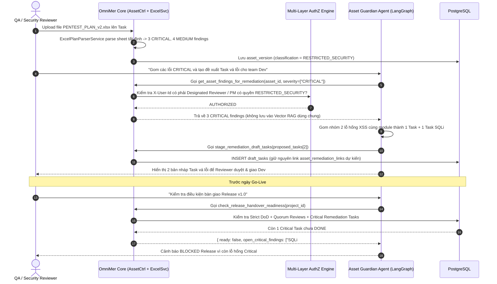

<!--
  name: FR-AGT-007_asset_governance_and_remediation_agent.md
  description: Functional Requirements specification for OPAgent Asset Governance & Remediation Guardian covering automated finding-to-task remediation sync, pre-release handover readiness audit, and RBAC-redacted handover bundle assembly.
-->

# Feature: Asset Governance & Remediation Guardian Agent (FR-AGT-007)

**Mô tả:** Chuyên viên AI giám sát chất lượng tri thức, nghiệm thu kế hoạch và xử lý khắc phục sự cố (**Asset & Compliance Guardian**), kết nối trực tiếp hệ sinh thái OPAgent với phân hệ **Asset Governance (`FR-DOC-001`)**. Agent tự động đọc kết quả phân tích từ các tài liệu `STRUCTURED_PLAN` (`.xlsx` / `.md`), đồng bộ các lỗ hổng/lỗi kiểm thử (`FAIL` / `CRITICAL`) thành Task vá lỗi, kiểm tra điều kiện sẵn sàng bàn giao (Pre-Release Readiness) và hỗ trợ soạn thảo hồ sơ bàn giao (`00_HANDOVER_MANIFEST.md`) tuân thủ chặt chẽ phân tầng bảo mật.

**Kiến trúc cốt lõi (tham chiếu [`sa.md`](./sa.md), [`01_SRS_ASSET_GOVERNANCE_AND_PLANNING_HANDOVER.md`](../asset_governance/01_SRS_ASSET_GOVERNANCE_AND_PLANNING_HANDOVER.md), [`FR-DOC-001`](../asset_governance/FR-DOC-001_automated_asset_governance.md)):**
- **Zero-Exposure of `RESTRICTED_SECURITY` in General RAG:** Tuyệt đối không đưa nội dung chi tiết các tài liệu độ mật `CONFIDENTIAL` hoặc `RESTRICTED_SECURITY` (như `PENTEST_PLAN`, `INCIDENT_RESPONSE_PLAN`) vào bộ nhớ Vector RAG dùng chung. Agent chỉ được phép truy xuất dữ liệu đã phân mảnh theo ngữ cảnh phiên làm việc của đúng `Designated Reviewer` hoặc `PM/Admin` có quyền hợp lệ.
- **Deterministic Excel Parsing First:** Việc đọc file `.xlsx`, kiểm tra schema cột và đếm số lượng dòng `FAIL` / `CRITICAL` do **ExcelPlanParserService (TS Core)** thực hiện 100% tất định; OPAgent chỉ nhận danh sách Finding đã chuẩn hóa để tóm tắt, gom nhóm lỗi trùng lặp và gợi ý Task vá lỗi.
- **Anti-Self-Approval & Quorum Gate Enforcement (`FR-DOC-001.3`):** Agent không thể phê duyệt thay `Designated Reviewer` và luôn kiểm tra đủ số phiếu duyệt (`ALL_REQUIRED` / `ANY_ONE`) trước khi xác nhận đủ điều kiện bàn giao.

---

## 1. Functional Requirements List

| FR ID | Requirement Description | Input | Output | Associated Business Rule | Priority |
|---|---|---|---|---|---|
| **FR-AGT-007.1** | **Automated Finding-to-Task Remediation Sync (`FR-DOC-001.4`):** Khi tài liệu `TEST_PLAN`, `PENTEST_PLAN` hoặc `INCIDENT_RESPONSE_PLAN` được upload và parse xong tại Core, Agent gom nhóm các Finding trạng thái `FAIL` / `CRITICAL`, gợi ý mô tả cách khắc phục và sinh bản nháp Task vá lỗi (`draft_tasks`) gắn với `asset_remediation_links`. | `asset_id`, `version_number`, `parsed_findings[]`, `X-User-Id` | Danh sách `draft_tasks` vá lỗi + liên kết `asset_remediation_links` chờ PM/Reviewer duyệt | `BL-AGT-007.1`, `BL-AGT-007.2`, `BR-001` | Must-have |
| **FR-AGT-007.2** | **Pre-Release & Handover Readiness Audit:** Kiểm tra toàn diện điều kiện nghiệm thu trước khi đóng Sprint/Release: mọi Task có `OutputContractType = STRUCTURED_PLAN` đã đạt `APPROVED_BASELINE` chưa, đủ chữ ký Quorum (`ALL_REQUIRED` / `ANY_ONE`) chưa, và còn Finding mức `CRITICAL` nào chưa đóng không. | `project_id` / `release_scope`, `X-User-Id` | Báo cáo Readiness (`READY` \| `BLOCKED`) liệt kê chi tiết các hạng mục còn kẹt | `BL-AGT-007.3`, `BL-PRJ-008` | Must-have |
| **FR-AGT-007.3** | **Smart Handover Manifest & Bundle Copilot (`FR-DOC-001.6`):** Tự động tổng hợp nội dung tóm tắt điều hành cho file `00_HANDOVER_MANIFEST.md` từ các tài sản `APPROVED_BASELINE`, thực thi lọc/ẩn tài sản theo quyền RBAC của người nhận (`RBAC Redaction`), và hỗ trợ đóng gói `.zip` / tạo Share Link có thời hạn (TTL). | `project_id`, `target_recipient_role`, `asset_ids[]`, `X-User-Id` | Nội dung `00_HANDOVER_MANIFEST.md` + Gói bàn giao ZIP đã Redact đúng chuẩn | `BL-AGT-007.4` | Should-have |

---

## 2. Business Rules

| BR ID | Rule Description | Applies to FR |
|---|---|---|
| **BL-AGT-007.1** | **Security Classification Guardrail (`FR-DOC-001.5`):** Trước khi truyền danh sách Finding từ Core sang OPAgent để tóm tắt hoặc sinh Task vá lỗi, TS Core kiểm tra quyền truy cập của `X-User-Id` theo độ mật (`INTERNAL`, `CONFIDENTIAL`, `RESTRICTED_SECURITY`). Với tài sản `RESTRICTED_SECURITY` (như lỗ hổng Pentest), dữ liệu **chỉ được xử lý qua LLM nội bộ hoặc luồng Zero-Retention**, không lưu cache gợi ý chung trên Vector DB. | FR-AGT-007.1, FR-AGT-007.3 |
| **BL-AGT-007.2** | **Remediation Task Traceability & Strict DoD:** Mọi Task vá lỗi sinh từ Finding của `asset_governance` vào Project `DELIVERY` đều phải lưu quan hệ trong `asset_remediation_links`, giữ lại `parent_fr_id` của tính năng bị lỗi (`BR-001`) và gợi ý gắn `Dev Dispatcher` (`FR-AGT-006`) nếu cần tìm người sửa nhanh. | FR-AGT-007.1 |
| **BL-AGT-007.3** | **Anti-Self-Approval & Critical Blocker Lock:** Agent tuân thủ tuyệt đối quy tắc không cho phép `Asset Author` tự duyệt bài của mình (`Self-Approval Guard`). Nếu tồn tại bất kỳ Finding `CRITICAL` nào chưa có Task vá lỗi trạng thái `DONE`, Agent bắt buộc báo trạng thái `BLOCKED` cho cổng Release / Handover. | FR-AGT-007.2 |
| **BL-AGT-007.4** | **Mandatory RBAC Redaction in Handover Bundles:** Khi tạo gói bàn giao cho đối tượng `Guest` hoặc Khách hàng ngoài tổ chức, Agent và `HandoverBundleService` tự động loại bỏ các tệp `RESTRICTED_SECURITY` / `CONFIDENTIAL` khỏi tệp `.zip` và ghi chú minh bạch lý do ẩn trong `00_HANDOVER_MANIFEST.md` thay vì để lộ đường dẫn file nhạy cảm. | FR-AGT-007.3 |

---

## 3. Data Structure & Coarse-Grained Tool Contracts

### 3.1. Cross-Module Entities Referenced (từ `FR-DOC-001` & `01_SRS_ASSET_GOVERNANCE`)
- `project_assets` & `asset_versions`: Lưu trữ bất biến file `.xlsx` / `.md` (băm `SHA-256`), `security_classification`, `handover_status`.
- `asset_handover_reviews`: Lưu quyết định duyệt (`APPROVED` / `CHANGES_REQUESTED`) của từng `designated_reviewer_id`.
- `asset_remediation_links`: Bảng liên kết giữa `asset_finding_id` và `remediation_task_id`.

### 3.2. Coarse-Grained Tool Contracts (TS Facade / MCP)

| Tool Name | Server-Injected Locked Params | LLM / Agent Params | Output DTO |
|---|---|---|---|
| `get_asset_findings_for_remediation` | `tenant_id`, `X-User-Id` (Classification AuthZ checked) | `asset_id`, `version_number`, `severity_filter[]` | `{ asset_title, classification, plan_type, findings[{ finding_code, title, severity, component, existing_task_id }] }` |
| `stage_remediation_draft_tasks` | `tenant_id`, `X-User-Id`, `asset_id` | `proposed_tasks[{ finding_codes[], task_title, description, parent_fr_id, priority }]` | `{ draft_task_ids[], grouped_findings_count }` |
| `check_release_handover_readiness` | `tenant_id`, `X-User-Id` | `project_id`, `milestone_id` (optional) | `{ ready: boolean, pending_dod_tasks[], unapproved_assets[], open_critical_findings[] }` |
| `build_handover_manifest_preview` | `tenant_id`, `X-User-Id` | `project_id`, `recipient_audience` (`INTERNAL_TEAM` \| `EXTERNAL_CLIENT`), `notes` | `{ manifest_markdown, included_assets[], redacted_assets_count }` |

---

## 4. Sequence Diagram: Finding-to-Task Sync & Pre-Release Readiness Audit



---

## 5. Pre/Post-Conditions & Acceptance Criteria

### FR-AGT-007.1, 007.2 & 007.3: Remediation Sync, Readiness Audit & Bundle Redaction
- **Pre-condition:** Tài sản kế hoạch (`.xlsx` hoặc `.md`) đã được tải lên qua `FR-DOC-001` và parse hợp lệ; người yêu cầu thao tác vượt qua lớp kiểm tra quyền ngữ cảnh và độ mật tại Core AuthZ.
- **Post-condition:** Các lỗ hổng `FAIL`/`CRITICAL` được đề xuất thành Task vá lỗi có truy vết hai chiều với tài sản gốc; việc kiểm tra Release phản ánh đúng thực trạng DoD và Critical Findings; gói bàn giao xuất ra cho bên ngoài luôn được lọc bỏ tài sản mật.
- **Exception / Error case:**
  - `Team Member` thông thường (không phải `Designated Reviewer` hay `Author`) nhờ Agent đọc lỗi từ tài liệu `RESTRICTED_SECURITY` -> TS Core AuthZ chặn với lỗi `HTTP 403` và Agent không hiển thị bất kỳ dữ liệu nào của file đó.
  - Tài sản chưa đạt `APPROVED_BASELINE` hoặc tác giả tự duyệt bài của mình -> Readiness Audit báo `BLOCKED` và từ chối đưa vào gói bàn giao chính thức.

**Acceptance Criteria (Gherkin):**
```gherkin
Scenario: Tự động đề xuất Task vá lỗi từ Pentest Plan và chặn Release khi còn lỗi Critical
  Given tài liệu "PENTEST_PLAN_v1.xlsx" (độ mật RESTRICTED_SECURITY) vừa được parse với 2 lỗi CRITICAL
  And tôi là Designated Reviewer của Task đó
  When tôi yêu cầu Asset Guardian Agent tạo Task khắc phục từ các lỗi CRITICAL
  Then Core AuthZ xác thực quyền truy cập thành công và KHÔNG index file này vào RAG công cộng
  And Agent trả về bản nháp Task vá lỗi kèm liên kết truy vết tới từng mã Finding
  When tôi xác nhận tạo Task vá lỗi và sau đó hỏi Agent: "Dự án đã sẵn sàng Release chưa?"
  And Task vá lỗi CRITICAL vẫn đang ở trạng thái IN_PROGRESS
  Then Agent báo trạng thái BLOCKED và chỉ rõ lỗ hổng CRITICAL đang chặn cổng bàn giao

Scenario: Tự động Redact tài sản bảo mật khi đóng gói bàn giao cho Khách hàng ngoài
  Given Project có 3 tài sản APPROVED_BASELINE gồm 2 tài liệu INTERNAL và 1 tài liệu RESTRICTED_SECURITY
  When PM yêu cầu Agent xuất gói bàn giao cho đối tượng EXTERNAL_CLIENT
  Then Agent sinh file 00_HANDOVER_MANIFEST.md chỉ liệt kê 2 tài liệu INTERNAL và loại bỏ hoàn toàn tài liệu RESTRICTED_SECURITY khỏi file ZIP
```
