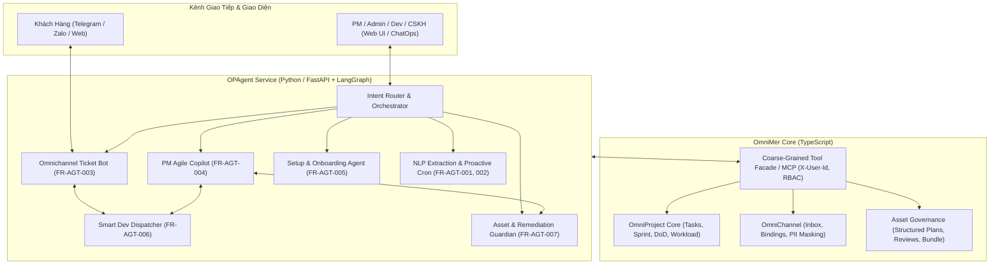

<!--
  name: README.md
  description: Index and architectural overview of the OPAgent Multi-Agent Ecosystem functional requirements (FR-AGT-001 to FR-AGT-007) and cross-module traceability.
-->

# Phân hệ Agent Project (`OPAgent`) — Hệ sinh thái Multi-Agent OmniMer

Thư mục này chứa tài liệu **Kiến trúc Giải pháp (`sa.md`)**, **Đặc tả Yêu cầu Phần mềm (`01_SRS_OPAGENT_MULTI_AGENT_ECOSYSTEM.md`)**, **Ma trận Truy vết Yêu cầu (`02_RTM_OPAGENT_MULTI_AGENT_ECOSYSTEM.csv`)** và bộ đặc tả **Yêu cầu Chức năng (`FR-AGT-001` $\rightarrow$ `FR-AGT-007`)** cho hệ thống AI Agent (`OPAgent Service` bằng Python/LangGraph kết hợp `Coarse-Grained Tool Facade / MCP` trên TypeScript Core).

---

## 1. Danh mục Tài liệu & Ánh xạ 5 Chuyên viên Agent

| Tài liệu | Chuyên viên Agent / Vai trò | Phạm vi Chức năng Chính |
|---|---|---|
| [**sa.md**](./sa.md) | *Kiến trúc Nền tảng OPAgent* | Database-per-Service, Coarse-Grained Remote Facade, Deterministic-First, Contract-First OpenAPI/Zod, Zero-Trust Auth & Circuit Breaker. |
| [**01_SRS_OPAGENT_MULTI_AGENT_ECOSYSTEM.md**](./01_SRS_OPAGENT_MULTI_AGENT_ECOSYSTEM.md) | *SRS Tổng thể (IEEE Std 830)* | Đặc tả kỹ thuật hợp nhất `FR-AGT-001..007`, Data Dictionary, Redis Keys, Coarse-Grained Tool Contracts, NFRs và Phân công AI Models. |
| [**02_RTM_OPAGENT_MULTI_AGENT_ECOSYSTEM.csv**](./02_RTM_OPAGENT_MULTI_AGENT_ECOSYSTEM.csv) | *Ma trận Truy vết (RTM)* | Truy vết 100% từ Business Rules (`BL-AGT-*`) $\rightarrow$ Functional Requirements (`FR-AGT-*`) $\rightarrow$ User Stories $\rightarrow$ Test Cases (`TC-AGT-001..032`). |
| [**09_opagent_multi_agent_ecosystem_changelog.md**](../../../../../backend_otm/opagent_service/docs/change_log/09_opagent_multi_agent_ecosystem_changelog.md) | *Implementation Plan & Changelog (v2.0.0)* | Lộ trình triển khai Triad + Giai đoạn 0 Bảo mật/Phân quyền cho `backend_otm/opagent_service/` kết hợp TS Core Tool Facade. |
| [**01_opagent_source_architecture.md**](../../../../../backend_otm/opagent_service/docs/architecture/01_opagent_source_architecture.md) | *Source, State/Event & Protocol Architecture* | Cấu trúc source `opagent_service`, tách bạch State vs. Event LangGraph, HTTP/1.1 Keep-Alive + SSE + ADT EdDSA, Latency Budget & `pgvector` schema. |
| [**02_opagent_technology_evaluation_adr.md**](../../../../../backend_otm/opagent_service/docs/architecture/02_opagent_technology_evaluation_adr.md) | *Technology Evaluation (ADRs)* | Đánh giá LangGraph (`1.2.x`), ADR-OPA-002 thay Qdrant bằng `pgvector`, giao thức nội bộ, ADT, Cron/Queue & Postgres Checkpointer. |
| [**03_opagent_security_authorization_architecture.md**](../../../../../backend_otm/opagent_service/docs/architecture/03_opagent_security_authorization_architecture.md) | *Security & Authorization Architecture* | Trust boundaries, STRIDE, OWASP LLM Top 10 (2025), ma trận RBAC `FR-AGT-001..007`, 20 Tool Scopes, PII/Classification & `SEC-AGT-01..16`. |
| [**FR-AGT-001**](./FR-AGT-001_nlp_text_to_task.md) | *Core Extraction Engine* | NLP Text/Voice-to-Task (STT), Neo múi giờ tiếng Việt (`UTC+7`), PII Masking, Fuzzy Search Assignee & Human-in-the-Loop (`draft_tasks`). |
| [**FR-AGT-002**](./FR-AGT-002_proactive_health_monitor.md) | *Proactive Health Monitor* | Quét rủi ro Task 4h/lần & SLA hội thoại/Zalo 48h thuần SQL (Zero-LLM), Standup 18:00 qua Redis Queue, Idempotency chống spam, Radar Đường găng & WIP Bottleneck. |
| [**FR-AGT-003**](./FR-AGT-003_omnichannel_ticket_bot.md) | **1. Omnichannel Ticket Bot & Support Copilot** | Auto-Triage phân loại tin nhắn khách (`FAQ / Feature / Bug P1-P4`), Support RAG (chỉ nguồn `INTERNAL`), Chọn tin nhắn tạo Ticket `SUPPORT` (`FR-SUP-000`), Leo thang sang Dev & Tóm tắt bàn giao ca. |
| [**FR-AGT-004**](./FR-AGT-004_pm_copilot_full_task_lifecycle.md) | **2. PM Bot & Delivery Agile Copilot** | Tìm kiếm NL & OQL, CRUD đa lượt có xác nhận HITL, Bảo vệ cổng Strict DoD (`FR-PRJ-008`), Rã WBS & Ước lượng Story Points, Đánh giá tiến độ EVM / SPI / Burndown. |
| [**FR-AGT-005**](./FR-AGT-005_project_setup_and_account_onboarding_agent.md) | **3. Setup & Governance Onboarding Agent** | Wizard khởi tạo Project qua hội thoại (Template, Workflow, WIP, EAV, DoD, Channel), Mời thành viên hàng loạt + QR ChatOps, Cẩm nang Onboarding & Kiểm toán bảo mật Workspace. |
| [**FR-AGT-006**](./FR-AGT-006_smart_developer_dispatcher.md) | **4. Smart Developer Dispatcher** | Chấm điểm đa yếu tố (Skills, Module Ownership, Cross-Project Workload, Leave Calendar), Chốt chặn Overload `>= 100%`, Gợi ý tái phân bổ & Auto-Dispatch P1 có kiểm soát. |
| [**FR-AGT-007**](./FR-AGT-007_asset_governance_and_remediation_agent.md) | **5. Asset Governance & Remediation Guardian** | Đồng bộ Finding `FAIL/CRITICAL` từ Excel/Markdown sang Task vá lỗi, Kiểm tra điều kiện Pre-Release & Quorum, Soạn `00_HANDOVER_MANIFEST.md` kèm RBAC Redaction. |

---

## 2. Sơ đồ Tương tác Hệ sinh thái Multi-Agent

---

## 3. Ma trận Truy vết Liên Phân Hệ & Chốt Chặn Bất Biến

| Nguyên tắc / Chốt chặn | Tài liệu Nguồn Liên kết | Vai trò Bảo vệ trong Hệ sinh thái Agent |
| :--- | :--- | :--- |
| **Traceability `BR-001`** | [`FR-CHN-007`](../omnichannel/phase_3/FR-CHN-007_support_vs_delivery_conversion.md) | Mọi `TASK` ở dự án `DELIVERY` (tạo từ PM Bot, Leo thang hay Remediation) phải có `parent_fr_id` thật (khác `FR-SUP-000`) trước khi vào `IN_PROGRESS`. |
| **Velocity Isolation `BR-005`** | [`FR-PRJ-012`](../omniproject_core/phase_6/FR-PRJ-012_reporting_analytics.md) | Toàn bộ `TICKET` (`FR-SUP-000`) được loại trừ khỏi chỉ số Dev Velocity / Story Points và báo cáo tiến độ Sprint kỹ thuật. |
| **Strict DoD Gate `BL-PRJ-008`** | [`FR-PRJ-008`](../omniproject_core/phase_4/FR-PRJ-008_strict_dod_output.md) | PM Bot không được phép ép chuyển trạng thái `DONE` nếu thiếu `OutputContractType` hoặc chưa duyệt `STRUCTURED_PLAN`. |
| **PII Masking `BR-CHN-007`** | [`FR-CHN-008`](../omnichannel/phase_3/FR-CHN-008_opagent_draft_and_pii_masking.md) | Che SĐT, Email, CCCD, STK bằng Regex tất định trước khi gửi tới External LLM; giữ nguyên văn bản gốc trên Server. |
| **Security Redaction & AuthZ** | [`01_SRS_ASSET_GOVERNANCE`](../asset_governance/01_SRS_ASSET_GOVERNANCE_AND_PLANNING_HANDOVER.md) | Chặn index `CONFIDENTIAL` / `RESTRICTED_SECURITY` vào RAG công cộng; lọc bỏ file mật khi đóng gói bàn giao cho khách ngoài. |
| **Workload & Anti-Gaming** | [`FR-PRJ-011`](../omniproject_core/phase_6/FR-PRJ-011_resource_capacity.md) · [`FR-PRJ-007`](../omniproject_core/phase_5/FR-PRJ-007_smart_prioritization.md) | Tránh tự động gán Dev vượt `100%` capacity hoặc đang nghỉ phép; chặn `Assignee` tự lùi `due_date` qua PM Bot. |

---

## 4. Lộ trình Triển khai Đề xuất (Phasing Alignment)

1. **Giai đoạn 1 (Nền tảng & Trợ lý Nhập liệu):** `FR-AGT-001` (Text/Voice-to-Task), `FR-AGT-002` (SQL 4h Risk Alert + 18:00 Standup), thiết lập `Coarse-Grained Tool Facade` theo [`sa.md`](./sa.md).
2. **Giai đoạn 2 (CSKH & Quản trị Tác vụ):** `FR-AGT-003` (Omnichannel Ticket Bot & Support Copilot), `FR-AGT-004` (PM Bot CRUD, Strict DoD Guard & EVM Assessment), `FR-AGT-006` (Smart Developer Dispatcher).
3. **Giai đoạn 3 (Tự động hóa Khởi tạo & Tuân thủ Tài sản):** `FR-AGT-005` (Project Setup Wizard & Account Onboarding Agent), `FR-AGT-007` (Asset Remediation & Pre-Release Bundle Guardian).
