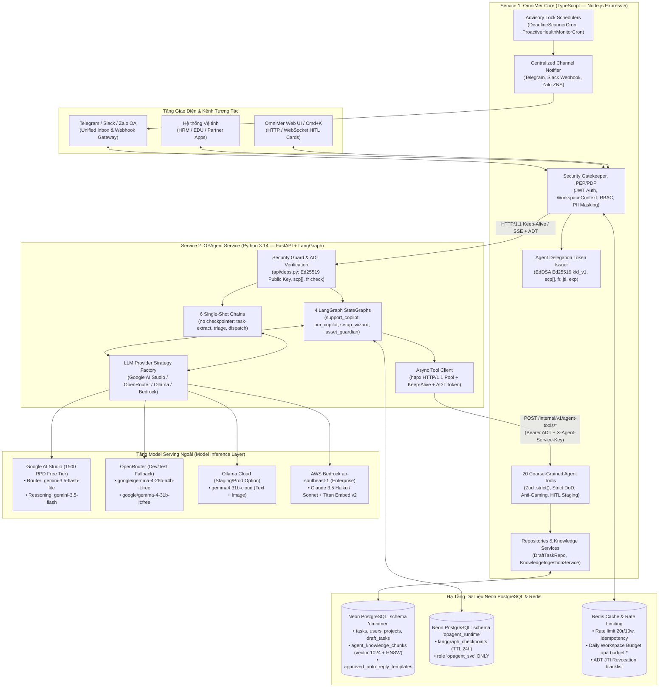
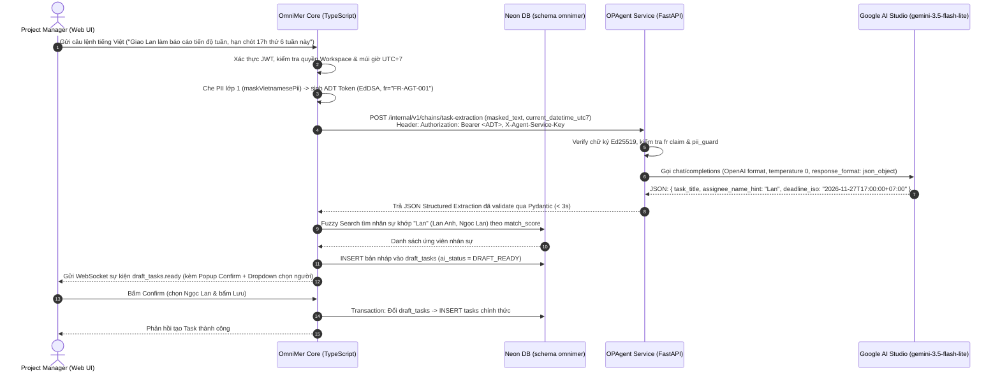
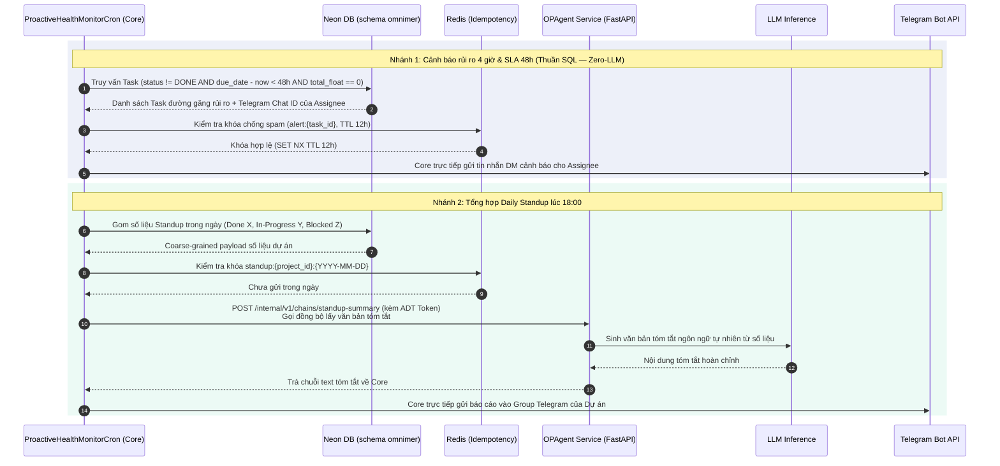
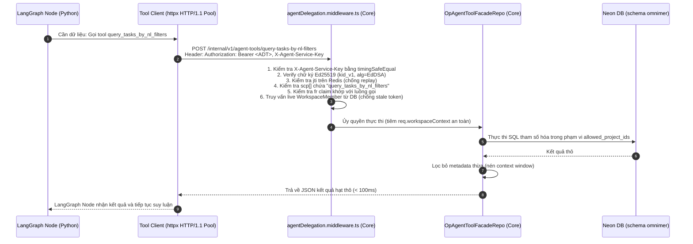

<!--
  name: sa.md
  description: Solution Architecture specification for OPAgent Multi-Agent Ecosystem, defining Dual-Service boundaries (TypeScript project_core PEP/PDP + Python opagent_service Reasoning Engine), HTTP/1.1 Keep-Alive + SSE protocol, Agent Delegation Token (EdDSA Ed25519), pgvector vector(1024) RAG, 20-tool catalog, PostgreSQL opagent_runtime checkpointer, and Google AI Studio / OpenRouter / AWS Bedrock serving strategy.
-->

# TÀI LIỆU GIẢI PHÁP KIẾN TRÚC (SOLUTION ARCHITECTURE)

**Hệ sinh thái AI Agent (OPAgent) — Mô hình Dual-Service: TypeScript Core (System of Record & PEP/PDP) & Python OPAgent (LangGraph Reasoning Engine)**

> [!NOTE]
> **Phiên bản kiến trúc:** `v2.0.0` (Đồng bộ toàn diện theo bộ ADR [`02_opagent_technology_evaluation_adr.md`](file:///Users/macbookair/Downloads/source/omnimer_team/backend_otm/opagent_service/docs/architecture/02_opagent_technology_evaluation_adr.md), Kiến trúc mã nguồn [`01_opagent_source_architecture.md`](file:///Users/macbookair/Downloads/source/omnimer_team/backend_otm/opagent_service/docs/architecture/01_opagent_source_architecture.md) và Kiến trúc An toàn Thông tin [`03_opagent_security_authorization_architecture.md`](file:///Users/macbookair/Downloads/source/omnimer_team/backend_otm/opagent_service/docs/architecture/03_opagent_security_authorization_architecture.md)).
> *Quyết định kỹ thuật cốt lõi:* Tích hợp `pgvector (vector(1024))` ngay trong Neon PostgreSQL Core thay cho Qdrant độc lập; xác thực liên dịch vụ bằng Agent Delegation Token (`EdDSA Ed25519`); truyền thông bằng HTTP/1.1 Keep-Alive + SSE; lưu checkpoint LangGraph tại schema cô lập `opagent_runtime` (role `opagent_svc`); toàn bộ thông báo kênh ngoài (Telegram/Slack/Zalo OA) do Core trực tiếp phát; và tầng phục vụ Model chuyển đổi linh hoạt `Google AI Studio` (1500 RPD) $\rightarrow$ `OpenRouter` $\rightarrow$ `AWS Bedrock`.

---

## 1. Tổng quan & Nguyên tắc Thiết kế

Tài liệu này mô tả giải pháp kiến trúc tách biệt 2 dịch vụ (**OmniMer Core** bằng TypeScript và **OPAgent Service** bằng Python) nhằm phục vụ hệ sinh thái OmniMer Team và các hệ thống vệ tinh:

1. **Service 1 — OmniMer Core (`backend_otm/project_core` — TypeScript / Express 5 / Prisma):**
   - Đóng vai trò **System of Record duy nhất** và là **Policy Enforcement Point (PEP) / Policy Decision Point (PDP)** duy nhất của toàn hệ thống.
   - Sở hữu cơ sở dữ liệu chính (PostgreSQL schema `omnimer`), quản lý toàn bộ phân quyền (RBAC/ABAC), bảo mật PII lớp 1, cổng kiểm duyệt Strict DoD (`FR-PRJ-008`), Anti-Gaming (`FR-PRJ-007.4`), kho tri thức `pgvector` (`agent_knowledge_chunks`), các bảng nháp HITL (`draft_tasks`, `agent_action_drafts`, `setup_blueprint_drafts`), và trực tiếp gửi thông báo kênh ngoài tới Telegram, Slack, Zalo OA.
2. **Service 2 — OPAgent Service (`backend_otm/opagent_service` — Python 3.14 + FastAPI + LangGraph):**
   - Đóng vai trò **Reasoning Engine thuần túy**, chạy dưới dạng Render Private Service (`pserv`) tại region Singapore, không mở public URL ra Internet.
   - Hoàn toàn **stateless** đối với dữ liệu nghiệp vụ: không có kết nối tới schema `omnimer`, chỉ kết nối tới schema cô lập `opagent_runtime` qua role chuyên biệt `opagent_svc` (đã bị revoke toàn bộ quyền trên `omnimer` và `public`) để lưu trữ LangGraph checkpoint ngắn hạn (tối đa 24h, xóa khi có dữ liệu `> INTERNAL`).
   - Tách biệt **6 Single-Shot Chains** (không checkpoint: trích xuất task, phân loại triage, tìm ứng viên dispatch, tóm tắt standup, kiểm tra release, tóm tắt ca trực) và **4 LangGraph StateGraphs** (`support_copilot`, `pm_copilot`, `setup_wizard`, `asset_guardian` với `recursion_limit = 6..8`).

### Ba nguyên tắc nền tảng:
* **Tách biệt ranh giới dữ liệu & Không có quyền ghi trực tiếp (Zero Direct Commit):** Toàn bộ 20 công cụ của Agent chỉ thuộc 2 nhóm `READ` và `STAGE`. Agent không bao giờ có quyền tự ý `COMMIT` thay đổi vào các bảng nghiệp vụ chính (`tasks`, `users`, `projects`). Mọi thao tác ghi đều phải dừng lại ở bảng nháp Staging (`draft_tasks`, `agent_action_drafts`) để người dùng xác nhận (Human-in-the-Loop) hoặc kích hoạt qua rule tất định phía Core.
* **Giao diện Tool dạng hạt thô (Coarse-Grained Remote Facade):** Dựa trên mẫu thiết kế *Remote Facade* (Martin Fowler), các API nội bộ phía TypeScript Core gom nhiều truy vấn phức tạp (Workload, Skills, Ownership, Leave) thành 1 lần gọi duy nhất (`POST /internal/v1/agent-tools/*`), giúp giảm số vòng lặp suy luận của LLM, hạ độ trễ và tiết kiệm token.
* **Ưu tiên mã nguồn tất định (Deterministic First):** Các tác vụ có quy tắc rõ ràng (như quét hạn chót 4h bằng SQL, kiểm tra cửa sổ 48h Zalo OA, tính điểm điều phối Dev `40/35/25`, tính SPI/EVM Sprint, và phản hồi ngoài giờ bằng mẫu đã duyệt `ApprovedAutoReplyTemplate`) được thực thi 100% bằng mã nguồn tất định tại Core Service; LLM chỉ được gọi khi thực sự cần xử lý ngôn ngữ tự nhiên.

---

## 2. Kiến trúc Hệ thống Tổng thể

---

## 3. Luồng Xử lý Trọng yếu (Sequence Diagrams)

### 3.1. Luồng FR-AGT-001: NLP Text/Voice-to-Task (Human-in-the-Loop)

Toàn bộ thông tin từ AI chỉ được bóc tách và ghi tạm vào `draft_tasks`. Không bao giờ ghi trực tiếp vào bảng `tasks` trước khi PM bấm xác nhận trên giao diện.

### 3.2. Luồng FR-AGT-002: Proactive Health Monitor (100% Core Sở Hữu Kênh Ngoại)

Tuân thủ nguyên tắc **Core gửi mọi thông báo kênh ngoài**: OPAgent không nắm giữ Telegram Bot Token, không gửi tin nhắn trực tiếp ra bên ngoài.

### 3.3. Luồng Agent Đa bước gọi 20 Coarse-Grained Tools qua ADT Token

---

## 4. Danh mục 20 Agent Tools & Chuẩn Hóa Hợp Đồng Dữ Liệu

### 4.1. Quy chuẩn Phân Loại Tool (READ & STAGE ONLY — 0 COMMIT)

Hệ thống rút hoàn toàn quyền `COMMIT` của LLM (`commit_task_assignment` đã bị loại bỏ) để triệt tiêu lỗ hổng **Excessive Agency (OWASP LLM06)**:
* **Tool loại `READ` (13 tools):** Đọc số liệu tổng hợp, tra cứu danh bạ, tìm kiếm vector RAG, kiểm tra DoD, đánh giá EVM/SPI.
* **Tool loại `STAGE` (7 tools):** Ghi tạm vào các bảng nháp Staging (`draft_tasks`, `agent_action_drafts`, `setup_blueprint_drafts`) có kiểm tra Anti-Gaming (`FR-PRJ-007.4`), khóa Strict DoD (`FR-PRJ-008`) và thời gian sống ngắn (TTL 15 phút, OCC versioning).

### 4.2. Cơ chế Phản hồi Ngoài giờ Tất định (After-Hours Template-Based Auto-Reply)
Đối với `FR-AGT-003` (Support Bot):
* **Trong giờ làm việc:** Bot chỉ gợi ý câu trả lời để nhân viên CSKH duyệt trước khi gửi khách.
* **Ngoài giờ làm việc:** Khi Workspace bật cờ `after_hours_auto_reply_enabled = true`:
  - LLM chỉ được phép phân loại `intent`, đánh giá `severity` và chọn `matched_template_id`.
  - Core kiểm tra điều kiện khắt khe: `intent === 'FAQ'`, `severity` không phải `P1/P2`, và độ tin cậy $\ge$ ngưỡng cấu hình.
  - Core trích xuất nguyên văn nội dung từ bảng `ApprovedAutoReplyTemplate` (`status = APPROVED`) và gửi cho khách hàng.
  - **Tuyệt đối không gửi bất kỳ câu chữ tự do nào do LLM tự sinh ra.**
  - Nếu là sự cố `P1_CRITICAL`, hệ thống chuyển ngay sang luồng cảnh báo khẩn cấp (Emergency Alert) tới trực ban.

### 4.3. Quy trình Đồng bộ Hợp đồng Hai Chiều (Contract-First Pipeline)
1. **TypeScript $\rightarrow$ Python:** Toàn bộ Input/Output DTO của 20 Tools được định nghĩa bằng **Zod `.strict()`** tại Core, xuất ra `/manifest`. Script `sync_tool_contracts.py` tự động chuyển đổi sang các Pydantic model trong `_generated.py` tại `opagent_service`.
2. **Python $\rightarrow$ TypeScript:** FastAPI tự động xuất `openapi.json`. Core chạy `openapi-typescript` để sinh kiểu dữ liệu `opagent.d.ts` đồng bộ 100%.

---

## 5. Kiến trúc Bảo mật & Chốt chặn Vận hành (Security & Guardrails)

### 5.1. Ma trận Phòng Thủ STRIDE & OWASP LLM Top 10 (2025)
Hệ thống triển khai 16 chốt chặn kiểm thử an toàn thông tin chuyên sâu (**`SEC-AGT-01..16`**):
* **Bảo vệ danh tính & ủy quyền:** Bắt buộc ADT token ký `Ed25519 (kid_v1)`, kiểm tra danh sách quyền `scp[]`, kiểm tra claim `fr`, kiểm tra trạng thái hoạt động thực tế của người dùng trực tiếp từ DB tại thời điểm gọi.
* **Cô lập RAG đa tầng & Zero Drift:** Lưu vector 1024 chiều ngay trong bảng `agent_knowledge_chunks` của Neon DB; lọc cứng 2 tầng `classification = 'INTERNAL'` và `faq_eligible = true`; khi tài liệu bị hạ độ mật hoặc gỡ cờ FAQ, toàn bộ vector chunk bị xóa **ngay trong cùng một DB transaction** với sự kiện đổi độ mật, đảm bảo 0ms drift window.
* **Bảo mật PII 2 lớp:** Lớp 1 tại Core (`maskVietnamesePii` bằng Regex tất định che SĐT, Email, CCCD, STK ngân hàng trước khi gửi sang Python); Lớp 2 tại Python (`pii_guard.py` kiểm tra lại trước khi gửi External LLM).
* **Kiểm soát vòng lặp & Ngân sách:** LangGraph đặt giới hạn `recursion_limit = 6..8`; Redis kiểm soát ngân sách token hàng ngày của Workspace (`opa:budget:{workspace_id}:{date}`); Circuit Breaker ngắt tự động sau 5s/15s.

### 5.2. Chiến lược Phục Vụ Model Đa Tầng (ADR-OPA-007)
* **Môi trường Dev / Test (Google AI Studio [Chính] & OpenRouter [Dự phòng]):**
  - **Google AI Studio (`LLM_PROVIDER=google_ai_studio`):** Kết nối chuẩn OpenAI-compatible tới `https://generativelanguage.googleapis.com/v1beta/openai` với hạn mức **1,500 requests/ngày** miễn phí. Router Model: `gemini-3.5-flash-lite` (~2.1s); Reasoning Model: `gemini-3.5-flash` (~3.6s).
  - **OpenRouter (`LLM_PROVIDER=openrouter`):** Phục vụ test các model mã nguồn mở `google/gemma-4-26b-a4b-it:free` và `google/gemma-4-31b-it:free` (hoặc kết nối qua Google BYOK).
* **Môi trường Staging / Prod Option:** Sẵn sàng kết nối **Ollama Cloud** (`gemma4:31b-cloud`) qua `langchain-ollama`.
* **Môi trường Enterprise Scale (AWS Bedrock):** Kết nối cụm dịch vụ tại **Singapore (`ap-southeast-1`)** qua VPC Endpoint, xác thực bằng **IAM Role / IRSA**, sử dụng `amazon.titan-embed-text-v2:0` (`1024-d`) khớp chuẩn 100% với schema `vector(1024)` của Neon PostgreSQL mà không cần chỉnh sửa database.

---

## 6. Lộ trình Triển khai Kế thừa & Tài liệu Liên quan

* **Giai đoạn 0: Nền tảng Bảo mật & Hạ tầng** *(Đã hoàn tất Bước 0.1 & Bước 0.2 — Neon pgvector 0.8.7, role `opagent_svc`, cặp khóa `Ed25519 kid_v1`, Render Environment Groups, benchmark LLM PASS)*.
* **Giai đoạn I: Nền tảng Dữ liệu Core, ADT Security Guard & Khởi tạo `opagent_service`** *(Bước 1 $\rightarrow$ Bước 4)*.
* **Giai đoạn II: Triển khai 7 Bộ Tính năng & 4 StateGraphs** *(Bước 5 $\rightarrow$ Bước 8)*.
* **Giai đoạn III: Kiểm thử Tải, 16 SEC-AGT Security Gate & Tích hợp UI** *(Bước 9 $\rightarrow$ Bước 11)*.

👉 **Các tài liệu kỹ thuật liên kết trực tiếp:**
* [01_opagent_source_architecture.md](file:///Users/macbookair/Downloads/source/omnimer_team/backend_otm/opagent_service/docs/architecture/01_opagent_source_architecture.md)
* [02_opagent_technology_evaluation_adr.md](file:///Users/macbookair/Downloads/source/omnimer_team/backend_otm/opagent_service/docs/architecture/02_opagent_technology_evaluation_adr.md)
* [03_opagent_security_authorization_architecture.md](file:///Users/macbookair/Downloads/source/omnimer_team/backend_otm/opagent_service/docs/architecture/03_opagent_security_authorization_architecture.md)
* [09_opagent_multi_agent_ecosystem_changelog.md](file:///Users/macbookair/Downloads/source/omnimer_team/backend_otm/opagent_service/docs/change_log/09_opagent_multi_agent_ecosystem_changelog.md)
* [01_SRS_OPAGENT_MULTI_AGENT_ECOSYSTEM.md](./01_SRS_OPAGENT_MULTI_AGENT_ECOSYSTEM.md)
* [02_RTM_OPAGENT_MULTI_AGENT_ECOSYSTEM.csv](./02_RTM_OPAGENT_MULTI_AGENT_ECOSYSTEM.csv)
