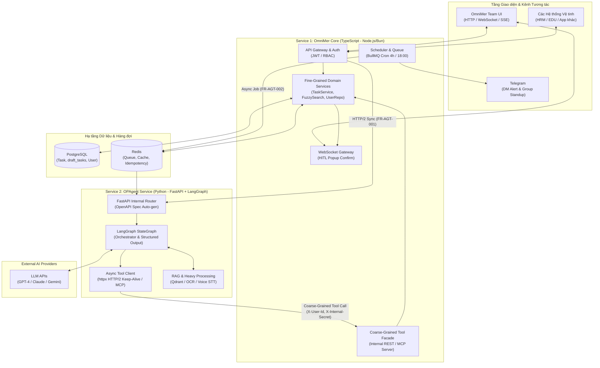
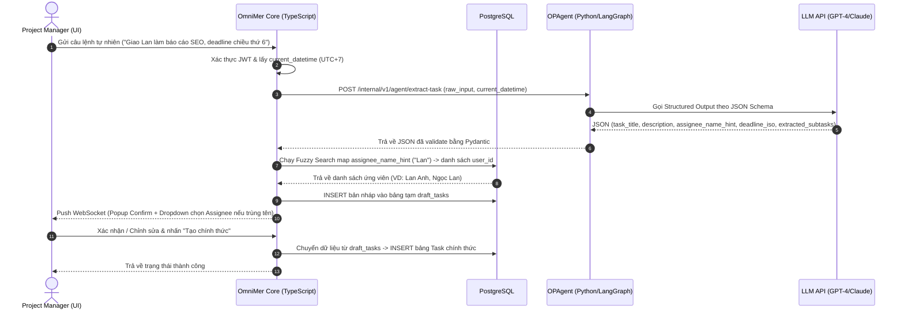
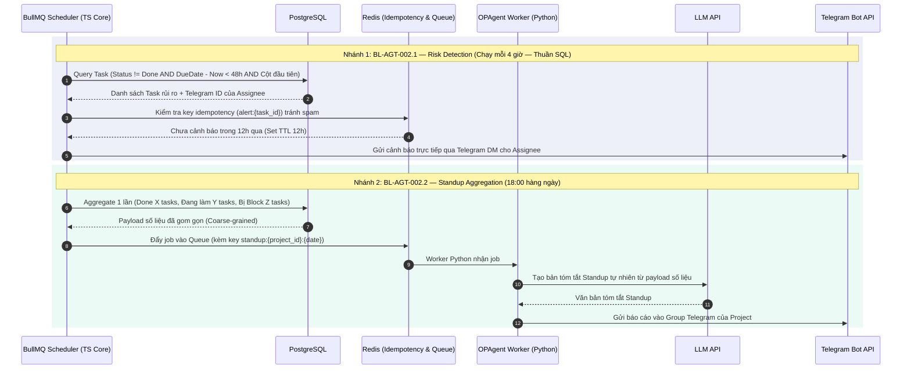
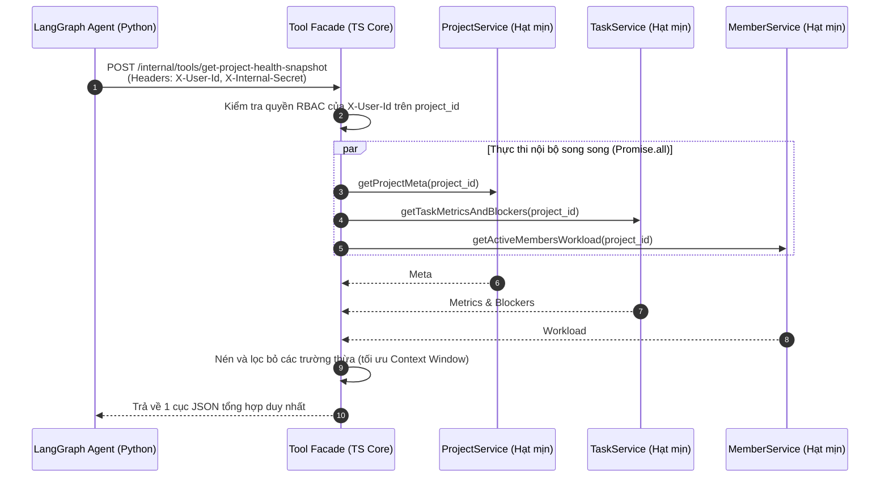

# TÀI LIỆU GIẢI PHÁP KIẾN TRÚC (SOLUTION ARCHITECTURE)

**Hệ thống AI Agent (OPAgent) — Mô hình Python (LangGraph) & TypeScript Coarse-Grained Tools**

> [!NOTE]
> **Cập nhật kiến trúc (2026-11-23):** Một số quyết định hạ tầng và giao thức trong tài liệu gốc này đã được điều chỉnh qua bộ ADR tại [`02_opagent_technology_evaluation_adr.md`](../../../../../backend_otm/opagent_service/docs/architecture/02_opagent_technology_evaluation_adr.md): thay Qdrant bằng `pgvector` trong PostgreSQL Core, thay static header bằng Agent Delegation Token (`EdDSA`), dùng HTTP/1.1 Keep-Alive + SSE thay HTTP/2, và Core trực tiếp gửi thông báo Telegram. Phần thân tài liệu dưới đây sẽ được đồng bộ chi tiết ở Bước 11 của changelog.

---

## 1. Tổng quan & Nguyên tắc Thiết kế

Tài liệu này mô tả giải pháp kiến trúc tách biệt 2 dịch vụ (**OmniMer Core** bằng TypeScript và **OPAgent Service** bằng Python) nhằm phục vụ hệ sinh thái OmniMer Team và các hệ thống vệ tinh.

Kiến trúc tuân thủ 3 nguyên tắc nền tảng:

* **Tách biệt ranh giới dữ liệu (Database-per-Service):** OPAgent Service (Python) chạy ở trạng thái phi trạng thái (stateless) về mặt dữ liệu nghiệp vụ và không truy cập trực tiếp vào cơ sở dữ liệu của OmniMer Core. Mọi thao tác đọc/ghi nghiệp vụ đều đi qua lớp API nội bộ của TypeScript Core để bảo toàn quy tắc phân quyền (RBAC) và tính toàn vẹn dữ liệu.
* **Giao diện Tool dạng hạt thô (Coarse-Grained Remote Facade):** Dựa trên mẫu thiết kế *Remote Facade* (Martin Fowler, *Patterns of Enterprise Application Architecture*), các hàm nghiệp vụ bên trong TypeScript Core vẫn giữ dạng hạt mịn để tái sử dụng, nhưng lớp cổng phơi bày cho AI Agent phải gom nhiều truy vấn thành một điểm gọi duy nhất. Cách này giúp giảm số vòng lặp suy luận của LLM, hạ độ trễ đầu cuối và tiết kiệm token.
* **Ưu tiên mã nguồn tất định (Deterministic First):** Dựa trên hướng dẫn *Building Effective Agents* của Anthropic, các tác vụ có quy tắc rõ ràng (như quét hạn chót bằng SQL) được thực thi hoàn toàn bằng mã nguồn tất định tại Core Service; LLM chỉ được gọi ở các bước cần xử lý ngôn ngữ tự nhiên hoặc tổng hợp thông tin.

---

## 2. Kiến trúc Hệ thống Tổng thể

Sơ đồ dưới đây mô tả ranh giới giữa 2 dịch vụ, các kênh giao tiếp (đồng bộ HTTP/SSE và bất đồng bộ Redis Queue) và cách kết nối tới các hệ thống vệ tinh:

---

## 3. Luồng Xử lý Chi tiết (Sequence Diagrams)

### 3.1. Luồng FR-AGT-001: NLP Text/Voice-to-Task (Human-in-the-Loop)

Luồng này đảm bảo dữ liệu từ AI không bao giờ ghi thẳng vào bảng `Task` chính thức mà đi qua bảng tạm `draft_tasks` để Project Manager xác nhận qua WebSocket. Phần xử lý Fuzzy Search để ánh xạ tên người thực hiện sang `user_id` được giữ tại TypeScript Core để tối ưu tốc độ truy vấn cục bộ.

### 3.2. Luồng FR-AGT-002: Proactive Health Monitor (Tách bạch SQL & AI)

Theo đặc tả kỹ thuật, quy tắc phát hiện rủi ro mỗi 4 giờ hoàn toàn có thể giải quyết bằng truy vấn SQL thuần mà không cần tốn chi phí LLM. Chỉ bước tổng hợp Standup lúc 18:00 hàng ngày mới cần gọi sang OPAgent Service để sinh văn bản tóm tắt.

### 3.3. Luồng Mở rộng: Agent Đa bước gọi Coarse-Grained TS Tools

Khi hệ thống mở rộng sang các bài toán Agent hỏi đáp đa bước trên nhiều hệ thống vệ tinh quanh OmniMer Team, LangGraph sẽ gọi các Tool hạt thô bên TypeScript Core:

---

## 4. Quy chuẩn Thiết kế Tool Dạng Hạt Thô & Hợp đồng API

### 4.1. Tiêu chuẩn phân tách Hạt mịn vs. Hạt thô

| Tiêu chí | Hạt mịn (Chỉ dùng nội bộ TS Core) | Hạt thô (Bắt buộc cho AI Tool Facade) |
| --- | --- | --- |
| **Mục đích** | Tái sử dụng cho CRUD, đơn vị nghiệp vụ nhỏ (`getUser`, `getTask`). | Phục vụ trọn vẹn một ý định/ngữ cảnh của Agent (`getDailyStandupPayload`, `resolveAssigneeCandidates`). |
| **Số lần gọi từ LangGraph** | Nhiều lần nối tiếp $\rightarrow$ phát sinh nhiều vòng lặp suy luận LLM. | 1 lần gọi duy nhất $\rightarrow$ giảm độ trễ từ nhiều giây xuống còn 1 bước suy luận. |
| **Cấu trúc JSON trả về** | Trả toàn bộ cột trong DB (gây nhiễu và tốn Token). | Đã qua lớp DTO lược bỏ metadata thừa (như `created_by_ip`, `updated_at` không cần thiết). |

### 4.2. Đồng bộ Kiểu dữ liệu Tự động (Contract-First)

Để loại bỏ rủi ro lệch schema giữa 2 ngôn ngữ (Python và TypeScript):

1. **Chiều Python $\rightarrow$ TypeScript:** FastAPI tự động sinh file `openapi.json` từ các Pydantic Model (ví dụ schema đầu ra của FR-AGT-001 gồm `task_title`, `description`, `assignee_name_hint`, `deadline_iso`, `extracted_subtasks`). TypeScript chạy lệnh `openapi-typescript` trong pipeline CI/CD để tự động sinh file `schema.d.ts` và HTTP Client có kiểm tra kiểu lúc biên dịch.

2. **Chiều TypeScript $\rightarrow$ Python:** Lớp Tool Facade bên TypeScript sử dụng **Zod** để định nghĩa Input/Output và xuất ra chuẩn **JSON Schema** (hoặc chạy dưới dạng **MCP Server** sử dụng `@modelcontextprotocol/sdk`). LangGraph phía Python nạp trực tiếp danh sách Tool thông qua `langchain-mcp-adapters` mà không cần viết tay lại định nghĩa tool.

---

## 5. Kiến trúc Triển khai, Bảo mật & Chốt chặn Vận hành

### 5.1. Tối ưu Hiệu năng Mạng nội bộ

* **Triển khai cùng mạng nội bộ (Private Docker Network / VPC):** Giữ độ trễ truyền tin giữa 2 service ở mức 1–5ms.
* **Connection Pooling (HTTP/2 Keep-Alive):** Phía Python khởi tạo duy nhất một instance `httpx.AsyncClient(http2=True)` trong vòng đời `lifespan` của FastAPI để tái sử dụng kết nối TCP khi gọi sang TypeScript Tools.
* **Chống nghẽn tài nguyên Python:** Chạy FastAPI với nhiều worker (Uvicorn/Gunicorn) và tách riêng các tác vụ nặng về CPU (như OCR tài liệu hoặc nạp embedding hàng loạt vào Vector DB) sang hàng đợi Redis Worker độc lập với API phục vụ người dùng trực tiếp.

### 5.2. Bảo mật & Chốt chặn An toàn (Guardrails)

* **Zero-Trust đối với tham số từ LLM:** Các thông tin định danh bảo mật (`user_id`, `team_id`, `role`) tuyệt đối không đưa vào schema để LLM tự điền. OmniMer Core trích xuất từ JWT và truyền qua Header nội bộ (`X-User-Id`, `X-Team-Id`, `X-Internal-Secret`). Khi LangGraph gọi ngược Tool sang TS Core, nó bắt buộc đính kèm lại đúng các header này để TS Core kiểm tra RBAC.
* **Giới hạn vòng lặp & Thời gian chờ:**
* Cấu hình `recursion_limit` trong LangGraph (tối đa 5–8 bước) để tránh vòng lặp gọi tool vô hạn.
* Cấu hình Timeout (10–15 giây) và **Circuit Breaker** phía TS Core khi gọi sang Python. Với FR-AGT-001, nếu OPAgent Service quá tải hoặc LLM API lỗi, hệ thống lập tức trả về fallback cho phép PM nhập tay trên form tạo task.

* **Chống gửi lặp thông báo (Idempotency):** Mọi tác vụ định kỳ trong FR-AGT-002 (cảnh báo DM mỗi 4 giờ và Standup lúc 18:00) đều phải kiểm tra khóa định danh trên Redis (`alert:{task_id}` với TTL 12h và `standup:{project_id}:{YYYY-MM-DD}`) để đảm bảo không spam Telegram khi worker thực hiện retry.

---

## 6. Lộ trình Triển khai Đề xuất

1. **Giai đoạn 1 (Nền tảng & FR-AGT-001):** Dựng khung FastAPI + LangGraph (Structured Output) và kết nối đồng bộ với TS Core. Thiết lập cơ chế tự sinh Type (`openapi-typescript`), bảng `draft_tasks`, Fuzzy Search ánh xạ `user_id` và luồng xác nhận WebSocket.

2. **Giai đoạn 2 (Tự động hóa & FR-AGT-002):** Triển khai BullMQ Cron Job tại TS Core cho nhánh quét rủi ro 4 giờ/lần (thuần SQL + Telegram DM) và kết nối Redis Queue đẩy payload tổng hợp lúc 18:00 sang Worker Python để tóm tắt Standup.

3. **Giai đoạn 3 (Mở rộng Đa hệ thống):** Chuẩn hóa lớp `Coarse-Grained Tool Facade` theo chuẩn MCP (Model Context Protocol) để các ứng dụng vệ tinh khác trong hệ sinh thái OmniMer có thể đăng ký Tool mới vào OPAgent mà không phải chỉnh sửa mã nguồn cốt lõi của Python Service.

---

## 7. Tài liệu Tham khảo

* Martin Fowler (2002), *Patterns of Enterprise Application Architecture* — Remote Facade Pattern (Nguyên tắc thiết kế giao diện hạt thô qua biên mạng).
* Anthropic Engineering (2024), *Building Effective Agents* — Phân tách Deterministic Workflows vs. Autonomous Agents và thiết kế Agent-Computer Interface (ACI) cho Tool.
* FastAPI & OpenAPI Specification — Cơ chế tự động sinh hợp đồng API từ Pydantic Models.
* Model Context Protocol (MCP) Specification — Chuẩn kết nối công cụ động giữa AI Agent và hệ thống lõi.