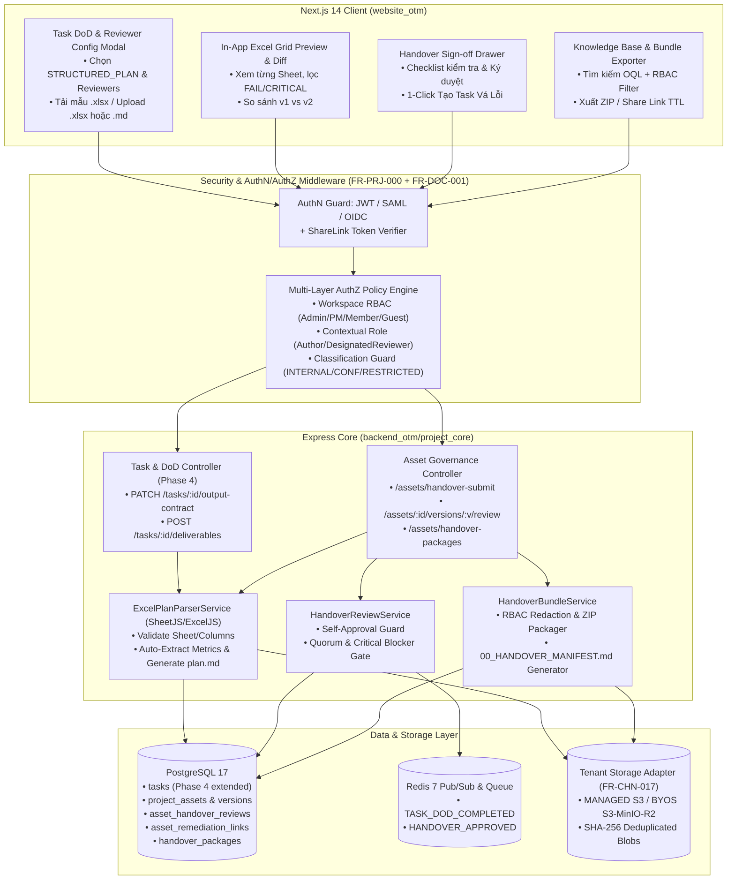
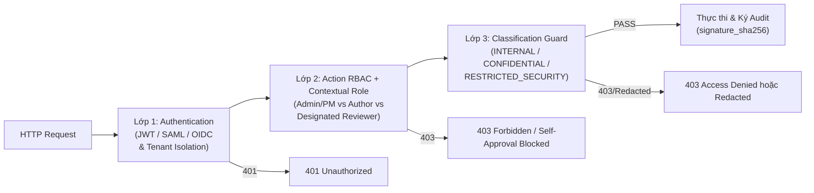

<!--
  name: 01_SRS_ASSET_GOVERNANCE_AND_PLANNING_HANDOVER.md
  description: Software Requirements Specification (SRS) for Automated Asset Governance, Multi-Format Planning Handover (Excel/Markdown), and Multi-Layer Authentication & Authorization Matrix integrated with OmniProject Core Phase 4 (FR-PRJ-008, FR-PRJ-003) and Core Architecture (FR-PRJ-000).
-->

# Software Requirements Specification (SRS) — Asset Governance, Structured Planning Handover & Authorization Matrix (`FR-DOC-001` & `FR-PRJ-008` Sync)

> **Document Name:** `01_SRS_ASSET_GOVERNANCE_AND_PLANNING_HANDOVER`  
> **Reference Standards:** IEEE Std 830-1998 · INVEST · ISO/IEC 25010 · RFC 7807 (Problem Details) · OWASP ASVS (Access Control & Authentication)  
> **Project:** OmniMer Enterprise PMIS (`omnimer_team`)  
> **Scope:** Asset Governance (`FR-DOC-001` v2.1), Strict DoD & Planning Handover Gate (`FR-PRJ-008` Phase 4 Extension), Core RBAC/AuthN Inheritance (`FR-PRJ-000`), BYOS/Managed Storage (`FR-CHN-017`)  
> **RTM Companion:** [`02_RTM_ASSET_GOVERNANCE_AND_PLANNING_HANDOVER.csv`](./02_RTM_ASSET_GOVERNANCE_AND_PLANNING_HANDOVER.csv)  
> **Phase 4 Master Specs:** [`06_SRS_PHASE4A_CORE_AGILE_SCHEDULING_ENGINE.md`](../omniproject_core/phase_4/06_SRS_PHASE4A_CORE_AGILE_SCHEDULING_ENGINE.md) · [`07_RTM_PHASE4A_CORE_AGILE_SCHEDULING_ENGINE.csv`](../omniproject_core/phase_4/07_RTM_PHASE4A_CORE_AGILE_SCHEDULING_ENGINE.csv)  
> **Implementation Changelog:** [`08_asset_governance_and_planning_handover_changelog.md`](../../../../../backend_otm/project_core/docs/change_log/08_asset_governance_and_planning_handover_changelog.md)  
> **Trạng thái:** `APPROVED SPECIFICATION`

---

## 1. Giới Thiệu & Bản Đồ Kế Thừa Liên Phân Hệ (Introduction & Cross-Module Scope)

### 1.1 Mục Đích (Purpose)
Tài liệu này là **Hợp đồng Thiết kế Kỹ thuật & Bảo mật (Engineering & Security Specification Contract)** cho phân hệ **Kho Tri Thức & Bàn Giao Kế Hoạch (`FR-DOC-001`)** và phần mở rộng của phân hệ **Cổng Tiêu Chuẩn Nghiệm Thu Strict DoD (`FR-PRJ-008` - Phase 4)**.  
Mục tiêu trọng tâm gồm 3 trụ cột:
1. **Chuẩn hóa Bàn Giao Đa Định Dạng (Excel `.xlsx` + Markdown `.md`):** Hỗ trợ 7 bộ khung Plan (`TEST_PLAN`, `PENTEST_PLAN`, `ARCH_TECHNICAL_PLAN`, `RELEASE_HANDOVER_PLAN`, `SPRINT_ITERATION_PLAN`, `MIGRATION_PLAN`, `INCIDENT_RESPONSE_PLAN`) với khả năng tự động parse sheet/cột Excel, bóc tách chỉ số thực tế và đồng bộ truy vết sang Task vá lỗi.
2. **Mở rộng Cổng DoD Phase 4 (`FR-PRJ-008` & `FR-PRJ-003`):** Kế thừa toàn bộ cơ chế khóa chuyển trạng thái `DONE` của Phase 4A (`BL-PRJ-008.1..008.4`), bổ sung chế độ `STRUCTURED_PLAN` và cổng nghiệm thu linh hoạt ngay trên Task (`designated_reviewer_ids[]`, `handover_approval_policy`).
3. **Ma Trận Xác Thực & Phân Quyền Đa Tầng (Multi-Layer Authentication & Authorization Matrix):** Kế thừa mô hình RBAC 4 cấp (`Admin`, `PM`, `Team Member`, `Guest`) và Xác thực JWT/SAML 2.0/OIDC từ [`FR-PRJ-000`](../omniproject_core/phase_1/FR-PRJ-000_core_technical_architecture.md), bổ sung tầng **Vai trò Ngữ cảnh trên Task/Handover** (`Task Owner`, `Asset Author`, `Designated Reviewer`, `Non-Reviewer Member`) kết hợp **3 Tầng Độ Mật Tài Sản** (`INTERNAL`, `CONFIDENTIAL`, `RESTRICTED_SECURITY`) để chống rò rỉ dữ liệu nhạy cảm (đặc biệt là `PENTEST_PLAN` và `INCIDENT_RESPONSE_PLAN`) và chống tự duyệt (Self-Approval).

### 1.2 Bảng Ánh Xạ Truy Vết Liên Phân Hệ (Cross-Module Traceability)

| Phân Hệ / Mã FR | Tài Liệu Nguồn | Vai Trò & Dữ Liệu Kế Thừa / Đồng Bộ |
| :--- | :--- | :--- |
| **Core Architecture & RBAC** (`FR-PRJ-000`) | [`FR-PRJ-000_core_technical_architecture.md`](../omniproject_core/phase_1/FR-PRJ-000_core_technical_architecture.md) | Kế thừa JWT (15m/30d HttpOnly), SAML 2.0, OIDC PKCE, RBAC 4 cấp (`Admin`, `PM`, `Team Member`, `Guest`), OCC `version`, và Rate Limiting. |
| **Strict DoD Gate - Phase 4** (`FR-PRJ-008`) | [`FR-PRJ-008_strict_dod_output.md`](../omniproject_core/phase_4/FR-PRJ-008_strict_dod_output.md) | Mở rộng `OutputContractType` thêm `STRUCTURED_PLAN`; bổ sung `requiredPlanType`, `designatedReviewerIds[]`, `handoverApprovalPolicy` lên `Task` và quy tắc `BL-PRJ-008.5`. |
| **Dependency Gate - Phase 4** (`FR-PRJ-003`) | [`FR-PRJ-003_dependency_critical_path.md`](../omniproject_core/phase_4/FR-PRJ-003_dependency_critical_path.md) | Khóa các Task hậu nhiệm (`FS`) trỏ tới Task Plan cho đến khi Asset đạt `APPROVED_BASELINE` và Task tiền nhiệm chuyển `DONE`. |
| **Asset Governance** (`FR-DOC-001.1..6`) | [`FR-DOC-001_automated_asset_governance.md`](./FR-DOC-001_automated_asset_governance.md) | Lưu trữ phiên bản bất biến `.xlsx`/`.md`, Excel Parser, Nghiệm thu đa chiều, Truy vết Finding-to-Task, Phân quyền 3 tầng, Đóng gói bàn giao `.zip` + `00_HANDOVER_MANIFEST.md`. |
| **Tenant Storage BYOS** (`FR-CHN-017`) | [`FR-CHN-017_tenant_storage_byos_and_archival.md`](../omnichannel/phase_3/FR-CHN-017_tenant_storage_byos_and_archival.md) | Tái sử dụng `StorageAdapterInterface` (`MANAGED` / `BYOS`), khóa băm nội dung SHA-256 và đường dẫn lưu trữ cô lập theo `tenant_id` / `workspace_id`. |

---

## 2. Kiến Trúc Hệ Thống & Mô Hình Dữ Liệu Prisma (Architecture & Data Schema)

### 2.1 Sơ Đồ Kiến Trúc Tổng Thể (System Topology)



### 2.2 Prisma Schema Đầy Đủ (Mở Rộng Phase 4 `Task` & Hệ Thống `Asset Governance`)

```prisma
// ==========================================
// 1. ENUMS MỞ RỘNG CHO PHASE 4 (FR-PRJ-008) & FR-DOC-001
// ==========================================

enum OutputContractType {
  NONE
  URL_LINK
  FILE_UPLOAD
  MERGE_REQUEST
  STRUCTURED_PLAN // Mở rộng Phase 4 cho FR-DOC-001 v2.1
}

enum PlanBlueprintType {
  TEST_PLAN
  PENTEST_PLAN
  ARCH_TECHNICAL_PLAN
  RELEASE_HANDOVER_PLAN
  SPRINT_ITERATION_PLAN
  MIGRATION_PLAN
  INCIDENT_RESPONSE_PLAN
}

enum ContentFormatMode {
  EXCEL_WORKBOOK
  MARKDOWN_DOC
  HYBRID_PACKAGE
}

enum SecurityClassification {
  INTERNAL
  CONFIDENTIAL
  RESTRICTED_SECURITY
}

enum AssetHandoverStatus {
  DRAFT
  PENDING_HANDOVER_REVIEW
  CHANGES_REQUESTED
  APPROVED_BASELINE
  SUPERSEDED
}

enum HandoverApprovalPolicy {
  NONE
  ANY_ONE
  ALL_REQUIRED
}

enum ReviewDecision {
  PENDING
  APPROVED
  CHANGES_REQUESTED
}

enum RemediationStatus {
  OPEN
  IN_PROGRESS
  TASK_DONE_AWAITING_RETEST
  VERIFIED_FIXED
  RISK_ACCEPTED
}

enum AssetSourceType {
  TASK
  OMNICHANNEL_ARCHIVE
  DIRECT_UPLOAD
}

enum AssetCategory {
  PLAN_BLUEPRINT
  DELIVERABLE
  CHAT_ARCHIVE
  REFERENCE_DOC
}

enum BundlePurpose {
  ONBOARDING_NEW_HIRE
  PHASE_SIGN_OFF
  QA_SECURITY_AUDIT
  OPS_HANDOVER
}

enum TargetAudienceRole {
  NEW_HIRE_MEMBER
  PM_LEAD
  EXTERNAL_AUDITOR
  TENANT_ADMIN
}

enum BundleExportMode {
  WEB_LINK
  ZIP_ARCHIVE
}

// ==========================================
// 2. CẬP NHẬT MODEL TASK THUỘC PHASE 4 (FR-PRJ-008)
// ==========================================

model Task {
  // ... giữ nguyên toàn bộ các trường hiện có từ Phase 1 -> Phase 4A ...

  // Mở rộng Strict DoD & Handover Reviewer (FR-PRJ-008 + FR-DOC-001)
  outputContractType     OutputContractType     @default(NONE) @map("output_contract_type")
  requiredPlanType       PlanBlueprintType?     @map("required_plan_type")
  designatedReviewerIds  String[]               @default([]) @map("designated_reviewer_ids") @db.Uuid
  handoverApprovalPolicy HandoverApprovalPolicy @default(NONE) @map("handover_approval_policy")
  outputDeliverable      Json?                  @map("output_deliverable")

  generatedAssets        ProjectAsset[]         @relation("TaskGeneratedAssets")
  remediationLinks       AssetRemediationLink[] @relation("RemediationTasks")
}

// ==========================================
// 3. CÁC MODEL THUỘC PHÂN HỆ ASSET GOVERNANCE (FR-DOC-001)
// ==========================================

model ProjectAsset {
  id                   String                 @id @default(dbgenerated("gen_random_uuid()")) @db.Uuid
  workspaceId          String                 @map("workspace_id") @db.Uuid
  projectId            String                 @map("project_id") @db.Uuid
  title                String                 @db.VarChar(255)
  sourceType           AssetSourceType        @map("source_type")
  sourceTaskId         String?                @map("source_task_id") @db.Uuid
  sourceArchiveId      String?                @map("source_archive_id") @db.Uuid
  sourceConversationId String?                @map("source_conversation_id") @db.Uuid
  assetCategory        AssetCategory          @map("asset_category")
  assetType            String                 @map("asset_type") @db.VarChar(64)
  contentFormatMode    ContentFormatMode      @default(MARKDOWN_DOC) @map("content_format_mode")
  classification       SecurityClassification @default(INTERNAL)
  handoverStatus       AssetHandoverStatus    @default(DRAFT) @map("handover_status")
  currentVersion       Int                    @default(1) @map("current_version")
  approvalPolicy       HandoverApprovalPolicy @default(NONE) @map("approval_policy")
  planMetadata         Json?                  @map("plan_metadata")
  authorId             String                 @map("author_id") @db.Uuid
  storageModeUsed      String                 @map("storage_mode_used") @db.VarChar(20)
  storageBucketRef     String                 @map("storage_bucket_ref") @db.VarChar(255)
  latestStorageKey     String?                @map("latest_storage_key") @db.VarChar(500)
  latestSha256         String?                @map("latest_sha256") @db.Char(64)
  externalUrl          String?                @map("external_url") @db.VarChar(1000)
  idempotencyKey       String?                @map("idempotency_key") @db.VarChar(150)
  createdAt            DateTime               @default(now()) @map("created_at")
  updatedAt            DateTime               @updatedAt @map("updated_at")

  sourceTask           Task?                  @relation("TaskGeneratedAssets", fields: [sourceTaskId], references: [id], onDelete: SetNull)
  versions             ProjectAssetVersion[]
  reviews              AssetHandoverReview[]
  remediationLinks     AssetRemediationLink[]

  @@unique([workspaceId, idempotencyKey])
  @@index([workspaceId, projectId, classification])
  @@index([projectId, assetType, handoverStatus])
  @@index([sourceTaskId])
  @@map("project_assets")
}

model ProjectAssetVersion {
  id                        String              @id @default(dbgenerated("gen_random_uuid()")) @db.Uuid
  assetId                   String              @map("asset_id") @db.Uuid
  versionNumber             Int                 @map("version_number")
  versionStatus             AssetHandoverStatus @map("version_status")
  primaryWorkbookStorageKey String?             @map("primary_workbook_storage_key") @db.VarChar(500)
  primaryWorkbookSha256     String?             @map("primary_workbook_sha256") @db.Char(64)
  markdownStorageKey        String?             @map("markdown_storage_key") @db.VarChar(500)
  markdownSha256            String?             @map("markdown_sha256") @db.Char(64)
  parsedSheetSummary        Json?               @map("parsed_sheet_summary")
  attachmentsManifest       Json?               @map("attachments_manifest")
  planSnapshotMetadata      Json?               @map("plan_snapshot_metadata")
  changeSummary             String?             @map("change_summary") @db.Text
  submittedBy               String              @map("submitted_by") @db.Uuid
  createdAt                 DateTime            @default(now()) @map("created_at")

  asset                     ProjectAsset        @relation(fields: [assetId], references: [id], onDelete: Cascade)

  @@unique([assetId, versionNumber])
  @@index([assetId])
  @@map("project_asset_versions")
}

model AssetHandoverReview {
  id                String         @id @default(dbgenerated("gen_random_uuid()")) @db.Uuid
  assetId           String         @map("asset_id") @db.Uuid
  versionNumber     Int            @map("version_number")
  reviewerId        String         @map("reviewer_id") @db.Uuid
  roleContext       String?        @map("role_context") @db.VarChar(100)
  decision          ReviewDecision @default(PENDING)
  checklistVerified Json?          @map("checklist_verified")
  reviewComment     String?        @map("review_comment") @db.Text
  signatureSha256   String?        @map("signature_sha256") @db.Char(64)
  signedAt          DateTime?      @map("signed_at")
  createdAt         DateTime       @default(now()) @map("created_at")

  asset             ProjectAsset   @relation(fields: [assetId], references: [id], onDelete: Cascade)

  @@unique([assetId, versionNumber, reviewerId])
  @@index([reviewerId, decision])
  @@map("asset_handover_reviews")
}

model AssetRemediationLink {
  id                 String            @id @default(dbgenerated("gen_random_uuid()")) @db.Uuid
  assetId            String            @map("asset_id") @db.Uuid
  findingRefCode     String            @map("finding_ref_code") @db.VarChar(50)
  findingTitle       String            @map("finding_title") @db.VarChar(255)
  sourceSheetName    String?           @map("source_sheet_name") @db.VarChar(100)
  sourceRowNumber    Int?              @map("source_row_number")
  severity           String            @db.VarChar(20) // CRITICAL | HIGH | MEDIUM | LOW | INFO
  linkedTaskId       String            @map("linked_task_id") @db.Uuid
  verificationStatus RemediationStatus @default(OPEN) @map("verification_status")
  riskWaiverReason   String?           @map("risk_waiver_reason") @db.Text
  riskAcceptedBy     String?           @map("risk_accepted_by") @db.Uuid
  updatedAt          DateTime          @updatedAt @map("updated_at")

  asset              ProjectAsset      @relation(fields: [assetId], references: [id], onDelete: Cascade)
  linkedTask         Task              @relation("RemediationTasks", fields: [linkedTaskId], references: [id], onDelete: Cascade)

  @@unique([assetId, findingRefCode, linkedTaskId])
  @@index([linkedTaskId])
  @@map("asset_remediation_links")
}

model HandoverPackage {
  id                 String             @id @default(dbgenerated("gen_random_uuid()")) @db.Uuid
  workspaceId        String             @map("workspace_id") @db.Uuid
  projectId          String             @map("project_id") @db.Uuid
  bundleName         String             @map("bundle_name") @db.VarChar(255)
  bundlePurpose      BundlePurpose      @map("bundle_purpose")
  targetAudienceRole TargetAudienceRole @map("target_audience_role")
  includedAssetIds   String[]           @map("included_asset_ids") @db.Uuid
  redactedAssetIds   String[]           @default([]) @map("redacted_asset_ids") @db.Uuid
  exportMode         BundleExportMode   @map("export_mode")
  zipStorageKey      String?            @map("zip_storage_key") @db.VarChar(500)
  manifestSha256     String?            @map("manifest_sha256") @db.Char(64)
  shareTokenHash     String?            @map("share_token_hash") @db.Char(64)
  expiresAt          DateTime?          @map("expires_at")
  createdBy          String             @map("created_by") @db.Uuid
  createdAt          DateTime           @default(now()) @map("created_at")

  @@index([workspaceId, projectId])
  @@index([shareTokenHash])
  @@map("handover_packages")
}
```

---

## 3. Ma Trận Xác Thực & Phân Quyền Đa Tầng (Multi-Layer Authentication & Authorization Matrix)

Hệ thống bảo mật của Kho Tri Thức (`FR-DOC-001`) và Cổng DoD Phase 4 (`FR-PRJ-008`) áp dụng mô hình **3 lớp kiểm soát nối tiếp (Defense-in-Depth)** để đảm bảo không thể giả mạo chữ ký nghiệm thu, không tự duyệt bài của mình và không rò rỉ tài liệu Pentest/Incident nhạy cảm.



### 3.1 Lớp 1 — Cơ Chế Xác Thực Danh Tính & Chứng Thực Chữ Ký (Authentication Layer — Kế thừa `FR-PRJ-000`)

| Cơ Chế Xác Thực | Đối Tượng Áp Dụng | Cơ Chế Kỹ Thuật & Ràng Buộc Bảo Mật |
| :--- | :--- | :--- |
| **Session JWT (`HttpOnly` Cookie)** | Toàn bộ User đăng nhập Email/Password | Kế thừa `FR-PRJ-000`: Access Token `15 phút`, Refresh Token `30 ngày`. Mọi API đọc/ghi Asset bắt buộc trích xuất `userId`, `workspaceId`, `workspaceRole` từ verified JWT payload (chống giả mạo `workspaceId` qua header/body — IDOR Guard). |
| **Enterprise SSO (SAML 2.0 / OIDC PKCE)** | Doanh nghiệp bật SSO Enforced | Kế thừa `BR-PRJ-000-SSO.1`: Nếu Workspace bật SSO Enforced, chặn đăng nhập mật khẩu thường khi truy cập tài liệu `CONFIDENTIAL` / `RESTRICTED_SECURITY`. |
| **Cryptographic Sign-off Proof (`signature_sha256`)** | Hành động `APPROVE` Plan & `RISK_ACCEPTED` | Khi Reviewer ký nghiệm thu hoặc PM ký miễn trừ rủi ro, Backend bắt buộc tính mã chứng thực chống chối bỏ:<br/>`SHA256(asset_id \| version_number \| primary_file_sha256 \| reviewer_user_id \| jwt_jti \| signed_at_iso)` và lưu kèm Audit Log bất biến. |
| **Scoped Share-Link Token (`share_token_hash`)** | Gói Bàn Giao (`WEB_LINK` Export) | Token ngẫu nhiên `256-bit` chỉ lưu bản băm `SHA-256` trong `handover_packages.share_token_hash`. Bắt buộc kiểm tra `expires_at > NOW()`, `workspace.status == ACTIVE`, và áp dụng bộ lọc `redacted_asset_ids[]` trước khi trả dữ liệu. |

### 3.2 Lớp 2 — Ma Trận Phân Quyền Hành Động (Workspace RBAC × Contextual Task/Handover Roles)

**Chú thích Vai trò Kế thừa & Mở rộng:**
* **Workspace Roles (từ `FR-PRJ-000`):** `Tenant Admin` (Org/Workspace Owner), `PM` (Project Manager), `Team Member`, `Guest (Client)`.
* **Contextual Handover Roles (mở rộng trên Task/Asset):**
  * **`Task Owner`:** Người chịu trách nhiệm cuối cùng trên Task (`FR-PRJ-007.1`).
  * **`Author / Assignee`:** Người trực tiếp tạo/nộp phiên bản Plan (`project_assets.author_id` hoặc `task.assignee_id`).
  * **`Designated Reviewer`:** Thành viên nằm trong `task.designated_reviewer_ids[]` (có thể là QA Lead, SecLead, Tech Lead, PM).
  * **`Non-Reviewer Member`:** Thành viên cùng Project nhưng không phải Author và không nằm trong `designated_reviewer_ids[]`.

| Nhóm | Mã Quyền | Hành Động (Action) | Tenant Admin | PM / Task Owner | Author (Task Assignee) | Designated Reviewer *(gán trên Task)* | Other Member *(Non-Reviewer)* | Guest / Client | Điều Kiện Guard & Ghi Chú Nghiệp Vụ |
| :---: | :--- | :--- | :---: | :---: | :---: | :---: | :---: | :---: | :--- |
| **DoD & Config** | `AUTH-DOD-01` | Thiết lập / Sửa `output_contract_type = STRUCTURED_PLAN` & `required_plan_type` | ✅ | ✅ | ❌ | ❌ | ❌ | ❌ | `FR-PRJ-008.1`: Chỉ Admin/PM hoặc Task Owner được khóa chuẩn đầu ra (chống Dev tự hạ chuẩn DoD). |
| **DoD & Config** | `AUTH-DOD-02` | Cấu hình / Thay đổi `designated_reviewer_ids[]` & `handover_approval_policy` trên Task | ✅ | ✅ | ❌ | ❌ | ❌ | ❌ | Chặn Member tự gỡ Reviewer để vượt cổng nghiệm thu (`HTTP 403`). |
| **DoD & Config** | `AUTH-DOD-03` | Tải mẫu biểu `.xlsx` / Markdown Blueprint chuẩn (`templates/:planType.xlsx`) | ✅ | ✅ | ✅ | ✅ | ✅ | ❌ | Mọi thành viên nội bộ thuộc Project `ACTIVE` đều được tải mẫu chuẩn. |
| **Submit** | `AUTH-SUB-01` | Nộp mới / Nộp lại (`vN+1`) Plan (`.xlsx`/`.md`) qua cổng DoD của Task | ✅ | ✅ | ✅ *(Task của mình)* | ❌ *(Trừ khi đồng thời là Assignee)* | ❌ | ❌ | `BL-PRJ-008.2`: Chạy `ExcelParser` / `PlanSchemaValidator`. Chặn nếu Project `ARCHIVED`. |
| **Submit** | `AUTH-SUB-02` | Upload trực tiếp tài liệu tham khảo (không qua Task) vào Knowledge Base | ✅ | ✅ | ✅ *(Tạo mới)* | ✅ | ✅ | ❌ | Tự động gắn `source_type = DIRECT_UPLOAD`. Không áp dụng cho Task DoD bắt buộc. |
| **Submit** | `AUTH-SUB-03` | Xóa bản nháp (`DRAFT`) hoặc đưa Asset vào Thùng rác | ✅ | ✅ | ✅ *(Chỉ bản `DRAFT` do mình tạo)* | ❌ | ❌ | ❌ | Cấm xóa các phiên bản đã vào `PENDING_HANDOVER_REVIEW` hoặc `APPROVED_BASELINE` (tính bất biến). |
| **Sign-off** | `AUTH-REV-01` | Xem In-App Excel Grid Preview & So sánh Version Diff (`v1` vs `v2`) | ✅ | ✅ | ✅ *(Bản của mình)* | ✅ | 🟡 *(Theo Classification)* | 🟡 *(Chỉ gói Share)* | Phải vượt qua Lớp 3 (Classification Guard) nếu là `RESTRICTED_SECURITY`. |
| **Sign-off** | `AUTH-REV-02` | Ký Nghiệm Thu (`APPROVE`) hoặc Yêu cầu Sửa (`CHANGES_REQUESTED`) cho phiên bản `vN` | 🟡 *(Nếu nằm trong Reviewer List hoặc Override khẩn)* | 🟡 *(Nếu nằm trong Reviewer List)* | ❌ **CẤM TỰ DUYỆT** | ✅ *(Bắt buộc thuộc `designated_reviewer_ids[]`)* | ❌ | ❌ | **Self-Approval Prohibition (`BL-DOC-001.5`):** Nếu `currentUser.id == asset.authorId` → `403 SELF_APPROVAL_PROHIBITED` (trừ Workspace 1 người duy nhất). |
| **Sign-off** | `AUTH-REV-03` | Kéo / Chuyển Task có `STRUCTURED_PLAN` sang cột `DONE` | 🟡 *(Chỉ sau khi `APPROVED_BASELINE`)* | 🟡 *(Chỉ sau khi `APPROVED_BASELINE`)* | 🟡 *(Chỉ sau khi `APPROVED_BASELINE`)* | ❌ | ❌ | ❌ | `BL-PRJ-008.5`: Chặn hoàn toàn nếu chưa đạt `APPROVED_BASELINE` (`403 HANDOVER_SIGNOFF_REQUIRED`). |
| **Trace** | `AUTH-REM-01` | Tạo / Gắn liên kết Bug/Remediation Task từ dòng lỗi Excel (`asset_remediation_links`) | ✅ | ✅ | ✅ *(Plan của mình)* | ✅ | ❌ | ❌ | Cho phép Reviewer hoặc Author tách nhanh Bug Task từ dòng `FAIL`/`CRITICAL`. |
| **Trace** | `AUTH-REM-02` | Xác nhận `VERIFIED_FIXED` cho Finding sau khi Task vá lỗi đã `DONE` | ✅ | ✅ | 🟡 *(Nếu là QA/SecOps tác giả bản Retest)* | ✅ | ❌ | ❌ | Member không liên quan không được tự tick `VERIFIED_FIXED`. |
| **Trace** | `AUTH-REM-03` | Ký Miễn Trừ Rủi Ro (`RISK_ACCEPTED`) để vượt qua Finding `CRITICAL`/`HIGH` chưa vá | ✅ | ✅ *(Cần lý do Audit)* | ❌ | ❌ | ❌ | ❌ | `BL-DOC-001.7`: Bắt buộc nhập `risk_waiver_reason` và ghi Audit Log cấp Org. |
| **Security** | `AUTH-CLS-01` | Nâng cấp Độ Mật tài liệu (VD: `INTERNAL` → `CONFIDENTIAL` / `RESTRICTED_SECURITY`) | ✅ | ✅ | ✅ *(Khi mới tạo)* | ✅ | ❌ | ❌ | Nâng độ mật luôn được khuyến khích nhằm bảo vệ thông tin. |
| **Security** | `AUTH-CLS-02` | Hạ cấp Độ Mật tài liệu (VD: `RESTRICTED_SECURITY` → `INTERNAL`) | ✅ | ✅ *(Kèm Audit Reason)* | ❌ | ❌ | ❌ | ❌ | `BL-DOC-001.4`: Cấm Author hoặc Member tự ý hạ độ mật báo cáo Pentest/Incident. |
| **Export** | `AUTH-EXP-01` | Tạo & Xuất Gói Bàn Giao (`handover_packages` — Link TTL hoặc `.zip`) | ✅ | ✅ | ❌ | ❌ | ❌ | ❌ | `BL-DOC-001.9`: Hệ thống tự động áp dụng Redaction theo `target_audience_role`. |
| **Export** | `AUTH-EXP-02` | Thu hồi (Revoke) Link chia sẻ Gói Bàn Giao trước hạn TTL | ✅ | ✅ *(Gói mình tạo hoặc trong Project)* | ❌ | ❌ | ❌ | ❌ | Link bị revoke lập tức trả về `HTTP 410 Gone` / `403`. |

### 3.3 Lớp 3 — Ma Trận Độ Mật 3 Tầng & Quy Tắc Che Giấu Tự Động (3-Tier Classification & Redaction Matrix)

Ngay cả khi User đã vượt qua Lớp 1 (JWT hợp lệ) và thuộc Project (`project_members`), dữ liệu trả về vẫn bị lọc chặt chẽ theo cột `project_assets.classification`:

| Mức Độ Mật (`classification`) | Loại Plan Áp Dụng Mặc Định | Tenant Admin / PM của Project | Author & Designated Reviewers của Asset đó | Project Member Khác *(Non-Reviewer)* | Guest / Client & Gói `ONBOARDING_NEW_HIRE` |
| :--- | :--- | :---: | :---: | :---: | :---: |
| **`INTERNAL`** | `TEST_PLAN`, `ARCH_TECHNICAL_PLAN`, `SPRINT_ITERATION_PLAN`, `FRD_DOC`, `CODE_PR` | **Full Access** *(Xem, Search, Grid Preview, Tải `.xlsx`/`.md`, Xuất Bundle)* | **Full Access** | **Read & Search** *(Xem, Grid Preview, Tải bản đọc; Không được sửa/xóa)* | **Scoped Read** *(Chỉ xem nếu PM đưa vào Handover Bundle được cấp quyền)* |
| **`CONFIDENTIAL`** | `RELEASE_HANDOVER_PLAN`, `MIGRATION_PLAN` | **Full Access** | **Full Access** | **Restricted Read / Metadata Only** *(Thấy tên & trạng thái Sign-off; Chỉ tải file nếu được PM cấp quyền hoặc thuộc đội Ops)* | **Excluded by Default** *(Bị loại khỏi gói Onboarding New Hire trừ khi chỉ định `OPS_HANDOVER` / `PHASE_SIGN_OFF`)* |
| **`RESTRICTED_SECURITY`** | `PENTEST_PLAN`, `INCIDENT_RESPONSE_PLAN` *(Cưỡng bức mặc định theo `BL-DOC-001.4`)* | **Full Access** *(Có Audit Log mọi lượt xem & tải)* | **Full Access** *(Có Audit Log mọi lượt xem & tải)* | **HIDDEN (`403` / Không xuất hiện trong Search Results)** | **AUTO-REDACTED** *(Bị loại bỏ khỏi ZIP/Web Link và ghi `[REDACTED: RESTRICTED_SECURITY]` trong `00_HANDOVER_MANIFEST.md`)* |

---

## 4. Đặc Tả Thuật Toán & Quy Tắc Vận Hành Cốt Lõi

### 4.1 Thuật Toán Parse Excel & Anti-Fake Metrics (`BL-DOC-001.3a`)
1. Khi nhận multipart upload `.xlsx`/`.csv`, `ExcelPlanParserService` đọc workbook bằng stream (giới hạn kích thước file theo cấu hình Tenant, mặc định tối đa `50MB`, tối đa `20,000` dòng mỗi workbook để chống DoS memory exhaustion).
2. Đối chiếu tên Sheet và các cột Header bắt buộc theo `required_plan_type` (không phân biệt khoảng trắng thừa ở header, kiểm tra strict từng cột bắt buộc). Nếu thiếu Sheet/Cột hoặc sheet dữ liệu chính có `0` dòng hợp lệ $\rightarrow$ trả về `HTTP 422 Unprocessable Entity` (`EXCEL_TEMPLATE_INVALID`) kèm mảng JSON `missingSheets[]`, `missingColumns[]`.
3. Tự động quét từng dòng để tính `planMetadata` (bỏ qua giá trị gõ tay nếu mâu thuẫn với công thức tổng hợp) và xây dựng `parsedSheetSummary` (lưu tối đa 500 dòng preview đầu hoặc phân trang qua cache để render In-App Data Grid).
4. Tự động tìm các dòng có `Status == 'FAIL'` (với `TEST_PLAN`) hoặc `Severity IN ('CRITICAL', 'HIGH')` (với `PENTEST_PLAN`), lưu tọa độ `(sourceSheetName, sourceRowNumber)` để đồng bộ `asset_remediation_links`.
5. Tự động render `plan.md` có YAML Frontmatter + bảng tóm tắt các dòng lỗi, tính `SHA-256` cho cả file `.xlsx` gốc và `plan.md`, ghi nguyên tử lên Tenant Storage (`MANAGED`/`BYOS`).

### 4.2 Máy Trạng Thái Nghiệm Thu & Cổng Chặn Phase 4 (`BL-DOC-001.5`, `BL-DOC-001.6`, `BL-PRJ-008.5`)
1. Khi Task có `outputContractType = STRUCTURED_PLAN` nhận file qua `POST /tasks/:id/deliverables` hoặc `POST /assets/handover-submit`:
   - Kiểm tra `task.designatedReviewerIds.length >= 1` và `task.handoverApprovalPolicy != NONE` (nếu thiếu cấu hình Reviewer cho Plan bắt buộc duyệt $\rightarrow$ yêu cầu PM cấu hình hoặc fallback về danh sách `PM` của Project).
   - Tạo `ProjectAssetVersion` (`vN`) với trạng thái `PENDING_HANDOVER_REVIEW`.
   - Khởi tạo bản ghi `AssetHandoverReview` (`decision = PENDING`) cho từng `reviewerId` trong `task.designatedReviewerIds`.
   - Tự động chuyển `Task` sang trạng thái thuộc Meta-Status `IN_REVIEW` (nếu Project có cột `IN_REVIEW`) và **khóa** chuyển vào `DONE`.
2. Khi một Reviewer gọi API ký duyệt:
   - Kiểm tra `currentUser.id IN assetReviews.reviewerIds` (hoặc Admin Override có ghi nhận).
   - Kiểm tra **Chống Tự Duyệt (`Self-Approval Guard`)**: Nếu `currentUser.id == version.submittedBy` VÀ Workspace có $> 1$ thành viên active $\rightarrow$ `HTTP 403 SELF_APPROVAL_PROHIBITED`.
   - Nếu `decision == APPROVED`: Kiểm tra tất cả `AssetRemediationLink` có `severity IN ('CRITICAL', 'HIGH')`. Nếu tồn tại liên kết chưa `VERIFIED_FIXED` và chưa `RISK_ACCEPTED` khi chuẩn bị chốt trạng thái cuối cùng (`APPROVED_BASELINE`) $\rightarrow$ `HTTP 409 UNRESOLVED_CRITICAL_FINDINGS`.
   - Đánh giá **Quorum Policy**:
     - `ANY_ONE`: Chỉ cần $\ge 1$ Reviewer `APPROVED` (và 0 `CHANGES_REQUESTED` đang mở).
     - `ALL_REQUIRED`: 100% Reviewer được chỉ định có `decision == APPROVED`.
   - Khi đạt Quorum: Cập nhật `versionStatus = APPROVED_BASELINE`, phiên bản baseline cũ (nếu có) thành `SUPERSEDED`, phát sự kiện `HANDOVER_APPROVED` qua Redis Pub/Sub, tự động cập nhật Task nguồn sang `DONE` (hoặc mở khóa cho phép chuyển `DONE`) và mở khóa các Task hậu nhiệm `FS` (`FR-PRJ-003`).

---

## 5. Đặc Tả Giao Diện Lập Trình (REST API Contracts & Error Catalog)

### 5.1 Bảng Tổng Hợp 12 Endpoints Chính

| Nhóm | Method | Endpoint Path | Lớp Quyền (AuthZ Code) | Mô Tả Tóm Tắt |
| :--- | :---: | :--- | :--- | :--- |
| **DoD Config** | `PATCH` | `/api/v1/tasks/:taskId/output-contract` | `AUTH-DOD-01`, `AUTH-DOD-02` (`Admin`, `PM`, `Owner`) | Cấu hình `outputContractType`, `requiredPlanType`, `designatedReviewerIds[]`, `handoverApprovalPolicy` |
| **Templates** | `GET` | `/api/v1/assets/templates/:planType.xlsx` | `AUTH-DOD-03` (`Member+`) | Tải file mẫu Excel `.xlsx` chuẩn cho 1 trong 7 loại Plan |
| **Submit** | `POST` | `/api/v1/tasks/:taskId/deliverables` | `AUTH-SUB-01` (`Assignee`, `PM`, `Admin`) | Nộp đầu ra DoD cho Task (hỗ trợ URL, File, PR, hoặc `STRUCTURED_PLAN` `.xlsx`/`.md`) |
| **Submit** | `POST` | `/api/v1/assets/handover-submit` | `AUTH-SUB-01`, `AUTH-SUB-02` (`Member+`) | Nộp phiên bản mới `v(N+1)` cho Plan Asset đang ở `CHANGES_REQUESTED` hoặc upload trực tiếp |
| **Read/Search** | `GET` | `/api/v1/projects/:projectId/assets` | `AUTH-REV-01` + **Lớp 3 Classification Filter** | Tìm kiếm đa chiều (OQL, Full-text, lọc theo `assetType`, `handoverStatus`, `classification`) |
| **Preview/Diff** | `GET` | `/api/v1/assets/:assetId/versions/:version/preview` | `AUTH-REV-01` + **Lớp 3 Classification Guard** | Lấy In-App Excel Grid Preview (`parsedSheetSummary`) và dữ liệu Version Diff |
| **Sign-off** | `POST` | `/api/v1/assets/:assetId/versions/:version/review` | `AUTH-REV-02` (`Designated Reviewer` + No Self-Approval) | Ký `APPROVED` (sinh `signature_sha256`) hoặc `CHANGES_REQUESTED` |
| **Remediation** | `POST` | `/api/v1/assets/:assetId/remediations` | `AUTH-REM-01` (`Author`, `Reviewer`, `PM`, `Admin`) | Liên kết hoặc 1-click tạo Task vá lỗi từ dòng `FAIL`/`CRITICAL` trong Excel |
| **Remediation** | `PATCH` | `/api/v1/assets/:assetId/remediations/:linkId` | `AUTH-REM-02` / `AUTH-REM-03` | Cập nhật `VERIFIED_FIXED` (`Reviewer`/`PM`) hoặc ký `RISK_ACCEPTED` (`Admin`/`PM` kèm lý do) |
| **Security** | `PATCH` | `/api/v1/assets/:assetId/classification` | `AUTH-CLS-01` / `AUTH-CLS-02` | Thay đổi độ mật (`Admin`/`PM` mới được hạ độ mật, ghi Audit Log) |
| **Bundle** | `POST` | `/api/v1/projects/:projectId/handover-packages` | `AUTH-EXP-01` (`PM`, `Admin`) | Đóng gói Gói Bàn Giao (áp dụng tự động Redaction + tạo `00_HANDOVER_MANIFEST.md`) |
| **Bundle** | `GET` / `DELETE` | `/api/v1/handover-packages/:packageId` | `ShareToken` hoặc `AUTH-EXP-02` | Truy cập gói qua Link TTL / Tải `.zip` (có kiểm tra Redaction) hoặc thu hồi Link |

### 5.2 Danh Mục Mã Lỗi Chuẩn RFC 7807 (Error Catalog)

| HTTP Status | Mã Lỗi (`code`) | Điều Kiện Kích Hoạt |
| :---: | :--- | :--- |
| `403` | `DOD_DELIVERABLE_REQUIRED` | Cố chuyển Task có `outputContractType != NONE` sang `DONE` khi chưa nộp tài liệu (`BL-PRJ-008.2`). |
| `403` | `HANDOVER_SIGNOFF_REQUIRED` | Cố chuyển Task có `STRUCTURED_PLAN` sang `DONE` khi Plan chưa đạt `APPROVED_BASELINE` (`BL-PRJ-008.5`). |
| `403` | `SELF_APPROVAL_PROHIBITED` | Author của phiên bản `vN` cố tự gọi API ký duyệt `APPROVED` cho chính mình (`BL-DOC-001.5`). |
| `403` | `CLASSIFICATION_ACCESS_DENIED` | Member thường hoặc Guest cố truy cập/tải trực tiếp Asset có `classification = RESTRICTED_SECURITY` (`BL-DOC-001.8`). |
| `403` | `DOWNGRADE_CLASSIFICATION_DENIED` | Non-PM/Non-Admin cố hạ độ mật từ `RESTRICTED_SECURITY` xuống `INTERNAL` (`BL-DOC-001.4`). |
| `409` | `UNRESOLVED_CRITICAL_FINDINGS` | Ký chốt `APPROVED_BASELINE` khi còn Finding `CRITICAL`/`HIGH` chưa `VERIFIED_FIXED` và chưa có `RISK_ACCEPTED` (`BL-DOC-001.7`). |
| `422` | `EXCEL_TEMPLATE_INVALID` | File `.xlsx`/`.csv` tải lên thiếu Sheet bắt buộc, thiếu Cột bắt buộc hoặc có 0 dòng dữ liệu hợp lệ (`BL-DOC-001.3a`). |
| `422` | `PLAN_SCHEMA_INCOMPLETE` | Nội dung Markdown/Metadata thiếu trường bắt buộc của Plan Blueprint (`BL-DOC-001.3`). |
| `502` | `BYOS_STORAGE_WRITE_ERROR` | Kết nối Storage BYOS của Tenant thất bại khi upload `.xlsx`/`.md`; hủy giao dịch để không tạo Asset rỗng (`BL-CHN-017.1`). |

---

## 6. Yêu Cầu Phi Chức Năng (Non-Functional Requirements - NFRs)

* **`NFR-DOC-01` (Excel Parsing Performance):** Thời gian parse, validate cấu trúc sheet/cột và tính toán chỉ số tự động cho 1 file `.xlsx` kích thước tối đa 1,000 dòng Test Cases phải hoàn tất trong **$\le 500\text{ms}$** (không block Event Loop Node.js bằng Worker Thread nếu file $> 2,000$ dòng).
* **`NFR-DOC-02` (Zero-Trust Tenant & Classification Isolation):** 100% truy vấn đọc/tìm kiếm `project_assets` và sinh Presigned URL tải `.xlsx`/attachments phải kèm mệnh đề lọc `workspace_id = jwt.workspaceId` và đánh giá `classification` tại tầng Service/Repository; chặn tuyệt đối IDOR xuyên Tenant hoặc xuyên quyền độ mật.
* **`NFR-DOC-03` (Non-Repudiation & Immutability):** Phiên bản đã nộp (`project_asset_versions`) không cho phép ghi đè file vật lý trên Storage; mọi chữ ký nghiệm thu (`signature_sha256`) và miễn trừ rủi ro (`risk_waiver_reason`) phải lưu vết bất biến trong Audit Log tối thiểu 36 tháng.
* **`NFR-DOC-04` (Streaming SHA-256 & ZIP Packaging):** Quá trình tính SHA-256 và đóng gói Gói Bàn Giao `.zip` phải sử dụng Streaming I/O từ `StorageAdapterInterface` để giữ mức tiêu thụ RAM của pod Backend dưới `256MB` cho gói dung lượng tới `500MB`.
