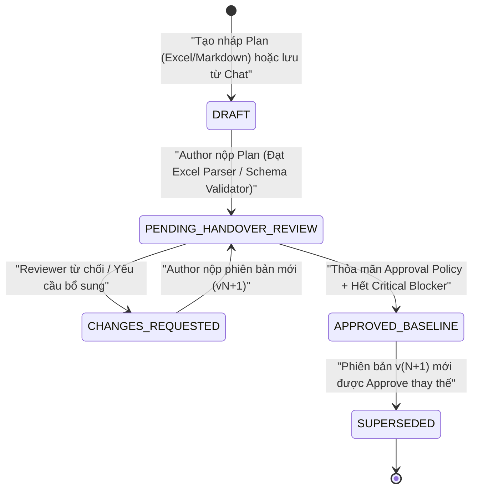
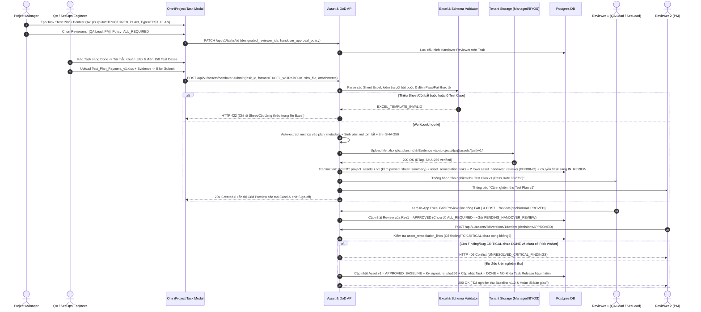

# Feature: Automated Asset Governance & Structured Planning Handover (FR-DOC-001)

**Mô tả:** Hệ thống Kho Tri Thức (Knowledge Base) tự động thu thập, chuẩn hóa cấu trúc, kiểm soát chất lượng bàn giao (Sign-off Gate), quản lý phiên bản bất biến và đóng gói chuyển giao toàn bộ tài liệu đầu ra của Dự án — đặc biệt tối ưu cho các tài liệu lập kế hoạch trọng yếu (**Test Plan, Pentest Plan, Architecture/Technical Plan, Release/Handover Plan, Sprint/Iteration Plan, Migration Plan, Incident Response Plan**) ở cả định dạng **Excel Workbook (`.xlsx` / `.csv`)** lẫn **Markdown (`.md`)**, phục vụ đào tạo (Training), kiểm toán bảo mật (Audit), bảo trì (Maintenance) và bàn giao nhân sự/vận hành.
**Priority:** P1 (High)
**Phiên bản Đặc tả:** v2.1 (Multi-Format Excel-First Hybrid Planning & Multi-Reviewer Handover Registry)
**Tài liệu Kỹ thuật & Truy vết:**
- **SRS & Authentication/Authorization Matrix:** [`01_SRS_ASSET_GOVERNANCE_AND_PLANNING_HANDOVER.md`](./01_SRS_ASSET_GOVERNANCE_AND_PLANNING_HANDOVER.md)
- **RTM (Requirements Traceability Matrix):** [`02_RTM_ASSET_GOVERNANCE_AND_PLANNING_HANDOVER.csv`](./02_RTM_ASSET_GOVERNANCE_AND_PLANNING_HANDOVER.csv)
- **Kế thừa Nền tảng & Phase 4:** [`FR-PRJ-000`](../omniproject_core/phase_1/FR-PRJ-000_core_technical_architecture.md) · [`FR-PRJ-008`](../omniproject_core/phase_4/FR-PRJ-008_strict_dod_output.md) · [`06_SRS_PHASE4A`](../omniproject_core/phase_4/06_SRS_PHASE4A_CORE_AGILE_SCHEDULING_ENGINE.md)

**Kiến trúc cốt lõi:** Áp dụng mô hình **Multi-Format Planning Engine (Excel `.xlsx` + Markdown Dual-Layer) + Tenant Storage (BYOS/Managed) + Flexible Handover Sign-off Gate**:
1. **Multi-Format Authoring Modes (`content_format_mode` — Excel `.xlsx` / `.csv` + Markdown Dual-Layer):**
   - **`EXCEL_WORKBOOK` (`.xlsx` / `.csv` Native — Khuyên dùng cho Test Plan chứa hàng trăm Test Case, Pentest Finding Matrix, Migration Runbook, Release Checklist):** Người dùng tải biểu mẫu `.xlsx` chuẩn từ OmniProject (hoặc dùng file Excel sẵn có đúng chuẩn cột), điền dữ liệu và tải lên. Hệ thống chạy **Excel Workbook Parser (`SheetJS / ExcelJS` worker)** để kiểm tra hợp lệ các Sheet/Cột bắt buộc, tự động bóc tách chỉ số tổng hợp (`total_cases`, `pass_rate_pct`, `severity_counts`, các dòng `FAIL`) vào `plan_metadata` (JSONB), lưu nguyên bản file `.xlsx` bất biến kèm `SHA-256` lên Storage Tenant, **đồng thời** tự động sinh kèm tệp `plan_v{N}.md` tóm tắt để phục vụ tìm kiếm Full-text Search, xem nhanh dạng lưới (In-App Grid Preview) và lập chỉ mục AI/RAG mà không làm mất bất kỳ công thức hay sheet Excel nào.
   - **`MARKDOWN_DOC` (`.md` Native):** Phù hợp cho tài liệu giàu văn bản/sơ đồ như `ARCH_TECHNICAL_PLAN` (Mermaid C4) hoặc `INCIDENT_RESPONSE_PLAN` (5-Whys RCA).
   - **`HYBRID_PACKAGE` (Markdown Tổng quan + Excel Sheet Chi tiết/Evidence):** Kết hợp phần mô tả kiến trúc/ngữ cảnh bằng Markdown với file `.xlsx` chứa ma trận Test Case hoặc Finding Matrix đi kèm.
2. **Tenant Storage (BYOS/Managed) & Content-Addressable Integrity ([`FR-CHN-017`](../omnichannel/phase_3/FR-CHN-017_tenant_storage_byos_and_archival.md)):** Mọi phiên bản tài liệu Plan (`.xlsx`, `plan_v{N}.md`, và tệp bằng chứng đính kèm) được lưu theo đường dẫn `{tenant_id}/projects/{project_id}/assets/{asset_id}/v{version}/` trên Storage của Tenant (`MANAGED` hoặc `BYOS` AWS S3/MinIO/GCS/R2) kèm kiểm chứng toàn vẹn `SHA-256`.
3. **Anti-Vibe-Planning Schema & Sheet Validation:** Tích hợp chặt chẽ với Strict DoD ([`FR-PRJ-008`](../omniproject_core/phase_4/FR-PRJ-008_strict_dod_output.md)). Nhân sự không thể nộp file Excel rỗng hoặc link sơ sài cho các Task yêu cầu `STRUCTURED_PLAN`; hệ thống kiểm tra tự động cấu trúc Sheet/Cột Excel hoặc các phân mục Markdown và chỉ số thực tế trước khi cho nộp.
4. **Cấu hình Người Nghiệm Thu Linh Hoạt ngay trên Task (Flexible Designated Reviewers):** Trước hoặc trong khi thực hiện Task, PM/Owner chỉ định danh sách người nghiệm thu bàn giao (`designated_reviewer_ids[]`) và cơ chế chốt (`ALL_REQUIRED` hoặc `ANY_ONE`) ngay trên Task (ví dụ: Task Pentest Plan gán `SecLead + PM` cùng nghiệm thu; Task Test Plan gán `QA Lead`). Tài liệu chỉ đạt trạng thái `APPROVED_BASELINE` và Task mới được đóng `DONE` khi vượt qua cổng Sign-off này.

---

## 1. Functional Requirements List

| FR ID | Requirement Description | Input | Output | Associated Business Rule | Priority |
| :--- | :--- | :--- | :--- | :--- | :--- |
| **FR-DOC-001.1** | **Auto-Tagging & Multi-Source Asset Ingestion:** Tự động thu thập và bóc tách metadata (`project_id`, `author_id`, `source_type`, `timestamp`, `sha256`) từ 3 nguồn: (1) Task hoàn thành DoD (`FR-PRJ-008`), (2) Nút *"Lưu vào Dự án"* từ OmniChannel (`FR-CHN-017`), và (3) Tạo/Upload trực tiếp trong Knowledge Base. | Event `TaskDone_WithOutput` / `OmniChannelArchiveCreated` / Direct Upload | Bản ghi `project_assets` + `project_asset_versions` v1 | `BL-DOC-001.1`, `BL-DOC-001.2` | Must-have |
| **FR-DOC-001.2** | **7 Bộ Khung Planning Đa Định Dạng (Excel `.xlsx` & Markdown Blueprints) & Parser Kiểm Tra Tự Động:** Cung cấp cả **Template Excel (`.xlsx`) tải về (`GET /api/v1/assets/templates/:planType.xlsx`)** lẫn **Markdown Blueprint** cho 7 loại Plan cốt lõi (`TEST_PLAN`, `PENTEST_PLAN`, `ARCH_TECHNICAL_PLAN`, `RELEASE_HANDOVER_PLAN`, `SPRINT_ITERATION_PLAN`, `MIGRATION_PLAN`, `INCIDENT_RESPONSE_PLAN`). Tự động parse file `.xlsx`, kiểm tra sheet/cột bắt buộc, tính toán chỉ số từ dòng thực tế, sinh file `plan_v{N}.md` đồng hành và hiển thị In-App Excel Grid Preview + Version Diff. | `asset_type`, `content_format_mode`, file `.xlsx`/`.csv` và/hoặc `markdown_body`, `plan_metadata`, `attachments[]` | Schema/Sheet Validation (`PASS \| 422`), lưu `.xlsx` + sinh `plan_v{N}.md` + `parsed_sheet_summary` | `BL-DOC-001.3`, `BL-DOC-001.3a`, `BL-DOC-001.3b`, `BL-DOC-001.4` | Must-have |
| **FR-DOC-001.3** | **Cấu Hình Người Nghiệm Thu Linh Hoạt & Quy Trình Bàn Giao 4 Bước (Flexible Sign-off & Immutable Versioning):** Cho phép cấu hình `designated_reviewer_ids[]` và `approval_policy` (`ALL_REQUIRED \| ANY_ONE`) ngay trên Task. Quản lý vòng đời tài liệu qua 4 trạng thái (`DRAFT` → `PENDING_HANDOVER_REVIEW` → `CHANGES_REQUESTED` / `APPROVED_BASELINE` → `SUPERSEDED`), lưu lịch sử phiên bản bất biến (`v1, v2...`) kèm mã băm SHA-256 và khóa Task hậu nhiệm (`FR-PRJ-003`) cho tới khi Plan đạt `APPROVED_BASELINE`. | `task_id`, `designated_reviewer_ids[]`, `approval_policy`, Reviewer Decision (`APPROVE \| REQUEST_CHANGES`) | Bản ghi `asset_handover_reviews`, chữ ký nghiệm thu `signature_sha256`, mở khóa Task/Dependency | `BL-DOC-001.5`, `BL-DOC-001.6` | Must-have |
| **FR-DOC-001.4** | **Truy Vết Plan-to-Execution & Khắc Phục Lỗi (Remediation Traceability):** Cho phép gắn kết trực tiếp các Task thực thi hoặc Task vá lỗi/lỗ hổng (`linked_task_ids[]`) vào từng đầu mục/Finding hoặc **từng dòng `FAIL`/`CRITICAL` trong sheet Excel** (`source_sheet_name`, `source_row_number`). Hỗ trợ 1-click sinh Bug/Remediation Task từ dòng lỗi trong Excel, tự động tính `% Remediation Readiness` và chặn chốt Release nếu còn Finding `CRITICAL` chưa xử lý xong. | `asset_id`, `finding_ref_code`, `severity`, `linked_task_id`, `source_sheet_name`, `source_row_number` | Bảng `asset_remediation_links`, tỷ lệ khắc phục `%`, trạng thái Sign-off Gate | `BL-DOC-001.3a`, `BL-DOC-001.7` | Must-have |
| **FR-DOC-001.5** | **Tìm Kiếm Đa Chiều & Phân Quyền Độ Mật (Classification & RBAC Guard):** Hỗ trợ tìm kiếm Full-text trên nội dung Markdown + chỉ mục dòng Excel (`parsed_sheet_summary`) và lọc đa chiều theo OQL (`asset_type`, `content_format_mode`, `plan_category`, `author_id`, `reviewer_id`, `handover_status`, `classification`, `created_at`). Áp dụng 3 tầng bảo mật: `INTERNAL`, `CONFIDENTIAL`, `RESTRICTED_SECURITY` (mặc định cho Pentest & Incident RCA). | Query filter (OQL/UI) + User Context (`role`, `user_id`) | Danh sách Asset được phép truy cập (tự động ẩn/lọc tài liệu vượt quyền) | `BL-DOC-001.8` | Must-have |
| **FR-DOC-001.6** | **Đóng Gói Bàn Giao Thông Minh (Smart Handover & Onboarding Bundle Exporter):** Cho phép PM/Owner đóng gói nhiều Asset thành 1 Gói Bàn Giao theo mục đích (`ONBOARDING_NEW_HIRE`, `PHASE_SIGN_OFF`, `QA_SECURITY_AUDIT`, `OPS_HANDOVER`). Tự động loại bỏ/ẩn tài liệu `RESTRICTED_SECURITY` nếu người nhận không đủ quyền. Xuất dưới 2 dạng: Link Web có TTL + Audit Log hoặc file `.zip` chứa `00_HANDOVER_MANIFEST.md` kèm nguyên bản các file `.xlsx`, `.md` và `/attachments/*`. | `asset_ids[]`, `bundle_purpose`, `export_mode` (`WEB_LINK \| ZIP_ARCHIVE`), `target_audience_role`, `expires_at` | Gói `handover_packages`, Presigned URL / File `.zip` chuẩn hóa | `BL-DOC-001.9`, `BL-DOC-001.10` | Must-have |

---

## 1.1. Danh mục 7 Loại Plan Chuẩn — Cấu Trúc Excel Workbook (`.xlsx`) & Markdown (`FR-DOC-001.2`)

Người dùng có thể tải file mẫu chuẩn tại `GET /api/v1/assets/templates/:planType.xlsx` hoặc nộp qua Markdown/Hybrid. Bảng dưới quy định định dạng khuyên dùng, **cấu trúc Sheet & Cột bắt buộc cho Excel**, **phân mục cho Markdown**, và các trường **`plan_metadata` (JSONB)** hệ thống tự động trích xuất/kiểm tra:

| # | `asset_type` (Enum) | Định Dạng Khuyên Dùng | Cấu Trúc Excel Workbook Bắt Buộc (Sheets & Mandatory Columns) | Các Trường `plan_metadata` (JSONB) & Phân Mục Markdown | Độ Mật Mặc Định |
| :-: | :--- | :---: | :--- | :--- | :--- |
| 1 | `TEST_PLAN` *(QA/QC Test Plan & Execution)* | **`EXCEL_WORKBOOK`** (`.xlsx`) | **Sheet 1 `01_Test_Overview`:** Scope, Target Env, Exit Criteria.<br/>**Sheet 2 `02_Test_Cases`:** Cột bắt buộc `TC_ID`, `Module`, `Pre_Condition`, `Test_Steps`, `Expected_Result`, `Actual_Result`, `Status` (`PASS \| FAIL \| BLOCKED \| SKIPPED`), `Priority`, `Executed_By`, `Evidence_Link`, `Linked_Bug_Task_ID`.<br/>**Sheet 3 `03_Execution_Summary`:** Công thức/Bảng tổng hợp (hệ thống tự đối soát lại từ Sheet 2). | **Metadata tự động extract từ Excel:** `test_levels[]`, `target_environment`, `total_cases` (int ≥ 1), `passed_cases`, `failed_cases`, `blocked_cases`, `pass_rate_pct` (0..100), `coverage_pct`, `exit_criteria_met` (bool), `known_defects_summary`.<br/>**Markdown sections:** 1. Phạm vi & Mục tiêu; 2. Môi trường; 3. Ma trận Test Cases & Tỷ lệ Pass; 4. Lỗi tồn đọng. | `INTERNAL` |
| 2 | `PENTEST_PLAN` *(Security Assessment)* | **`HYBRID_PACKAGE`** hoặc **`EXCEL_WORKBOOK`** | **Sheet 1 `01_Scope_And_RoE`:** Target Scope, Box Mode, RoE Window.<br/>**Sheet 2 `02_OWASP_Checklist`:** Cột `WSTG_ID`, `Category`, `Target_Endpoint`, `Test_Result`.<br/>**Sheet 3 `03_Findings_Log`:** Cột `Finding_ID`, `Title`, `CVSS_Score`, `Severity` (`CRITICAL \| HIGH \| MEDIUM \| LOW \| INFO`), `Affected_URL`, `PoC_Steps`, `Remediation_Guide`, `Retest_Status`, `Linked_Task_ID`. | **Metadata:** `target_scope[]`, `methodology` (`OWASP_WSTG \| PTES \| NIST`), `box_mode` (`BLACK_BOX \| GREY_BOX \| WHITE_BOX`), `rules_of_engagement`, `severity_counts` (`{critical, high, medium, low, info}` tự đếm từ Sheet 3), `cvss_max_score`, `remediation_status`, `retest_required`.<br/>**Markdown sections:** 1. Scope & RoE; 2. Attack Vectors; 3. Tổng hợp CVSS; 4. Findings & PoC. | `RESTRICTED_SECURITY` |
| 3 | `ARCH_TECHNICAL_PLAN` *(RFC / ADR / System Design)* | **`MARKDOWN_DOC`** (hoặc kèm `.xlsx` API/Sizing) | *(Tùy chọn nếu kèm Excel)* **Sheet `01_Component_And_API_Matrix`:** Cột `Service_Name`, `Endpoint_Or_Topic`, `Change_Type`, `Latency_SLO_Ms`, `Owner`. | **Metadata:** `c4_scope` (`CONTEXT \| CONTAINER \| COMPONENT`), `affected_components[]`, `design_patterns[]`, `api_contract_changes` (bool), `nfr_impact`, `tradeoffs_and_risks`.<br/>**Markdown sections:** 1. Context; 2. Sơ đồ Kiến trúc (Mermaid); 3. API/DB Changes; 4. Trade-offs & NFR. | `INTERNAL` |
| 4 | `RELEASE_HANDOVER_PLAN` *(Deployment & Ops)* | **`EXCEL_WORKBOOK`** hoặc **`HYBRID_PACKAGE`** | **Sheet 1 `01_Release_Info`:** SemVer, Window, On-call Contacts.<br/>**Sheet 2 `02_Preflight_Checklist`:** Cột `Step_No`, `Category`, `Check_Item`, `Owner`, `Status` (`READY \| PENDING`).<br/>**Sheet 3 `03_Env_Config_Diff`:** `Key_Name`, `Environment`, `Action` (`ADD \| UPDATE`), `Secret_Flag`.<br/>**Sheet 4 `04_Smoke_Test_And_Rollback`:** `Check_URL`, `Expected_HTTP`, `Rollback_Trigger`, `Rollback_Command`. | **Metadata:** `release_version` (SemVer), `deployment_window`, `preflight_checklist[]`, `env_config_changes` (bool), `smoke_test_plan`, `rollback_strategy`, `oncall_contacts[]`.<br/>**Markdown sections:** 1. Scope & Preflight; 2. Env Config; 3. Deployment & Smoke Test; 4. Rollback & On-call. | `CONFIDENTIAL` |
| 5 | `SPRINT_ITERATION_PLAN` *(Sprint Capacity & Scope)* | **`EXCEL_WORKBOOK`** hoặc **`MARKDOWN_DOC`** | **Sheet 1 `01_Sprint_Goal_And_Risks`:** Sprint ID, Goal, Carryover Policy.<br/>**Sheet 2 `02_Team_Capacity_Matrix`:** Cột `Member`, `Role`, `Leave_Days`, `Available_Hours`, `Allocated_Points`.<br/>**Sheet 3 `03_Committed_Backlog`:** `Task_ID`, `Title`, `Story_Points`, `Owner`, `Dependency_Risk`. | **Metadata:** `sprint_id`, `sprint_goal`, `committed_story_points` (int), `team_capacity_hours` (number), `key_deliverables[]`, `dependency_risks[]`, `carryover_policy`.<br/>**Markdown sections:** 1. Sprint Goal; 2. Capacity; 3. Committed Deliverables; 4. Dependency Risks. | `INTERNAL` |
| 6 | `MIGRATION_PLAN` *(Data / Schema / BYOS Cutover)* | **`EXCEL_WORKBOOK`** hoặc **`HYBRID_PACKAGE`** | **Sheet 1 `01_Cutover_Timeline_Runbook`:** Cột `T_Minus_Min`, `Step_Order`, `Command_Or_Action`, `Owner`, `Duration_Min`, `Verify_Gate`.<br/>**Sheet 2 `02_Data_Mapping_And_Checksum`:** `Source_Table_Or_Bucket`, `Target_Location`, `Record_Count`, `Checksum_Method`.<br/>**Sheet 3 `03_Rollback_Steps`:** `Trigger_Condition`, `Rollback_Script_Ref`, `Max_RTO_Min`. | **Metadata:** `migration_type` (`DB_SCHEMA \| DATA_BACKFILL \| STORAGE_BYOS \| INFRA_CUTOVER`), `source_system`, `target_system`, `estimated_downtime_ms`, `dry_run_verified` (bool), `data_integrity_checksum_method`, `backward_compatibility_strategy`, `emergency_rollback_script_ref`.<br/>**Markdown sections:** 1. Kiến trúc Nguồn→Đích; 2. Dry-run & Downtime; 3. Checksum; 4. Emergency Rollback. | `CONFIDENTIAL` |
| 7 | `INCIDENT_RESPONSE_PLAN` *(Post-Mortem & RCA)* | **`MARKDOWN_DOC`** (hoặc kèm `.xlsx` Action Items) | *(Tùy chọn nếu kèm Excel)* **Sheet `01_Preventive_Action_Items`:** Cột `Action_ID`, `Root_Cause_Ref`, `Action_Description`, `Owner`, `Due_Date`, `Linked_Task_ID`, `Status`. | **Metadata:** `incident_severity` (`SEV1 \| SEV2 \| SEV3`), `detection_and_escalation_flow`, `mitigation_steps[]`, `root_cause_analysis_5whys`, `timeline_summary`, `preventive_action_items[]`, `sla_breach_impact`.<br/>**Markdown sections:** 1. Tóm tắt & SLA; 2. Timeline; 3. 5-Whys RCA; 4. Action Items phòng ngừa. | `RESTRICTED_SECURITY` |

*(Ngoài 7 loại Plan chuẩn trên, `asset_type` vẫn hỗ trợ đầy đủ các tài sản kỹ thuật khác: `CODE_PR`, `DESIGN_FIGMA`, `FRD_DOC`, `SPREADSHEET`, `IMAGE`, `CHAT_ARCHIVE`, `OTHER`.)*

---

## 2. Business Logic & Rules

| BR ID | Rule Description | Applies to FR |
| :--- | :--- | :--- |
| **BL-DOC-001.1** | **Auto-Tagging Pipeline & Idempotent Ingestion:** Khi nhận sự kiện `TaskDone_WithOutput` (`FR-PRJ-008`) hoặc `OmniChannelArchiveCreated` (`FR-CHN-017`), hệ thống tự động tạo hoặc cập nhật `project_assets` kèm metadata (`project_id`, `author_id`, `source_task_id`, `source_archive_id`, `created_at`). Dùng khóa bất biến `idempotency_key` (`source_type + source_id + version`) để tránh tạo trùng Asset nếu Broker retry message. | FR-DOC-001.1 |
| **BL-DOC-001.2** | **Tenant Storage (BYOS/Managed) & SHA-256 Integrity:** Mọi tệp tài liệu Plan (file gốc `.xlsx`/`.csv`, file `plan_v{N}.md` và tệp bằng chứng đính kèm) đều đi qua `StorageAdapterInterface` (`FR-CHN-017`), ghi vào Storage hiện hành của Tenant (`MANAGED` hoặc `BYOS`) và lưu lại `storage_mode_used` + `storage_bucket_ref` trên bản ghi để tương thích đọc ngược khi Tenant đổi Bucket. Tệp nhị phân đính kèm lưu khử trùng lặp theo `{workspace_id}/blobs/{sha256}`. | FR-DOC-001.1, FR-DOC-001.3 |
| **BL-DOC-001.3** | **Anti-Vibe-Planning Schema Guard (Markdown & Hybrid):** Khi nộp Asset có `asset_type` thuộc 7 loại Plan chuẩn với chế độ `MARKDOWN_DOC` hoặc `HYBRID_PACKAGE`, Backend chạy `PlanSchemaValidator` kiểm tra đủ các key bắt buộc trong `plan_metadata` và các heading bắt buộc trong Markdown. Nếu thiếu hoặc giá trị không hợp lệ (VD: `MIGRATION_PLAN` chưa đánh dấu `dry_run_verified` khi nộp bản Release), từ chối với `HTTP 422 Unprocessable Entity` (`PLAN_SCHEMA_INCOMPLETE`) kèm danh sách trường còn thiếu. | FR-DOC-001.2 |
| **BL-DOC-001.3a** | **Automated Excel Workbook Parsing, Column Validation & Auto-Metrics Extraction:** Khi người dùng tải lên file `.xlsx`/`.csv` cho `STRUCTURED_PLAN` (chế độ `EXCEL_WORKBOOK` hoặc `HYBRID_PACKAGE`), **Excel Parser Worker** đọc toàn bộ Workbook trên bộ nhớ:<br/>1. **Kiểm tra cấu trúc Sheet/Cột:** Đối chiếu tên Sheet bắt buộc và các cột header chuẩn theo Bảng `1.1` (VD: `TEST_PLAN` phải có sheet `02_Test_Cases` chứa tối thiểu 1 dòng dữ liệu hợp lệ và đủ các cột `TC_ID`, `Test_Steps`, `Expected_Result`, `Status`). Nếu file rỗng, sai tên cột hoặc 0 Test Case → chặn ngay với `HTTP 422 (EXCEL_TEMPLATE_INVALID)` kèm danh sách Sheet/Cột thiếu.<br/>2. **Tự động tổng hợp chỉ số thực tế (Anti-Fake Metrics):** Hệ thống tự đếm trực tiếp từ từng dòng trong Excel để điền `plan_metadata` (`total_cases`, `passed_cases`, `failed_cases`, `pass_rate_pct` cho `TEST_PLAN`; `severity_counts`, `cvss_max_score` cho `PENTEST_PLAN`) — không cho Author tự gõ con số tóm tắt sai lệch với số dòng trong file.<br/>3. **Auto-Link & 1-Click Task Creation từ dòng lỗi Excel:** Các dòng có `Status = FAIL` hoặc `Severity IN ('CRITICAL', 'HIGH')` được bóc tách kèm `source_sheet_name` và `source_row_number`. Nếu có điền cột `Linked_Task_ID`, hệ thống tự động tạo `asset_remediation_links`; nếu chưa có, UI cung cấp nút **"Tạo Task Vá Lỗi (1-Click)"** ngay trên từng dòng lỗi.<br/>4. **Dual-Layer Companion Markdown:** Hệ thống tự động sinh file `plan_v{N}.md` tóm tắt bảng chỉ số & các dòng nổi bật lưu cạnh file `.xlsx` gốc để phục vụ Full-text Search và AI/RAG. | FR-DOC-001.2, FR-DOC-001.4 |
| **BL-DOC-001.3b** | **In-App Excel Grid Preview & Version Diffing:** Trên giao diện Knowledge Base và Modal Nghiệm thu, Reviewer (`QA Lead`, `SecLead`, `PM`) có thể xem trực tiếp các tab Excel dưới dạng bảng dữ liệu tương tác (Data Grid) lấy từ `parsed_sheet_summary` (lọc nhanh `Status = FAIL`, `Severity = CRITICAL`) mà không cần tải file về máy. Khi nộp phiên bản `v2.xlsx`, hệ thống tự động hiển thị báo cáo chênh lệch (Diff) so với `v1.xlsx` (VD: *"Thêm 12 Test Cases; 14 Test Cases chuyển FAIL → PASS; Pass Rate tăng 78% → 94%"*). | FR-DOC-001.2, FR-DOC-001.3 |
| **BL-DOC-001.4** | **Automatic Classification Escalation:** Khi tạo Asset loại `PENTEST_PLAN` hoặc `INCIDENT_RESPONSE_PLAN`, hệ thống **mặc định cưỡng bức** `classification = RESTRICTED_SECURITY`; với `RELEASE_HANDOVER_PLAN` và `MIGRATION_PLAN` mặc định `CONFIDENTIAL`. Chỉ `TENANT_ADMIN` hoặc `PM` mới có quyền hạ độ mật (kèm Audit Log). | FR-DOC-001.2, FR-DOC-001.5 |
| **BL-DOC-001.5** | **Flexible Task-Level Designated Reviewer & Approval Policy:** Khi thiết lập Task có `output_contract_type = STRUCTURED_PLAN` (hoặc bất kỳ Task cần nghiệm thu bàn giao), người tạo Task/PM cấu hình ngay trên Task: `designated_reviewer_ids[]` (từ 1 đến N thành viên trong Project) và `handover_approval_policy` (`ALL_REQUIRED` — tất cả người nghiệm thu đều phải Approve; hoặc `ANY_ONE` — chỉ cần 1 người trong danh sách Approve). Lưu ý: **Author không được phép tự duyệt (Self-Approval Blocked)** nếu danh sách Reviewer còn thành viên khác (`HTTP 403 Forbidden - SELF_APPROVAL_PROHIBITED`), trừ trường hợp Workspace chỉ có 1 Admin duy nhất (`SINGLE_MEMBER_WORKSPACE`). | FR-DOC-001.3 |
| **BL-DOC-001.6** | **4-Stage Handover Lifecycle, Immutable Versioning & Dependency Gate:**<br/>- Khi Author nộp Plan (`.xlsx` và/hoặc `.md`), Asset tạo phiên bản `v{N}` mới và chuyển trạng thái sang `PENDING_HANDOVER_REVIEW`; Task tương ứng chuyển sang Meta-Status `IN_REVIEW` (chặn chuyển thẳng sang `DONE`).<br/>- Nếu bất kỳ Reviewer nào chọn `CHANGES_REQUESTED` (bắt buộc nhập `review_comment`), Asset chuyển về `CHANGES_REQUESTED` và thông báo Author chỉnh sửa để nộp phiên bản kế tiếp `v{N+1}` (file `.xlsx` / `.md` phiên bản `v{N}` cũ vẫn giữ nguyên bất biến để đối chiếu lịch sử).<br/>- Khi thỏa mãn `handover_approval_policy`, phiên bản `v{N}` chuyển sang `APPROVED_BASELINE`, sinh chữ ký kiểm toàn `signature_sha256`, tự động đánh dấu phiên bản baseline trước đó (nếu có) thành `SUPERSEDED`, đồng thời cho phép Task chuyển sang `DONE` và **mở khóa các Task hậu nhiệm (`FS` Dependency)** trong `FR-PRJ-003`. | FR-DOC-001.3 |
| **BL-DOC-001.7** | **Plan-to-Remediation Traceability & Critical Blocker Gate:** Các Finding/Đầu mục lỗi ghi nhận trong `PENTEST_PLAN`, `TEST_PLAN`, `INCIDENT_RESPONSE_PLAN` liên kết 1-N với các Task vá lỗi qua `asset_remediation_links` (kèm tọa độ dòng Excel `source_sheet_name + source_row_number` nếu xuất phát từ `.xlsx`). Nếu một `PENTEST_PLAN` (hoặc `RELEASE_HANDOVER_PLAN` tham chiếu tới `PENTEST_PLAN` / `TEST_PLAN` của cùng Release) còn bất kỳ liên kết có `severity IN ('CRITICAL', 'HIGH')` ở trạng thái chưa `DONE` (hoặc chưa `VERIFIED_FIXED`), hệ thống **chặn chốt nghiệm thu** (`HTTP 409 Conflict - UNRESOLVED_CRITICAL_FINDINGS`), trừ khi `PM` hoặc `TENANT_ADMIN` ký cờ `RISK_ACCEPTED` kèm lý do bắt buộc vào Audit Log. | FR-DOC-001.4 |
| **BL-DOC-001.8** | **RBAC & Security Redaction on Read/Search:** Tài liệu `RESTRICTED_SECURITY` chỉ hiển thị trong kết quả tìm kiếm và chi tiết đối với `TENANT_ADMIN`, `PM` của dự án, `Author` tạo tài liệu, và các `Designated Reviewers` của tài liệu đó. Thành viên thường hoặc Viewer khác không thấy nội dung, sheet Excel hoặc PoC lỗ hổng. | FR-DOC-001.5 |
| **BL-DOC-001.9** | **Smart Handover Package Security Redaction:** Khi xuất Gói Bàn Giao (`ONBOARDING_NEW_HIRE`, `PHASE_SIGN_OFF`, v.v.), hệ thống đối chiếu `target_audience_role`. Nếu xuất gói Onboarding chung cho nhân sự mới hoặc Guest mà trong danh sách chọn có lẫn tài liệu `RESTRICTED_SECURITY`, hệ thống **tự động loại bỏ khỏi file nén `.zip` / link chia sẻ** và ghi chú dòng cảnh báo *"Redacted due to Security Classification"* trong file mục lục `00_HANDOVER_MANIFEST.md` (ngăn rò rỉ PoC Pentest). | FR-DOC-001.6 |
| **BL-DOC-001.10** | **Self-Contained Handover Manifest (`00_HANDOVER_MANIFEST.md`):** Mỗi gói bàn giao xuất ra file `.zip` chứa thư mục `/plans/` (chứa nguyên bản các file `.xlsx` và `.md` kèm file tóm tắt), `/attachments/`, và bắt buộc có tệp `00_HANDOVER_MANIFEST.md` ở thư mục gốc liệt kê: Tên Dự án, Người xuất, Thời điểm, Mục lục toàn bộ Plan/Asset, Trạng thái Nghiệm thu (`APPROVED_BASELINE` hay `DRAFT`), Danh sách Người ký duyệt & Thời gian ký, cùng bảng mã băm `SHA-256` của từng file `.xlsx`, `.md` và tệp đính kèm để bên nhận kiểm chứng toàn vẹn ngoại tuyến. | FR-DOC-001.6 |

---

## 2.1. Cấu Trúc Lưu Trữ Song Song trên Tenant Storage (`.xlsx` Gốc + `plan_v1.md` Đồng Hành)

Đường dẫn lưu trữ chuẩn trên Managed / BYOS Storage cho một phiên bản Plan:
- File Excel Workbook gốc (Bất biến): `{tenant_id}/projects/{project_id}/assets/{asset_id}/v1/Test_Plan_Payment_v1.xlsx`
- File Markdown Index đồng hành (Tự động sinh / Hybrid): `{tenant_id}/projects/{project_id}/assets/{asset_id}/v1/plan.md`

### A. Ví dụ Cấu trúc 3 Sheet trong File Excel `TEST_PLAN` (`Test_Plan_Payment_v1.xlsx`)

**Sheet 1 (`01_Test_Overview`):**
| Trường Thông Tin | Giá Trị Khai Báo |
| :--- | :--- |
| `Project` | OmniMer Payment Gateway |
| `Target_Environment` | Staging (`staging-pay.omnimer.io`) |
| `Test_Levels` | `INTEGRATION, E2E, PERF` |
| `Exit_Criteria` | Pass Rate ≥ 95%, 0 Critical/High Bugs |

**Sheet 2 (`02_Test_Cases`):**
| `TC_ID` | `Module` | `Pre_Condition` | `Test_Steps` | `Expected_Result` | `Actual_Result` | `Status` | `Priority` | `Executed_By` | `Evidence_Link` | `Linked_Bug_Task_ID` |
| :--- | :--- | :--- | :--- | :--- | :--- | :---: | :---: | :--- | :--- | :--- |
| `TC-PAY-001` | Checkout | User đã login | 1. Chọn gói Pro<br/>2. Thanh toán VNPay | Trả về `200 OK`, cập nhật gói | Đúng kỳ vọng | `PASS` | `P1` | `qa_hoa` | `./ev/tc001.png` | |
| `TC-PAY-002` | Webhook | Đơn hàng pending | 1. Giả lập retry 2 lần cùng `txn_id` | Idempotent, không cộng tiền 2 lần | Bị tạo 2 invoice trùng | `FAIL` | `CRITICAL` | `qa_hoa` | `./ev/tc002.png` | `TASK-508` |

### B. File Markdown Index Đồng Hành Tự Sinh (`plan.md`)

```markdown
---
asset_id: "ast_99a2b10c-1122-4455-8899-001122334455"
project_id: "prj_omnimer_payment"
task_id: "tsk_qa_testplan_v1"
asset_type: "TEST_PLAN"
content_format_mode: "EXCEL_WORKBOOK"
classification: "INTERNAL"
version: 1
handover_status: "APPROVED_BASELINE"
author_id: "usr_qa_hoa"
approval_policy: "ALL_REQUIRED"
primary_workbook:
  file_name: "Test_Plan_Payment_v1.xlsx"
  storage_key: "ten_01/projects/prj_omnimer_payment/assets/ast_99a2b10c/v1/Test_Plan_Payment_v1.xlsx"
  sha256: "d4735e3a265e16eee03f59718b9b5d03019c07d8b6c51f90da3a666eec13ab35"
designated_reviewers:
  - user_id: "usr_qalead_tuan"
    decision: "APPROVED"
    signed_at: "2026-11-22T15:10:00+07:00"
  - user_id: "usr_pm_lan"
    decision: "APPROVED"
    signed_at: "2026-11-22T15:25:00+07:00"
plan_metadata:
  target_environment: "Staging (staging-pay.omnimer.io)"
  test_levels: ["INTEGRATION", "E2E", "PERF"]
  total_cases: 150
  passed_cases: 148
  failed_cases: 2
  blocked_cases: 0
  pass_rate_pct: 98.67
  coverage_pct: 92.5
  exit_criteria_met: true
  known_defects_summary: "2 lỗi nhẹ UI đã link TASK-508, TASK-509"
---

# QA/QC Test Plan — OmniMer Payment Gateway (v1)

> **Tệp gốc Excel Workbook:** [`Test_Plan_Payment_v1.xlsx`](./Test_Plan_Payment_v1.xlsx) *(SHA-256: `d4735e3a...`)*  
> *Tài liệu tóm tắt này được sinh tự động từ Excel Workbook Parser để phục vụ tìm kiếm toàn văn, xem nhanh và kiểm toán bàn giao.*

## 1. Tổng hợp Kết quả Thực thi (Tự động bóc tách từ `02_Test_Cases`)
- **Tổng số Test Cases:** `150` (`PASS: 148`, `FAIL: 2`, `BLOCKED: 0`)
- **Tỷ lệ Đạt (Pass Rate):** `98.67%` | **Độ phủ (Coverage):** `92.5%`

## 2. Danh sách Test Cases Trượt (`FAIL`) Cần Theo dõi
| Sheet & Dòng | `TC_ID` | Module | Mức độ | Task Khắc phục |
| :--- | :--- | :--- | :---: | :--- |
| `02_Test_Cases` #Row 3 | `TC-PAY-002` | Webhook | `CRITICAL` | `TASK-508` |
```

---

## 2.2. Ma Trận Xác Thực & Phân Quyền Bàn Giao Đa Tầng (Authentication & Authorization Matrix — Kế thừa `FR-PRJ-000` & `FR-PRJ-008`)

Chi tiết đầy đủ về JWT/SAML/OIDC, chữ ký `signature_sha256`, và danh mục lỗi RFC 7807 được đặc tả tại [`01_SRS_ASSET_GOVERNANCE_AND_PLANNING_HANDOVER.md`](./01_SRS_ASSET_GOVERNANCE_AND_PLANNING_HANDOVER.md#3-ma-trận-xác-thực--phân-quyền-đa-tầng-multi-layer-authentication--authorization-matrix). Tóm tắt ma trận phân quyền kế thừa RBAC từ [`FR-PRJ-000`](../omniproject_core/phase_1/FR-PRJ-000_core_technical_architecture.md) kết hợp vai trò ngữ cảnh trên Task (`FR-PRJ-008`):

### A. Ma Trận Quyền Hành Động (RBAC × Contextual Task/Handover Roles)

| Hành Động (Action) | Tenant Admin | PM / Task Owner | Author (Assignee) | Designated Reviewer *(gán trên Task)* | Other Member *(Non-Reviewer)* | Guest / Client |
| :--- | :---: | :---: | :---: | :---: | :---: | :---: |
| Cấu hình `STRUCTURED_PLAN`, `designated_reviewer_ids[]`, `approval_policy` | ✅ | ✅ | ❌ | ❌ | ❌ | ❌ |
| Tải biểu mẫu chuẩn `.xlsx` / Markdown Blueprint | ✅ | ✅ | ✅ | ✅ | ✅ | ❌ |
| Nộp / Nộp lại (`vN+1`) Plan `.xlsx` / `.md` qua DoD của Task | ✅ | ✅ | ✅ *(Task của mình)* | ❌ | ❌ | ❌ |
| Xem In-App Excel Grid Preview & Version Diff | ✅ | ✅ | ✅ *(Bản của mình)* | ✅ | 🟡 *(Theo độ mật)* | 🟡 *(Link Share)* |
| Ký Nghiệm thu `APPROVED` / `CHANGES_REQUESTED` | 🟡 *(Nếu trong Reviewer List)* | 🟡 *(Nếu trong Reviewer List)* | ❌ **CẤM TỰ DUYỆT** | ✅ | ❌ | ❌ |
| Gắn / Tạo Bug Task từ dòng lỗi Excel (`asset_remediation_links`) | ✅ | ✅ | ✅ | ✅ | ❌ | ❌ |
| Ký Miễn trừ Rủi ro (`RISK_ACCEPTED`) cho Finding `CRITICAL`/`HIGH` | ✅ | ✅ *(Cần Audit Log)* | ❌ | ❌ | ❌ | ❌ |
| Hạ Độ Mật (`RESTRICTED_SECURITY` → `INTERNAL`) | ✅ | ✅ *(Cần Audit Log)* | ❌ | ❌ | ❌ | ❌ |
| Tạo / Xuất / Thu hồi Gói Bàn Giao (`handover_packages`) | ✅ | ✅ | ❌ | ❌ | ❌ | ❌ |

### B. Ma Trận Hiển Thị & Xuất Bàn Giao Theo 3 Tầng Độ Mật

| Độ Mật (`classification`) | Tenant Admin / PM | Author & Designated Reviewers | Other Project Member | Guest / Gói `ONBOARDING_NEW_HIRE` |
| :--- | :---: | :---: | :---: | :---: |
| **`INTERNAL`** *(Test Plan, Arch Plan, Sprint Plan)* | Full Access | Full Access | Read & Search | Scoped Read (nếu được chia sẻ) |
| **`CONFIDENTIAL`** *(Release Plan, Migration Plan)* | Full Access | Full Access | Metadata Only (trừ Ops/được cấp quyền) | Excluded khỏi Onboarding mặc định |
| **`RESTRICTED_SECURITY`** *(Pentest Plan, Incident RCA)* | Full Access *(Audit Log)* | Full Access *(Audit Log)* | **HIDDEN (`403` / Ẩn khỏi Search)** | **AUTO-REDACTED** (`[REDACTED]` trong Manifest) |

---

## 3. Data Structure

*(Giữ tương thích hoàn toàn với khóa ngoại `knowledge_base_asset_id → assets.id` trong [`FR-CHN-017`](../omnichannel/phase_3/FR-CHN-017_tenant_storage_byos_and_archival.md) và `Task.outputDeliverable` trong [`FR-PRJ-008`](../omniproject_core/phase_4/FR-PRJ-008_strict_dod_output.md)).*

### Entity 1: `project_assets` (Bảng chính Quản trị Tài sản & Kế hoạch — alias bảng `assets`)
| Field | Data Type | Required | Constraints / Description |
| :--- | :--- | :---: | :--- |
| `id` (`asset_id`) | `UUID` | Yes | Primary Key |
| `workspace_id` | `UUID` | Yes | FK → `workspaces.id`, Indexed (Tenant Isolation) |
| `project_id` | `UUID` | Yes | FK → `projects.id`, Indexed |
| `title` | `VARCHAR(255)` | Yes | Tiêu đề tài liệu / Plan |
| `source_type` | `ENUM` | Yes | `TASK \| OMNICHANNEL_ARCHIVE \| DIRECT_UPLOAD` |
| `source_task_id` | `UUID` | No | FK → `tasks.id` (Null nếu từ Archive/Upload trực tiếp) |
| `source_archive_id` | `UUID` | No | FK → `project_chat_archives.id` (`FR-CHN-017`) |
| `source_conversation_id` | `UUID` | No | Deep-link về hội thoại OmniChannel nếu có |
| `asset_category` | `ENUM` | Yes | `PLAN_BLUEPRINT \| DELIVERABLE \| CHAT_ARCHIVE \| REFERENCE_DOC` |
| `asset_type` | `ENUM` | Yes | `TEST_PLAN \| PENTEST_PLAN \| ARCH_TECHNICAL_PLAN \| RELEASE_HANDOVER_PLAN \| SPRINT_ITERATION_PLAN \| MIGRATION_PLAN \| INCIDENT_RESPONSE_PLAN \| CODE_PR \| DESIGN_FIGMA \| FRD_DOC \| SPREADSHEET \| IMAGE \| CHAT_ARCHIVE \| OTHER` |
| `content_format_mode` | `ENUM` | Yes | `EXCEL_WORKBOOK \| MARKDOWN_DOC \| HYBRID_PACKAGE` (Default: `EXCEL_WORKBOOK` cho Test/Pentest/Release/Migration; `MARKDOWN_DOC` cho Arch/Incident) |
| `classification` | `ENUM` | Yes | `INTERNAL \| CONFIDENTIAL \| RESTRICTED_SECURITY` |
| `handover_status` | `ENUM` | Yes | `DRAFT \| PENDING_HANDOVER_REVIEW \| CHANGES_REQUESTED \| APPROVED_BASELINE \| SUPERSEDED` |
| `current_version` | `INT` | Yes | Default `1` |
| `approval_policy` | `ENUM` | Yes | `NONE \| ANY_ONE \| ALL_REQUIRED` (Kế thừa từ Task hoặc cấu hình trực tiếp) |
| `plan_metadata` | `JSONB` | No | Metadata có cấu trúc của phiên bản hiện hành (tự động extract từ Excel hoặc nhập tay với Markdown) |
| `author_id` | `UUID` | Yes | FK → `users.id` (Người tạo / nộp tài liệu) |
| `storage_mode_used` | `ENUM` | Yes | `MANAGED \| BYOS` |
| `storage_bucket_ref` | `VARCHAR(255)` | Yes | Tên Bucket tại thời điểm lưu (`BL-CHN-017.7`) |
| `latest_storage_key` | `VARCHAR(500)` | No | Key trên Storage Tenant của tệp chính phiên bản mới nhất (`.xlsx` hoặc `.md`) |
| `latest_sha256` | `CHAR(64)` | No | Checksum SHA-256 của file chính phiên bản mới nhất |
| `external_url` | `VARCHAR(1000)` | No | Link ngoài (GitHub PR, Figma URL) nếu là loại link |
| `search_vector` | `TSVECTOR` | No | Postgres Full-text index từ `title` + nội dung Markdown + chỉ mục dòng Excel |
| `idempotency_key` | `VARCHAR(150)` | No | Unique per workspace để chống trùng khi retry event |
| `created_at` | `TIMESTAMPTZ` | Yes | Default `NOW()` |
| `updated_at` | `TIMESTAMPTZ` | Yes | Default `NOW()` |

### Entity 2: `project_asset_versions` (Lịch sử Phiên bản Bất biến)
| Field | Data Type | Required | Constraints / Description |
| :--- | :--- | :---: | :--- |
| `id` | `UUID` | Yes | Primary Key |
| `asset_id` | `UUID` | Yes | FK → `project_assets.id` (Cascade) |
| `version_number` | `INT` | Yes | Unique `(asset_id, version_number)` (`1, 2, 3...`) |
| `version_status` | `ENUM` | Yes | `PENDING_REVIEW \| CHANGES_REQUESTED \| APPROVED_BASELINE \| SUPERSEDED` |
| `primary_workbook_storage_key` | `VARCHAR(500)` | No | Đường dẫn file `.xlsx` / `.csv` gốc bất biến trên Storage Tenant (nếu `EXCEL_WORKBOOK` hoặc `HYBRID_PACKAGE`) |
| `primary_workbook_sha256` | `CHAR(64)` | No | Mã băm SHA-256 của file Excel gốc |
| `markdown_storage_key` | `VARCHAR(500)` | No | Đường dẫn `plan.md` gốc (hoặc bản tóm tắt tự sinh từ Excel) trên Storage Tenant |
| `markdown_sha256` | `CHAR(64)` | No | Mã băm SHA-256 của nội dung Markdown phiên bản này |
| `parsed_sheet_summary` | `JSONB` | No | Cấu trúc dữ liệu đã parse từ Excel: `{ "sheets": [...], "row_counts": {...}, "pass_fail_breakdown": {...}, "preview_rows_index": [...] }` phục vụ Grid Preview & Version Diff |
| `attachments_manifest` | `JSONB` | No | `[{ "file_name": "...", "storage_key": "...", "mime_type": "...", "size": 0, "sha256": "..." }]` |
| `plan_snapshot_metadata` | `JSONB` | No | Bản chụp `plan_metadata` tại thời điểm nộp phiên bản này |
| `change_summary` | `TEXT` | No | Ghi chú những điểm thay đổi/retest so với phiên bản trước |
| `submitted_by` | `UUID` | Yes | FK → `users.id` |
| `created_at` | `TIMESTAMPTZ` | Yes | Default `NOW()` |

### Entity 3: `asset_handover_reviews` (Phiếu Nghiệm Thu Bàn Giao Theo Người Duyệt Linh Hoạt)
| Field | Data Type | Required | Constraints / Description |
| :--- | :--- | :---: | :--- |
| `id` | `UUID` | Yes | Primary Key |
| `asset_id` | `UUID` | Yes | FK → `project_assets.id`, Indexed |
| `version_number` | `INT` | Yes | Phiên bản đang được nghiệm thu |
| `reviewer_id` | `UUID` | Yes | FK → `users.id` (Lấy từ `Task.designated_reviewer_ids[]` hoặc cấu hình trên Asset) |
| `role_context` | `VARCHAR(100)` | No | Vai trò ngữ cảnh khi duyệt (VD: `"Security Lead"`, `"QA Lead"`, `"PM"`) |
| `decision` | `ENUM` | Yes | `PENDING \| APPROVED \| CHANGES_REQUESTED` (Default `PENDING`) |
| `checklist_verified` | `JSONB` | No | Danh sách mục kiểm tra Reviewer đã tick xác nhận (VD: `{"scope_clear": true, "rollback_tested": true}`) |
| `review_comment` | `TEXT` | No | Bắt buộc nếu `decision = CHANGES_REQUESTED` |
| `signature_sha256` | `CHAR(64)` | No | Mã băm chứng thực `(asset_id + version + primary_sha256 + reviewer_id + signed_at)` |
| `signed_at` | `TIMESTAMPTZ` | No | Thời điểm ký nghiệm thu |
| `created_at` | `TIMESTAMPTZ` | Yes | Default `NOW()` |

### Entity 4: `asset_remediation_links` (Liên kết Truy vết Từ Plan / Dòng Excel Sang Task Khắc Phục)
| Field | Data Type | Required | Constraints / Description |
| :--- | :--- | :---: | :--- |
| `id` | `UUID` | Yes | Primary Key |
| `asset_id` | `UUID` | Yes | FK → `project_assets.id`, Indexed |
| `finding_ref_code` | `VARCHAR(50)` | Yes | Mã đầu mục / Finding / Test Case trong Plan (VD: `PT-001`, `TC-PAY-002`, `RCA-ACT-03`) |
| `finding_title` | `VARCHAR(255)` | Yes | Mô tả ngắn vấn đề / hạng mục cần xử lý |
| `source_sheet_name` | `VARCHAR(100)` | No | Tên Sheet Excel phát sinh (VD: `02_Test_Cases`, `03_Findings_Log`) nếu nguồn từ `.xlsx` |
| `source_row_number` | `INT` | No | Số dòng chính xác trong Sheet Excel (VD: `48`) phục vụ click nhảy thẳng tới dòng lỗi |
| `severity` | `ENUM` | Yes | `CRITICAL \| HIGH \| MEDIUM \| LOW \| INFO` |
| `linked_task_id` | `UUID` | Yes | FK → `tasks.id` (Task Dev/Ops xử lý khắc phục) |
| `verification_status` | `ENUM` | Yes | `OPEN \| IN_PROGRESS \| TASK_DONE_AWAITING_RETEST \| VERIFIED_FIXED \| RISK_ACCEPTED` |
| `risk_waiver_reason` | `TEXT` | No | Bắt buộc nếu `verification_status = RISK_ACCEPTED` |
| `risk_accepted_by` | `UUID` | No | FK → `users.id` (`PM` hoặc `TENANT_ADMIN`) |
| `updated_at` | `TIMESTAMPTZ` | Yes | Default `NOW()` |

### Entity 5: `handover_packages` (Gói Bàn Giao & Onboarding Export)
| Field | Data Type | Required | Constraints / Description |
| :--- | :--- | :---: | :--- |
| `id` | `UUID` | Yes | Primary Key |
| `workspace_id` | `UUID` | Yes | FK → `workspaces.id` |
| `project_id` | `UUID` | Yes | FK → `projects.id` |
| `bundle_name` | `VARCHAR(255)` | Yes | Tên gói bàn giao (VD: `"Gói Nghiệm thu Phase 1 & Test/Pentest Q4"`) |
| `bundle_purpose` | `ENUM` | Yes | `ONBOARDING_NEW_HIRE \| PHASE_SIGN_OFF \| QA_SECURITY_AUDIT \| OPS_HANDOVER` |
| `target_audience_role` | `ENUM` | Yes | `NEW_HIRE_MEMBER \| PM_LEAD \| EXTERNAL_AUDITOR \| TENANT_ADMIN` |
| `included_asset_ids` | `UUID[]` | Yes | Danh sách Asset gốc được chọn |
| `redacted_asset_ids` | `UUID[]` | No | Danh sách Asset bị hệ thống tự động ẩn do vượt quyền `target_audience_role` |
| `export_mode` | `ENUM` | Yes | `WEB_LINK \| ZIP_ARCHIVE` |
| `zip_storage_key` | `VARCHAR(500)` | No | Đường dẫn file `.zip` đóng gói trên Storage Tenant (nếu `ZIP_ARCHIVE`) |
| `manifest_sha256` | `CHAR(64)` | No | Mã băm của file `00_HANDOVER_MANIFEST.md` |
| `share_token_hash` | `CHAR(64)` | No | Hash của đường link chia sẻ nội bộ |
| `expires_at` | `TIMESTAMPTZ` | No | Thời hạn hết hiệu lực của Link/Archive |
| `created_by` | `UUID` | Yes | FK → `users.id` |
| `created_at` | `TIMESTAMPTZ` | Yes | Default `NOW()` |

---

## 4. State & Sequence Diagrams

### 4.1. State Diagram: Vòng đời Phiên bản & Nghiệm thu Plan Asset



### 4.2. Sequence Diagram: Cấu hình Reviewer Linh Hoạt & Bàn Giao Test/Pentest Plan (Excel `.xlsx` + Markdown)



---

## 5. Pre/Post-Conditions & Acceptance Criteria

### Scenario 1: Tải Mẫu Excel `.xlsx`, Nộp `TEST_PLAN` (150 Test Cases) & Tự Động Kiểm Tra Sheet/Tính Pass Rate
- **Pre-condition:** Task có `output_contract_type = STRUCTURED_PLAN`, `required_plan_type = TEST_PLAN`, `designated_reviewer_ids = [QALead, PM]`, `handover_approval_policy = ALL_REQUIRED`. Tenant Storage (`MANAGED` hoặc `BYOS`) đang `ACTIVE`.
- **Post-condition:** File `.xlsx` gốc và bản tóm tắt `plan.md` được lưu bất biến trên Tenant Storage kèm `SHA-256`; chỉ số `total_cases` và `pass_rate_pct` khớp 100% với số dòng thực tế trong sheet `02_Test_Cases`; các dòng `FAIL` có `Linked_Bug_Task_ID` tự động ghi vào `asset_remediation_links` kèm tọa độ dòng Excel.

```gherkin
Given Task "QA Test Plan Thanh toán" cấu hình Output Contract là "TEST_PLAN" với Designated Reviewers là [QA Lead "Tuấn", PM "Lan"] và chính sách "ALL_REQUIRED"
When QA "Hoa" tải mẫu Excel chuẩn từ nút "Download .xlsx Template", nhưng cố tình nộp 1 file Excel thiếu sheet "02_Test_Cases" hoặc thiếu cột "Expected_Result"
Then Hệ thống chặn không cho nộp và trả về lỗi 422 (EXCEL_TEMPLATE_INVALID) chỉ rõ tên Sheet hoặc Cột bị thiếu

When QA "Hoa" điền đủ 150 Test Cases vào sheet "02_Test_Cases" (trong đó 148 PASS, 2 FAIL có gắn "TASK-508" tại dòng 3) rồi Upload file "Test_Plan_Payment_v1.xlsx"
Then Hệ thống lưu nguyên bản "Test_Plan_Payment_v1.xlsx" và tự động sinh "plan.md" lên Tenant Storage kèm mã băm SHA-256
And Hệ thống tự động điền metadata: total_cases = 150, pass_rate_pct = 98.67% và tự tạo liên kết truy vết tới "TASK-508" tại "02_Test_Cases #Row 3"
And Asset có trạng thái "PENDING_HANDOVER_REVIEW", đồng thời Task chuyển sang cột "In Review"

When QA Lead "Tuấn" mở In-App Excel Grid Preview, lọc các dòng "FAIL", kiểm tra "TASK-508" và bấm "Approve Handover", sau đó PM "Lan" cũng bấm "Approve Handover"
Then Phiên bản v1 đạt trạng thái "APPROVED_BASELINE" kèm chữ ký SHA-256 của cả 2 người duyệt
And Task "QA Test Plan Thanh toán" tự động chuyển sang "Done" và mở khóa các Task Release phụ thuộc
```

### Scenario 2: Nộp `PENTEST_PLAN` (Hybrid / Excel Finding Matrix) với Độ Mật `RESTRICTED_SECURITY` & Chặn Release khi còn Finding Critical
```gherkin
Given Task "Pentest API Q4" có Output Contract là "PENTEST_PLAN" với Designated Reviewers là [SecLead "Hùng", PM "Lan"]
When SecOps "Minh" nộp file "Pentest_Findings_Q4_v1.xlsx" có 1 dòng Finding CRITICAL mã "PT-001" tại sheet "03_Findings_Log" dòng 5 liên kết tới "TASK-412" đang ở trạng thái "In Progress"
Then Asset tự động gắn nhãn độ mật "RESTRICTED_SECURITY" (ẩn với nhân viên thường)
When Cả SecLead và PM cố gắng ký chốt "APPROVED_BASELINE" cho bản Release hoặc bản Retest trong khi "TASK-412" chưa Done
Then Hệ thống từ chối ký duyệt với mã lỗi "UNRESOLVED_CRITICAL_FINDINGS" và hiển thị vị trí lỗi "03_Findings_Log #Row 5 (PT-001)"
When Developer hoàn thành "TASK-412" và SecOps nộp phiên bản "v2.xlsx" chuyển "PT-001" sang "VERIFIED_FIXED"
Then Hệ thống hiển thị Version Diff ("PT-001: OPEN -> VERIFIED_FIXED") và cho phép Reviewer ký "APPROVED_BASELINE"
```

### Scenario 3: Đóng gói Bàn Giao Thông Minh & Tự động Ẩn Tài Liệu Mật (`RESTRICTED_SECURITY`)
```gherkin
Given Dự án "OmniMer Core" có 3 tài liệu Baseline: "ARCH_TECHNICAL_PLAN" (plan.md, INTERNAL), "TEST_PLAN" (Test_Plan_v1.xlsx, INTERNAL) và "PENTEST_PLAN" (Pentest_v2.xlsx, RESTRICTED_SECURITY)
When PM chọn cả 3 tài liệu để xuất Gói Bàn Giao mục đích "ONBOARDING_NEW_HIRE" cho đối tượng "NEW_HIRE_MEMBER" dưới dạng ZIP
Then Hệ thống đóng gói nguyên bản "Test_Plan_v1.xlsx" và "ARCH_TECHNICAL_PLAN" vào thư mục "/plans/" và tự động loại bỏ toàn bộ tệp của "PENTEST_PLAN" khỏi gói ZIP xuất ra
And File "00_HANDOVER_MANIFEST.md" ở thư mục gốc liệt kê đầy đủ 2 tài liệu hợp lệ kèm SHA-256 và ghi chú "[REDACTED: RESTRICTED_SECURITY]" tại dòng của "PENTEST_PLAN"
```
