# OmniChannel — Lộ trình Phát triển theo Giai đoạn (Development Phases Roadmap)

> **Mục tiêu:** Phân rã **17 Phân hệ Tính năng (`FR-CHN-001` → `FR-CHN-017`)** thuộc 4 Epics + Cross-Cutting Storage/Compliance của **OmniChannel** thành **6 Giai đoạn Phát triển tuần tự (Phase 1 → Phase 6)** theo đồ thị phụ thuộc dữ liệu (DAG) và chiến lược giảm thiểu rủi ro đã chốt trong [BRD_OMNICHANNEL_USER_STORIES.md](./BRD_OMNICHANNEL_USER_STORIES.md):
> - **Thứ tự Kênh:** `Telegram Bot` (chứng minh Core Gateway) → `Slack Workspace` → `Zalo OA` (kiểm soát cửa sổ 48h & ZNS).
> - **Thứ tự AI ChatOps:** `Đợt 2A — Nhân viên Nội bộ (FR-CHN-014)` → `Đợt 2B — Khách hàng/Guest (FR-CHN-015)` (chỉ mở sau khi vượt qua Red-team Prompt Injection).
> - **Thống nhất với `omniproject_core`:** Ánh xạ `tenant_id = workspace_id` (`FR-ORG-001`), RBAC 4 cấp (`FR-PRJ-000`), OCC `version`, ngoại lệ DoD (`FR-PRJ-008`) cho Support Ticket và đồng bộ Knowledge Base (`FR-DOC-001`).

---

## 🧭 Ma trận Phụ thuộc & Đồ thị Triển khai (DAG)

```mermaid
flowchart TD
    P1["🧱 Phase 1: Storage Foundation (BYOS) & Telegram Core Gateway<br/>(FR-CHN-001, FR-CHN-002, FR-CHN-017.1)<br/><b>[Nền móng Kết nối, Queue & Content-Addressable Storage]</b>"] --> P2["💬 Phase 2: Unified 2-Way Inbox, Triage, RBAC & Internal Note<br/>(FR-CHN-003, FR-CHN-004, FR-CHN-005)<br/><b>[Màn hình Chat 2 Chiều, Project Discussion & Chặn cứng Internal Note]</b>"]
    P2 --> P3["📋 Phase 3: Message-to-Task/Ticket, OPAgent Draft & Project Archival<br/>(FR-CHN-006, FR-CHN-007, FR-CHN-008, FR-CHN-017.2..4)<br/><b>[Snapshot, Support vs Delivery, AI Regex PII & Lưu vào Dự án .md]</b>"]
    P3 --> P4["🔌 Phase 4: Multi-Channel Expansion (Slack, Zalo OA 48h/ZNS) & In-Chat Mention<br/>(FR-CHN-009, FR-CHN-010, FR-CHN-011)<br/><b>[Mở rộng Slack/Zalo, Auto-Notify & @member / #task Backlinks]</b>"]
    P4 --> P5["🤖 Phase 5: Account Binding Governance & Internal AI ChatOps (Đợt 2A)<br/>(FR-CHN-012, FR-CHN-013, FR-CHN-014)<br/><b>[OTP/QR 5m, Thu hồi Tức thì <1s & Bot Tra cứu Nội bộ Read-only]</b>"]
    P5 --> P6["🛡️ Phase 6: External Client AI ChatOps (Đợt 2B), NĐ 13 Compliance & Security Hardening<br/>(FR-CHN-015, FR-CHN-016)<br/><b>[Public View Projection, Red-team Prompt Injection, Retention & NĐ 13]</b>"]

    style P1 fill:#e8f0fe,stroke:#1a73e8,stroke-width:2px,color:#174ea6
    style P2 fill:#e8f0fe,stroke:#1a73e8,stroke-width:2px,color:#174ea6
    style P3 fill:#fef7e0,stroke:#f29900,stroke-width:2px,color:#b06000
    style P4 fill:#fef7e0,stroke:#f29900,stroke-width:2px,color:#b06000
    style P5 fill:#e6f4ea,stroke:#137333,stroke-width:2px,color:#0d652d
    style P6 fill:#fce8e6,stroke:#c5221f,stroke-width:2px,color:#a50e0e
```

---

## 📌 Bảng Tổng hợp 6 Giai đoạn Phát triển (Phases Breakdown)

| Phase | Tên Giai đoạn | Trọng tâm Kỹ thuật & Nghiệp vụ | Các FR & SRS/RTM Bao gồm | Điều kiện Tiên quyết |
| :--- | :--- | :--- | :--- | :--- |
| **Phase 1** | **Storage Foundation (BYOS) & Telegram Core Gateway** | Xây dựng Pluggable Storage Adapter (`MANAGED` + `BYOS` S3/MinIO/GCS), Content-Addressable Blob `{workspace_id}/blobs/{sha256}`, Kết nối Kênh (mã hóa AES-256) và Inbound Webhook Pipeline (Telegram trước, Fast-Ack `<100ms`, Idempotency, tách lưu Text/Media, DLQ). | `FR-CHN-001`, `FR-CHN-002`, `FR-CHN-017.1` 👉 [SRS P1](./phase_1/01_SRS_PHASE1_STORAGE_GATEWAY.md) \| [RTM P1](./phase_1/02_RTM_PHASE1_STORAGE_GATEWAY.csv) | `FR-ORG-001` `FR-PRJ-000` |
| **Phase 2** | **Unified 2-Way Inbox, Triage, RBAC & Internal Note** | Giao diện Unified Inbox 2 chiều, Outbound Token-Bucket Rate Limiter, phân luồng trạng thái (`UNASSIGNED`/`OPEN`/`RESOLVED` + OCC `version`), Kênh thảo luận tự động theo Project (`PROJECT_DISCUSSION`), và chế độ `INTERNAL_NOTE` có **Server Outbound Hard Gate**. | `FR-CHN-003`, `FR-CHN-004`, `FR-CHN-005` 👉 [SRS P2](./phase_2/01_SRS_PHASE2_UNIFIED_INBOX.md) \| [RTM P2](./phase_2/02_RTM_PHASE2_UNIFIED_INBOX.csv) | Phase 1 |
| **Phase 3** | **Message-to-Task/Ticket, OPAgent Draft & Project Archival** | Gom 1..20 tin nhắn tạo Task/Ticket kèm Immutable Snapshot + Deep-link, phân loại `SUPPORT` (`FR-SUP-000`, `output_contract_type=NONE`) vs `DELIVERY`, OPAgent gợi ý nháp (Regex PII + giữ nguyên Raw Description), Đánh dấu Bảo lưu (`is_preserved`) và nút **"Lưu vào Dự án"** (`archive.md` → `FR-DOC-001`). | `FR-CHN-006`, `FR-CHN-007`, `FR-CHN-008`, `FR-CHN-017.2..4` 👉 [SRS P3](./phase_3/01_SRS_PHASE3_CONVERSION_ARCHIVAL.md) \| [RTM P3](./phase_3/02_RTM_PHASE3_CONVERSION_ARCHIVAL.csv) | Phase 2, `FR-DOC-001`, `FR-PRJ-008` |
| **Phase 4** | **Slack/Zalo OA Expansion, Auto-Notify & In-Chat Mention** | Mở rộng Adapter cho **Slack Workspace** và **Zalo OA** (kiểm soát cửa sổ 48h & gợi ý ZNS), tự động thông báo khi tạo/`DONE` (chống trùng với `FR-PRJ-013.4`), tag `@member`/`#task` nội bộ (chặn cứng ở Public Reply) và lưu vết `task_chat_backlinks` có lọc quyền. | `FR-CHN-009`, `FR-CHN-010`, `FR-CHN-011` 👉 [SRS P4](./phase_4/01_SRS_PHASE4_MULTICHANNEL_MENTIONS.md) \| [RTM P4](./phase_4/02_RTM_PHASE4_MULTICHANNEL_MENTIONS.csv) | Phase 3, `FR-PRJ-013` |
| **Phase 5** | **Account Binding Governance & Internal AI ChatOps (Đợt 2A)** | Liên kết tài khoản qua OTP/QR (TTL 5 phút, single-use, 1-1, khóa brute-force), bảng quản trị Whitelist & **thu hồi quyền tức thì `<1s`** (xóa cả auth cache và context memory), và Bot AI tra cứu Read-only cho **Nhân viên Nội bộ** (Server-injected RBAC, Disambiguation TTL 10m). | `FR-CHN-012`, `FR-CHN-013`, `FR-CHN-014` 👉 [SRS P5](./phase_5/01_SRS_PHASE5_BINDING_INTERNAL_CHATOPS.md) \| [RTM P5](./phase_5/02_RTM_PHASE5_BINDING_INTERNAL_CHATOPS.csv) | Phase 4 |
| **Phase 6** | **External Client AI ChatOps (Đợt 2B), NĐ 13 Compliance & Hardening** | Mở Bot AI tra cứu Read-only cho **Khách hàng/Guest** (Field-level Public View Projection, bọc `<untrusted_ticket_data>`, Output Guardrail), Cấu hình Retention Policy, Thùng rác 30 ngày (`PM/Admin`), Xóa/Ẩn danh PII theo **Nghị định 13/2023/NĐ-CP** và kiểm thử Red-team Prompt Injection. | `FR-CHN-015`, `FR-CHN-016` 👉 [SRS P6](./phase_6/01_SRS_PHASE6_CLIENT_CHATOPS_COMPLIANCE.md) \| [RTM P6](./phase_6/02_RTM_PHASE6_CLIENT_CHATOPS_COMPLIANCE.csv) | Phase 5 |

---

## 📋 Danh sách Công việc Cụ thể theo Từng Phase (Work Breakdown Structure)

### 🧱 Phase 1: Storage Foundation (BYOS) & Telegram Core Gateway
1. **[CHN-P1-01] Thiết kế & Triển khai Tenant Storage Adapter (`FR-CHN-017.1`):**
   - Xây dựng `StorageAdapterInterface` hỗ trợ `MANAGED` và `BYOS` (`AWS_S3`, `MINIO`, `GCS_S3`, `CLOUDFLARE_R2`), Preflight Test (`Put/Get/Delete`), lưu trữ Content-Addressable `{workspace_id}/blobs/{sha256}` kèm `ref_count` và bộ đệm Staging 24h khi BYOS lỗi.
2. **[CHN-P1-02] Quản lý Kết nối Kênh & Mã hóa Credentials (`FR-CHN-001`):**
   - API & UI kết nối kênh (bắt đầu với `TELEGRAM`), mã hóa AES-256/KMS cho `encrypted_credentials`, sinh `webhook_secret`, Health Check và ghi `chatops_audit_logs`.
3. **[CHN-P1-03] Inbound Webhook Pipeline, Idempotency & DLQ (`FR-CHN-002`):**
   - Xác thực chữ ký Webhook (`401/403`), khóa chống trùng `(tenant_id, channel_type, external_message_id, event_action)`, Fast-Ack `<100ms`, tách lưu Text (`messages.content`) trước khi tải Media异步, Retry 3 lần + Dead-Letter Queue (DLQ), đạt `p95 < 3s`.

### 💬 Phase 2: Unified 2-Way Inbox, Triage, RBAC & Internal Note
4. **[CHN-P2-01] Giao diện Unified Inbox 2 Chiều & Outbound Rate Limiter (`FR-CHN-003`):**
   - Hiển thị hội thoại sắp xếp theo `provider_timestamp`, placeholder cho Sticker/Voice/Edit/Recall, gửi Public Reply (Text/Image/File) qua Outbound Token-Bucket Rate Limiter và hỗ trợ Manual Retry.
5. **[CHN-P2-02] Phân luồng Hội thoại, OCC, RBAC & Project Discussion (`FR-CHN-004`):**
   - Quản lý trạng thái `UNASSIGNED` → `OPEN` → `RESOLVED` (Auto Re-open khi khách nhắn lại), chống tranh chấp Claim bằng OCC `version` (`HTTP 412`), lọc quyền `channel_access_members`, và tự động tạo kênh `PROJECT_DISCUSSION` cho mỗi Project `ACTIVE`.
6. **[CHN-P2-03] Ghi chú Nội bộ (`INTERNAL_NOTE`) & Server Outbound Hard Gate (`FR-CHN-005`):**
   - Chế độ `Internal Note` tách màu cảnh báo trên UI, hộp thoại xác nhận khi chuyển sang `PUBLIC` có `@/#`, và chốt chặn cứng ở Outbound Gateway (`visibility !== 'PUBLIC'` → abort + ghi `outbound_security_blocks`).

### 📋 Phase 3: Message-to-Task/Ticket, OPAgent Draft & Project Archival
7. **[CHN-P3-01] Gom Tin nhắn (1..20), Immutable Snapshot & Deep-Link (`FR-CHN-006`):**
   - Chọn đa tin nhắn trong cùng 1 hội thoại (`<= 50MB`), chống tạo trùng qua `linked_task_ids[]`, kiểm tra Project `ACTIVE` / Billing, lưu `task_message_snapshots` bất biến (tham chiếu blob `sha256`) và Deep-link chịu lỗi xóa tin gốc.
8. **[CHN-P3-02] Phân loại Support Project (`FR-SUP-000`) vs Delivery & Tách Velocity (`FR-CHN-007`):**
   - Tự động gán `task_type = TICKET`, `parent_fr_id = FR-SUP-000`, `output_contract_type = NONE` (`FR-PRJ-008` exemption) cho Project `SUPPORT`; tính năng Escalate `TICKET → DELIVERY TASK` và loại trừ Ticket khỏi Dev Velocity (`BR-005`).
9. **[CHN-P3-03] OPAgent Gợi ý Nháp với Regex PII Masking & Neo Múi giờ (`FR-CHN-008`):**
   - Regex tất định che SĐT/Email/CCCD/STK trước khi gọi External LLM; neo `received_at` + múi giờ Tenant để trích xuất `{suggested_title, assignee_name_hint, suggested_deadline}`; giữ nguyên 100% Raw Chronological Merge cho `description` và Fallback 5s.
10. **[CHN-P3-04] Đánh dấu Bảo lưu (`is_preserved`) & Nút "Lưu vào Dự án" (`FR-CHN-017.2..4`):**
    - Gắn cờ bảo lưu tin nhắn quan trọng; nút *"Lưu vào Dự án"* xuất file chuẩn `archive.md` (YAML Frontmatter + nội dung + manifest tệp đính kèm `sha256`) lên Storage của Tenant và đồng bộ thẳng vào Knowledge Base (`FR-DOC-001`).

### 🔌 Phase 4: Slack/Zalo OA Expansion, Auto-Notify & In-Chat Mention
11. **[CHN-P4-01] Tích hợp Slack Workspace, Zalo OA 48h Window & ZNS Fallback (`FR-CHN-001/003`):**
    - Mở rộng Adapter cho Slack và Zalo OA; hiển thị đếm ngược 48h từ `last_customer_message_at`, chặn gửi tự do khi hết hạn (`ZALO_WINDOW_EXPIRED`) và điều hướng gửi mẫu ZNS đã duyệt.
12. **[CHN-P4-02] Phản hồi Tự động khi Tạo / `DONE` Ticket-Task (`FR-CHN-009`):**
    - Tự động bắn thông báo tiến độ về `external_thread_id` nguồn (khóa cứng `notify_external_channel = false` cho Task từ `INTERNAL_NOTE`), chống gửi trùng với `FR-PRJ-013.4` Slack Webhook và nhắc PM nếu Zalo quá 48h chưa có ZNS.
13. **[CHN-P4-03] Tag `@member` / `#task` Nội bộ & Lưu vết Backlink (`FR-CHN-010`, `FR-CHN-011`):**
    - Autocomplete `@member` và thẻ preview `#task` trong `INTERNAL_NOTE`/`PROJECT_DISCUSSION`; chặn render & reject `HTTP 400` ở Server nếu `PUBLIC` Reply chứa token nội bộ; hiển thị `task_chat_backlinks` trên Task Detail có lọc quyền hội thoại gốc.

### 🤖 Phase 5: Account Binding Governance & Internal AI ChatOps (Đợt 2A)
14. **[CHN-P5-01] Account Binding qua OTP/QR Ngắn hạn & Chống Brute-Force (`FR-CHN-012`):**
    - Sinh mã OTP/QR (TTL 5 phút, single-use), ánh xạ 1-1 `(tenant_id, channel_type, external_sender_id) <-> user_id`, khóa 15 phút khi nhập sai 5 lần và chặn mặc định mọi tài khoản chưa liên kết.
15. **[CHN-P5-02] Quản trị Whitelist Khách hàng & Thu hồi Quyền Tức thì `<1s` (`FR-CHN-013`):**
    - Màn hình Admin/PM cấp quyền `customer_scope` cho `Guest (Client)`; thu hồi liên kết nhân viên/khách hàng có hiệu lực tức thì (`<1s`, xóa đồng thời `binding_cache` và `chatops_context_memory` trên Redis) + Lifecycle Hook khi khóa user.
16. **[CHN-P5-03] AI ChatOps Read-Only cho Nhân viên Nội bộ — Đợt 2A (`FR-CHN-014`):**
    - Intent Gate chặn mọi lệnh ghi/sửa dữ liệu, thực thi Read-only Tool API với `(tenant_id, user_id, allowed_project_ids)` tiêm cứng từ Server, Disambiguation với bộ nhớ ngắn hạn 3 lượt (TTL 10 phút) và Rate Limit (`10 req/phút`).

### 🛡️ Phase 6: External Client AI ChatOps (Đợt 2B), NĐ 13 Compliance & Hardening
17. **[CHN-P6-01] AI ChatOps Read-Only cho Khách hàng & Phòng thủ Prompt Injection — Đợt 2B (`FR-CHN-015`):**
    - Lọc cứng theo `customer_scope` tại tầng Query, chỉ trả `ClientTicketPublicViewDTO` (5 trường công khai, loại bỏ tuyệt đối Internal Note/Dev/Chi phí), bọc `<untrusted_ticket_data>` chống Indirect Injection, Output Guardrail và kiểm thử Red-team.
18. **[CHN-P6-02] Retention Policy, Thùng rác 30 ngày & Tuân thủ Nghị định 13/2023/NĐ-CP (`FR-CHN-016`):**
    - Job dọn dẹp dữ liệu quá hạn (miễn trừ `is_preserved` & `is_archived_to_project`, xóa blob vật lý theo `ref_count == 0`), Thùng rác 30 ngày chỉ dành cho `PM/Workspace Admin`, và quy trình xóa/ẩn danh PII theo NĐ 13 bảo toàn nguyên vẹn `archive.md` của Dự án.
