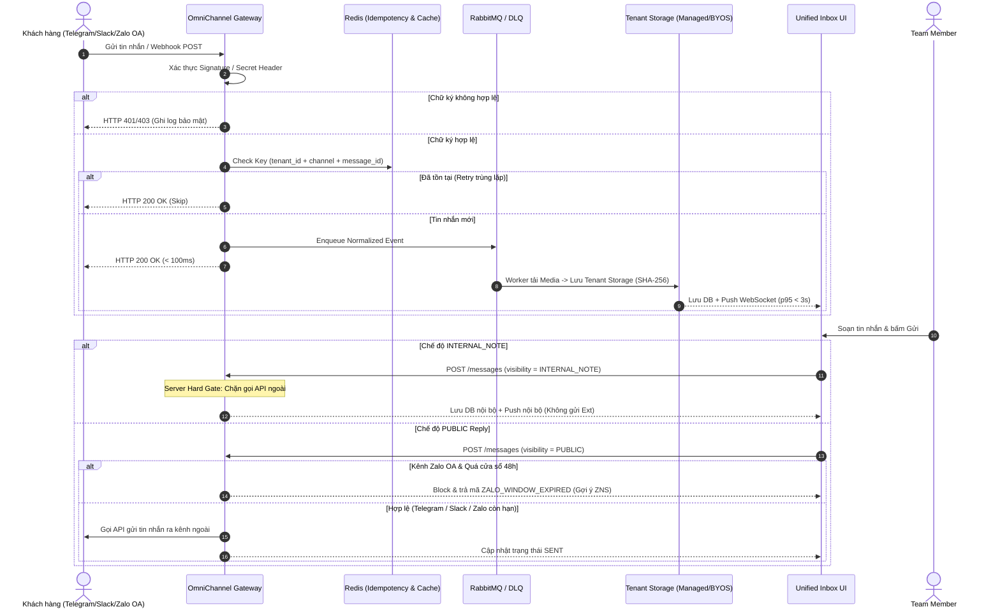
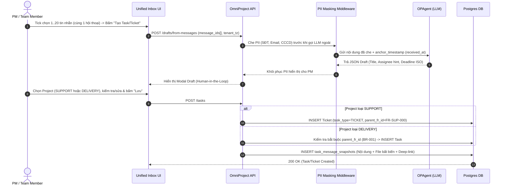
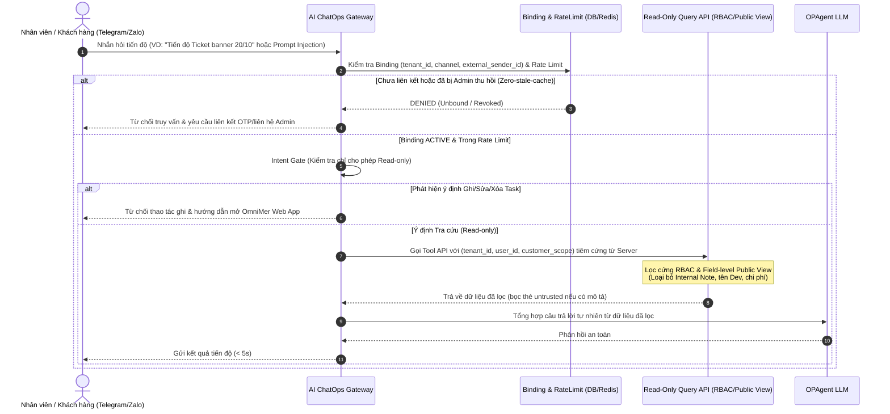
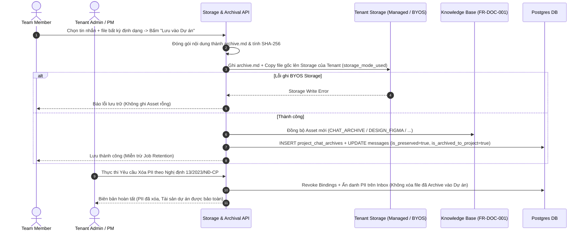

# Sequence Diagrams: OmniChannel (Phase 1)

Tài liệu mô tả chi tiết luồng xử lý kỹ thuật (bao gồm Happy Path và Alternate/Exception Flows) cho 4 nhóm nghiệp vụ chính của phân hệ OmniChannel, bám sát [BRD_OMNICHANNEL_USER_STORIES.md](file:///Users/macbookair/Downloads/source/omnimer_team/omnimer_team_doc/docs/bda/02-phase1-omniproject/omnichannel/BRD_OMNICHANNEL_USER_STORIES.md).

---

## 1. Luồng Inbound Webhook & Outbound 2 Chiều (`FR-CHN-002`, `FR-CHN-003`, `FR-CHN-005`)

---

## 2. Luồng Gom Nhiều Tin Nhắn → Task/Ticket với OPAgent & Snapshot (`FR-CHN-006`, `FR-CHN-007`, `FR-CHN-008`)

---

## 3. Luồng AI ChatOps Read-Only, Account Binding & Phòng thủ Prompt Injection (`FR-CHN-012`..`015`)

---

## 4. Luồng Lưu trữ BYOS, Lưu vào Dự án (`archive.md`) & Tuân thủ NĐ 13/2023/NĐ-CP (`FR-CHN-016`, `FR-CHN-017`)

