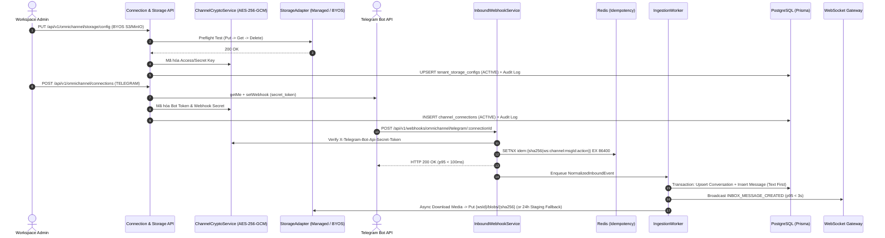

# Software Requirements Specification (SRS) — OmniChannel Phase 1: Storage Foundation (BYOS) & Telegram Core Gateway

> **Reference Standard:** IEEE Std 830-1998  
> **Project:** OmniMer Enterprise PMIS — OmniChannel Module  
> **Phase:** Phase 1 (Storage Adapter BYOS, Channel Connection Management & Inbound Webhook Pipeline)  
> **RTM:** [02_RTM_PHASE1_STORAGE_GATEWAY.csv](./02_RTM_PHASE1_STORAGE_GATEWAY.csv)  
> **Changelog:** [07_omnichannel_implementation_changelog.md](../../../../../../backend_otm/project_core/docs/change_log/07_omnichannel_implementation_changelog.md)

---

## 1. Introduction

### 1.1 Purpose
Tài liệu SRS này đặc tả toàn bộ yêu cầu chức năng, quy tắc nghiệp vụ, mô hình dữ liệu Prisma/PostgreSQL, yêu cầu phi chức năng (NFR), và hợp đồng giao tiếp REST API / WebSocket cho **OmniChannel Phase 1**. Đây là hợp đồng kỹ thuật (Design Contract) bắt buộc cho các AI Models (**Neon**, **Gemini 4 Hydrogen**, **Claude Opus**, **Gemini 4 Argon**, **Gemini Flash**) trong Giai đoạn I và Sub-Phase 1.

### 1.2 Product Scope (Phase 1)
Phase 1 thiết lập tầng nền móng lưu trữ và cổng tiếp nhận sự kiện bất đồng bộ:
1. **`FR-CHN-017.1` (Pluggable Tenant Storage Adapter — `MANAGED` & `BYOS`):** Cho phép `Workspace Admin` giữ mặc định `MANAGED` hoặc tự cắm hạ tầng lưu trữ riêng (`AWS_S3`, `MINIO`, `GCS_S3`, `CLOUDFLARE_R2`), thực thi Preflight Test (`PutObject → GetObject → DeleteObject`), mã hóa credentials AES-256-GCM, lưu trữ tệp vật lý chống trùng theo khóa băm `{workspace_id}/blobs/{sha256}` kèm `ref_count` và bộ đệm Staging 24h khi BYOS tạm lỗi.
2. **`FR-CHN-001` (Channel Connection Management & Token Security):** Quản lý vòng đời kết nối kênh (`TELEGRAM`, `SLACK`, `ZALO_OA` — ưu tiên chứng minh Core Gateway bằng **Telegram Bot** ở Phase 1; cấm tuyệt đối Zalo cá nhân / unofficial API), mã hóa `encrypted_credentials`, sinh `webhook_secret_hash`, Health Check / Rotate Token và ghi `chatops_audit_logs`.
3. **`FR-CHN-002` (Inbound Webhook Gateway, Idempotency & DLQ):** Tiếp nhận Webhook, xác thực chữ ký HMAC/Secret (`HTTP 401/403`), chống trùng đa khách thuê bằng khóa tổ hợp `SHA256(workspace_id:channel_type:external_message_id:event_action)` trên Redis (TTL 24h), chuẩn hóa payload, trả `HTTP 200 OK` trong `< 100ms`, tách lưu `messages.content` (Text) trước khi tải Media异步 (`p95 < 3s`), và Retry 3 lần (`5s, 30s, 120s`) trước khi đẩy vào Dead-Letter Queue (`webhook_dead_letters`).

### 1.3 References
- [FR-CHN-001: Channel Connection Management](./FR-CHN-001_channel_connection_management.md)
- [FR-CHN-002: Inbound Webhook Gateway](./FR-CHN-002_inbound_webhook_gateway.md)
- [FR-CHN-017: Tenant Storage BYOS & Project Archival](../phase_3/FR-CHN-017_tenant_storage_byos_and_archival.md)
- [00_DEVELOPMENT_PHASES_ROADMAP.md](../00_DEVELOPMENT_PHASES_ROADMAP.md)

---

## 2. Overall Description & Architecture

---

## 3. Data Dictionary & Prisma Models (Phase 1 Scope)

### 3.1 `tenant_storage_configs` (`TenantStorageConfig`)
| Column | Prisma Type | Nullable | Constraints & Description |
| :--- | :--- | :---: | :--- |
| `workspace_id` | `String @id @db.Uuid` | No | PK, FK → `workspaces.id` (`onDelete: Cascade`) |
| `storage_mode` | `StorageMode` | No | `MANAGED \| BYOS` (Default: `MANAGED`) |
| `provider_type` | `StorageProviderType` | No | `OMNIMER_S3 \| AWS_S3 \| MINIO \| GCS_S3 \| CLOUDFLARE_R2` |
| `endpoint_url` | `String? @db.VarChar(500)` | Yes | Bắt buộc nếu `MINIO` / custom S3 |
| `bucket_name` | `String @db.VarChar(255)` | No | Tên Bucket lưu trữ |
| `region` | `String? @db.VarChar(100)` | Yes | Region (VD: `ap-southeast-1`, `auto`) |
| `encrypted_credentials` | `String? @db.Text` | Yes | Ciphertext AES-256-GCM cho `BYOS` |
| `quota_bytes` | `BigInt?` | Yes | Giới hạn dung lượng khi dùng `MANAGED` |
| `used_bytes` | `BigInt @default(0)` | No | Dung lượng đã sử dụng |
| `status` | `String @db.VarChar(20)` | No | `ACTIVE \| ERROR \| VERIFYING` |
| `updated_at` | `DateTime @updatedAt` | No | Timestamp cập nhật cuối |

### 3.2 `storage_blob_refs` (`StorageBlobRef`)
| Column | Prisma Type | Nullable | Constraints & Description |
| :--- | :--- | :---: | :--- |
| `id` | `String @id @db.Uuid` | No | Primary Key |
| `workspace_id` | `String @db.Uuid` | No | FK → `workspaces.id`, Indexed |
| `sha256` | `String @db.Char(64)` | No | Mã băm nội dung tệp; Unique `(workspace_id, sha256, storage_bucket_ref)` |
| `storage_mode_used` | `StorageMode` | No | `MANAGED \| BYOS` tại thời điểm ghi |
| `storage_bucket_ref` | `String @db.VarChar(255)` | No | Tên Bucket tại thời điểm ghi (đảm bảo đọc tương thích ngược) |
| `storage_key` | `String @db.VarChar(500)` | No | `{workspace_id}/blobs/{sha256}` |
| `size_bytes` | `BigInt` | No | Kích thước tệp |
| `ref_count` | `Int @default(1)` | No | Số tham chiếu từ Inbox / Task Snapshot / Project Archive |
| `staging_expires_at` | `DateTime?` | Yes | Khác `null` nếu đang nằm ở bộ đệm Staging 24h chờ BYOS phục hồi |

### 3.3 `channel_connections` (`ChannelConnection`) & `webhook_dead_letters` (`WebhookDeadLetter`)
- `channel_connections`: `id`, `workspace_id`, `channel_type` (`TELEGRAM | SLACK | ZALO_OA`), `channel_name`, `external_account_id`, `encrypted_credentials`, `webhook_secret_hash`, `status` (`ACTIVE | INACTIVE | TOKEN_EXPIRED | ERROR`), `last_checked_at`, `created_by`, `created_at`, `updated_at`. Unique `(workspace_id, channel_type, external_account_id)`.
- `webhook_dead_letters`: `id`, `workspace_id`, `channel_type`, `raw_payload` (`Json`), `error_message` (`Text`), `retry_count` (`Int @default(3)`), `status` (`PENDING_REVIEW | REPLAYED | DISCARDED`), `created_at`.

---

## 4. Detailed Functional Specifications & Business Rules

1. **Preflight Storage Verification (`BL-CHN-017.1`):** Khi `storageMode = BYOS`, hệ thống ghi thử object `{workspace_id}/_preflight_probe.txt` (16 bytes), đọc lại kiểm tra khớp nội dung, rồi xóa. Nếu bất kỳ bước nào ném lỗi → trả `HTTP 422 ERR_BYOS_PREFLIGHT_FAILED` kèm thông báo lỗi S3 chi tiết, giữ nguyên cấu hình cũ.
2. **Channel Whitelist & Secret Masking (`BL-CHN-001.1`, `001.3`):** Zod `.strict()` chỉ chấp nhận `TELEGRAM | SLACK | ZALO_OA`. Mọi response trả về client chỉ chứa `maskedToken: "****" + last4`, tuyệt đối không trả `encrypted_credentials`.
3. **Decoupled Text vs. Media Ingestion (`BL-CHN-002.6`):**
   - Bước A (Đồng bộ trong Worker): Upsert `Conversation` + Insert `Message` với `content` văn bản và `attachment_status = NONE` (nếu không có file) hoặc `PENDING` (nếu có file) → Phát WebSocket `INBOX_MESSAGE_CREATED` ngay lập tức (`p95 < 3s`).
   - Bước B (Tải Media): Nếu kích thước file báo từ nền tảng vượt ngưỡng API của nền tảng (VD: Telegram Bot API `> 20MB`) → cập nhật `attachment_status = PROVIDER_LIMIT_EXCEEDED`. Nếu tải được file → tính `sha256`: nếu đã tồn tại trong `storage_blob_refs` của Workspace thì chỉ tăng `ref_count + 1` (không upload lại); nếu chưa có thì upload lên Tenant Storage (`attachment_status = SYNCED`). Nếu BYOS của khách bị lỗi kết nối/đầy → lưu tạm vào Staging 24h với `attachment_status = BYOS_STAGED_FALLBACK`.

---

## 5. Non-Functional Requirements (Phase 1 Thresholds)

| NFR ID | Metric | Target Threshold | Verification Method |
| :--- | :--- | :--- | :--- |
| **NFR-P1-01** | Webhook Fast-Ack Latency | `p95 < 100ms` (`HTTP 200 OK`) | Benchmark 500 concurrent requests |
| **NFR-P1-02** | Text Message to WebSocket UI | `p95 < 3000ms` | E2E timestamp diff (`received_at` vs WS emit) |
| **NFR-P1-03** | Cryptographic Security | AES-256-GCM (96-bit IV, 128-bit AuthTag), Constant-time HMAC/Secret check (`crypto.timingSafeEqual`) | Whitebox unit test & Tampered signature test |
| **NFR-P1-04** | Idempotency & DLQ | 0 duplicate rows on 10x parallel retry; 100% failed events in DLQ after 3 retries | Concurrency integration test |

---

## 6. REST API Contracts (Phase 1)

| Method | Endpoint | Role | Request DTO (`.strict()`) | Success / Error Codes |
| :---: | :--- | :---: | :--- | :--- |
| `PUT` | `/api/v1/omnichannel/storage/config` | `ADMIN` | `UpsertStorageConfigSchema` | `200 OK` / `403`, `422 ERR_BYOS_PREFLIGHT_FAILED` |
| `GET` | `/api/v1/omnichannel/storage/config` | `ADMIN`, `PM` | N/A | `200 OK` (Credentials masked) |
| `POST` | `/api/v1/omnichannel/connections` | `ADMIN`, `PM` | `CreateChannelConnectionSchema` | `201 Created` / `400`, `409`, `422` |
| `GET` | `/api/v1/omnichannel/connections` | `ADMIN`, `PM` | N/A | `200 OK` |
| `POST` | `/api/v1/omnichannel/connections/:id/rotate` | `ADMIN`, `PM` | `RotateTokenSchema` | `200 OK` / `404`, `422` |
| `PATCH` | `/api/v1/omnichannel/connections/:id/disconnect` | `ADMIN`, `PM` | N/A | `200 OK` (Non-destructive) |
| `POST` | `/api/v1/webhooks/omnichannel/:channel/:connectionId` | Public (Signed) | Raw Provider JSON | `200 OK` (`<100ms`) / `401`, `403` |

---

## 7. Model Allocation for Phase 1

| Hạng mục Công việc Phase 1 | Model Phụ Trách |
| :--- | :--- |
| Prisma Schema (19 Models, 13 Enums), Migration & Concrete Repositories (`CHN-FOUNDATION-01`) | **Neon** |
| Zod `.strict()` Validation DTOs (`CHN-FOUNDATION-02`) + Connection Controllers/Routes + API Spec `15_..._api.md` | **Gemini 4 Argon** |
| `ChannelCryptoService` (AES-256-GCM + `timingSafeEqual` Webhook Signature Verifier) (`FR-CHN-001.2`, `002.1`) | **Claude Opus** |
| `TenantStorageService` (BYOS Preflight, SHA-256 Blob Dedup, Staging 24h) + `InboundWebhookService` & `IngestionWorker` (`FR-CHN-017.1`, `001.1`, `002.2..5`) | **Gemini 4 Hydrogen** |
| Kiểm tra `npx tsc --noEmit`, ESLint & tạo Webhook/S3 Mock Fixtures | **Gemini Flash** |
