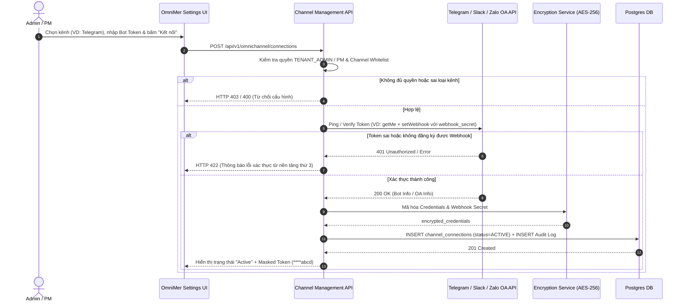

# Feature: Channel Connection Management & Token Security (FR-CHN-001)

**Mô tả:** Cho phép Admin/PM của Tenant kết nối, kiểm tra trạng thái, cập nhật và ngắt kết nối các kênh giao tiếp bên ngoài (ưu tiên theo lộ trình: **Telegram Bot → Slack Workspace → Zalo OA**), đảm bảo mã hóa thông tin xác thực và ghi vết Audit Log.

**Kiến trúc cốt lõi:** Áp dụng mô hình **Tenant-Scoped Connector Registry** kết hợp **Envelope Encryption (KMS/AES-256)**:
- **Ưu tiên lộ trình kênh:** Hệ thống hỗ trợ chuẩn giao tiếp chung qua Interface Adapter cho `TELEGRAM`, `SLACK`, và `ZALO_OA`. Tuyệt đối không hỗ trợ kết nối Zalo cá nhân / unofficial API (`zca-js`).
- **Tách biệt Secret & Runtime:** Toàn bộ Token/Secret sau khi xác thực thành công được mã hóa tại tầng Application trước khi lưu DB; mỗi kết nối sinh một `webhook_secret` riêng để xác thực request từ bên ngoài.
- **Giám sát sức khỏe kênh (Health Check):** Kênh lưu trạng thái vòng đời (`ACTIVE`, `INACTIVE`, `TOKEN_EXPIRED`, `ERROR`) để UI cảnh báo sớm cho Admin khi token hết hạn hoặc bị thu hồi từ nền tảng thứ 3.

## 1. Functional Requirements List

| FR ID | Requirement Description | Input | Output | Associated Business Rule | Priority |
|---|---|---|---|---|---|
| **FR-CHN-001.1** | **Tạo & Xác thực Kết nối Kênh mới:** Admin/PM chọn loại kênh (`TELEGRAM \| SLACK \| ZALO_OA`), nhập thông số xác thực; hệ thống ping API nền tảng thứ 3 để verify và tự động đăng ký Webhook URL (nếu nền tảng hỗ trợ). | `tenant_id`, `channel_type`, `channel_name`, `credentials` (Bot Token / App Secret / OA ID) | `channel_connection_id`, `webhook_url`, `status = ACTIVE` | `BL-CHN-001.1`, `BL-CHN-001.2` | Must-have |
| **FR-CHN-001.2** | **Mã hóa Thông tin Xác thực (Encryption at Rest):** Toàn bộ Access Token, Refresh Token, App Secret phải được mã hóa AES-256/KMS trước khi lưu vào Database và không bao giờ trả nguyên văn ra API GET. | Raw `credentials` JSON | `encrypted_credentials` (Ciphertext + Key Version), Masked preview (VD: `***8a9f`) | `BL-CHN-001.3` (`NFR-CHN-03`) | Must-have |
| **FR-CHN-001.3** | **Cập nhật, Làm mới Token & Kiểm tra Kết nối:** Cho phép Admin/PM test lại kết nối (Ping Health Check) hoặc xoay vòng (Rotate) Token/Webhook Secret khi nghi ngờ lộ lọt. | `channel_connection_id`, `new_credentials` (tùy chọn) | Kết quả Health Check (`OK \| ERROR`), cập nhật `last_checked_at` | `BL-CHN-001.4` | Must-have |
| **FR-CHN-001.4** | **Ngắt kết nối & Xử lý Token Hết hạn:** Cho phép vô hiệu hóa kênh (`INACTIVE`) hoặc hệ thống tự động đánh dấu `TOKEN_EXPIRED` khi Outbound/Refresh gặp lỗi 401 liên tiếp từ nền tảng thứ 3. | `channel_connection_id`, `action = DISCONNECT` | Cập nhật `status = INACTIVE`, dừng nhận/gửi mới, giữ nguyên lịch sử hội thoại | `BL-CHN-001.5` | Must-have |

## 2. Business Rules

| BR ID | Rule Description | Applies to FR |
|---|---|---|
| **BL-CHN-001.1** | **Channel Whitelist Policy:** Hệ thống chỉ chấp nhận `channel_type` thuộc tập `{TELEGRAM, SLACK, ZALO_OA}`. Mọi yêu cầu cấu hình kênh không chính thức (Zalo cá nhân, unofficial script) bị từ chối ở cả UI và API (`HTTP 400`). | FR-CHN-001.1 |
| **BL-CHN-001.2** | **Role Authorization (`FR-PRJ-000` Alignment):** Chỉ tài khoản có vai trò `TENANT_ADMIN` (tương ứng **`Workspace Admin`** trong `omniproject_core`) hoặc `PM` được gán quyền quản trị kênh mới được tạo, chỉnh sửa hoặc ngắt kết nối kênh. Member/Guest gọi API nhận `HTTP 403 Forbidden`. | FR-CHN-001.1, FR-CHN-001.3, FR-CHN-001.4 |
| **BL-CHN-001.3** | **Zero Plaintext Secret Exposure:** Token/Secret lưu ở DB phải ở dạng mã hóa; API trả danh sách kênh chỉ hiển thị 4 ký tự cuối (`****1234`), tuyệt đối không log raw token vào stdout/file log. | FR-CHN-001.2 |
| **BL-CHN-001.4** | **Audit Trail Mandatory:** Mọi hành động Kết nối mới, Rotate Token/Secret, và Ngắt kết nối bắt buộc ghi vào `chatops_audit_logs` gồm `actor_user_id`, `tenant_id`, `channel_connection_id`, `action`, `timestamp`. | FR-CHN-001.1, FR-CHN-001.3, FR-CHN-001.4 |
| **BL-CHN-001.5** | **Non-destructive Disconnect:** Khi ngắt kết nối một kênh, dữ liệu `conversations` và `messages` lịch sử không bị xóa để phục vụ tra cứu/truy vết Task; chỉ chặn phát sinh giao dịch gửi/nhận mới. | FR-CHN-001.4 |

## 3. Data Structure

### Entity: `channel_connections`
| Field | Data Type | Required | Constraints |
|---|---|---|---|
| `id` | `UUID` | Yes | Primary Key |
| `tenant_id` | `UUID` | Yes | FK → `workspaces.workspace_id` (`FR-ORG-001`), Indexed |
| `channel_type` | `ENUM` | Yes | `TELEGRAM \| SLACK \| ZALO_OA` |
| `channel_name` | `VARCHAR(150)` | Yes | Tên hiển thị (VD: `Bot Hỗ Trợ CSKH`) |
| `external_account_id` | `VARCHAR(255)` | Yes | Bot ID / Workspace ID / OA ID; Unique cùng `(tenant_id, channel_type)` |
| `encrypted_credentials` | `TEXT` | Yes | Ciphertext AES-256-GCM (chứa Access/Refresh Token, App Secret) |
| `webhook_secret_hash` | `VARCHAR(255)` | Yes | Hash hoặc ciphertext dùng verify Inbound Webhook |
| `status` | `ENUM` | Yes | `ACTIVE \| INACTIVE \| TOKEN_EXPIRED \| ERROR` |
| `last_checked_at` | `TIMESTAMPTZ` | No | Thời điểm kiểm tra kết nối gần nhất |
| `created_by` | `UUID` | Yes | FK → `users.id` |
| `created_at` | `TIMESTAMPTZ` | Yes | Default `NOW()` |
| `updated_at` | `TIMESTAMPTZ` | Yes | Default `NOW()` |

## 4. Sequence Diagram: Kết nối & Xác thực Kênh Mới



## 5. Pre/Post-Conditions & Acceptance Criteria

### FR-CHN-001.1 & FR-CHN-001.2: Kết nối Kênh & Mã hóa Token
- **Pre-condition:** Người thực hiện đăng nhập với vai trò `TENANT_ADMIN` hoặc `PM`; có tài khoản Telegram Bot / Slack App / Zalo OA hợp lệ.
- **Post-condition:** Bản ghi kết nối được tạo ở trạng thái `ACTIVE`, credentials được mã hóa trong DB, Webhook đã đăng ký và Audit Log đã ghi nhận.
- **Exception / Error case:** Token sai hoặc hết hạn khi verify → trả lỗi chi tiết từ nền tảng thứ 3, không lưu bản ghi kết nối; Trùng `external_account_id` trong cùng Tenant → trả lỗi `409 Conflict`.

**Gherkin Scenario:**
```gherkin
Given tôi là Admin của Tenant A đang ở màn hình "Cấu hình Kênh OmniChannel"
When tôi chọn loại kênh "TELEGRAM", nhập Bot Token hợp lệ và nhấn "Kết nối"
Then hệ thống xác thực thành công với Telegram API, đăng ký Webhook kèm secret token
And thông tin credentials được mã hóa khi lưu vào DB, giao diện hiển thị trạng thái "Active" với token đã che (****1234)
And hệ thống ghi nhận 1 bản ghi Audit Log cho hành động kết nối kênh
```
