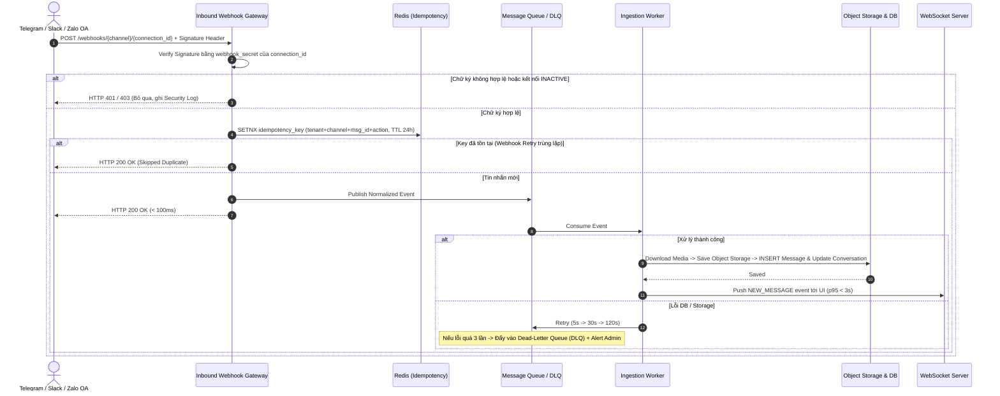

# Feature: Inbound Webhook Gateway (FR-CHN-002)

**Mô tả:** Tiếp nhận toàn bộ Webhook sự kiện tin nhắn từ Telegram, Slack và Zalo OA; xác thực tính toàn vẹn chữ ký, chống trùng lặp đa Tenant, chuẩn hóa về cấu trúc thống nhất, tải tệp đính kèm về lưu trữ nội bộ và đẩy vào hàng đợi xử lý bất đồng bộ với cơ chế Retry & Dead-Letter Queue (DLQ).

**Kiến trúc cốt lõi:** Áp dụng mô hình **Fast-Ack Asynchronous Ingestion Pipeline**:
- **Tách pha Tiếp nhận & Xử lý (Fast Ack < 100ms):** Endpoint Webhook chỉ làm 3 việc nhẹ: (1) Xác thực chữ ký, (2) Kiểm tra Idempotency trên Redis, (3) Đẩy Raw/Normalized Event vào RabbitMQ/Redis Streams và trả `HTTP 200 OK` ngay trong `< 100ms` để không bị Telegram/Zalo ngắt kết nối hoặc retry bão.
- **Chuẩn hóa Adapter (Unified Data Contract):** Mọi payload dị biệt từ các nền tảng đều được Adapter chuyển về một schema chuẩn chung trước khi Worker lưu DB.
- **Bảo toàn Media nội bộ:** Link ảnh/file từ Zalo/Telegram thường có thời hạn ngắn hoặc gắn token bí mật; Worker bắt buộc tải về Object Storage (S3/MinIO) nội bộ của Tenant.

## 1. Functional Requirements List

| FR ID | Requirement Description | Input | Output | Associated Business Rule | Priority |
|---|---|---|---|---|---|
| **FR-CHN-002.1** | **Xác thực Chữ ký Webhook (Signature Verification):** Kiểm tra tính hợp lệ của HTTP Request bằng Secret Header / HMAC Signature tương ứng với `channel_connection_id` trên URL. | HTTP Headers (`X-Telegram-Bot-Api-Secret-Token`, `X-Slack-Signature`, `X-ZEvent-Signature`), Raw Body | Pass hoặc `HTTP 401/403` + Security Alert Log | `BL-CHN-002.1` | Must-have |
| **FR-CHN-002.2** | **Chống Trùng lặp Đa Tenant (Composite Idempotency):** Tạo khóa tổ hợp từ `(tenant_id, channel_type, external_message_id)` trên Redis để bỏ qua các bản tin gửi lặp lại (Retry) từ nền tảng thứ 3. | `tenant_id`, `channel_type`, `external_message_id`, `event_action` | Cho phép xử lý (lần đầu) hoặc `HTTP 200 OK (Skipped)` | `BL-CHN-002.2` (`NFR-CHN-02`) | Must-have |
| **FR-CHN-002.3** | **Chuẩn hóa Payload & Enqueue (< 100ms):** Map payload đặc thù về Data Contract chuẩn và đẩy vào hàng đợi bất đồng bộ. | Raw JSON từ Telegram / Slack / Zalo OA | Normalized Event trong Queue + `HTTP 200 OK` (`< 100ms`) | `BL-CHN-002.3` (`NFR-CHN-01`) | Must-have |
| **FR-CHN-002.4** | **Consumer Lưu trữ, Tải Media & Push Real-time:** Worker đọc Queue, tạo/cập nhật `conversations`, tải tệp đính kèm về Object Storage nội bộ, lưu `messages` và phát sự kiện WebSocket tới UI (`p95 < 3s`). | Normalized Event từ Queue | Bản ghi DB + File trên Storage + WebSocket Push | `BL-CHN-002.4` (`NFR-CHN-01`) | Must-have |
| **FR-CHN-002.5** | **Cơ chế Retry & Dead-Letter Queue (DLQ):** Tự động thử lại khi Worker gặp lỗi tạm thời (DB/Storage timeout); sau tối đa số lần retry thì chuyển sang DLQ để vận hành kiểm tra. | Failed Queue Event | Retry theo Exponential Backoff hoặc chuyển DLQ + Alert | `BL-CHN-002.5` (`NFR-CHN-02`) | Must-have |

## 2. Business Rules

| BR ID | Rule Description | Applies to FR |
|---|---|---|
| **BL-CHN-002.1** | **Strict Signature Check:** Mọi Webhook request thiếu hoặc sai chữ ký HMAC/Secret Token bắt buộc bị từ chối bằng `HTTP 401` (thiếu) hoặc `HTTP 403` (sai), không được phép đưa vào Message Queue. | FR-CHN-002.1 |
| **BL-CHN-002.2** | **Composite Idempotency Key:** Do `external_message_id` có thể trùng giữa các nền tảng hoặc các Tenant khác nhau, khóa chống trùng lặp bắt buộc phải gồm đủ `tenant_id + channel_type + external_message_id + event_action` (TTL Redis tối thiểu 24h, kèm Unique Index trong DB). | FR-CHN-002.2 |
| **BL-CHN-002.3** | **Fast-Ack SLA:** Webhook Endpoint phải phản hồi `HTTP 200 OK` trong `< 100ms` (không thực hiện tải file hoặc gọi LLM đồng bộ trong HTTP thread tiếp nhận Webhook). | FR-CHN-002.3 |
| **BL-CHN-002.4** | **End-to-End Delivery SLA:** Tổng thời gian từ lúc Gateway nhận Webhook hợp lệ đến khi tin nhắn xuất hiện trên Unified Inbox UI phải đạt `p95 < 3 giây`. | FR-CHN-002.4 |
| **BL-CHN-002.5** | **DLQ Retention & Alerting:** Worker thực hiện tối đa 3 lần retry (giãn cách 5s, 30s, 120s). Nếu vẫn lỗi, event chuyển sang DLQ (lưu trữ tối thiểu 7 ngày) và kích hoạt cảnh báo cho System Admin. | FR-CHN-002.5 |
| **BL-CHN-002.6** | **Decoupled Text vs. Media Ingestion & Content-Addressable Storage:** (1) Worker luôn lưu `messages.content` (chữ) vào DB và đẩy WebSocket lên UI ngay lập tức trước khi tải Media nặng; (2) Nếu tệp vượt giới hạn tải của nền tảng thứ 3 (VD: Telegram Bot API `> 20MB`), gán `attachment_status = PROVIDER_LIMIT_EXCEEDED` và vẫn hiển thị tin nhắn chữ bình thường; (3) Nếu BYOS Storage của Tenant tạm lỗi/đầy, giữ tệp tại bộ đệm Staging 24h (`attachment_status = BYOS_STAGED_FALLBACK`) để tự động đồng bộ lại khi BYOS phục hồi; (4) Tệp vật lý lưu theo đường dẫn chống trùng `{workspace_id}/blobs/{sha256}`. | FR-CHN-002.4, FR-CHN-002.5 |

## 2.1. Data Contract (Normalized Inbound Payload)

```json
{
  "tenant_id": "uuid",
  "channel_connection_id": "uuid",
  "channel_type": "TELEGRAM | SLACK | ZALO_OA",
  "event_action": "CREATE | EDIT | RECALL",
  "external_message_id": "string",
  "external_thread_id": "string",
  "external_sender_id": "string",
  "sender_name": "string",
  "message_type": "TEXT | IMAGE | FILE | STICKER | VOICE | UNSUPPORTED",
  "content": "string | null",
  "raw_attachments": [
    { "provider_file_id": "string", "url": "string", "file_name": "string", "mime_type": "string", "size_bytes": 0 }
  ],
  "provider_timestamp": "ISO8601",
  "received_at": "ISO8601"
}
```

## 3. Data Structure

### Entity: `webhook_idempotency_logs` (hoặc Redis Key + DB Unique Constraint)
| Field | Data Type | Required | Constraints |
|---|---|---|---|
| `idempotency_key` | `VARCHAR(128)` | Yes | Primary Key (`SHA256(tenant_id:channel_type:external_message_id:event_action)`) |
| `tenant_id` | `UUID` | Yes | FK → `tenants.id` |
| `channel_connection_id` | `UUID` | Yes | FK → `channel_connections.id` |
| `processed_at` | `TIMESTAMPTZ` | Yes | Default `NOW()` |

### Entity: `webhook_dead_letters`
| Field | Data Type | Required | Constraints |
|---|---|---|---|
| `id` | `UUID` | Yes | Primary Key |
| `tenant_id` | `UUID` | Yes | FK → `tenants.id`, Indexed |
| `channel_type` | `ENUM` | Yes | `TELEGRAM \| SLACK \| ZALO_OA` |
| `raw_payload` | `JSONB` | Yes | Payload gốc để replay khi khắc phục lỗi |
| `error_message` | `TEXT` | Yes | Chi tiết ngoại lệ cuối cùng |
| `retry_count` | `INTEGER` | Yes | Số lần đã thử (Mặc định: 3) |
| `status` | `ENUM` | Yes | `PENDING_REVIEW \| REPLAYED \| DISCARDED` |
| `created_at` | `TIMESTAMPTZ` | Yes | Default `NOW()` |

## 4. Sequence Diagram: Inbound Webhook, Idempotency & DLQ



## 5. Pre/Post-Conditions & Acceptance Criteria

### FR-CHN-002.1 & FR-CHN-002.2: Bảo mật Webhook & Chống trùng lặp
- **Pre-condition:** Kết nối kênh ở trạng thái `ACTIVE`, có `webhook_secret` hợp lệ.
- **Post-condition:** Tin nhắn duy nhất được lưu DB kèm bản sao media trên storage nội bộ, UI nhận WebSocket push trong `p95 < 3s`.
- **Exception / Error case:** Request giả mạo chữ ký → `401/403`; Webhook gửi trùng `external_message_id` trong cùng Tenant → `200 OK` nhưng không sinh tin nhắn thứ hai; Worker lỗi quá 3 lần → lưu `webhook_dead_letters`.

**Gherkin Scenario:**
```gherkin
Given kênh Telegram của Tenant A đang ở trạng thái "Active"
When Telegram gửi một Webhook hợp lệ với message_id = "msg_1001"
Then Gateway xác thực chữ ký, trả về HTTP 200 OK trong vòng < 100ms và tin nhắn hiển thị trên Unified Inbox (p95 < 3 giây)
When Telegram gửi lại (Retry) cùng message_id = "msg_1001" cho Tenant A
Then Gateway trả về HTTP 200 OK nhưng bỏ qua không tạo tin nhắn trùng thứ hai trên Unified Inbox
When một request giả mạo có chữ ký sai gửi tới endpoint Webhook
Then Gateway từ chối ngay với mã HTTP 403 và không đẩy vào Message Queue
```
