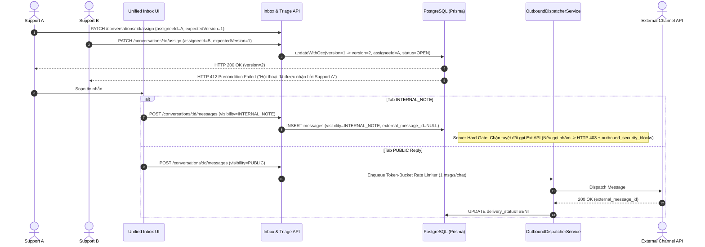

# Software Requirements Specification (SRS) — OmniChannel Phase 2: Unified 2-Way Inbox, Triage OCC, RBAC & Internal Note

> **Reference Standard:** IEEE Std 830-1998  
> **Project:** OmniMer Enterprise PMIS — OmniChannel Module  
> **Phase:** Phase 2 (`FR-CHN-003`, `FR-CHN-004`, `FR-CHN-005`)  
> **RTM:** [02_RTM_PHASE2_UNIFIED_INBOX.csv](./02_RTM_PHASE2_UNIFIED_INBOX.csv)  
> **Changelog:** [07_omnichannel_implementation_changelog.md](../../../../../../backend_otm/project_core/docs/change_log/07_omnichannel_implementation_changelog.md)

---

## 1. Introduction

### 1.1 Purpose
Đặc tả toàn bộ yêu cầu kỹ thuật cho **OmniChannel Phase 2**: giao diện và hệ thống xử lý nhắn tin 2 chiều tập trung, bộ điều tiết tốc độ gửi đi (Outbound Token-Bucket Rate Limiter), quản lý phân luồng hội thoại có chống xung đột đồng thời (OCC `version`), phân quyền cấp hội thoại (`BR-CHN-006`), kênh thảo luận nội bộ tự động theo Project (`PROJECT_DISCUSSION`), và cơ chế cô lập Ghi chú nội bộ (`INTERNAL_NOTE`) với **Server Outbound Hard Gate**.

### 1.2 Product Scope (Phase 2)
1. **`FR-CHN-003` (2-Way Messaging & Outbound Gateway):** Hiển thị luồng tin nhắn sắp xếp tất định theo `(provider_timestamp ASC, created_at ASC, id ASC)`, placeholder cho `STICKER`/`VOICE`/`UNSUPPORTED` và nhãn `[Đã chỉnh sửa]`/`[Đã thu hồi]`, gửi Public Reply (Text/Image/File) qua Outbound Token-Bucket Rate Limiter và hỗ trợ Manual Retry khi gửi lỗi.
2. **`FR-CHN-004` (Conversation Triage, OCC, RBAC & Project Discussion):** Vòng đời `UNASSIGNED → OPEN → RESOLVED` (tự động Re-open về `OPEN` khi khách nhắn tiếp), chống 2 nhân viên nhận trùng hội thoại bằng OCC `version` (`HTTP 412 Precondition Failed`), lọc quyền truy cập theo `channel_access_members` (`BR-CHN-006`), và tự động tạo 1 kênh thảo luận nội bộ `PROJECT_DISCUSSION` cho mỗi Project `ACTIVE` (chuyển Read-only khi Project `ARCHIVED` theo `FR-PRJ-018.4`).
3. **`FR-CHN-005` (Internal Note Isolation & Server Hard Gate):** Soạn thảo `INTERNAL_NOTE` trên giao diện nền vàng tách biệt, hộp thoại cảnh báo khi chuyển sang `PUBLIC` có chứa `@` hoặc `#`, và chốt chặn cứng tại `OutboundDispatcherService` (`if (msg.visibility !== 'PUBLIC') abort + insert outbound_security_blocks`).

### 1.3 References
- [FR-CHN-003: 2-Way Messaging & Outbound](./FR-CHN-003_2way_messaging_and_outbound.md)
- [FR-CHN-004: Conversation Triage & RBAC](./FR-CHN-004_conversation_triage_and_rbac.md)
- [FR-CHN-005: Internal Note Isolation](./FR-CHN-005_internal_note_isolation.md)

---

## 2. Overall Description & Architecture

---

## 3. Data Dictionary & Prisma Models (Phase 2 Scope)

- **`conversations` (`Conversation`):** `id`, `workspace_id`, `conversation_type` (`EXTERNAL_CHANNEL | PROJECT_DISCUSSION`), `channel_type` (`TELEGRAM | SLACK | ZALO_OA | INTERNAL`), `channel_connection_id?`, `project_id?` (Unique khi `PROJECT_DISCUSSION`), `external_thread_id?`, `contact_name?`, `assignee_id?`, `status` (`UNASSIGNED | OPEN | RESOLVED`), `version` (`Int @default(1)`), `last_message_at`, `last_customer_message_at?`.
- **`channel_access_members` (`ChannelAccessMember`):** `id`, `workspace_id`, `channel_connection_id`, `user_id`, `access_role` (`SUPERVISOR | AGENT`). Unique `(channel_connection_id, user_id)`.
- **`messages` (`Message`):** `id`, `workspace_id`, `conversation_id`, `sender_type`, `sender_user_id?`, `external_message_id?` (`NULL` khi `INTERNAL_NOTE`), `visibility` (`PUBLIC | INTERNAL_NOTE`), `message_type`, `content?`, `attachments?` (`Json`), `attachment_status`, `linked_task_ids` (`String[]`), `delivery_status`, `error_reason?`, `is_edited`, `is_recalled`, `is_preserved`, `is_archived_to_project`, `is_purged`, `deleted_at?`, `provider_timestamp`, `created_at`.
- **`outbound_security_blocks` (`OutboundSecurityBlock`):** `id`, `workspace_id`, `message_id`, `actor_user_id?`, `reason` (`BLOCKED_INTERNAL_NOTE_OUTBOUND`), `created_at`.

---

## 4. Non-Functional Requirements (Phase 2 Thresholds)

| NFR ID | Metric | Target Threshold |
| :--- | :--- | :--- |
| **NFR-P2-01** | Inbox Conversation List & Message History Query | `p95 < 200ms` (Cursor-based pagination `limit <= 50`) |
| **NFR-P2-02** | Internal Note Leakage Rate | `0%` (Chặn cứng tại `OutboundDispatcherService` + DB Check Constraint `external_message_id IS NULL`) |
| **NFR-P2-03** | Outbound Rate Limiting | Token-Bucket giãn nhịp tự động (`1 msg/s/chat`, `25 msg/s/bot` cho Telegram), `0` lỗi `HTTP 429` khi burst 50 tin |
| **NFR-P2-04** | Multi-User Claim Concurrency | 100% request đến sau với `expectedVersion` cũ nhận `HTTP 412 Precondition Failed` |

---

## 5. REST API & WebSocket Contracts (Phase 2)

| Method | Endpoint | Role | Request DTO (`.strict()`) | Success / Error Codes |
| :---: | :--- | :---: | :--- | :--- |
| `GET` | `/api/v1/omnichannel/conversations` | `ADMIN`, `PM`, `MEMBER` | `ListConversationsQuerySchema` | `200 OK` (Filtered by RBAC) |
| `GET` | `/api/v1/omnichannel/conversations/:id/messages` | Authorized Member | `?cursor=uuid&limit=50` | `200 OK` / `403 Forbidden` |
| `PATCH` | `/api/v1/omnichannel/conversations/:id/assign` | Authorized Member | `AssignConversationSchema` | `200 OK` / `403`, `412 OCC Conflict` |
| `PATCH` | `/api/v1/omnichannel/conversations/:id/status` | Authorized Member | `{ status, expectedVersion }` | `200 OK` / `403`, `412` |
| `POST` | `/api/v1/omnichannel/conversations/:id/messages` | Authorized Member | `SendMessageSchema` | `201 Created` / `400`, `403`, `422` |
| `POST` | `/api/v1/omnichannel/messages/:id/retry` | Authorized Member | N/A | `200 OK` / `400`, `404` |

---

## 6. Model Allocation for Phase 2

| Hạng mục Công việc Phase 2 | Model Phụ Trách |
| :--- | :--- |
| `ConversationTriageService` (OCC `assignWithOcc` `HTTP 412`, Auto Re-open, `PROJECT_DISCUSSION` auto-sync) (`FR-CHN-004.1/2/5`) | **Neon** |
| `requireConversationAccess` RBAC Middleware (`FR-CHN-004.4`) + Server Outbound Hard Gate (`FR-CHN-005.3`) | **Claude Opus** |
| `OutboundDispatcherService` Token-Bucket Rate Limiter (`FR-CHN-003.3`) | **Gemini 4 Hydrogen** |
| `InboxController`, Unified Inbox UI, Internal Note Composer UI, Ordering/Placeholders, Manual Retry & API Spec `16_..._api.md` | **Gemini 4 Argon** |
| Kiểm tra `npx tsc --noEmit`, ESLint & UI alignment fixes | **Gemini Flash** |
