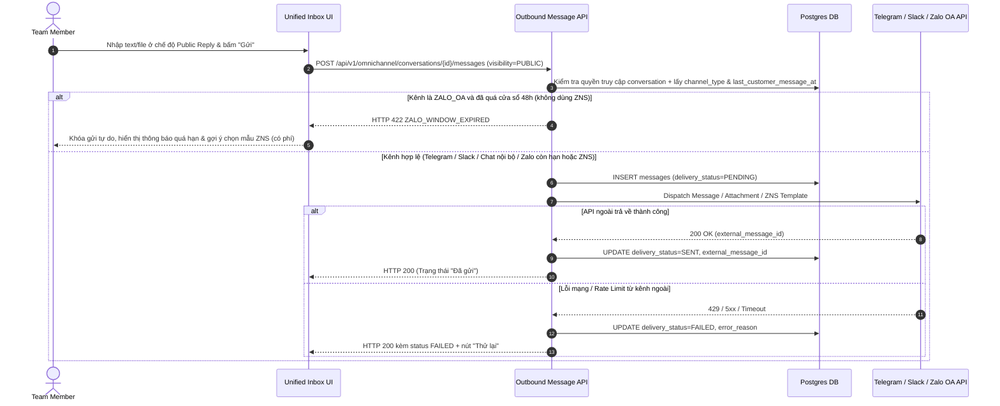

# Feature: 2-Way Messaging & Outbound Gateway (FR-CHN-003)

**Mô tả:** Cho phép thành viên đọc và phản hồi tin nhắn 2 chiều (văn bản, hình ảnh, tệp đính kèm) trên một màn hình Unified Inbox duy nhất cho Telegram, Slack, Zalo OA và Chat nội bộ; xử lý sắp xếp đúng thứ tự thời gian, hiển thị placeholder cho định dạng chưa hỗ trợ và kiểm soát cửa sổ tương tác 48h / ZNS của Zalo OA.

**Kiến trúc cốt lõi:** Áp dụng mô hình **Channel-Aware Outbound Dispatcher**:
- **Sắp xếp theo Thời gian Gốc (`provider_timestamp`):** Khi tin nhắn từ mạng đến lệch thứ tự hoặc có nhiều tin nhắn gửi trong cùng một giây, UI và API lịch sử luôn sắp xếp theo `(provider_timestamp ASC, sequence_id ASC)`.
- **Tiền kiểm tra Chính sách Kênh (Pre-flight Policy Check):** Trước khi gửi `PUBLIC` Reply sang Zalo OA, hệ thống kiểm tra mốc `last_customer_message_at` để tính cửa sổ tương tác miễn phí 48h; chặn gửi tự do nếu đã hết hạn và hướng dẫn chuyển sang ZNS.
- **Graceful Degradation cho Media/Events Phase 1:** Các định dạng ngoài phạm vi Phase 1 (`STICKER`, `VOICE`) hoặc sự kiện `EDIT`/`RECALL` không làm lỗi luồng hiển thị mà được render thành placeholder/nhãn rõ ràng.

## 1. Functional Requirements List

| FR ID | Requirement Description | Input | Output | Associated Business Rule | Priority |
|---|---|---|---|---|---|
| **FR-CHN-003.1** | **Hiển thị Hội thoại Đa kênh & Thứ tự Thời gian:** Tải và hiển thị luồng tin nhắn (Text, Image, File) của Telegram, Slack, Zalo OA và Chat nội bộ trên 1 màn hình, sắp xếp chuẩn theo `provider_timestamp`. | `conversation_id`, `cursor / pagination` | Danh sách tin nhắn sắp xếp đúng thứ tự kèm badge kênh nguồn | `BL-CHN-003.1` | Must-have |
| **FR-CHN-003.2** | **Hiển thị Định dạng Chưa hỗ trợ & Sự kiện Sửa/Thu hồi:** Render placeholder cho `STICKER`/`VOICE`/`UNSUPPORTED` và gắn nhãn `[Đã chỉnh sửa]` / `[Đã thu hồi]` khi nhận sự kiện từ kênh gốc. | `message_type`, `event_action`, `is_edited`, `is_recalled` | UI hiển thị placeholder hoặc nhãn trạng thái an toàn | `BL-CHN-003.2` | Must-have |
| **FR-CHN-003.3** | **Gửi Tin nhắn 2 Chiều (Public Reply — Text/Image/File):** Cho phép soạn thảo văn bản và đính kèm ảnh/file gửi ra nền tảng tương ứng thông qua Outbound Worker. | `conversation_id`, `sender_user_id`, `content`, `attachments[]`, `visibility = PUBLIC` | Gửi qua API nền tảng thứ 3, cập nhật `delivery_status = SENT \| FAILED` | `BL-CHN-003.3`, `BL-CHN-003.4` | Must-have |
| **FR-CHN-003.4** | **Kiểm soát Cửa sổ Tương tác Zalo OA (48h) & Gợi ý ZNS:** Tính toán và hiển thị bộ đếm ngược 48h trên hội thoại Zalo OA; chặn gửi tin tự do khi hết hạn và gợi ý chọn mẫu ZNS đã duyệt. | `conversation_id`, `last_customer_message_at`, `zns_template_id` (tùy chọn) | Bộ đếm ngược UI; Chặn gửi (`ZALO_WINDOW_EXPIRED`) hoặc điều hướng gửi ZNS | `BL-CHN-003.5` | Must-have |
| **FR-CHN-003.5** | **Thử lại khi Gửi Lỗi (Manual Retry Outbound):** Cho phép người dùng bấm "Thử lại" đối với tin nhắn có `delivery_status = FAILED` (lỗi mạng tạm thời/rate limit). | `message_id` (`status = FAILED`) | Thực thi gửi lại qua Outbound API, cập nhật `SENT` nếu thành công | `BL-CHN-003.4` | Must-have |

## 2. Business Rules

| BR ID | Rule Description | Applies to FR |
|---|---|---|
| **BL-CHN-003.1** | **Deterministic Message Ordering:** Danh sách tin nhắn trong một hội thoại luôn được sắp xếp theo `provider_timestamp ASC`, trường hợp bằng nhau thì sắp theo `created_at ASC` và `id ASC`. | FR-CHN-003.1 |
| **BL-CHN-003.2** | **Unsupported Media & Recall Handling:** Ở Phase 1, không giải mã hay phát trực tiếp Sticker/Voice note từ nền tảng ngoài; UI bắt buộc render placeholder `[Tin nhắn Sticker/Voice chưa hỗ trợ xem trực tiếp]`. Nếu tin nhắn bị thu hồi (`is_recalled = true`), giữ bản ghi log hệ thống cho Audit nhưng ẩn nội dung text trên UI bằng nhãn `[Tin nhắn đã được người gửi thu hồi]`. | FR-CHN-003.2 |
| **BL-CHN-003.3** | **Attachment Validation:** Tệp đính kèm gửi đi phải tuân theo giới hạn dung lượng nhỏ hơn hoặc bằng ngưỡng tối đa của từng nền tảng đích (ví dụ: Telegram Bot API file upload, Slack file size, Zalo OA attachment limit) và kiểm tra định dạng hợp lệ trước khi gọi API ngoài. | FR-CHN-003.3 |
| **BL-CHN-003.4** | **Outbound Delivery Feedback:** Tin nhắn gửi đi ban đầu có trạng thái `PENDING`. Khi API nền tảng thứ 3 trả về thành công → chuyển `SENT` và lưu `external_message_id`. Nếu lỗi → chuyển `FAILED`, lưu `error_code` + `error_reason` hiển thị cho người dùng kèm nút `Retry`. | FR-CHN-003.3, FR-CHN-003.5 |
| **BL-CHN-003.5** | **Zalo OA 48h Window Hard Check:** Đối với kênh `ZALO_OA`, nếu `(NOW() - last_customer_message_at) > 48 giờ` (hoặc theo cấu hình cửa sổ hiện hành của Zalo OA API), hệ thống **chặn trước khi gọi API phản hồi tự do** ở cả UI và Backend (`HTTP 422 - ZALO_WINDOW_EXPIRED`), hiển thị đếm ngược `00:00:00` và gợi ý gửi qua **Mẫu ZNS đã duyệt (có tính phí)**. | FR-CHN-003.4 |
| **BL-CHN-003.6** | **Outbound Token-Bucket Rate Limiter:** Mọi tin nhắn gửi ra ngoài (bao gồm Public Reply và Auto-Notification `FR-CHN-009`) phải đi qua Outbound Queue có bộ điều tiết Token Bucket theo từng `channel_connection_id` (VD: Telegram tối đa 1 tin/giây/chat và 25 tin/giây/bot) để tránh lỗi `HTTP 429 Too Many Requests` khi gửi hàng loạt. | FR-CHN-003.3, FR-CHN-003.5 |

## 3. Data Structure

### Entity: `messages`
| Field | Data Type | Required | Constraints |
|---|---|---|---|
| `id` | `UUID` | Yes | Primary Key |
| `tenant_id` | `UUID` | Yes | FK → `workspaces.workspace_id` (`FR-ORG-001`), Indexed |
| `conversation_id` | `UUID` | Yes | FK → `conversations.id`, Indexed |
| `sender_type` | `ENUM` | Yes | `EXTERNAL_CONTACT \| INTERNAL_USER \| SYSTEM_BOT` |
| `sender_user_id` | `UUID` | No | FK → `users.id` (nếu `sender_type = INTERNAL_USER`) |
| `external_message_id` | `VARCHAR(255)` | No | ID tin nhắn trên Telegram/Slack/Zalo |
| `visibility` | `ENUM` | Yes | `PUBLIC \| INTERNAL_NOTE` |
| `message_type` | `ENUM` | Yes | `TEXT \| IMAGE \| FILE \| STICKER \| VOICE \| UNSUPPORTED` |
| `content` | `TEXT` | No | Nội dung văn bản |
| `attachments` | `JSONB` | No | `[{ "storage_key": "{workspace_id}/blobs/{sha256}", "storage_mode_used": "MANAGED \| BYOS", "storage_bucket_ref": "...", "sha256": "...", "name": "...", "mime": "...", "size": 0 }]` |
| `attachment_status` | `ENUM` | Yes | `NONE \| SYNCED \| BYOS_STAGED_FALLBACK \| PROVIDER_LIMIT_EXCEEDED` |
| `linked_task_ids` | `UUID[]` | No | Danh sách Task/Ticket đã tạo từ tin nhắn này (chống tạo trùng `FR-CHN-006`) |
| `delivery_status` | `ENUM` | Yes | `RECEIVED \| PENDING \| SENT \| FAILED` |
| `error_reason` | `VARCHAR(500)` | No | Lý do lỗi khi `FAILED` |
| `is_edited` | `BOOLEAN` | Yes | Default `false` |
| `is_recalled` | `BOOLEAN` | Yes | Default `false` |
| `is_preserved` | `BOOLEAN` | Yes | Default `false` (Miễn trừ Job Retention `FR-CHN-016`) |
| `is_archived_to_project` | `BOOLEAN` | Yes | Default `false` (`true` khi đã bấm "Lưu vào Dự án" `FR-CHN-017`) |
| `is_purged` | `BOOLEAN` | Yes | Default `false` (`true` khi tệp/tin quá hạn đã dọn) |
| `deleted_at` | `TIMESTAMPTZ` | No | Dùng cho Thùng rác 30 ngày (`FR-CHN-016`) |
| `provider_timestamp` | `TIMESTAMPTZ` | Yes | Thời gian gốc từ nền tảng, Indexed |
| `created_at` | `TIMESTAMPTZ` | Yes | Default `NOW()` |

## 4. Sequence Diagram: Gửi Tin nhắn 2 Chiều & Kiểm soát Zalo OA 48h



## 5. Pre/Post-Conditions & Acceptance Criteria

### FR-CHN-003.3 & FR-CHN-003.4: Gửi Public Reply & Chặn ngoài cửa sổ Zalo 48h
- **Pre-condition:** Nhân viên có quyền truy cập `conversation_id`; chế độ gửi đang là `PUBLIC`; kết nối kênh ở trạng thái `ACTIVE`.
- **Post-condition:** Tin nhắn gửi thành công qua nền tảng ngoài và lưu trạng thái `SENT`; hoặc nếu quá cửa sổ Zalo 48h thì bị chặn trước khi gọi API phản hồi tự do.
- **Exception / Error case:** Tệp vượt dung lượng nền tảng cho phép → chặn ở API với `400 Bad Request`; Mất kết nối/timeout tới API ngoài → chuyển trạng thái `FAILED` kèm nút `Thử lại`.

**Gherkin Scenario:**
```gherkin
Given tôi đang mở một hội thoại từ kênh Zalo OA mà tin nhắn cuối của khách hàng đã cách đây 49 giờ
When tôi xem khung soạn thảo Public Reply
Then bộ đếm ngược hiển thị hết hạn (00:00:00), hệ thống chặn nút gửi tin nhắn tự do trước khi gọi API Zalo
And hệ thống hiển thị gợi ý "Chuyển sang gửi mẫu tin ZNS đã duyệt (phát sinh chi phí)"
When tôi chuyển sang mở một hội thoại Telegram đang hoạt động, đính kèm 1 ảnh PNG hợp lệ và nhấn "Gửi"
Then tin nhắn hiển thị trạng thái "Đã gửi" và khách hàng trên Telegram nhận được ảnh kèm nội dung
```
