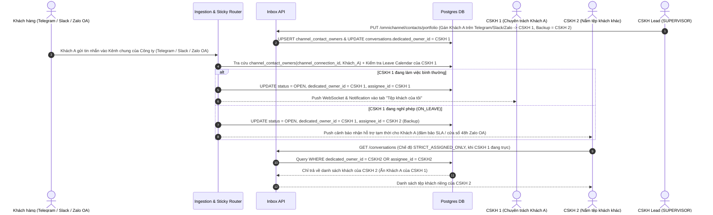

<!--
  name: FR-CHN-004_conversation_triage_and_rbac.md
  description: Functional Requirements specification for Conversation Triage, Multi-Channel Sticky Customer Ownership Portfolio per CSKH across shared Telegram Bot, Slack Workspace, and Zalo OA connections, Assigned-Only Visibility Mode, and Conversation-Level RBAC.
-->

# Feature: Conversation Triage, Multi-Channel Sticky Customer Portfolio & Conversation-Level RBAC (FR-CHN-004)

**Mô tả:** Quản lý phân luồng hội thoại (`UNASSIGNED`, `OPEN`, `RESOLVED`), phân công người phụ trách (`Assignee`) và **gán danh sách khách hàng/nhóm khách hàng chuyên trách cố định cho từng nhân viên CSKH (`Sticky Account Owner`) trên toàn bộ các kênh dùng chung (1 Telegram Bot, 1 Slack Workspace, 1 Zalo OA, v.v.)**, tránh trả lời trùng hoặc sót khách hàng, đồng thời thực thi phân quyền chặt chẽ ở cấp hội thoại (hỗ trợ chế độ **Cô lập danh sách khách riêng từng CSKH trên mọi nền tảng**) và cô lập tuyệt đối giữa các Tenant.

**Kiến trúc cốt lõi:** Áp dụng mô hình **Queue-based Triage + Multi-Channel Sticky Portfolio Routing + Row-Level Access Control (RLAC)**:
- **Vòng đời Trạng thái Tự động & Sticky Routing Đa Kênh:** Hội thoại từ khách mới (trên Telegram DM/Group, Slack Channel/Connect, Zalo OA) chưa có người quản lý vào `UNASSIGNED` (hoặc chia tự động Least-Active / Round-Robin); nếu khách hàng hoặc nhóm chat đã nằm trong danh sách phụ trách (`channel_contact_owners` / `dedicated_owner_id`) của một CSKH, hệ thống tự động định tuyến thẳng vào hộp thư **`Tệp khách của tôi`** của CSKH đó (`status = OPEN`), kể cả khi khách nhắn lại sau nhiều tuần từ trạng thái `RESOLVED`.
- **Phân quyền Kênh & Chế độ Cô lập Danh sách Khách (`BR-CHN-006`):** Trên cùng 1 kết nối kênh dùng chung (`TELEGRAM`, `SLACK`, `ZALO_OA`), Admin/PM có thể bật chính sách hiển thị `visibility_policy = TEAM_SHARED` (cả đội CSKH cùng thấy để hỗ trợ nhau) hoặc `STRICT_ASSIGNED_ONLY` (mỗi CSKH chỉ nhìn thấy danh sách khách hàng/nhóm chat Telegram/Slack/Zalo do mình nắm giữ, còn `SUPERVISOR` / `PM` / `Admin` thấy toàn bộ).
- **Chuyển giao Tạm thời khi CSKH Nghỉ phép (`Leave Backup Handover`):** Khi CSKH chuyên trách đang trong kỳ nghỉ phép (`ON_LEAVE` theo `FR-PRJ-011.2`) mà khách hàng thuộc danh sách của họ nhắn tin vào Telegram, Slack hoặc Zalo OA, hệ thống tự động gán tạm thời (`assignee_id`) cho CSKH dự phòng (`backup_owner_id`) hoặc đẩy ra hàng đợi ưu tiên để đảm bảo SLA phản hồi (và không bị trôi quá cửa sổ 48h đối với Zalo OA), nhưng vẫn giữ nguyên quyền sở hữu gốc (`dedicated_owner_id`).

## 1. Functional Requirements List

| FR ID | Requirement Description | Input | Output | Associated Business Rule | Priority |
|---|---|---|---|---|---|
| **FR-CHN-004.1** | **Phân công Người phụ trách (Assign Conversation):** Cho phép PM/Support tự nhận (`Claim`) hoặc gán một thành viên đủ quyền làm `assignee_id` của hội thoại. | `conversation_id`, `assignee_id`, `actor_user_id` | Cập nhật `assignee_id`, `status = OPEN`, Notification cho Assignee | `BL-CHN-004.1`, `BL-CHN-004.2` | Must-have |
| **FR-CHN-004.2** | **Chuyển trạng thái & Tự động Mở lại (Resolve / Re-open):** Cho phép chuyển hội thoại sang `RESOLVED` khi xử lý xong và tự động chuyển lại `OPEN` nếu khách hàng nhắn tin mới. | `conversation_id`, `target_status` hoặc Inbound Customer Message | Cập nhật `conversations.status`, đẩy lên đầu danh sách nếu Re-open | `BL-CHN-004.3`, `BL-CHN-004.7` | Must-have |
| **FR-CHN-004.3** | **Lọc Danh sách & Tìm kiếm Hội thoại (Inbox Views):** Hỗ trợ tab lọc nhanh (`Chưa nhận`, `Của tôi`, `Tệp khách của tôi`, `Đang mở`, `Đã xong`, theo Kênh) chỉ trả về các hội thoại trong phạm vi quyền. | `tenant_id`, `user_id`, `filter_tab`, `channel_type`, `keyword` | Danh sách `conversations` phân trang đúng quyền | `BL-CHN-004.4` (`BR-CHN-006`), `BL-CHN-004.8` | Must-have |
| **FR-CHN-004.4** | **Kiểm soát RBAC Cấp Kênh & Cô lập Multi-tenant:** Chặn mọi truy vấn xem chi tiết, tìm kiếm hoặc gửi tin nếu User không thuộc Tenant hoặc chưa được cấp quyền truy cập Kênh / Tệp khách hàng đó. | `requester_user_id`, `requester_tenant_id`, `conversation_id` | Dữ liệu hợp lệ hoặc `HTTP 403 Forbidden` / rỗng | `BL-CHN-004.4`, `BL-CHN-004.5`, `BL-CHN-004.8` | Must-have |
| **FR-CHN-004.5** | **Kênh Thảo luận Nội bộ Tự động theo Dự án (`PROJECT_DISCUSSION`):** Mỗi Project đang `ACTIVE` tự động có sẵn 1 kênh thảo luận nội bộ trên Unified Inbox (tự động đồng bộ thành viên theo Project Members, không cần quản lý tạo/rời nhóm chat tự do phức tạp). | `project_id` (`PROJECT_CREATED` / `MEMBER_UPDATED`) | Bản ghi `conversations` loại `PROJECT_DISCUSSION` gắn với `project_id` | `BL-CHN-004.6` | Must-have |
| **FR-CHN-004.6** | **Phân bổ Danh sách Khách hàng Đa Kênh theo CSKH Chuyên trách (`Multi-Channel Sticky Customer Portfolio`):** Trên cùng 1 kết nối kênh dùng chung (Telegram Bot, Slack Workspace, Zalo OA,...), cho phép Admin/SUPERVISOR gán trước (qua UI hoặc import CSV/danh bạ) hoặc tự động gắn cố định khách hàng/nhóm chat khách hàng (`external_contact_id` / `external_thread_id` / `customer_scope`) vào danh sách của từng nhân viên CSKH (`dedicated_owner_id`), kèm cơ chế dự phòng khi CSKH nghỉ phép. | `channel_connection_id`, `contact_mappings[{ external_contact_id, dedicated_owner_id, backup_owner_id }]` | Bản ghi `channel_contact_owners`, tự động định tuyến tin nhắn khách trên Telegram/Slack/Zalo về đúng CSKH chuyên trách | `BL-CHN-004.7`, `BL-CHN-004.8`, `BL-CHN-004.9` | Must-have |

## 2. Business Rules

| BR ID | Rule Description | Applies to FR |
|---|---|---|
| **BL-CHN-004.1** | **Valid Assignee Scope & OCC (`FR-PRJ-000`):** Chỉ gán `assignee_id` là thành viên nội bộ thuộc cùng `tenant_id` (`workspace_id`) và có quyền vào kênh. Thao tác nhận/gán hội thoại áp dụng **Optimistic Concurrency Control (`version`)**: nếu 2 nhân viên bấm nhận cùng lúc, người thứ hai nhận `HTTP 412 Precondition Failed` để tránh tranh chấp. | FR-CHN-004.1 |
| **BL-CHN-004.2** | **Collision Prevention & Notification:** Khi một hội thoại chuyển từ `UNASSIGNED` sang `OPEN` (đã có Assignee), UI hiển thị rõ avatar/tên người phụ trách; nếu thành viên khác mở cùng hội thoại, UI hiển thị cảnh báo `"Đang được xử lý bởi [Tên]"` để tránh trả lời trùng. Hệ thống bắn Notification In-app cho Assignee mới. | FR-CHN-004.1 |
| **BL-CHN-004.3** | **Auto Re-open on Customer Reply:** Bất kỳ tin nhắn Inbound mới nào từ khách hàng vào một hội thoại đang có `status = RESOLVED` đều tự động cập nhật `status = OPEN` và cập nhật `last_message_at = NOW()` để đẩy lên đầu hàng đợi chờ xử lý. | FR-CHN-004.2 |
| **BL-CHN-004.4** | **Conversation-Level RBAC (`BR-CHN-006`):** Với `EXTERNAL_CHANNEL`, User chỉ được đọc/trả lời khi thuộc cùng `tenant_id` VÀ thỏa mãn quy tắc quyền của kênh (`channel_access_members` kết hợp `visibility_policy` ở `BL-CHN-004.8`). Với `PROJECT_DISCUSSION`, quyền truy cập tự động đồng bộ theo danh sách thành viên nội bộ (`ADMIN/PM/MEMBER`, không gồm `GUEST`) của `project_id` đó. | FR-CHN-004.3, FR-CHN-004.4 |
| **BL-CHN-004.5** | **Cross-Tenant & Unauthorized Search Protection:** API tìm kiếm tin nhắn/hội thoại luôn tiêm cứng `WHERE tenant_id = :session_workspace_id` và điều kiện `channel_access_members` / `project_members`. Tuyệt đối không trả thông tin rò rỉ (count, preview snippet) của hội thoại không có quyền. | FR-CHN-004.3, FR-CHN-004.4 |
| **BL-CHN-004.6** | **Project Discussion Lifecycle (`FR-PRJ-018` Alignment):** Mỗi Project có tối đa 1 hội thoại `conversation_type = PROJECT_DISCUSSION`. Khi Project chuyển sang `ARCHIVED` (`FR-PRJ-018.4`), hội thoại thảo luận của Project đó tự động chuyển sang chế độ `Read-only`. | FR-CHN-004.5 |
| **BL-CHN-004.7** | **Multi-Channel Sticky Account Owner Auto-Routing:** Khi khách hàng gửi tin nhắn vào bất kỳ kênh ngoài nào đã kết nối (`TELEGRAM` DM/Group, `SLACK` Channel/Connect, `ZALO_OA`,...), Ingestion Worker tra cứu bảng `channel_contact_owners` theo `(tenant_id, channel_connection_id, external_contact_id)`. Nếu đã có `dedicated_owner_id` (CSKH chuyên trách), hội thoại lập tức được gán `assignee_id = dedicated_owner_id`, chuyển sang `OPEN` và chỉ bắn thông báo cho đúng CSKH đó. Với khách mới chưa có trong danh sách, nếu kênh bật `auto_bind_on_first_claim = true`, CSKH đầu tiên nhận xử lý sẽ tự động trở thành `dedicated_owner_id` cho các lần liên hệ về sau. | FR-CHN-004.2, FR-CHN-004.6 |
| **BL-CHN-004.8** | **Assigned-Only Visibility Isolation (`STRICT_ASSIGNED_ONLY` vs `TEAM_SHARED`):** Mỗi kênh kết nối (`channel_connections` của Telegram, Slack, Zalo OA,...) hỗ trợ cấu hình `visibility_policy`: (1) Nếu là `TEAM_SHARED`, tất cả CSKH trong `channel_access_members` đều xem được danh sách hội thoại của kênh; (2) Nếu là `STRICT_ASSIGNED_ONLY`, nhân viên có role `AGENT` **chỉ nhìn thấy và tìm kiếm được các khách hàng/nhóm chat thuộc danh sách mình phụ trách trên các kênh đó** (`dedicated_owner_id = user_id` hoặc `assignee_id = user_id`, cùng hàng đợi khách mới `UNASSIGNED` nếu được cấp cờ `can_claim_unassigned = true`), không thể xem hội thoại thuộc tệp khách của CSKH khác. Tài khoản `SUPERVISOR`, `PM` và `Workspace Admin` luôn nhìn thấy toàn bộ 100% hội thoại của cả đội. | FR-CHN-004.3, FR-CHN-004.4, FR-CHN-004.6 |
| **BL-CHN-004.9** | **Leave & Offline Fallback Routing (Bảo vệ SLA Đa Kênh & Cửa sổ 48h Zalo OA):** Nếu khách hàng thuộc danh sách của CSKH A nhắn tin vào Telegram, Slack hoặc Zalo OA trong lúc CSKH A đang có trạng thái nghỉ phép (`ON_LEAVE` trên `FR-PRJ-011.2` hoặc bị `INACTIVE`), hệ thống giữ nguyên `dedicated_owner_id = CSKH A` nhưng tự động chuyển `assignee_id` hiện thời sang `backup_owner_id` (CSKH dự phòng đã cấu hình) hoặc đẩy lên hàng đợi ưu tiên của `SUPERVISOR` để phản hồi kịp SLA (và không bị lỡ cửa sổ 48h đối với Zalo OA). | FR-CHN-004.6 |

## 3. Data Structure

### Entity: `conversations`
| Field | Data Type | Required | Constraints |
|---|---|---|---|
| `id` | `UUID` | Yes | Primary Key |
| `tenant_id` | `UUID` | Yes | FK → `workspaces.workspace_id` (`FR-ORG-001`), Indexed |
| `conversation_type` | `ENUM` | Yes | `EXTERNAL_CHANNEL \| PROJECT_DISCUSSION` |
| `channel_type` | `ENUM` | Yes | `TELEGRAM \| SLACK \| ZALO_OA \| INTERNAL` |
| `channel_connection_id` | `UUID` | No | FK → `channel_connections.id` (`NULL` khi `conversation_type = PROJECT_DISCUSSION`) |
| `project_id` | `UUID` | No | FK → `projects.id` (Unique khi `conversation_type = PROJECT_DISCUSSION`) |
| `external_thread_id` | `VARCHAR(255)` | No | Unique cùng `(tenant_id, channel_connection_id)` khi là kênh ngoài |
| `contact_name` | `VARCHAR(255)` | No | Tên hiển thị khách hàng hoặc tên kênh thảo luận Project |
| `dedicated_owner_id` | `UUID` | No | FK → `users.id`, Indexed (CSKH chuyên trách cố định nắm khách hàng này) |
| `assignee_id` | `UUID` | No | FK → `users.id`, Indexed (CSKH đang trực tiếp xử lý phiên hội thoại hiện tại) |
| `status` | `ENUM` | Yes | `UNASSIGNED \| OPEN \| RESOLVED` |
| `version` | `INTEGER` | Yes | Default `1` (Dùng cho OCC chống 2 người Claim cùng lúc theo `FR-PRJ-000`) |
| `last_message_at` | `TIMESTAMPTZ` | Yes | Dùng sort danh sách hội thoại mới nhất |
| `last_customer_message_at` | `TIMESTAMPTZ` | No | Mốc tin nhắn cuối từ khách hàng |

### Entity: `channel_access_members`
| Field | Data Type | Required | Constraints |
|---|---|---|---|
| `id` | `UUID` | Yes | Primary Key |
| `tenant_id` | `UUID` | Yes | FK → `tenants.id` |
| `channel_connection_id` | `UUID` | Yes | FK → `channel_connections.id` |
| `user_id` | `UUID` | Yes | FK → `users.id` |
| `access_role` | `ENUM` | Yes | `SUPERVISOR \| AGENT` |
| `visibility_scope` | `ENUM` | Yes | `ALL_CHANNEL \| ASSIGNED_PORTFOLIO_ONLY` (Default `ASSIGNED_PORTFOLIO_ONLY` cho `AGENT` khi kênh bật cô lập tệp khách) |
| `can_claim_unassigned` | `BOOLEAN` | Yes | Default `true` (Cho phép nhận thêm khách mới chưa có chủ) |
| `created_at` | `TIMESTAMPTZ` | Yes | Default `NOW()` |

### Entity: `channel_contact_owners` (Danh bạ Phân bổ Khách hàng Đa Kênh theo CSKH trên cùng 1 Telegram Bot / Slack Workspace / Zalo OA)
| Field | Data Type | Required | Constraints |
|---|---|---|---|
| `id` | `UUID` | Yes | Primary Key |
| `tenant_id` | `UUID` | Yes | FK → `tenants.id`, Indexed |
| `channel_connection_id` | `UUID` | Yes | FK → `channel_connections.id` (Kết nối Telegram Bot / Slack Workspace / Zalo OA chung của công ty) |
| `external_contact_id` | `VARCHAR(255)` | Yes | Telegram User/Group Chat ID, Slack Channel/User ID, hoặc Zalo User ID của khách; Unique cùng `(tenant_id, channel_connection_id)` |
| `contact_display_name` | `VARCHAR(255)` | No | Tên khách hàng / Tên nhóm dự án khách hàng / Tên doanh nghiệp đối tác |
| `customer_group_tag` | `VARCHAR(100)` | No | Nhóm tệp khách (VD: `VIP_MIEN_BAC`, `DAI_LY_CAP_1`, `ENTERPRISE_B2B`) |
| `dedicated_owner_id` | `UUID` | Yes | FK → `users.id`, Indexed (CSKH chính nắm giữ khách hàng/nhóm chat này) |
| `backup_owner_id` | `UUID` | No | FK → `users.id` (CSKH dự phòng nhận thay khi CSKH chính `ON_LEAVE`) |
| `assigned_by` | `UUID` | Yes | FK → `users.id` (Admin / SUPERVISOR phân bổ hoặc `SYSTEM_FIRST_CLAIM`) |
| `updated_at` | `TIMESTAMPTZ` | Yes | Default `NOW()` |

## 4. Sequence Diagram: Phân luồng Sticky Owner Đa Kênh (Telegram / Slack / Zalo OA), Re-open & Kiểm soát RBAC



## 5. Pre/Post-Conditions & Acceptance Criteria

### FR-CHN-004.2, FR-CHN-004.4 & FR-CHN-004.6: Định tuyến Tệp Khách Đa Kênh theo CSKH Chuyên trách & Cô lập Quyền Hội thoại
- **Pre-condition:** Tenant đã kết nối tài khoản kênh chung (1 Telegram Bot, 1 Slack Workspace, 1 Zalo OA,... theo `FR-CHN-001`) và có 5 nhân viên CSKH trong `channel_access_members`.
- **Post-condition:** Mỗi khách hàng/nhóm chat khách hàng trên bất kỳ nền tảng nào (Telegram, Slack, Zalo OA) đều được định tuyến chính xác về đúng CSKH chuyên trách; chế độ `STRICT_ASSIGNED_ONLY` đảm bảo CSKH nào chỉ thấy tệp khách của CSKH đó; khi CSKH nghỉ phép có cơ chế chuyển tiếp dự phòng đảm bảo SLA phản hồi.
- **Exception / Error case:** Gán `dedicated_owner_id` không có quyền vào kênh → trả `400 Bad Request`; CSKH 2 (ở chế độ `STRICT_ASSIGNED_ONLY`) truy cập trực tiếp URL hội thoại thuộc tệp khách của CSKH 1 → trả `403 Forbidden`.

**Gherkin Scenario:**
```gherkin
Scenario: Chia các kênh chung (1 Telegram Bot, 1 Slack Workspace, 1 Zalo OA) cho 5 CSKH nắm 5 danh sách khách hàng riêng biệt
  Given Tenant 1 kết nối 1 Telegram Bot, 1 Slack Workspace và 1 tài khoản Zalo OA dùng chung cho 5 nhân viên CSKH (CSKH 1 đến CSKH 5) với visibility_scope = "ASSIGNED_PORTFOLIO_ONLY"
  And Khách hàng "Công ty Minh Phát" (có nhóm chat Telegram, kênh Slack Connect và tài khoản Zalo đều gán vào danh bạ của "CSKH 1", backup là "CSKH 2")
  When Khách hàng "Công ty Minh Phát" nhắn tin vào Telegram Bot, Slack hoặc Zalo OA của Tenant 1 (kể cả khi hội thoại cũ đã "Resolved" từ tháng trước)
  Then hệ thống tự động mở lại hội thoại tương ứng sang trạng thái "Open", gán trực tiếp assignee_id = "CSKH 1" và thông báo riêng cho "CSKH 1"
  When "CSKH 3" mở màn hình Unified Inbox hoặc gọi API tìm kiếm hội thoại của "Công ty Minh Phát" trên bất kỳ kênh nào (Telegram / Slack / Zalo OA)
  Then hệ thống không hiển thị các hội thoại của "Công ty Minh Phát" trong danh sách của "CSKH 3" (hoặc trả về HTTP 403 nếu truy cập trực tiếp bằng ID)
  And chỉ "CSKH 1" và tài khoản cấp "SUPERVISOR / PM / Admin" mới nhìn thấy hội thoại này
  When "CSKH 1" đăng ký nghỉ phép (ON_LEAVE) và "Công ty Minh Phát" nhắn tin mới vào Telegram, Slack hoặc Zalo OA
  Then hệ thống giữ nguyên dedicated_owner_id = "CSKH 1" nhưng tự động chuyển assignee_id tạm thời sang "CSKH 2" để phản hồi kịp SLA
```
