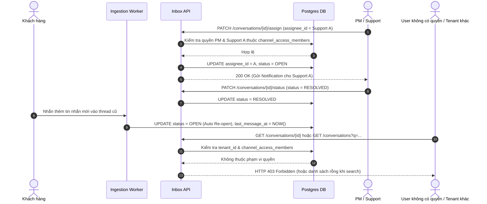

# Feature: Conversation Triage & Conversation-Level RBAC (FR-CHN-004)

**Mô tả:** Quản lý phân luồng hội thoại (`UNASSIGNED`, `OPEN`, `RESOLVED`), phân công người phụ trách (`Assignee`) tránh hai nhân viên trả lời trùng hoặc sót khách hàng, đồng thời thực thi phân quyền chặt chẽ ở cấp hội thoại và cô lập tuyệt đối giữa các Tenant.

**Kiến trúc cốt lõi:** Áp dụng mô hình **Queue-based Triage + Row-Level Access Control (RLAC)**:
- **Vòng đời Trạng thái Tự động:** Hội thoại mới vào `UNASSIGNED` để team nhận xử lý; gán người phụ trách tự động chuyển `OPEN`; đóng xong sang `RESOLVED`; nhưng tự động mở lại (`Re-open`) về `OPEN` ngay khi khách hàng nhắn tiếp.
- **Phân quyền Kênh/Hội thoại (`BR-CHN-006`):** Trong cùng một Tenant, không phải mọi nhân viên đều được xem mọi hội thoại (VD: kênh CSKH VIP hoặc kênh đối tác riêng). Quyền xem được lọc ở tầng Query dựa trên danh sách thành viên được gán vào `channel_connection` hoặc phân công trực tiếp.

## 1. Functional Requirements List

| FR ID | Requirement Description | Input | Output | Associated Business Rule | Priority |
|---|---|---|---|---|---|
| **FR-CHN-004.1** | **Phân công Người phụ trách (Assign Conversation):** Cho phép PM/Support tự nhận (`Claim`) hoặc gán một thành viên đủ quyền làm `assignee_id` của hội thoại. | `conversation_id`, `assignee_id`, `actor_user_id` | Cập nhật `assignee_id`, `status = OPEN`, Notification cho Assignee | `BL-CHN-004.1`, `BL-CHN-004.2` | Must-have |
| **FR-CHN-004.2** | **Chuyển trạng thái & Tự động Mở lại (Resolve / Re-open):** Cho phép chuyển hội thoại sang `RESOLVED` khi xử lý xong và tự động chuyển lại `OPEN` nếu khách hàng nhắn tin mới. | `conversation_id`, `target_status` hoặc Inbound Customer Message | Cập nhật `conversations.status`, đẩy lên đầu danh sách nếu Re-open | `BL-CHN-004.3` | Must-have |
| **FR-CHN-004.3** | **Lọc Danh sách & Tìm kiếm Hội thoại (Inbox Views):** Hỗ trợ tab lọc nhanh (`Chưa nhận`, `Của tôi`, `Đang mở`, `Đã xong`, theo Kênh) chỉ trả về các hội thoại trong phạm vi quyền. | `tenant_id`, `user_id`, `filter_tab`, `channel_type`, `keyword` | Danh sách `conversations` phân trang đúng quyền | `BL-CHN-004.4` (`BR-CHN-006`) | Must-have |
| **FR-CHN-004.4** | **Kiểm soát RBAC Cấp Kênh & Cô lập Multi-tenant:** Chặn mọi truy vấn xem chi tiết, tìm kiếm hoặc gửi tin nếu User không thuộc Tenant hoặc chưa được cấp quyền truy cập Kênh đó. | `requester_user_id`, `requester_tenant_id`, `conversation_id` | Dữ liệu hợp lệ hoặc `HTTP 403 Forbidden` / rỗng | `BL-CHN-004.4`, `BL-CHN-004.5` | Must-have |
| **FR-CHN-004.5** | **Kênh Thảo luận Nội bộ Tự động theo Dự án (`PROJECT_DISCUSSION`):** Mỗi Project đang `ACTIVE` tự động có sẵn 1 kênh thảo luận nội bộ trên Unified Inbox (tự động đồng bộ thành viên theo Project Members, không cần quản lý tạo/rời nhóm chat tự do phức tạp). | `project_id` (`PROJECT_CREATED` / `MEMBER_UPDATED`) | Bản ghi `conversations` loại `PROJECT_DISCUSSION` gắn với `project_id` | `BL-CHN-004.6` | Must-have |

## 2. Business Rules

| BR ID | Rule Description | Applies to FR |
|---|---|---|
| **BL-CHN-004.1** | **Valid Assignee Scope & OCC (`FR-PRJ-000`):** Chỉ gán `assignee_id` là thành viên nội bộ thuộc cùng `tenant_id` (`workspace_id`) và có quyền vào kênh. Thao tác nhận/gán hội thoại áp dụng **Optimistic Concurrency Control (`version`)**: nếu 2 nhân viên bấm nhận cùng lúc, người thứ hai nhận `HTTP 412 Precondition Failed` để tránh tranh chấp. | FR-CHN-004.1 |
| **BL-CHN-004.2** | **Collision Prevention & Notification:** Khi một hội thoại chuyển từ `UNASSIGNED` sang `OPEN` (đã có Assignee), UI hiển thị rõ avatar/tên người phụ trách; nếu thành viên khác mở cùng hội thoại, UI hiển thị cảnh báo `"Đang được xử lý bởi [Tên]"` để tránh trả lời trùng. Hệ thống bắn Notification In-app cho Assignee mới. | FR-CHN-004.1 |
| **BL-CHN-004.3** | **Auto Re-open on Customer Reply:** Bất kỳ tin nhắn Inbound mới nào từ khách hàng vào một hội thoại đang có `status = RESOLVED` đều tự động cập nhật `status = OPEN` và cập nhật `last_message_at = NOW()` để đẩy lên đầu hàng đợi chờ xử lý. | FR-CHN-004.2 |
| **BL-CHN-004.4** | **Conversation-Level RBAC (`BR-CHN-006`):** Với `EXTERNAL_CHANNEL`, User chỉ được đọc/trả lời khi thuộc cùng `tenant_id` VÀ là `Workspace Admin`, nằm trong `channel_access_members`, hoặc là `assignee_id` hiện tại. Với `PROJECT_DISCUSSION`, quyền truy cập tự động đồng bộ theo danh sách thành viên nội bộ (`ADMIN/PM/MEMBER`, không gồm `GUEST`) của `project_id` đó. | FR-CHN-004.3, FR-CHN-004.4 |
| **BL-CHN-004.5** | **Cross-Tenant & Unauthorized Search Protection:** API tìm kiếm tin nhắn/hội thoại luôn tiêm cứng `WHERE tenant_id = :session_workspace_id` và điều kiện `channel_access_members` / `project_members`. Tuyệt đối không trả thông tin rò rỉ (count, preview snippet) của hội thoại không có quyền. | FR-CHN-004.3, FR-CHN-004.4 |
| **BL-CHN-004.6** | **Project Discussion Lifecycle (`FR-PRJ-018` Alignment):** Mỗi Project có tối đa 1 hội thoại `conversation_type = PROJECT_DISCUSSION`. Khi Project chuyển sang `ARCHIVED` (`FR-PRJ-018.4`), hội thoại thảo luận của Project đó tự động chuyển sang chế độ `Read-only`. | FR-CHN-004.5 |

## 3. Data Structure

### Entity: `conversations`
| Field | Data Type | Required | Constraints |
|---|---|---|---|
| `id` | `UUID` | Yes | Primary Key |
| `tenant_id` | `UUID` | Yes | FK → `workspaces.workspace_id` (`FR-ORG-001`), Indexed |
| `conversation_type` | `ENUM` | Yes | `EXTERNAL_CHANNEL \| PROJECT_DISCUSSION` |
| `channel_type` | `ENUM` | Yes | `TELEGRAM \| SLACK \| ZALO_OA \| INTERNAL` |
| `channel_connection_id` | `UUID` | No | FK → `channel_connections.id` (`NULL` khi `conversation_type = PROJECT_DISCUSSION`) |
| `project_id` | `UUID` | No | FK → `projects.id` (Unique khi `conversation_type = PROJECT_DISCUSSION`) |
| `external_thread_id` | `VARCHAR(255)` | No | Unique cùng `(tenant_id, channel_connection_id)` khi là kênh ngoài |
| `contact_name` | `VARCHAR(255)` | No | Tên hiển thị khách hàng hoặc tên kênh thảo luận Project |
| `assignee_id` | `UUID` | No | FK → `users.id`, Indexed |
| `status` | `ENUM` | Yes | `UNASSIGNED \| OPEN \| RESOLVED` |
| `version` | `INTEGER` | Yes | Default `1` (Dùng cho OCC chống 2 người Claim cùng lúc theo `FR-PRJ-000`) |
| `last_message_at` | `TIMESTAMPTZ` | Yes | Dùng sort danh sách hội thoại mới nhất |
| `last_customer_message_at` | `TIMESTAMPTZ` | No | Mốc tin nhắn cuối từ khách hàng |

### Entity: `channel_access_members`
| Field | Data Type | Required | Constraints |
|---|---|---|---|
| `id` | `UUID` | Yes | Primary Key |
| `tenant_id` | `UUID` | Yes | FK → `tenants.id` |
| `channel_connection_id` | `UUID` | Yes | FK → `channel_connections.id` |
| `user_id` | `UUID` | Yes | FK → `users.id` |
| `access_role` | `ENUM` | Yes | `SUPERVISOR \| AGENT` |
| `created_at` | `TIMESTAMPTZ` | Yes | Default `NOW()` |

## 4. Sequence Diagram: Phân luồng, Re-open & Kiểm soát RBAC



## 5. Pre/Post-Conditions & Acceptance Criteria

### FR-CHN-004.2 & FR-CHN-004.4: Tự động Mở lại & Cô lập Quyền Hội thoại
- **Pre-condition:** Hội thoại tồn tại trong Tenant và có ít nhất 1 kênh kết nối.
- **Post-condition:** Trạng thái được cập nhật đúng vòng đời; mọi truy cập trái phép bị chặn ở tầng API/DB.
- **Exception / Error case:** Gán `assignee_id` không có quyền vào kênh → trả `400 Bad Request`; User thuộc Tenant khác hoặc không có quyền vào kênh truy cập URL hội thoại → trả `403 Forbidden`.

**Gherkin Scenario:**
```gherkin
Given hội thoại #C10 thuộc Kênh Hỗ Trợ VIP của Tenant 1 đang ở trạng thái "Resolved"
When khách hàng gửi thêm 1 tin nhắn mới vào hội thoại #C10
Then hệ thống tự động chuyển trạng thái hội thoại #C10 về "Open" và đẩy lên đầu danh sách chờ xử lý
When User B (thuộc Tenant 1 nhưng không có trong danh sách channel_access_members của Kênh Hỗ Trợ VIP) gọi API xem chi tiết hoặc tìm kiếm hội thoại #C10
Then hệ thống trả về HTTP 403 Forbidden (khi xem trực tiếp) và danh sách rỗng (khi tìm kiếm), không làm lộ bất kỳ nội dung nào của #C10
```
