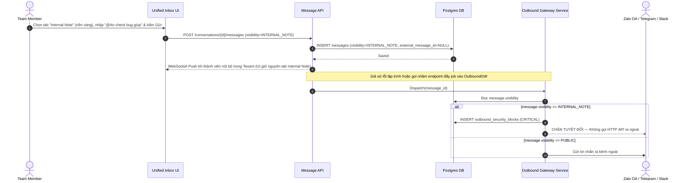

# Feature: Internal Note Isolation & Server Hard Gate (FR-CHN-005)

**Mô tả:** Cho phép thành viên đội ngũ trao đổi nội bộ (Ghi chú nội bộ / Whisper) ngay bên trong luồng hội thoại với khách hàng bằng giao diện màu sắc tách biệt rõ ràng, đồng thời thực thi cơ chế chặn cứng ở tầng Server Outbound Gateway để đảm bảo thông tin nhạy cảm tuyệt đối không bao giờ rò rỉ ra Zalo/Telegram/Slack của khách hàng.

**Kiến trúc cốt lõi:** Áp dụng mô hình **Defense-in-Depth Visibility Isolation (Phòng thủ 2 lớp UI + Server Hard Gate)**:
- **Lớp 1 (UX Guardrail tại Client):** Khung soạn thảo phân biệt màu sắc tương phản mạnh (`Public Reply` nền trắng vs `Internal Note` nền vàng nhạt có badge *"Chỉ nội bộ xem"*). Duy trì chế độ theo ngữ cảnh và bật hộp thoại xác nhận khi có dấu hiệu chuyển nhầm sang Public.
- **Lớp 2 (Server Hard Gate tại Outbound Gateway):** Không tin tưởng tuyệt đối vào cờ từ Client. Mọi tin nhắn `INTERNAL_NOTE` lưu vào bảng `messages` với `visibility = INTERNAL_NOTE`; dịch vụ Outbound Dispatcher kiểm tra cứng điều kiện `visibility === 'PUBLIC'` trước khi khởi tạo bất kỳ HTTP request nào tới API của bên thứ 3.

## 1. Functional Requirements List

| FR ID | Requirement Description | Input | Output | Associated Business Rule | Priority |
|---|---|---|---|---|---|
| **FR-CHN-005.1** | **Soạn thảo & Lưu trữ Ghi chú Nội bộ:** Cho phép thành viên có quyền xem hội thoại tạo tin nhắn với `visibility = INTERNAL_NOTE` (hỗ trợ text, đính kèm file nội bộ, `@mention`, `#task`). | `conversation_id`, `user_id`, `content`, `visibility = INTERNAL_NOTE` | Lưu DB với `visibility = INTERNAL_NOTE`, push WebSocket chỉ cho thành viên nội bộ | `BL-CHN-005.1` (`BR-CHN-003`) | Must-have |
| **FR-CHN-005.2** | **Hiển thị Phân biệt & Cảnh báo Chuyển Chế độ:** Render bong bóng chat `INTERNAL_NOTE` bằng màu nền riêng biệt trên timeline và cảnh báo xác nhận nếu người dùng chuyển sang `PUBLIC` khi nội dung có `@` hoặc `#`. | `messages.visibility`, Composer toggle event | Bong bóng chat màu vàng/badge nội bộ; Popup xác nhận chuyển chế độ | `BL-CHN-005.2` | Must-have |
| **FR-CHN-005.3** | **Chặn cứng tại Server Outbound Gateway (Hard Gate):** Kiểm tra bắt buộc ở tầng Outbound Dispatcher để từ chối và ghi cảnh báo an toàn nếu có bất kỳ luồng xử lý nào cố gửi tin nhắn `INTERNAL_NOTE` ra nền tảng thứ 3. | Outbound dispatch job (`message_id`) | Abort Outbound API Call + Security Alert Log + `HTTP 403` | `BL-CHN-005.3` (`BR-CHN-003`) | Must-have |

## 2. Business Rules

| BR ID | Rule Description | Applies to FR |
|---|---|---|
| **BL-CHN-005.1** | **Internal-Only Persistence & Broadcast:** Tin nhắn `visibility = INTERNAL_NOTE` có `delivery_status = RECEIVED` (nội bộ), không bao giờ gán `external_message_id`, và sự kiện WebSocket `NEW_MESSAGE` chỉ phát tới các socket session thuộc thành viên nội bộ có quyền xem hội thoại (`BR-CHN-006`). | FR-CHN-005.1 |
| **BL-CHN-005.2** | **Context-Aware Composer Safety:** Khi thành viên vừa gửi một `INTERNAL_NOTE`, khung soạn thảo giữ nguyên ở tab `Internal Note` (không tự nhảy về `Public Reply`). Nếu người dùng bấm chuyển từ `Internal Note` sang `Public Reply` trong khi ô nhập đang có nội dung chứa `@` hoặc `#`, UI hiển thị modal xác nhận *"Bạn đang chuyển sang chế độ Gửi cho Khách hàng. Xác nhận nội dung không chứa thông tin nội bộ?"*. | FR-CHN-005.2 |
| **BL-CHN-005.3** | **Server Outbound Hard Gate (`BR-CHN-003`):** Tầng Outbound Gateway Service phải thực thi assertion `if (message.visibility !== 'PUBLIC') throw ForbiddenOutboundException` ngay trước bước gọi HTTP client tới Telegram/Slack/Zalo OA. Vi phạm assertion phải được ghi nhận vào `security_audit_logs` mức `CRITICAL`. | FR-CHN-005.3 |

## 3. Data Structure

### Entity: `messages` (Bổ sung thuộc tính cô lập Internal Note)
| Field | Data Type | Required | Constraints |
|---|---|---|---|
| `id` | `UUID` | Yes | Primary Key |
| `conversation_id` | `UUID` | Yes | FK → `conversations.id` |
| `visibility` | `ENUM` | Yes | `PUBLIC \| INTERNAL_NOTE` (Bắt buộc kiểm tra tại Outbound Gateway) |
| `external_message_id` | `VARCHAR(255)` | No | **Bắt buộc `NULL`** khi `visibility = INTERNAL_NOTE` (DB Check Constraint) |
| `content` | `TEXT` | No | Nội dung ghi chú |

### Entity: `outbound_security_blocks` (Audit log chặn rò rỉ)
| Field | Data Type | Required | Constraints |
|---|---|---|---|
| `id` | `UUID` | Yes | Primary Key |
| `tenant_id` | `UUID` | Yes | FK → `tenants.id` |
| `message_id` | `UUID` | Yes | FK → `messages.id` |
| `actor_user_id` | `UUID` | No | FK → `users.id` |
| `reason` | `VARCHAR(255)` | Yes | VD: `BLOCKED_INTERNAL_NOTE_OUTBOUND` |
| `created_at` | `TIMESTAMPTZ` | Yes | Default `NOW()` |

## 4. Sequence Diagram: Gửi Internal Note & Cơ chế Server Hard Gate



## 5. Pre/Post-Conditions & Acceptance Criteria

### FR-CHN-005.1 & FR-CHN-005.3: Tạo Internal Note & Chặn cứng Gateway
- **Pre-condition:** User là thành viên nội bộ có quyền xem hội thoại `conversation_id`.
- **Post-condition:** Tin nhắn lưu với `visibility = INTERNAL_NOTE`, hiển thị nổi bật cho nội bộ; không có bất kỳ request outbound nào đi tới máy chủ Telegram/Slack/Zalo.
- **Exception / Error case:** Nếu xảy ra lỗi logic hoặc request giả mạo cố đẩy bản ghi `INTERNAL_NOTE` qua Outbound Gateway → Hard Gate chặn đứng, ghi `outbound_security_blocks` mức `CRITICAL` và trả `403`.

**Gherkin Scenario:**
```gherkin
Given tôi đang mở hội thoại Zalo của Khách hàng X và đang ở tab "Internal Note"
When tôi gõ "@An khách hàng này đang báo lỗi thanh toán, kiểm tra log giúp anh" và nhấn "Gửi"
Then tin nhắn hiển thị trong luồng chat với nền vàng cảnh báo và nhãn "Internal Note" cho các thành viên nội bộ
And khung soạn thảo giữ nguyên chế độ "Internal Note" để tránh gửi nhầm ở tin nhắn kế tiếp
And kiểm tra log Outbound Gateway xác nhận không có bất kỳ HTTP request nào được gửi tới máy chủ Zalo OA
When một tiến trình bất kỳ cố gắng đẩy message có visibility = "INTERNAL_NOTE" qua Outbound Gateway
Then Outbound Gateway từ chối thực thi (HTTP 403), ngắt kết nối trước khi gọi API ngoài và ghi log vào bảng outbound_security_blocks
```
