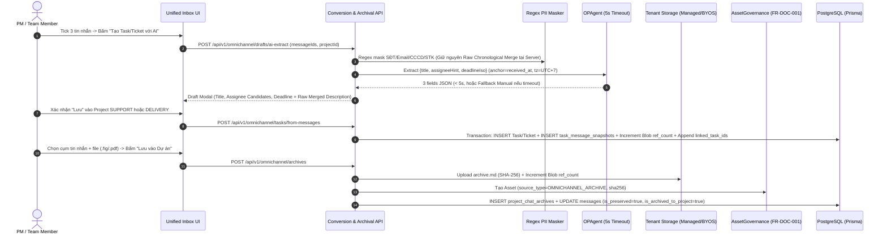

# Software Requirements Specification (SRS) — OmniChannel Phase 3: Message-to-Task/Ticket, OPAgent Draft & Project Archival

> **Reference Standard:** IEEE Std 830-1998  
> **Project:** OmniMer Enterprise PMIS — OmniChannel Module  
> **Phase:** Phase 3 (`FR-CHN-006`, `FR-CHN-007`, `FR-CHN-008`, `FR-CHN-017.2..4`)  
> **RTM:** [02_RTM_PHASE3_CONVERSION_ARCHIVAL.csv](./02_RTM_PHASE3_CONVERSION_ARCHIVAL.csv)  
> **Changelog:** [07_omnichannel_implementation_changelog.md](../../../../../../backend_otm/project_core/docs/change_log/07_omnichannel_implementation_changelog.md)

---

## 1. Introduction

### 1.1 Purpose
Đặc tả toàn bộ yêu cầu kỹ thuật cho **OmniChannel Phase 3**: biến hội thoại khách hàng/nội bộ thành đối tượng công việc (`Task` / `Ticket`) có bằng chứng bất biến (`task_message_snapshots`) và Deep-link, phân loại Project `SUPPORT` vs `DELIVERY` không làm lệch Velocity (`BR-005`) hay vướng DoD (`FR-PRJ-008`), tích hợp OPAgent AI gợi ý nháp an toàn (Regex PII Masking + Raw Chronological Merge), cùng nút **"Bảo lưu"** và **"Lưu vào Dự án"** (`archive.md` → Knowledge Base `FR-DOC-001`).

### 1.2 Product Scope (Phase 3)
1. **`FR-CHN-006` (Multi-Message Selection, Immutable Snapshot & Deep-Link):** Chọn `1..20` tin nhắn trong cùng 1 hội thoại (`<= 50MB`), chống tạo trùng qua `messages.linked_task_ids[]`, kiểm tra Project `ACTIVE` (`FR-PRJ-018.4`) & Billing (`BL-ORG-001.2`), lưu `task_message_snapshots` (Read-only, tham chiếu `{workspace_id}/blobs/{sha256}` tăng `ref_count`) và Deep-link chịu lỗi xóa tin gốc.
2. **`FR-CHN-007` (Support Project `FR-SUP-000` vs Delivery Conversion & Velocity Isolation):** Tự động gán `task_type = TICKET`, `parent_fr_id = FR-SUP-000`, `output_contract_type = NONE` (miễn trừ DoD `FR-PRJ-008`) cho Project `SUPPORT`; hỗ trợ Escalate `TICKET → DELIVERY TASK` (`ticket_delivery_links`) và loại trừ Ticket khỏi Dev Velocity (`BR-005`).
3. **`FR-CHN-008` (OPAgent Draft Extraction with Regex PII Masking & Timezone Anchor):** Dùng Regex tất định che SĐT/Email/CCCD/STK trước khi gọi External LLM để trích xuất 3 trường `{suggested_title, assignee_name_hint, deadline_iso}` neo theo `received_at + tenant_timezone`, giữ nguyên 100% văn bản gộp gốc cho `description` (0 lỗi Unmask, 0 hallucination), Fuzzy Assignee Dropdown và Fallback `5000ms`.
4. **`FR-CHN-017.2..4` (Message Preservation & "Lưu vào Dự án" `.md` Archival):** Gắn cờ `is_preserved = true`; nút **"Lưu vào Dự án"** đóng gói nội dung thành `archive.md` (YAML Frontmatter + Markdown + SHA-256 manifest) kèm tệp bất kỳ định dạng lên Storage Tenant (`MANAGED`/`BYOS`) và đồng bộ thẳng vào Knowledge Base (`FR-DOC-001`).

### 1.3 References
- [FR-CHN-006](./FR-CHN-006_multi_message_snapshot_deeplink.md), [FR-CHN-007](./FR-CHN-007_support_vs_delivery_conversion.md), [FR-CHN-008](./FR-CHN-008_opagent_draft_and_pii_masking.md), [FR-CHN-017](./FR-CHN-017_tenant_storage_byos_and_archival.md)

---

## 2. Overall Description & Architecture

---

## 3. Data Dictionary & Prisma Models (Phase 3 Scope)

- **`task_message_snapshots` (`TaskMessageSnapshot`):** `id`, `workspace_id`, `task_id`, `conversation_id`, `channel_type`, `source_message_ids` (`String[]`), `first_message_id`, `snapshot_content` (`Text`), `snapshot_attachments?` (`Json` tham chiếu `sha256` blob), `deep_link_url`, `created_by`, `created_at` *(Append-only)*.
- **`ticket_delivery_links` (`TicketDeliveryLink`):** `id`, `workspace_id`, `ticket_id`, `delivery_task_id`, `created_at`. Unique `(ticket_id, delivery_task_id)`.
- **`draft_tasks` (`DraftTask`):** `id`, `workspace_id`, `conversation_id`, `suggested_title`, `suggested_description` (`Text`), `assignee_candidates?` (`Json`), `suggested_deadline?`, `ai_status` (`DRAFT_READY | FALLBACK_MANUAL | CONFIRMED | DISCARDED`), `created_by`, `created_at`.
- **`project_chat_archives` (`ProjectChatArchive`):** `id`, `workspace_id`, `project_id`, `conversation_id`, `source_message_ids` (`String[]`), `archive_title`, `asset_type` (`CHAT_ARCHIVE | FRD_DOC | DESIGN_FIGMA | SPREADSHEET | IMAGE | OTHER`), `storage_mode_used`, `storage_bucket_ref`, `markdown_storage_key`, `markdown_sha256` (`Char(64)`), `attachments_manifest?` (`Json`), `knowledge_base_asset_id` (FK → `assets.id`), `archived_by`, `deleted_at?`, `created_at`.

---

## 4. Non-Functional Requirements (Phase 3 Thresholds)

| NFR ID | Metric | Target Threshold |
| :--- | :--- | :--- |
| **NFR-P3-01** | OPAgent Draft Extraction Timeout | Hard timeout `5000ms`; tự động fallback sang Manual Modal trong `< 5100ms` |
| **NFR-P3-02** | External LLM PII Exposure | `0%` SĐT, Email, CCCD, STK thô gửi ra External LLM; `0%` lệch nội dung `description` gốc |
| **NFR-P3-03** | Snapshot & Archive Transaction Atomicity | 100% All-or-Nothing (`BaseRepository.transaction()`); 0 tệp vật lý bị nhân bản trùng `sha256` |

---

## 5. REST API Contracts (Phase 3)

| Method | Endpoint | Role | Request DTO (`.strict()`) | Success / Error Codes |
| :---: | :--- | :---: | :--- | :--- |
| `POST` | `/api/v1/omnichannel/drafts/ai-extract` | `ADMIN`, `PM`, `MEMBER` | `AiExtractDraftSchema` | `200 OK` (`DRAFT_READY` or `FALLBACK_MANUAL`) |
| `POST` | `/api/v1/omnichannel/tasks/from-messages` | `ADMIN`, `PM`, `MEMBER` | `ConvertMessagesToTaskSchema` | `201 Created` / `400`, `403`, `422 Project Archived/BR-001` |
| `POST` | `/api/v1/projects/tickets/:ticketId/escalate` | `ADMIN`, `PM` | `EscalateTicketSchema` | `201 Created` / `403`, `404`, `422` |
| `POST` | `/api/v1/omnichannel/messages/preserve` | `ADMIN`, `PM`, `MEMBER` | `{ conversationId, messageIds }` | `200 OK` |
| `POST` | `/api/v1/omnichannel/archives` | `ADMIN`, `PM`, `MEMBER` | `CreateProjectArchiveSchema` | `201 Created` / `400`, `422`, `502 BYOS Write Error` |

---

## 6. Model Allocation for Phase 3

| Hạng mục Công việc Phase 3 | Model Phụ Trách |
| :--- | :--- |
| `MessageToTaskService` (Transaction tạo Task/Ticket + Snapshot + `linked_task_ids[]`, `SUPPORT` `FR-SUP-000` + `DoD=NONE`, Escalate) & `FR-DOC-001` Sync | **Neon** |
| Regex PII Masking (`FR-CHN-008.1`) + Escalation & Velocity Isolation Audit (`FR-CHN-007.3`) | **Claude Opus** |
| `OpAgentInboxDraftService` (Vietnamese Date Anchoring + Fuzzy Assignee) & `ProjectArchivalService` (`archive.md` Packager + SHA-256) | **Gemini 4 Hydrogen** |
| Multi-select UI (`1..20` msgs), Duplicate Warning Badge, Draft Modal (`5s` Fallback), Preserve Pin UI, Archive Modal & API Spec `17_..._api.md` | **Gemini 4 Argon** |
| Kiểm tra `npx tsc --noEmit`, ESLint & Test Fixtures | **Gemini Flash** |
