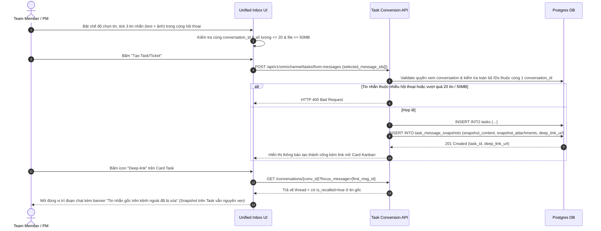

# Feature: Multi-Message Selection, Immutable Snapshot & Deep-Link (FR-CHN-006)

**Mô tả:** Cho phép thành viên chọn 1 tin nhắn hoặc tick gom nhiều tin nhắn liên tiếp (tối đa 20 tin nhắn trong cùng một hội thoại) kèm hình ảnh/tệp đính kèm để tạo thành Task hoặc Ticket trên OmniProject, đồng thời lưu bản sao bất biến (Immutable Snapshot) và Deep-link trỏ về đúng vị trí đoạn chat gốc.

**Kiến trúc cốt lõi:** Áp dụng mô hình **Single-Conversation Batching + Immutable Evidence Snapshot**:
- **Single-Conversation Constraint:** Đảm bảo ngữ cảnh nhất quán bằng cách chỉ cho phép chọn gom nhiều tin nhắn trong phạm vi một `conversation_id`, giới hạn số lượng (`1..20` tin nhắn) và tổng dung lượng file đính kèm (`<= 50MB`).
- **Tách biệt Snapshot và Live Reference:** Không chỉ lưu link trỏ về bảng `messages` hay link Telegram/Zalo gốc; tại thời điểm tạo Task/Ticket, hệ thống đóng băng toàn bộ nội dung văn bản và bản sao tệp đính kèm trên Storage nội bộ vào bảng `task_message_snapshots`. Khi người dùng xóa tin nhắn trên Telegram/Zalo, bằng chứng và yêu cầu công việc trên OmniProject vẫn còn nguyên vẹn.

## 1. Functional Requirements List

| FR ID | Requirement Description | Input | Output | Associated Business Rule | Priority |
|---|---|---|---|---|---|
| **FR-CHN-006.1** | **Chọn 1 hoặc Gom Nhiều Tin nhắn (Multi-Message Select):** Cho phép kích hoạt chế độ tick chọn từ `1` đến tối đa `20` tin nhắn trong cùng một cuộc hội thoại (bao gồm text, ảnh, file). | `conversation_id`, `selected_message_ids[]` | Danh sách tin nhắn hợp lệ kèm tổng dung lượng file | `BL-CHN-006.1`, `BL-CHN-006.2` | Must-have |
| **FR-CHN-006.2** | **Tổng hợp Dữ liệu vào Form Tạo Task/Ticket:** Tự động gộp nội dung văn bản theo thứ tự `provider_timestamp` (kèm tên người gửi và giờ gửi) và đính kèm tệp vào form tạo mới. | `selected_message_ids[]` | Pre-filled `description` (Markdown) và `attachments[]` | `BL-CHN-006.3` | Must-have |
| **FR-CHN-006.3** | **Lưu Snapshot Bất biến (Immutable Snapshot):** Khi lưu Task/Ticket, tạo bản ghi bất biến trong `task_message_snapshots` chứa toàn bộ text đã gộp và bản sao tham chiếu tệp trên Object Storage nội bộ. | `task_id`, `conversation_id`, `selected_message_ids[]` | Bản ghi `task_message_snapshots` (Read-only) | `BL-CHN-006.4` | Must-have |
| **FR-CHN-006.4** | **Deep-Link & Xử lý Tin nhắn Gốc bị Xóa:** Lưu `deep_link_url` trên Card Kanban để nhảy thẳng về đúng tin nhắn đầu tiên trong cụm chat; hiển thị thông báo rõ ràng nếu tin gốc đã bị thu hồi/xóa. | `task_id`, click `Deep-link` | Điều hướng tới `/inbox/conversations/{id}?focus_message={msg_id}` kèm trạng thái tin gốc | `BL-CHN-006.5` | Must-have |

## 2. Business Rules

| BR ID | Rule Description | Applies to FR |
|---|---|---|
| **BL-CHN-006.1** | **Single-Conversation Boundary:** Hệ thống bắt buộc tất cả `selected_message_ids` phải thuộc cùng một `conversation_id` và cùng `tenant_id`. Nếu API nhận danh sách tin nhắn từ nhiều hội thoại khác nhau → trả lỗi `HTTP 400 Bad Request`. | FR-CHN-006.1 |
| **BL-CHN-006.2** | **Batch & Attachment Limits:** Số lượng tin nhắn gộp cho 1 lần tạo Task/Ticket tối đa là **20 tin nhắn**; tổng dung lượng tệp đính kèm tối đa là **50MB** (có thể cấu hình thấp hơn theo gói Tenant). Vượt ngưỡng → UI vô hiệu hóa chọn thêm và báo giới hạn. | FR-CHN-006.1 |
| **BL-CHN-006.3** | **Chronological Merge Format:** Văn bản gộp phải sắp xếp theo `provider_timestamp ASC` với format chuẩn `[HH:mm DD/MM - Tên người gửi]: Nội dung` để người làm Task đọc liền mạch. Tin nhắn có `is_recalled = true` không thể chọn để tạo Task mới. | FR-CHN-006.2 |
| **BL-CHN-006.4** | **Immutability & Content-Addressable Dedup:** Bảng `task_message_snapshots` không hỗ trợ API `UPDATE`/`DELETE` từ User. Tệp đính kèm trong `snapshot_attachments` không copy nhân bản file vật lý mà tham chiếu tới khóa băm chống trùng `{workspace_id}/blobs/{sha256}` (tăng `ref_count`). | FR-CHN-006.3 |
| **BL-CHN-006.5** | **Deleted Source Resilience:** Khi tin nhắn gốc trên Telegram/Zalo bị xóa (`is_recalled = true`), Card Task/Ticket và `task_message_snapshots` không bị xóa theo. Click Deep-link vẫn mở được khung hội thoại tại vị trí neo thời gian đó kèm banner cảnh báo `"Tin nhắn gốc trên kênh ngoài đã bị xóa"`. | FR-CHN-006.4 |
| **BL-CHN-006.6** | **Duplicate Conversion Guard:** Khi cụm tin nhắn đã tạo Task/Ticket thành công, hệ thống ghi mã Task vào `messages.linked_task_ids[]` và hiển thị badge `#TK-xxx` ngay cạnh tin nhắn. Nếu nhân viên thứ hai chọn lại tin nhắn đã có trong `linked_task_ids[]` để tạo Task mới, UI bật cảnh báo *"Tin nhắn này đã được tạo thành #TK-xxx. Bạn vẫn muốn tạo thêm?"* để chống tạo trùng. | FR-CHN-006.1, FR-CHN-006.3 |
| **BL-CHN-006.7** | **Project Active & Billing Guard (`FR-PRJ-018.4`, `BL-ORG-001.2`):** Chỉ cho phép tạo Task/Ticket vào các Project đang ở trạng thái `ACTIVE` thuộc Workspace không bị khóa `Read-only` do quá hạn thanh toán. Nếu Project đã `ARCHIVED` → trả `HTTP 422`. | FR-CHN-006.2, FR-CHN-006.3 |

## 3. Data Structure

### Entity: `task_message_snapshots`
| Field | Data Type | Required | Constraints |
|---|---|---|---|
| `id` | `UUID` | Yes | Primary Key |
| `tenant_id` | `UUID` | Yes | FK → `tenants.id`, Indexed |
| `task_id` | `UUID` | Yes | FK → `tasks.id`, Unique (hoặc 1-N nếu link nhiều cụm) |
| `conversation_id` | `UUID` | Yes | FK → `conversations.id` |
| `channel_type` | `ENUM` | Yes | `TELEGRAM \| SLACK \| ZALO_OA \| INTERNAL` |
| `source_message_ids` | `UUID[]` | Yes | Mảng từ 1 đến 20 ID tin nhắn |
| `first_message_id` | `UUID` | Yes | Tin nhắn neo vị trí cho Deep-link |
| `snapshot_content` | `TEXT` | Yes | Nội dung gộp tại thời điểm tạo (Immutable) |
| `snapshot_attachments` | `JSONB` | No | Danh sách tệp lưu trên Object Storage nội bộ |
| `deep_link_url` | `VARCHAR(500)` | Yes | `/inbox/conversations/{conversation_id}?focus_message={first_message_id}` |
| `created_by` | `UUID` | Yes | FK → `users.id` |
| `created_at` | `TIMESTAMPTZ` | Yes | Default `NOW()` |

## 4. Sequence Diagram: Gom Nhiều Tin Nhắn, Lưu Snapshot & Deep-Link



## 5. Pre/Post-Conditions & Acceptance Criteria

### FR-CHN-006.1, 006.3 & 006.4: Gom tin nhắn, Snapshot & Deep-link
- **Pre-condition:** User có quyền truy cập hội thoại và quyền tạo Task/Ticket trong Project đích; các tin nhắn được chọn chưa bị thu hồi và thuộc cùng 1 hội thoại.
- **Post-condition:** Card mới được tạo trên Project đích, kèm 1 bản ghi `task_message_snapshots` bất biến và `deep_link_url` hợp lệ.
- **Exception / Error case:** Chọn quá 20 tin nhắn hoặc khác hội thoại → chặn tạo với mã `400`; Tin nhắn gốc trên kênh ngoài bị xóa sau khi tạo Task → Snapshot vẫn giữ nguyên vẹn 100%, Deep-link báo trạng thái tin gốc đã bị xóa.

**Gherkin Scenario:**
```gherkin
Given tôi đang xem hội thoại Zalo của Khách hàng X gồm 3 tin nhắn liên tiếp (2 đoạn văn bản và 1 hình ảnh)
When tôi tick chọn cả 3 tin nhắn đó và nhấn "Tạo Task/Ticket"
Then form tạo mới điền sẵn nội dung 3 tin nhắn theo đúng thứ tự thời gian kèm bản sao hình ảnh đính kèm
And sau khi bấm "Lưu", hệ thống tạo thành công Card mới kèm bản ghi snapshot bất biến và icon "Deep-link"
When khách hàng xóa 3 tin nhắn gốc trên ứng dụng Zalo của họ và tôi bấm vào "Deep-link" trên Card
Then nội dung mô tả và hình ảnh snapshot trong Card vẫn hiển thị đầy đủ
And màn hình hội thoại mở đúng vị trí neo kèm thông báo "Tin nhắn gốc trên kênh ngoài đã bị xóa"
```
