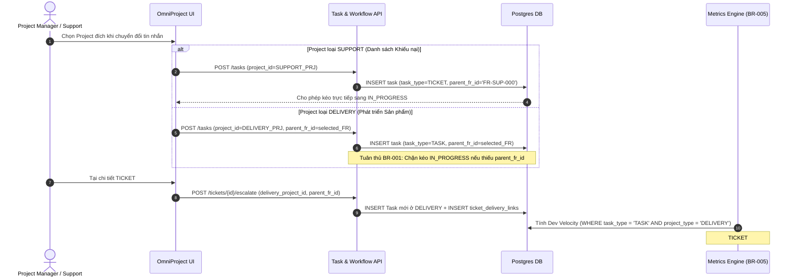

# Feature: Support Project (`FR-SUP-000`) vs Delivery Project Conversion (FR-CHN-007)

**Mô tả:** Quy định cơ chế phân loại và định tuyến khi chuyển tin nhắn từ OmniChannel thành Card Kanban trên Project Khiếu nại/Hỗ trợ (`project_type = SUPPORT`) hoặc Project Phát triển sản phẩm (`project_type = DELIVERY`), đảm bảo không vi phạm quy tắc truy vết `BR-001` và không làm sai lệch chỉ số Velocity `BR-005` trong [1-BRD.md](file:///Users/macbookair/Downloads/source/omnimer_team/omnimer_team_doc/docs/bda/01-business-context/1-BRD.md).

**Kiến trúc cốt lõi:** Áp dụng mô hình **Dual-Project Classification + Traceability Exception Isolation**:
- **Ticket là Card Kanban trên `SUPPORT` Project:** Tận dụng bảng Kanban sẵn có của OmniProject để quản lý danh sách khiếu nại/hỗ trợ mà không cần dựng hệ thống Helpdesk tách rời.
- **Ngoại lệ có chủ đích cho `BR-001`:** Các Card loại `TICKET` trong Project `SUPPORT` được tự động gắn vào Functional Requirement tổng mặc định `FR-SUP-000` (*Tiếp nhận & Xử lý Hỗ trợ/Khiếu nại*) để hợp lệ chuyển trạng thái sang `In Progress`, nhưng được gắn cờ `is_traceability_exception = true` để tách khỏi báo cáo tuân thủ `BR-001` của đội Dev.
- **Liên kết Ticket → Delivery Task (`BR-CHN-002`):** Khi một khiếu nại cần Dev sửa mã nguồn, PM tạo `Task` liên kết sang Project `DELIVERY` (bắt buộc gắn FR thật theo `BR-001`). Chỉ số Dev Velocity chỉ đếm `Task` ở `DELIVERY`, loại bỏ hoàn toàn `TICKET` để tránh đếm đôi hoặc làm nhiễu Velocity.

## 1. Functional Requirements List

| FR ID | Requirement Description | Input | Output | Associated Business Rule | Priority |
|---|---|---|---|---|---|
| **FR-CHN-007.1** | **Phân loại & Gán mặc định theo `project_type`:** Khi tạo Card từ tin nhắn, hệ thống kiểm tra `project_type` của Project đích để tự động đặt `task_type` (`TICKET` cho `SUPPORT`, `TASK` cho `DELIVERY`) và quy tắc chọn `parent_fr_id`. | `target_project_id`, `selected_fr_id` (tùy chọn) | `task_type`, `parent_fr_id` (Auto `FR-SUP-000` nếu `SUPPORT`) | `BL-CHN-007.1`, `BL-CHN-007.2` (`BR-CHN-001`) | Must-have |
| **FR-CHN-007.2** | **Chuyển tiếp Ticket sang Delivery Task (Escalation Link):** Trên chi tiết một `TICKET`, cho phép PM bấm *"Tạo Task kỹ thuật liên kết"* sang Project `DELIVERY` (kế thừa snapshot chat và lưu quan hệ `source_ticket_id`). | `ticket_id`, `delivery_project_id`, `parent_fr_id` | `Task` mới ở `DELIVERY` Project + bản ghi `ticket_delivery_links` | `BL-CHN-007.3` | Must-have |
| **FR-CHN-007.3** | **Cô lập Chỉ số Hiệu suất & Báo cáo Truy vết:** Loại trừ toàn bộ Card có `task_type = TICKET` (và `FR-SUP-000`) khỏi tính toán Dev Velocity / Defect Escape Rate (`BR-005`) và báo cáo tuân thủ `BR-001` của dự án phần mềm. | Query Analytics / KPI Engine | Metrics `DELIVERY` thuần túy + Dashboard Support riêng biệt | `BL-CHN-007.4` (`BR-CHN-002`) | Must-have |

## 2. Business Rules

| BR ID | Rule Description | Applies to FR |
|---|---|---|
| **BL-CHN-007.1** | **Support Project Auto-FR (`BR-CHN-001`):** Khi `project.project_type == 'SUPPORT'`, hệ thống tạo Card với `task_type = 'TICKET'`, tự động điền `parent_fr_id = 'FR-SUP-000'` và cho phép chuyển từ `TODO` sang `IN_PROGRESS` mà không yêu cầu PM chọn FR nghiệp vụ thủ công. | FR-CHN-007.1 |
| **BL-CHN-007.2** | **Delivery Project Strict Gate (`BR-001`):** Khi `project.project_type == 'DELIVERY'`, hệ thống tạo Card với `task_type = 'TASK'`. Nếu PM chưa gắn `parent_fr_id` hợp lệ (khác `FR-SUP-000`), Task vẫn có thể lưu ở `OPEN/TODO` nhưng bị chặn kéo sang `IN_PROGRESS` theo đúng `BR-001`. | FR-CHN-007.1, FR-CHN-007.2 |
| **BL-CHN-007.3** | **Escalation Traceability:** Khi tạo `Task` liên kết từ một `TICKET`, `Task` mới phải kế thừa `deep_link_url` (hoặc link về `TICKET` cha) và cập nhật trạng thái đồng bộ gợi ý cho PM khi `Delivery Task` chuyển `DONE` để PM đóng `TICKET`. | FR-CHN-007.2 |
| **BL-CHN-007.4** | **No Double-Counting Velocity (`BR-CHN-002`):** Công thức tính *Sprint Velocity* và *Story Points* (`BR-005`) chỉ tổng hợp các bản ghi có `task_type = 'TASK'` thuộc Project `DELIVERY`. Bản ghi `task_type = 'TICKET'` được thống kê ở bộ chỉ số CSKH riêng (Số Ticket tiếp nhận, Số Ticket đã đóng, Tỷ lệ chuyển giao sang Dev). | FR-CHN-007.3 |
| **BL-CHN-007.5** | **Strict DoD Exemption for Support Tickets (`FR-PRJ-008` Alignment):** Mọi Card có `task_type = 'TICKET'` thuộc Project `SUPPORT` mặc định có `output_contract_type = 'NONE'`, giúp nhân viên CSKH kéo Ticket sang `DONE` ngay sau khi giải quyết xong cho khách mà không bị chặn bởi popup yêu cầu nộp link PR/Figma của đội Dev. | FR-CHN-007.1 |

## 3. Data Structure

### Entity: `projects` (Bổ sung phân loại)
| Field | Data Type | Required | Constraints |
|---|---|---|---|
| `id` | `UUID` | Yes | Primary Key |
| `project_type` | `ENUM` | Yes | `DELIVERY \| SUPPORT` (Default: `DELIVERY`) |

### Entity: `tasks` (Bổ sung thuộc tính OmniChannel & Ticket)
| Field | Data Type | Required | Constraints |
|---|---|---|---|
| `id` | `UUID` | Yes | Primary Key |
| `project_id` | `UUID` | Yes | FK → `projects.id`, Indexed |
| `task_type` | `ENUM` | Yes | `TASK \| TICKET` |
| `parent_fr_id` | `VARCHAR(50)` | No | Bắt buộc khác `NULL` khi sang `IN_PROGRESS`; mặc định `FR-SUP-000` nếu `task_type = TICKET` |
| `source_channel` | `ENUM` | No | `TELEGRAM \| SLACK \| ZALO_OA \| INTERNAL \| NULL` |
| `notify_external_channel` | `BOOLEAN` | Yes | Default `false` (chỉ `true` khi tạo từ Public Chat và PM bật) |

### Entity: `ticket_delivery_links`
| Field | Data Type | Required | Constraints |
|---|---|---|---|
| `id` | `UUID` | Yes | Primary Key |
| `tenant_id` | `UUID` | Yes | FK → `tenants.id` |
| `ticket_id` | `UUID` | Yes | FK → `tasks.id` (`task_type = TICKET`) |
| `delivery_task_id` | `UUID` | Yes | FK → `tasks.id` (`task_type = TASK`) |
| `created_at` | `TIMESTAMPTZ` | Yes | Default `NOW()` |

## 4. Sequence Diagram: Chuyển đổi Ticket → Delivery Task & Kiểm soát `BR-001`



## 5. Pre/Post-Conditions & Acceptance Criteria

### FR-CHN-007.1 & FR-CHN-007.3: Support Project `FR-SUP-000` & Cô lập Velocity
- **Pre-condition:** Project đích được cấu hình đúng `project_type` (`SUPPORT` hoặc `DELIVERY`).
- **Post-condition:** Card tạo trên `SUPPORT` gắn `FR-SUP-000` chạy Kanban bình thường; Card tạo/escalate sang `DELIVERY` tuân thủ `BR-001` và được tính riêng trong Velocity.
- **Exception / Error case:** Cố tình kéo `Task` ở Project `DELIVERY` sang `In Progress` khi chưa có `parent_fr_id` (hoặc gán nhầm `FR-SUP-000` cho `DELIVERY`) → chặn với `HTTP 422` theo `BR-001`.

**Gherkin Scenario:**
```gherkin
Given Project "Khiếu nại Khách hàng" có project_type = SUPPORT và Project "OmniMer App" có project_type = DELIVERY
When tôi tạo một Ticket từ tin nhắn Zalo vào Project "Khiếu nại Khách hàng"
Then Card được tạo với task_type = TICKET, tự động gắn parent_fr_id = "FR-SUP-000" và kéo được sang cột "In Progress" ngay lập tức
When tôi bấm "Tạo Task kỹ thuật liên kết" từ Ticket đó sang Project "OmniMer App" (gắn FR-PRJ-002)
Then một Task mới (task_type = TASK) được sinh ra trong Project "OmniMer App" và liên kết với Ticket gốc
And báo cáo Dev Velocity của Sprint chỉ tính điểm của Task kỹ thuật mới, không cộng trùng Ticket gốc
```
