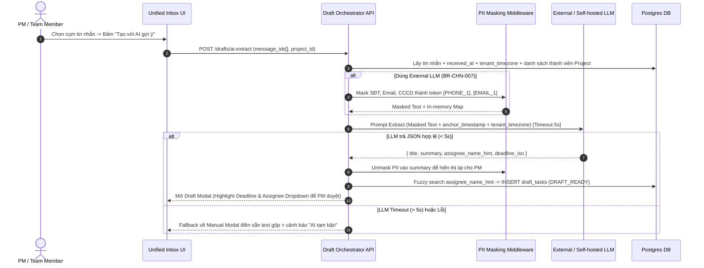

# Feature: OPAgent Draft Extraction, Timezone Anchor & PII Masking (FR-CHN-008)

**Mô tả:** Sử dụng OPAgent (LLM) để tóm tắt cụm tin nhắn được chọn, gợi ý Tiêu đề (Title), Người phụ trách (Assignee) và Hạn chót (Deadline) ở trạng thái bản nháp (Human-in-the-Loop), kèm cơ chế neo thời gian tiếng Việt theo múi giờ Tenant và che/ẩn dữ liệu định danh cá nhân (PII Masking) trước khi gửi qua mô hình LLM bên ngoài.

**Kiến trúc cốt lõi:** Áp dụng mô hình **Deterministic Regex PII Masking + Raw Description Preservation (Độ ổn định 100%)**:
- **Deterministic Regex PII Masking (`BR-CHN-007`):** Khi gọi LLM bên ngoài, Middleware dùng Regex tất định để che các chuỗi nhạy cảm cố định (SĐT, Email, CCCD/CMND, Số tài khoản) thành `[PHONE]`, `[EMAIL]`, `[ID_NUM]` (không dùng mô hình NER nặng và không che tên người để AI bắt được `assignee_name_hint`).
- **Tách biệt AI Metadata và Raw Description (Zero Unmasking Bug):** LLM chỉ trích xuất **3 trường metadata ngắn**: `{ suggested_title, assignee_name_hint, deadline_iso }`. Phần **`suggested_description` giữ nguyên 100% văn bản gộp gốc (`Chronological Merge` từ `FR-CHN-006.2`)** trên Server — giúp triệt tiêu hoàn toàn rủi ro AI bịa (hallucinate) sai yêu cầu của khách hoặc làm hỏng token khi khôi phục PII (Unmasking), đồng thời giảm 60% độ trễ LLM.
- **Temporal Anchoring & Human-in-the-Loop (`BL-AGT-001.1`):** Truyền `anchor_timestamp = last_message.received_at` và `tenant_timezone` (mặc định `Asia/Ho_Chi_Minh`, UTC+7). Kết quả chỉ điền vào form nháp `draft_tasks`, timeout 5s tự động fallback về form tạo tay.

## 1. Functional Requirements List

| FR ID | Requirement Description | Input | Output | Associated Business Rule | Priority |
|---|---|---|---|---|---|
| **FR-CHN-008.1** | **Che PII bằng Regex Tất định trước khi gọi LLM:** Tự động che SĐT, Email, CCCD, Số tài khoản trong bản sao văn bản gửi tới External LLM, trong khi giữ nguyên văn bản gộp gốc tại Server để làm `description`. | Raw merged messages, `llm_deployment_mode` | Masked text gửi LLM + Raw merged description giữ tại Server | `BL-CHN-008.1` (`BR-CHN-007`) | Must-have |
| **FR-CHN-008.2** | **Trích xuất 3 Trường Metadata & Neo Múi giờ Tiếng Việt:** Gửi Masked text kèm `anchor_timestamp` và `tenant_timezone` tới OPAgent để nhận JSON (`suggested_title`, `assignee_name_hint`, `deadline_iso`). | Masked text, `anchor_timestamp`, `tenant_timezone` | `{ suggested_title, assignee_name_hint, deadline_iso }` | `BL-CHN-008.2`, `FR-AGT-001` | Must-have |
| **FR-CHN-008.3** | **Đối chiếu Assignee & Human-in-the-Loop Confirm:** Dùng Fuzzy Search đối chiếu `assignee_name_hint` với danh sách thành viên Project; nếu trùng nhiều người thì hiện Dropdown; giữ ở Modal để PM chỉnh sửa và bấm Lưu. | `assignee_name_hint`, `project_id` | Danh sách `assignee_candidates[]`, Draft Modal chờ PM duyệt | `BL-CHN-008.3` (`BL-AGT-001.1`, `BL-AGT-001.2`) | Must-have |
| **FR-CHN-008.4** | **Graceful Fallback khi LLM Timeout/Lỗi:** Nếu LLM không phản hồi trong ngưỡng `5 giây` hoặc trả lỗi schema, mở ngay form tạo thủ công đã điền sẵn text gộp kèm thông báo nhẹ. | LLM Timeout / Error | Manual Creation Modal đã pre-fill text gộp | `BL-CHN-008.4` | Must-have |

## 2. Business Rules

| BR ID | Rule Description | Applies to FR |
|---|---|---|
| **BL-CHN-008.1** | **Zero-Unmask High-Stability PII Policy (`BR-CHN-007`):** Khi gọi External LLM, hệ thống dùng Regex che SĐT, Email, CCCD, STK trên chuỗi prompt gửi đi. Hệ thống **không yêu cầu LLM sinh lại `description`** mà ghép trực tiếp chuỗi `Chronological Merge` gốc (`FR-CHN-006.2`) vào ô `suggested_description` của bản nháp — đảm bảo không bao giờ lộ số nhạy cảm ra LLM ngoài và không bao giờ xảy ra lỗi lệch chuỗi khi Unmask. | FR-CHN-008.1 |
| **BL-CHN-008.2** | **Vietnamese Relative Date Resolution:** Hệ thống truyền `anchor_timestamp` (mốc `received_at` của tin nhắn cuối trong cụm chọn) và `tenant_timezone` (`UTC+7` mặc định). Quy ước mặc định khi khách không nói giờ cụ thể: cuối ngày làm việc (`17:30`), *"cuối tuần"* tính là Thứ Sáu/Chủ Nhật theo cấu hình lịch làm việc Tenant. UI luôn highlight ô Deadline để PM kiểm tra lại. | FR-CHN-008.2 |
| **BL-CHN-008.3** | **Zero Auto-Commit (`BL-AGT-001.1`):** OPAgent chỉ được phép tạo bản nháp hiển thị trên Modal (hoặc bảng tạm `draft_tasks`). Chỉ khi người dùng nhấn nút xác nhận *"Tạo Task/Ticket"* thì hệ thống mới thực hiện ghi chính thức vào bảng `tasks`. | FR-CHN-008.3 |
| **BL-CHN-008.4** | **Non-blocking AI Failure:** Lỗi của dịch vụ LLM không bao giờ được chặn luồng tạo Task/Ticket của PM; thời gian chờ tối đa (timeout) của lời gọi LLM cho Draft là `5000ms`. | FR-CHN-008.4 |

## 3. Data Structure

### Entity: `draft_tasks` (Bản nháp tạm trước khi Confirm)
| Field | Data Type | Required | Constraints |
|---|---|---|---|
| `id` | `UUID` | Yes | Primary Key |
| `tenant_id` | `UUID` | Yes | FK → `tenants.id` |
| `conversation_id` | `UUID` | Yes | FK → `conversations.id` |
| `suggested_title` | `VARCHAR(255)` | Yes | Tiêu đề do AI tóm tắt |
| `suggested_description` | `TEXT` | Yes | Mô tả Markdown (đã khôi phục PII cho PM xem) |
| `assignee_candidates` | `JSONB` | No | Mảng `[{ "user_id": "uuid", "full_name": "string", "score": 0.92 }]` |
| `suggested_deadline` | `TIMESTAMPTZ` | No | ISO8601 đã quy đổi theo múi giờ Tenant |
| `ai_status` | `ENUM` | Yes | `DRAFT_READY \| FALLBACK_MANUAL \| CONFIRMED \| DISCARDED` |
| `created_by` | `UUID` | Yes | FK → `users.id` |
| `created_at` | `TIMESTAMPTZ` | Yes | Default `NOW()` |

## 4. Sequence Diagram: OPAgent Draft, PII Masking & Fallback



## 5. Pre/Post-Conditions & Acceptance Criteria

### FR-CHN-008.1, 008.2 & 008.3: PII Masking, Neo thời gian & Human-in-the-Loop
- **Pre-condition:** Cụm tin nhắn hợp lệ (1..20 tin nhắn), Tenant đã cấu hình múi giờ (mặc định UTC+7).
- **Post-condition:** Draft Modal hiển thị đầy đủ thông tin bóc tách để PM chỉnh sửa/chọn Assignee trước khi lưu chính thức; dữ liệu PII không bị rò rỉ ra LLM ngoài.
- **Exception / Error case:** Trùng nhiều thành viên tên `"An"` → hiển thị Dropdown cho PM tự chọn; LLM timeout `> 5s` → fallback form thủ công tức thì.

**Gherkin Scenario:**
```gherkin
Given tin nhắn khách hàng gửi lúc 10:00 Thứ Ba (UTC+7) có nội dung: "Làm banner 20/10, xong trước thứ 6, giao An. Liên hệ anh Hùng 0901234567"
And hệ thống đang sử dụng External LLM và Project có 2 thành viên tên "An" (Nguyễn An, Trần An)
When PM bấm "Tạo với AI gợi ý"
Then Middleware che số "0901234567" thành "[PHONE_1]" trước khi gửi tới LLM
And OPAgent trả về bản nháp có Deadline gợi ý là Thứ Sáu cùng tuần (17:30 UTC+7), nội dung hiển thị lại số "0901234567" cho PM
And ô Assignee hiển thị Dropdown gồm "Nguyễn An" và "Trần An" để PM chọn, không tự ý lưu vào bảng Task chính thức
```
