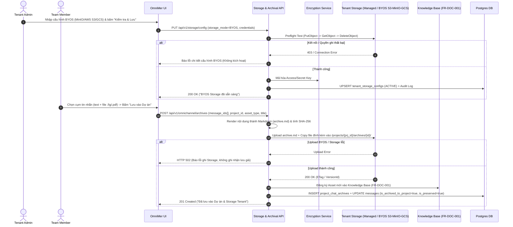

# Feature: Tenant Storage (BYOS), Important Message Preservation & Project Archival (FR-CHN-017)

**Mô tả:** Cho phép mỗi Tenant tự cấu hình hạ tầng lưu trữ riêng (**BYOS — Bring Your Own Storage**: AWS S3, MinIO, Google Cloud Storage S3-compatible, Cloudflare R2) ngay từ Phase 1 hoặc dùng Managed Storage cô lập của OmniMer; hỗ trợ đánh dấu **Bảo lưu (`is_preserved`)** tin nhắn quan trọng và nút bấm **"Lưu vào Dự án"** để đóng gói toàn bộ nội dung tin nhắn (xuất chuẩn **Markdown `.md`**) kèm tệp/ảnh **bất kỳ định dạng** vào Storage của Tenant và đồng bộ lên Knowledge Base (`FR-DOC-001`).

**Kiến trúc cốt lõi:** Áp dụng mô hình **Pluggable Tenant Storage Adapter (BYOS Phase 1) + Dual-Layer Markdown Archival**:
- **BYOS (Bring Your Own Storage) ngay từ Phase 1:** Mỗi Tenant có bản ghi `tenant_storage_configs` chọn `MANAGED` (hạ tầng OmniMer cô lập theo `tenant_id`) hoặc `BYOS` (công ty tự mua và quản lý S3/MinIO/GCS riêng để chủ động bảo mật và sao lưu). Mọi thao tác đọc/ghi tệp OmniChannel và tài liệu dự án đều đi qua `StorageAdapterInterface` và kiểm tra toàn vẹn bằng **SHA-256**.
- **Tại sao đóng gói tin nhắn thành Markdown (`.md`) thay vì chỉ lưu DB hoặc `.txt`?**
  - Nếu chỉ lưu trong DB ứng dụng, khi Tenant dùng BYOS thì nội dung các quyết định quan trọng trong chat sẽ không nằm trên Storage riêng của họ.
  - Nếu xuất `.txt` thuần sẽ mất cấu trúc người gửi, thời gian, kênh nguồn và liên kết tệp đính kèm.
  - Đóng gói thành **file `.md` (Markdown có YAML Frontmatter) + copy nguyên bản toàn bộ file đính kèm** vào `{prefix}/projects/{project_id}/archives/{archive_id}/` trên Storage của Tenant giúp dữ liệu **tự mô tả, đọc được độc lập ngay cả khi tách khỏi OmniMer**, đồng thời lưu Metadata + Text Index vào Postgres (`FR-DOC-001`) để tìm kiếm tức thì trên Web App và lập chỉ mục AI/RAG sau này.

## 1. Functional Requirements List

| FR ID | Requirement Description | Input | Output | Associated Business Rule | Priority |
|---|---|---|---|---|---|
| **FR-CHN-017.1** | **Cấu hình Storage Riêng cho Tenant (BYOS Phase 1 vs Managed):** Cho phép `TENANT_ADMIN` chọn `MANAGED` hoặc cấu hình `BYOS` (S3-compatible endpoint, Bucket, Region, Access/Secret Key), kiểm tra quyền Ghi/Đọc/Xóa (Preflight Test) trước khi kích hoạt. | `tenant_id`, `storage_mode`, `byos_credentials` | Kết quả Ping Test (`OK \| ERROR`), mã hóa KMS & lưu `tenant_storage_configs` | `BL-CHN-017.1`, `BL-CHN-017.2` (`BR-CHN-008`) | Must-have |
| **FR-CHN-017.2** | **Đánh dấu Bảo lưu Tin nhắn Quan trọng (Pin / Preserve):** Cho phép Team Member gắn cờ `is_preserved = true` trên 1 hoặc nhiều tin nhắn/file quan trọng ngay tại hội thoại để chống xóa khi hết hạn Retention, kèm bộ lọc *"Đã bảo lưu"*. | `conversation_id`, `message_ids[]`, `user_id` | Cập nhật `is_preserved = true`, badge Bảo lưu, miễn trừ Retention Job | `BL-CHN-017.3` (`BR-CHN-009`) | Must-have |
| **FR-CHN-017.3** | **Nút "Lưu vào Dự án" (Archive Text/Media thành Markdown + Files vào Storage):** Cho phép Team Member chọn 1 tin nhắn hoặc cụm tin nhắn (text thuần, ảnh, file bất kỳ định dạng) để lưu vào một Project đích. | `conversation_id`, `message_ids[]`, `target_project_id`, `asset_type`, `archive_title`, `note` | File `archive.md` + bản sao tệp gốc trên Storage Tenant + SHA-256 + bản ghi `project_chat_archives` | `BL-CHN-017.4`, `BL-CHN-017.5` (`BR-CHN-008`) | Must-have |
| **FR-CHN-017.4** | **Đồng bộ lên Knowledge Base Dự án (`FR-DOC-001`):** Tự động đăng ký bản ghi Archive vừa tạo vào kho tài liệu `FR-DOC-001` của Project đích để hiển thị, tìm kiếm và xuất gói bàn giao Onboarding. | `project_chat_archive_id` | Asset mới trong `FR-DOC-001` (liên kết ngược tới đoạn chat gốc & link Storage) | `BL-CHN-017.6` (`FR-DOC-001`) | Must-have |

## 2. Business Rules

| BR ID | Rule Description | Applies to FR |
|---|---|---|
| **BL-CHN-017.1** | **BYOS Preflight Verification & Encryption (`BR-CHN-008`):** Chỉ `TENANT_ADMIN` mới được thay đổi cấu hình Storage. Trước khi chuyển `storage_mode` sang `BYOS`, hệ thống bắt buộc chạy bài test thực tế (`PutObject` → `GetObject` → `DeleteObject` trên một file test tạm) để xác nhận bucket tồn tại và đủ quyền. Credentials của BYOS bắt buộc mã hóa AES-256/KMS, không trả nguyên văn ra API. | FR-CHN-017.1 |
| **BL-CHN-017.2** | **Content-Addressable SHA-256 Dedup & Quota:** Mọi tệp đính kèm ghi lên Storage (Managed hoặc BYOS) được lưu theo khóa băm `{workspace_id}/blobs/{sha256}` kèm bộ đếm tham chiếu (`ref_count`) để một file dù xuất hiện ở cả Inbox, Task Snapshot (`FR-CHN-006`) và Project Archive (`FR-CHN-017`) cũng chỉ tốn dung lượng **1 file vật lý duy nhất**. Với chế độ `MANAGED`, hệ thống cảnh báo Admin tại ngưỡng `80%` và `95%` Quota. | FR-CHN-017.1, FR-CHN-017.3 |
| **BL-CHN-017.3** | **Preserve Authorization & Project Active Guard (`BR-CHN-009`, `FR-PRJ-018.4`):** Mọi Team Member xem hội thoại được gắn cờ *"Bảo lưu"* (`is_preserved = true`) hoặc bấm *"Lưu vào Dự án"* vào một Project đang `ACTIVE` (chặn nếu Project đã `ARCHIVED` hoặc Workspace bị khóa `Read-only` do Billing). Chỉ `PM` hoặc `TENANT_ADMIN` (`Workspace Admin`) mới được gỡ bảo lưu hoặc xóa bản ghi đã lưu vào Dự án (`FR-CHN-016.3`). | FR-CHN-017.2, FR-CHN-017.3 |
| **BL-CHN-017.4** | **Any-Format File Policy & Security Guard:** Nút *"Lưu vào Dự án"* chấp nhận mọi định dạng tệp công việc (`.fig`, `.psd`, `.ai`, `.pdf`, `.docx`, `.xlsx`, `.zip`, `.mp4`, `.png`, `.json`...). Chỉ áp dụng kiểm tra kích thước tối đa mỗi file (theo cấu hình Tenant, VD `200MB`) và tùy chọn chặn file thực thi nguy hiểm (`.exe`, `.bat`, `.sh`) nếu Tenant bật chính sách an ninh nghiêm ngặt; lưu nguyên bản MIME type và tên file gốc. | FR-CHN-017.3 |
| **BL-CHN-017.5** | **Standard Markdown Archive Structure:** Mỗi lần bấm *"Lưu vào Dự án"*, hệ thống sinh 1 tệp `archive.md` lưu trên Storage của Tenant tại đường dẫn `{tenant_id}/projects/{project_id}/archives/{archive_id}/archive.md`, cấu trúc gồm: YAML Frontmatter (`archive_id`, `project_id`, `channel_type`, `archived_by`, `archived_at`, `source_messages_range`), nội dung tin nhắn sắp xếp theo `provider_timestamp`, và bảng liên kết tương đối (`./attachments/{file_name}`) kèm `sha256` của từng tệp đính kèm. | FR-CHN-017.3 |
| **BL-CHN-017.6** | **Knowledge Base Sync (`FR-DOC-001`):** Bản ghi tạo ra từ nút *"Lưu vào Dự án"* tự động gắn `is_archived_to_project = true` trên tin nhắn nguồn (để miễn trừ Retention Job) và tạo Asset tương ứng trong `FR-DOC-001` với `asset_type` phù hợp (VD: `CHAT_ARCHIVE`, `DESIGN_FIGMA`, `FRD_DOC`, `SPREADSHEET`, `IMAGE`). | FR-CHN-017.4 |
| **BL-CHN-017.7** | **Storage Switching & Backward Read Compatibility:** Khi Tenant chuyển đổi từ `MANAGED` sang `BYOS` (hoặc đổi Bucket BYOS mới), mọi bản ghi mới được ghi vào cấu hình hiện hành, nhưng các tệp/archive cũ vẫn giữ nguyên `storage_mode_used` và `storage_bucket_ref` trên metadata của bản ghi để hệ thống đọc đúng nơi đã lưu (tránh lỗi 404 mất dữ liệu cũ), kèm tùy chọn chạy Job đồng bộ chuyển dữ liệu nền nếu Admin yêu cầu. | FR-CHN-017.1, FR-CHN-017.3 |

## 2.1. Mẫu File Markdown Xuất vào Storage Tenant (`archive.md`)

```markdown
---
archive_id: "arch_9f8e7d6c"
tenant_id: "ten_01"
project_id: "prj_alpha"
channel_type: "ZALO_OA"
archived_by: "user_pm_an"
archived_at: "2026-11-19T00:45:00+07:00"
asset_type: "CHAT_ARCHIVE"
---

# Chốt thiết kế Banner 20/10 & Bộ nhận diện mới

> **Ghi chú người lưu:** Khách hàng xác nhận duyệt phương án V2 và gửi kèm file nguồn Figma/PDF.

## Nội dung Hội thoại
- **[14:20 18/11/2026 - Khách hàng Minh]:** Em ơi anh duyệt bản V2 này nhé, gửi em file PDF thông số in ấn và file gốc.
- **[14:21 18/11/2026 - Khách hàng Minh]:** Đính kèm 2 tệp bên dưới.

## Tệp đính kèm (Đã lưu toàn vẹn trên Storage Tenant)
| Tên tệp | Định dạng | Dung lượng | SHA-256 | Đường dẫn Storage |
| :--- | :--- | :--- | :--- | :--- |
| `Banner_20_10_V2.pdf` | `application/pdf` | 12.4 MB | `e3b0c44...` | `./attachments/Banner_20_10_V2.pdf` |
| `Source_Design.fig` | `application/octet-stream` | 45.1 MB | `8f14e45...` | `./attachments/Source_Design.fig` |
```

## 3. Data Structure

### Entity: `tenant_storage_configs`
| Field | Data Type | Required | Constraints |
|---|---|---|---|
| `tenant_id` | `UUID` | Yes | Primary Key, FK → `tenants.id` |
| `storage_mode` | `ENUM` | Yes | `MANAGED \| BYOS` (Default: `MANAGED`) |
| `provider_type` | `ENUM` | Yes | `OMNIMER_S3 \| AWS_S3 \| MINIO \| GCS_S3 \| CLOUDFLARE_R2` |
| `endpoint_url` | `VARCHAR(500)` | No | Bắt buộc nếu dùng `MINIO` / custom S3 |
| `bucket_name` | `VARCHAR(255)` | Yes | Tên bucket lưu trữ của Tenant |
| `region` | `VARCHAR(100)` | No | Region của bucket |
| `encrypted_credentials` | `TEXT` | No | Access Key & Secret Key mã hóa AES-256/KMS (cho `BYOS`) |
| `quota_bytes` | `BIGINT` | No | Áp dụng cho `MANAGED` |
| `used_bytes` | `BIGINT` | Yes | Default `0` |
| `status` | `ENUM` | Yes | `ACTIVE \| ERROR \| VERIFYING` |
| `updated_at` | `TIMESTAMPTZ` | Yes | Default `NOW()` |

### Entity: `project_chat_archives`
| Field | Data Type | Required | Constraints |
|---|---|---|---|
| `id` | `UUID` | Yes | Primary Key |
| `tenant_id` | `UUID` | Yes | FK → `tenants.id`, Indexed |
| `project_id` | `UUID` | Yes | FK → `projects.id`, Indexed |
| `conversation_id` | `UUID` | Yes | FK → `conversations.id` |
| `source_message_ids` | `UUID[]` | Yes | Danh sách tin nhắn đã lưu |
| `archive_title` | `VARCHAR(255)` | Yes | Tiêu đề tài liệu trong Dự án |
| `asset_type` | `ENUM` | Yes | `CHAT_ARCHIVE \| FRD_DOC \| DESIGN_FIGMA \| SPREADSHEET \| IMAGE \| OTHER` |
| `storage_mode_used` | `ENUM` | Yes | `MANAGED \| BYOS` |
| `storage_bucket_ref` | `VARCHAR(255)` | Yes | Tên Bucket / Storage Config ID tại thời điểm ghi (phục vụ đọc khi đổi BYOS) |
| `markdown_storage_key` | `VARCHAR(500)` | Yes | Đường dẫn `archive.md` trên Storage của Tenant |
| `markdown_sha256` | `CHAR(64)` | Yes | Mã băm kiểm tra toàn vẹn |
| `attachments_manifest` | `JSONB` | No | `[{ "file_name": "...", "storage_key": "...", "mime_type": "...", "size": 0, "sha256": "..." }]` |
| `knowledge_base_asset_id` | `UUID` | Yes | FK → `assets.id` (`FR-DOC-001`) |
| `archived_by` | `UUID` | Yes | FK → `users.id` |
| `deleted_at` | `TIMESTAMPTZ` | No | Dùng cho Thùng rác 30 ngày (`FR-CHN-016.3`) |
| `created_at` | `TIMESTAMPTZ` | Yes | Default `NOW()` |

## 4. Sequence Diagram: Cấu hình BYOS & Bấm "Lưu vào Dự án" (Markdown + Files)



## 5. Pre/Post-Conditions & Acceptance Criteria

### FR-CHN-017.1, 017.3 & 017.4: BYOS Phase 1 & Nút "Lưu vào Dự án" (Markdown + File Bất kỳ)
- **Pre-condition:** Tenant Storage (`MANAGED` hoặc `BYOS`) đang ở trạng thái `ACTIVE`; Team Member có quyền xem hội thoại và quyền truy cập Project đích.
- **Post-condition:** Tin nhắn được xuất thành `archive.md` kèm bản sao tệp gốc (tính SHA-256) nằm trực tiếp trên Storage của Tenant, xuất hiện trong Knowledge Base `FR-DOC-001` của Dự án và được gắn cờ miễn trừ khỏi Job Retention.
- **Exception / Error case:** Sai credentials BYOS khi test → chặn kích hoạt; Lỗi ghi lên BYOS lúc bấm lưu → báo lỗi rõ ràng, không tạo Asset rỗng trong Knowledge Base; Tệp thuộc loại thực thi nguy hiểm bị chặn theo chính sách Tenant → từ chối kèm lý do.

**Gherkin Scenario:**
```gherkin
Given Tenant Admin của Công ty A đã cấu hình thành công Storage riêng BYOS (MinIO/AWS S3) qua bài kiểm tra Put/Get/Delete
When Team Member chọn 2 tin nhắn chốt phương án kèm 1 file ".fig" và 1 file ".pdf" trong hội thoại Zalo, rồi bấm "Lưu vào Dự án" vào Project "Website 2026"
Then hệ thống tạo tệp "archive.md" theo chuẩn Markdown (có đầy đủ người gửi, thời gian, link file) và copy nguyên bản 2 tệp kèm SHA-256 vào bucket BYOS của Công ty A
And tài liệu mới xuất hiện ngay trong màn hình Knowledge Base (FR-DOC-001) của Project "Website 2026"
And các tin nhắn nguồn được đánh dấu is_preserved = true để Job Retention không bao giờ tự động xóa mất
```
