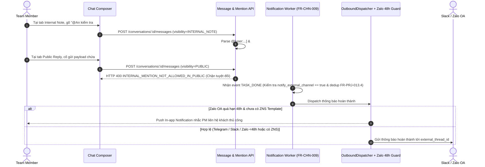

# Software Requirements Specification (SRS) — OmniChannel Phase 4: Multi-Channel Expansion (Slack, Zalo OA 48h/ZNS), Auto-Notify & In-Chat Mention

> **Reference Standard:** IEEE Std 830-1998  
> **Project:** OmniMer Enterprise PMIS — OmniChannel Module  
> **Phase:** Phase 4 (`FR-CHN-001/003` Slack & Zalo OA, `FR-CHN-009`, `FR-CHN-010`, `FR-CHN-011`)  
> **RTM:** [02_RTM_PHASE4_MULTICHANNEL_MENTIONS.csv](./02_RTM_PHASE4_MULTICHANNEL_MENTIONS.csv)  
> **Changelog:** [07_omnichannel_implementation_changelog.md](../../../../../../backend_otm/project_core/docs/change_log/07_omnichannel_implementation_changelog.md)

---

## 1. Introduction

### 1.1 Purpose
Đặc tả yêu cầu kỹ thuật cho **OmniChannel Phase 4**: mở rộng Adapter kết nối 2 chiều sang **Slack Workspace** và **Zalo OA** (kiểm soát cứng cửa sổ tương tác miễn phí 48h và điều hướng mẫu ZNS đã duyệt), tự động thông báo tiến độ về kênh gốc khi tạo hoặc hoàn thành Task/Ticket (`FR-CHN-009`), cùng hệ thống nhắc việc `@member` / `#task` trong luồng chat nội bộ và lưu vết `task_chat_backlinks` có lọc quyền (`FR-CHN-010`, `FR-CHN-011`).

### 1.2 Product Scope (Phase 4)
1. **Slack & Zalo OA Adapters (`FR-CHN-001.1`, `FR-CHN-003.4`):**
   - `SlackChannelAdapter`: Xác thực `X-Slack-Signature` (`v0=HMAC_SHA256`), gửi/nhận tin nhắn thread (`thread_ts`).
   - `ZaloOaChannelAdapter`: Xác thực `X-ZEvent-Signature`, tính toán `remaining_window = (last_customer_message_at + 48h) - NOW()`. Khi `remaining_window <= 0`, chặn gửi phản hồi tự do ở cả UI và Backend (`HTTP 422 ZALO_WINDOW_EXPIRED`) và điều hướng gửi qua **Mẫu ZNS đã duyệt**.
2. **`FR-CHN-009` (Auto-Notification on Ticket/Task Lifecycle):** Lắng nghe sự kiện tạo mới và `TASK_META_STATUS_CHANGED(DONE)`; khóa cứng `notify_external_channel = false` cho mọi Task sinh ra từ `INTERNAL_NOTE`; chống gửi trùng với `FR-PRJ-013.4` Slack Project Webhook; đẩy qua Outbound Token-Bucket Queue; fallback ZNS hoặc gửi In-app Notification nhắc PM khi Zalo quá 48h.
3. **`FR-CHN-010` & `FR-CHN-011` (In-Chat `@member` / `#task` Mention & Backlink Audit):**
   - Autocomplete `@member` (`INTERNAL_STAFF`) và `#task` (lọc theo `VIEW_TASK`) trong `INTERNAL_NOTE` và `PROJECT_DISCUSSION` (`p95 < 150ms`).
   - Lưu Structured Token `@[user:uuid|Name]` và `#[task:uuid|CODE]`; vô hiệu hóa ở tab `PUBLIC` và chặn cứng tại Server Validator (`HTTP 400 INTERNAL_MENTION_NOT_ALLOWED_IN_PUBLIC`).
   - Tự động ghi `task_chat_backlinks` (idempotent theo `(message_id, task_id)`) và lọc quyền xem `conversation_id` gốc khi hiển thị trên Task Detail.

### 1.3 References
- [FR-CHN-009: Auto-Status Notification](./FR-CHN-009_auto_status_notification.md)
- [FR-CHN-010: In-Chat Member & Task Mention](./FR-CHN-010_in_chat_member_task_mention.md)
- [FR-CHN-011: Task Chat Backlink Audit](./FR-CHN-011_task_chat_backlink_audit.md)
- [FR-CHN-003: 2-Way Messaging & Outbound](../phase_2/FR-CHN-003_2way_messaging_and_outbound.md)

---

## 2. Overall Description & Architecture

---

## 3. Data Dictionary & Prisma Models (Phase 4 Scope)

- **`task_notification_logs` (`TaskNotificationLog`):** `id`, `workspace_id`, `task_id`, `conversation_id`, `trigger_event` (`ON_CREATED | ON_DONE`), `dispatch_mode` (`STANDARD_REPLY | ZALO_ZNS | PM_MANUAL_REMINDER | BLOCKED_INTERNAL | DEDUP_SKIPPED`), `status` (`SENT | FAILED | SKIPPED`), `created_at`.
- **`message_mentions` (`MessageMention`):** `id`, `workspace_id`, `message_id`, `mention_type` (`USER | TASK`), `target_id` (`UUID`), `created_at`.
- **`task_chat_backlinks` (`TaskChatBacklink`):** `id`, `workspace_id`, `task_id`, `conversation_id`, `message_id`, `mentioned_by_user_id`, `created_at`. Unique `(message_id, task_id)`.

---

## 4. Non-Functional Requirements (Phase 4 Thresholds)

| NFR ID | Metric | Target Threshold |
| :--- | :--- | :--- |
| **NFR-P4-01** | Autocomplete `@member` & `#task` Latency | `p95 < 150ms` |
| **NFR-P4-02** | Public Reply Internal Token Block Rate | `100%` rejected with `HTTP 400` before entering Outbound Queue |
| **NFR-P4-03** | Backlink Permission Isolation | `0%` excerpt leakage when viewer lacks access to originating `conversation_id` |

---

## 5. REST API Contracts (Phase 4)

| Method | Endpoint | Role | Description & Error Codes |
| :---: | :--- | :---: | :--- |
| `GET` | `/api/v1/omnichannel/mentions/users?q=...&conversationId=...` | `ADMIN`, `PM`, `MEMBER` | Autocomplete `INTERNAL_STAFF` (`200 OK`) |
| `GET` | `/api/v1/omnichannel/mentions/tasks?q=...` | `ADMIN`, `PM`, `MEMBER` | Autocomplete Tasks filtered by `VIEW_TASK` (`200 OK`) |
| `GET` | `/api/v1/projects/tasks/:taskId/chat-backlinks` | `ADMIN`, `PM`, `MEMBER` | Trả về trích dẫn hoặc trạng thái `[Hạn chế quyền truy cập]` (`200 OK`) |

---

## 6. Model Allocation for Phase 4

| Hạng mục Công việc Phase 4 | Model Phụ Trách |
| :--- | :--- |
| `SlackChannelAdapter`, `ZaloOaChannelAdapter` (48h window check & ZNS dispatch) & `AutoStatusNotifierWorker` (Slack Dedup `FR-PRJ-013.4`) | **Gemini 4 Hydrogen** |
| Khóa cứng `INTERNAL_NOTE` `notify_external_channel=false` (`009.1`), Server Validator chặn token nội bộ trên `PUBLIC` (`010.3`) & Lọc quyền Backlink (`011.2`) | **Claude Opus** |
| Thẻ Preview `#task` (`010.2`) & Ghi nhận `task_chat_backlinks` idempotent (`011.1`) | **Neon** |
| UI Đếm ngược Zalo 48h & ZNS Modal (`003.4`), PM Manual Reminder (`009.3`), Autocomplete `@member` (`010.1`) & API Spec `18_..._api.md` | **Gemini 4 Argon** |
| Kiểm tra `npx tsc --noEmit`, ESLint & Slack/Zalo Mock Payloads | **Gemini Flash** |
