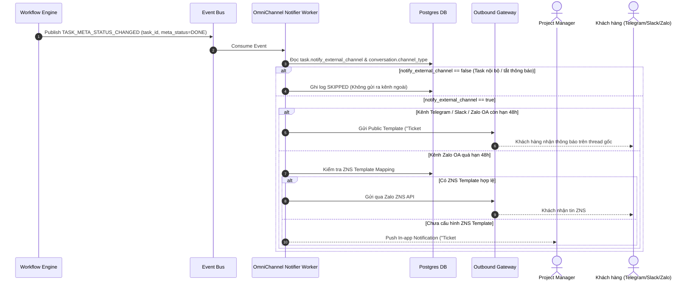

# Feature: Auto-Notification on Ticket/Task Lifecycle (FR-CHN-009)

**Mô tả:** Tự động gửi thông báo xác nhận mã Ticket/Task khi tạo mới thành công hoặc khi hoàn thành (`DONE`) về đúng luồng hội thoại gốc trên Telegram, Slack hoặc Zalo OA (có kiểm soát cửa sổ 48h và cơ chế chuyển tiếp qua ZNS hoặc nhắc PM), đồng thời đảm bảo tuyệt đối không rò rỉ thông báo cho Task nội bộ.

**Kiến trúc cốt lõi:** Áp dụng mô hình **Event-Driven Outbound Notification with Privacy Guard**:
- **Opt-in Explicit Flag (`notify_external_channel`):** Không phải Task nào tạo từ inbox cũng nên báo ra cho khách hàng (đặc biệt là Task tạo từ `INTERNAL_NOTE`). Chỉ các Card được bật tường minh cờ `notify_external_channel = true` mới kích hoạt luồng phản hồi ngoài.
- **Channel Policy Adaptation (`Should-have` cho Phase 1):** Hoạt động trực tiếp trên Telegram/Slack. Đối với Zalo OA, kiểm tra cửa sổ 48h trước khi gửi; nếu quá hạn thì tìm ZNS Template đã cấu hình, nếu không có template thì chuyển thành In-app Notification nhắc PM xử lý thủ công thay vì làm rơi thông báo.

## 1. Functional Requirements List

| FR ID | Requirement Description | Input | Output | Associated Business Rule | Priority |
|---|---|---|---|---|---|
| **FR-CHN-009.1** | **Cấu hình Cờ Thông báo Khi Tạo Card:** Trên Modal tạo Task/Ticket từ tin nhắn `PUBLIC`, cho phép bật/tắt tùy chọn *"Thông báo tiến độ tự động cho khách hàng"* (mặc định tắt nếu tạo từ `INTERNAL_NOTE`). | `source_message_visibility`, User toggle `notify_external_channel` | Lưu `notify_external_channel` và `notification_channel_id` trên Task | `BL-CHN-009.1` (`BR-CHN-003`) | Should-have |
| **FR-CHN-009.2** | **Gửi Xác nhận Khi Tạo & Báo Hoàn thành (`DONE`):** Lắng nghe domain event `TASK_CREATED` và `TASK_META_STATUS_CHANGED(DONE)`; gửi tin nhắn theo mẫu chuẩn về đúng `external_thread_id`. | Domain Event (`task_id`, `new_meta_status`) | Tin nhắn outbound xác nhận mã hoặc báo xong trên Telegram/Slack/Zalo | `BL-CHN-009.2` | Should-have |
| **FR-CHN-009.3** | **Xử lý Ngoại lệ Hết hạn Cửa sổ Zalo OA 48h:** Khi kích hoạt notify trên `ZALO_OA` quá hạn 48h, tự động kiểm tra mẫu ZNS được gán; nếu chưa cấu hình ZNS thì đẩy In-app Notification nhắc PM gửi tay. | `task_id`, `conversation.last_customer_message_at`, `zns_mapping` | Gửi qua ZNS hoặc In-app Notification nhắc PM | `BL-CHN-009.3` | Should-have |

## 2. Business Rules

| BR ID | Rule Description | Applies to FR |
|---|---|---|
| **BL-CHN-009.1** | **Internal Note Zero-Leakage Safeguard:** Nếu toàn bộ hoặc một phần cụm tin nhắn nguồn có `visibility = INTERNAL_NOTE`, hệ thống **khóa cứng** `notify_external_channel = false` (không cho phép bật trên UI và chặn ở Backend) để đảm bảo không bao giờ lộ tên Task/Ticket kỹ thuật nội bộ ra cho khách hàng. | FR-CHN-009.1, FR-CHN-009.2 |
| **BL-CHN-009.2** | **Safe Public Message Template:** Tin nhắn tự động gửi ra kênh khách hàng chỉ được chứa các trường Public (`task_code`, `public_title` hoặc `ticket_title`, `status_label`), tuyệt đối không đính kèm tên Dev nội bộ, ước lượng giờ (Story Points) hay nội dung Internal Note. | FR-CHN-009.2 |
| **BL-CHN-009.3** | **Zalo 48h Fallback Policy:** Nếu `channel_type == 'ZALO_OA'` và hết cửa sổ 48h: (1) Nếu Tenant đã map `zns_template_id` cho trạng thái tương ứng → gọi ZNS API (kèm log chi phí); (2) Nếu chưa có ZNS Template → không báo lỗi hệ thống âm thầm mà gửi Notification In-app cho PM/Assignee kèm nội dung gợi ý để liên hệ khách hàng bằng kênh khác. | FR-CHN-009.3 |
| **BL-CHN-009.4** | **Slack Deduplication with `FR-PRJ-013.4` & Token-Bucket Throttling:** `FR-CHN-009` chỉ gửi phản hồi vào đúng `external_thread_id` nguồn nơi sinh ra Task/Ticket. Nếu `external_thread_id` trùng với kênh Slack đã đăng ký nhận `Project_Webhook` (`FR-PRJ-013.4`) cho sự kiện `TASK_DONE`, hệ thống tự động gộp/bỏ qua thông báo trùng. Mọi bản tin đều đi qua Outbound Token-Bucket Queue (`FR-CHN-003`) để tránh lỗi `HTTP 429` khi kéo `DONE` hàng loạt. | FR-CHN-009.2 |

## 3. Data Structure

### Entity: `task_notification_logs`
| Field | Data Type | Required | Constraints |
|---|---|---|---|
| `id` | `UUID` | Yes | Primary Key |
| `tenant_id` | `UUID` | Yes | FK → `tenants.id` |
| `task_id` | `UUID` | Yes | FK → `tasks.id`, Indexed |
| `conversation_id` | `UUID` | Yes | FK → `conversations.id` |
| `trigger_event` | `ENUM` | Yes | `ON_CREATED \| ON_DONE` |
| `dispatch_mode` | `ENUM` | Yes | `STANDARD_REPLY \| ZALO_ZNS \| PM_MANUAL_REMINDER \| BLOCKED_INTERNAL` |
| `status` | `ENUM` | Yes | `SENT \| FAILED \| SKIPPED` |
| `created_at` | `TIMESTAMPTZ` | Yes | Default `NOW()` |

## 4. Sequence Diagram: Thông báo Tự động Khi Ticket `DONE`



## 5. Pre/Post-Conditions & Acceptance Criteria

### FR-CHN-009.1, 009.2 & 009.3: Tự động Thông báo & Xử lý Hết hạn Zalo 48h
- **Pre-condition:** Task/Ticket được tạo từ tin nhắn `PUBLIC` của hội thoại OmniChannel và có `notify_external_channel = true`.
- **Post-condition:** Khách hàng nhận được thông báo chuẩn Public View khi tạo hoặc khi `DONE` (hoặc PM nhận được nhắc nhở nếu Zalo quá 48h và chưa cấu hình ZNS).
- **Exception / Error case:** Task nguồn từ `INTERNAL_NOTE` → khóa cứng `notify_external_channel = false`; Zalo quá 48h không có ZNS → ghi `PM_MANUAL_REMINDER` và nhắc PM.

**Gherkin Scenario:**
```gherkin
Given một Ticket #TK-102 được tạo từ tin nhắn Public của Khách hàng X trên kênh Zalo OA (có bật "Thông báo tiến độ tự động")
When Ticket #TK-102 được kéo sang cột có Meta-Status là "DONE" tại thời điểm đã quá 50 giờ kể từ tin nhắn cuối của khách
And Tenant chưa cấu hình mẫu ZNS cho sự kiện hoàn thành
Then hệ thống không gọi API gửi tin tự do sang Zalo OA
And hệ thống gửi thông báo In-app cho PM với nội dung "Ticket #TK-102 đã hoàn thành nhưng quá cửa sổ Zalo 48h, vui lòng liên hệ khách hàng"
And với một Task kỹ thuật tạo từ "Internal Note", hệ thống khóa tùy chọn thông báo khách hàng và không gửi bất kỳ tin nhắn nào ra ngoài khi Task chuyển "DONE"
```
