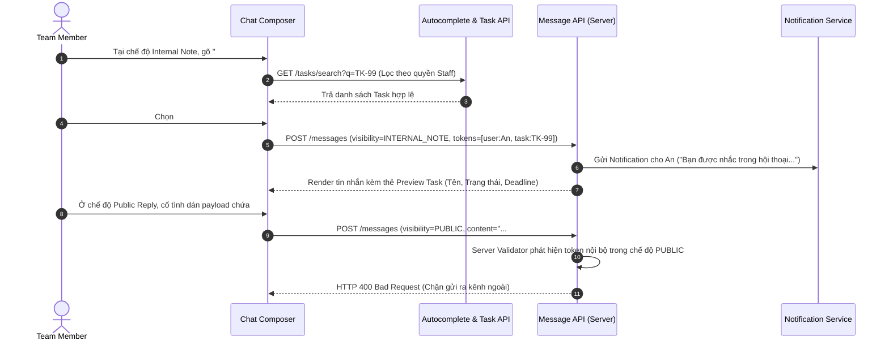

# Feature: In-Chat `@member` & `#task` Mention with Public Reply Protection (FR-CHN-010)

**Mô tả:** Cho phép thành viên gõ `@tên_thành_viên` để nhắc đồng nghiệp và `#mã_task` để nhúng thẻ tóm tắt Task (Tiêu đề, Trạng thái, Deadline) trực tiếp trong Chat nội bộ hoặc chế độ `INTERNAL_NOTE`, đồng thời vô hiệu hóa ở UI và chặn cứng phía Server đối với tin nhắn `PUBLIC` gửi ra khách hàng.

**Kiến trúc cốt lõi:** Áp dụng mô hình **Structured Mention Tokens + Visibility-Based Parser**:
- **Structured Token Format:** Thay vì lưu văn bản thuần `@An #TASK-99`, hệ thống lưu token có cấu trúc trong nội dung tin nhắn nội bộ (VD: `@[user:uuid|Nguyễn An]` và `#[task:uuid|TASK-99]`) để UI render tương tác (click xem hồ sơ / mở nhanh Task Card) và luôn cập nhật trạng thái Task mới nhất.
- **Public Reply Sanitization & Server Guard (`BR-CHN-003`):** Để ngăn tuyệt đối việc nhân viên vô tình dán hoặc nhúng dữ liệu nội bộ (Task kỹ thuật, Assignee nội bộ) gửi sang Zalo/Telegram của khách, bộ soạn thảo `PUBLIC` tắt autocomplete và Server Validation kiểm tra từ chối payload nếu phát hiện Structured Mention Token nội bộ.

## 1. Functional Requirements List

| FR ID | Requirement Description | Input | Output | Associated Business Rule | Priority |
|---|---|---|---|---|---|
| **FR-CHN-010.1** | **Autocomplete & Tag `@member` trong Chat Nội bộ / `INTERNAL_NOTE`:** Khi gõ `@`, gợi ý danh sách thành viên thuộc Workspace/Hội thoại; khi gửi, phát Notification tới các thành viên được nhắc. | Ký tự `@` + từ khóa, `conversation_id`, `visibility` | Danh sách user gợi ý; Notification cho người được tag | `BL-CHN-010.1` | Must-have |
| **FR-CHN-010.2** | **Autocomplete & Nhúng Thẻ Tóm tắt `#task`:** Khi gõ `#`, tìm kiếm Task theo mã/tên trong các Project mà người gửi có quyền xem; render thẻ tóm tắt (Tên, Trạng thái, Deadline) trong khung chat. | Ký tự `#` + từ khóa, `sender_user_id`, `visibility` | Danh sách Task gợi ý; Thẻ preview click mở chi tiết | `BL-CHN-010.2` | Must-have |
| **FR-CHN-010.3** | **Chặn Render UI & Validation Server tại `PUBLIC` Reply:** Tắt hoàn toàn autocomplete `@/#` khi ở tab `PUBLIC` và từ chối ở API nếu payload gửi ra kênh ngoài chứa Structured Mention Token nội bộ. | Outbound `PUBLIC` payload | UI không gợi ý; API trả `HTTP 400` nếu phát hiện token nội bộ | `BL-CHN-010.3` (`BR-CHN-003`) | Must-have |

## 2. Business Rules

| BR ID | Rule Description | Applies to FR |
|---|---|---|
| **BL-CHN-010.1** | **Scoped Member Suggestion:** Autocomplete `@member` chỉ trả về các thành viên nội bộ (`INTERNAL_STAFF`) thuộc cùng `tenant_id` (ưu tiên thành viên đang có quyền truy cập Project/Channel liên quan). | FR-CHN-010.1 |
| **BL-CHN-010.2** | **Permission-Filtered Task Suggestion:** Autocomplete `#task` chỉ tìm kiếm trong các Project thuộc `tenant_id` mà `sender_user_id` có quyền `VIEW_TASK`. Khi hiển thị thẻ tóm tắt `#task` trên khung chat cho người đọc khác, UI kiểm tra nếu người đọc không có quyền xem Project chứa Task đó thì ẩn chi tiết và hiển thị `[Task hạn chế quyền xem]`. | FR-CHN-010.2 |
| **BL-CHN-010.3** | **Zero Internal Token on Public Outbound:** Khi `visibility == 'PUBLIC'`, UI không kích hoạt popup `@/#`. Tại API Server, Regex/Parser kiểm tra nội dung tin nhắn `PUBLIC`: nếu tồn tại token dạng `@[user:...]` hoặc `#[task:...]` → trả về `HTTP 400 Bad Request (INTERNAL_MENTION_NOT_ALLOWED_IN_PUBLIC)` và chặn gửi. | FR-CHN-010.3 |

## 3. Data Structure

### Entity: `message_mentions`
| Field | Data Type | Required | Constraints |
|---|---|---|---|
| `id` | `UUID` | Yes | Primary Key |
| `tenant_id` | `UUID` | Yes | FK → `tenants.id` |
| `message_id` | `UUID` | Yes | FK → `messages.id`, Indexed |
| `mention_type` | `ENUM` | Yes | `USER \| TASK` |
| `target_id` | `UUID` | Yes | `user_id` hoặc `task_id` |
| `created_at` | `TIMESTAMPTZ` | Yes | Default `NOW()` |

## 4. Sequence Diagram: Tag `@member` / `#task` & Server Validation cho Public Reply



## 5. Pre/Post-Conditions & Acceptance Criteria

### FR-CHN-010.1, 010.2 & 010.3: Mention Nội bộ & Chặn Public Reply
- **Pre-condition:** User thuộc cùng `tenant_id` và có quyền truy cập hội thoại; ở chế độ `INTERNAL_NOTE` hoặc Chat nội bộ.
- **Post-condition:** Người được `@` nhận Notification; thẻ `#task` hiển thị live status; tin nhắn `PUBLIC` chứa token nội bộ bị chặn trước khi gửi.
- **Exception / Error case:** Cố tình gửi token nội bộ qua tab `PUBLIC` → Server trả `HTTP 400`; người xem không có quyền vào Project chứa Task → ẩn nội dung thẻ Task.

**Gherkin Scenario:**
```gherkin
Given tôi đang soạn tin nhắn trong chế độ "Internal Note" trên Unified Inbox
When tôi gõ "@An" và "#TASK-99" rồi chọn từ danh sách gợi ý và nhấn "Gửi"
Then nhân viên "An" nhận được thông báo nhắc việc và khung chat hiển thị thẻ tóm tắt của #TASK-99 (Tên, Trạng thái, Deadline)
When tôi chuyển sang chế độ "Public Reply" để trả lời ra Telegram cho khách hàng và gõ "#"
Then giao diện không bật autocomplete Task nội bộ, và nếu gửi payload chứa token Task nội bộ, API Server từ chối với mã HTTP 400
```
