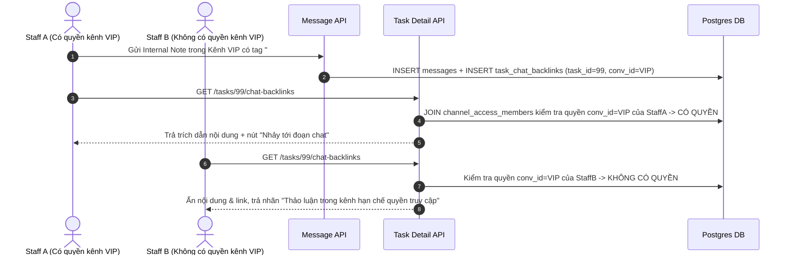

# Feature: Task Chat Backlink Audit & Scoped Visibility (FR-CHN-011)

**Mô tả:** Tự động ghi nhận liên kết ngược (Backlink) vào màn hình chi tiết của Task/Ticket mỗi khi `#mã_task` được nhắc đến trong Chat nội bộ hoặc `INTERNAL_NOTE`, giúp mọi thành viên nắm bắt đầy đủ bối cảnh thảo luận phát sinh mà vẫn bảo vệ quyền riêng tư của hội thoại gốc theo `BR-CHN-006`.

**Kiến trúc cốt lõi:** Áp dụng mô hình **Bidirectional Reference Indexing + Read-Time Permission Filtering**:
- **Event-driven Backlink Creation:** Khi `FR-CHN-010` lưu `message_mentions` loại `TASK`, hệ thống đồng thời chèn một bản ghi vào `task_chat_backlinks` (tham chiếu tới `task_id`, `conversation_id`, `message_id`).
- **Read-Time Scoped Masking (`BR-CHN-006`):** Có nhiều thành viên được phép xem `TASK-99` trên Kanban Board nhưng **không** có quyền xem kênh hội thoại khách hàng VIP hoặc kênh chat riêng tư nơi `TASK-99` được nhắc. Do đó, API lấy Activity/Backlinks của Task bắt buộc lọc từng backlink theo quyền xem `conversation_id` của người đang mở Task.

## 1. Functional Requirements List

| FR ID | Requirement Description | Input | Output | Associated Business Rule | Priority |
|---|---|---|---|---|---|
| **FR-CHN-011.1** | **Tự động Tạo Backlink Khi Tag `#task`:** Mỗi khi tin nhắn hợp lệ (`INTERNAL_NOTE` hoặc Chat nội bộ) chứa `#mã_task`, tự động tạo bản ghi liên kết ngược vào chi tiết Task đó. | `message_id`, `conversation_id`, `task_id`, `mentioned_by_user_id` | Bản ghi trong `task_chat_backlinks` | `BL-CHN-011.1` (`OBJ-01`) | Should-have |
| **FR-CHN-011.2** | **Hiển thị Danh sách Thảo luận Liên quan trên Task (Có Lọc Quyền):** Trên tab *"Liên kết thảo luận"* của Task Detail, hiển thị trích dẫn đoạn chat + nút nhảy về hội thoại gốc nếu user có quyền; ẩn trích dẫn nếu user không có quyền vào hội thoại đó. | `task_id`, `viewer_user_id` | Danh sách backlink đã lọc quyền (`EXCERPT` hoặc `RESTRICTED`) | `BL-CHN-011.2` (`BR-CHN-006`) | Should-have |

## 2. Business Rules

| BR ID | Rule Description | Applies to FR |
|---|---|---|
| **BL-CHN-011.1** | **Idempotent Backlink per Message-Task Pair:** Nếu một tin nhắn nhắc cùng một `#mã_task` nhiều lần, chỉ lưu 1 bản ghi backlink duy nhất cho cặp `(message_id, task_id)`. | FR-CHN-011.1 |
| **BL-CHN-011.2** | **Conversation Permission Enforcement (`BR-CHN-006`):** Khi render tab *"Liên kết thảo luận"* của `task_id`: với mỗi backlink, kiểm tra `viewer_user_id` có quyền truy cập `conversation_id` gốc không. Nếu **Có** → trả về tên kênh, người nhắn, thời gian, trích đoạn 150 ký tự và Deep-link nhảy tới tin nhắn. Nếu **Không** → chỉ trả về `"Thảo luận trong kênh hạn chế quyền truy cập"` (ẩn nội dung, ẩn tên khách hàng, vô hiệu hóa Deep-link). | FR-CHN-011.2 |

## 3. Data Structure

### Entity: `task_chat_backlinks`
| Field | Data Type | Required | Constraints |
|---|---|---|---|
| `id` | `UUID` | Yes | Primary Key |
| `tenant_id` | `UUID` | Yes | FK → `tenants.id`, Indexed |
| `task_id` | `UUID` | Yes | FK → `tasks.id`, Indexed |
| `conversation_id` | `UUID` | Yes | FK → `conversations.id` |
| `message_id` | `UUID` | Yes | FK → `messages.id` |
| `mentioned_by_user_id` | `UUID` | Yes | FK → `users.id` |
| `created_at` | `TIMESTAMPTZ` | Yes | Default `NOW()` |
| *Unique Constraint* | `(message_id, task_id)` | Yes | Chống trùng lặp trong 1 tin nhắn |

## 4. Sequence Diagram: Ghi nhận & Lọc Quyền Hiển thị Backlink trên Task



## 5. Pre/Post-Conditions & Acceptance Criteria

### FR-CHN-011.1 & FR-CHN-011.2: Tạo Backlink & Lọc Quyền
- **Pre-condition:** Tin nhắn nội bộ chứa `#mã_task` hợp lệ đã được lưu thành công.
- **Post-condition:** Trong chi tiết Task có bản ghi liên kết; chỉ người dùng có quyền xem hội thoại gốc mới đọc được nội dung trích dẫn.
- **Exception / Error case:** User mở Task nhưng bị thu hồi quyền xem kênh chat trước đó → ngay lần tải Task tiếp theo, trích dẫn đoạn chat tự động bị ẩn về trạng thái hạn chế quyền.

**Gherkin Scenario:**
```gherkin
Given Staff A gửi một Internal Note trong hội thoại "Kênh Hỗ Trợ VIP" có gắn thẻ "#TASK-99"
When Staff A (có quyền xem Kênh Hỗ Trợ VIP) mở chi tiết "#TASK-99"
Then mục "Liên kết thảo luận" hiển thị trích dẫn đoạn Internal Note kèm nút nhảy về đúng đoạn chat đó
When Staff B (thuộc cùng Project nhưng không có quyền vào Kênh Hỗ Trợ VIP) mở chi tiết "#TASK-99"
Then hệ thống ẩn toàn bộ nội dung trích dẫn và chỉ hiển thị trạng thái "Thảo luận trong kênh hạn chế quyền truy cập"
```
