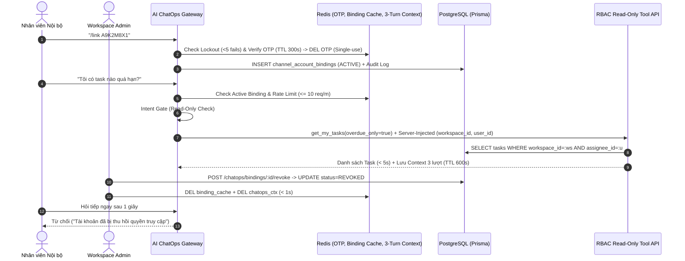

# Software Requirements Specification (SRS) — OmniChannel Phase 5: Account Binding Governance & Internal AI ChatOps (Đợt 2A)

> **Reference Standard:** IEEE Std 830-1998  
> **Project:** OmniMer Enterprise PMIS — OmniChannel Module  
> **Phase:** Phase 5 (`FR-CHN-012`, `FR-CHN-013`, `FR-CHN-014`)  
> **RTM:** [02_RTM_PHASE5_BINDING_INTERNAL_CHATOPS.csv](./02_RTM_PHASE5_BINDING_INTERNAL_CHATOPS.csv)  
> **Changelog:** [07_omnichannel_implementation_changelog.md](../../../../../../backend_otm/project_core/docs/change_log/07_omnichannel_implementation_changelog.md)

---

## 1. Introduction

### 1.1 Purpose
Đặc tả yêu cầu phần mềm cho **OmniChannel Phase 5**: định danh và liên kết tài khoản kênh ngoài (`Account Binding` qua OTP/QR ngắn hạn), quản trị Whitelist Khách hàng và cơ chế **thu hồi quyền có hiệu lực tức thì (`< 1s`, zero-stale-cache)**, cùng hệ thống **AI ChatOps Read-Only cho Nhân viên Nội bộ (Phát hành Đợt 2A)**.

### 1.2 Product Scope (Phase 5)
1. **`FR-CHN-012` (Account Binding via Short-Lived OTP/QR):**
   - Sinh mã OTP 8 ký tự CSPRNG (`TTL = 300s`, single-use) hoặc QR Deep-link.
   - Ánh xạ 1-1 duy nhất `(workspace_id, channel_type, external_sender_id) ↔ user_id` (`status = ACTIVE`).
   - Chống dò mã Brute-force: nhập sai `>= 5 lần trong 15 phút` khóa `external_sender_id` trong `15 phút` + ghi `BIND_FAILED_LIMIT`.
2. **`FR-CHN-013` (Binding Governance, Customer Whitelist & Instant Revocation):**
   - Bảng quản trị cấp quyền `client_chatops_permissions` cho `Guest (Client)` theo `allowed_company_ids[]` hoặc `allowed_project_ids[]`.
   - Thu hồi quyền tức thì (`< 1000ms`): cập nhật DB `REVOKED` đồng thời xóa ngay lập tức cả `binding_cache` lẫn bộ nhớ hội thoại ngắn hạn `chatops_ctx` trên Redis.
   - Lifecycle Hook tự động thu hồi toàn bộ binding khi User bị vô hiệu hóa (`USER_DEACTIVATED`).
3. **`FR-CHN-014` (Read-Only AI ChatOps for Internal Staff — Đợt 2A):**
   - Kiểm soát Rate Limit (`10 câu hỏi/phút/user` + hạn mức token ngày).
   - **Intent Gate (Read-Only Only):** Không đăng ký bất kỳ Write Tool nào; chặn mọi yêu cầu tạo/sửa/xóa Task (`BLOCKED_WRITE_INTENT`).
   - **Server-Injected RBAC Tool API:** LLM chỉ gọi 3 Read-only Tools (`get_my_tasks`, `get_project_progress`, `search_tasks`) với `(workspace_id, user_id, allowed_project_ids)` được tiêm cứng từ Server Session.
   - **Scoped Disambiguation & Bounded Memory:** Lưu tối đa 3 lượt hỏi đáp gần nhất trên Redis (`TTL = 600s` / 10 phút) để nhân viên chọn lại khi trùng tên Task/Project.

### 1.3 References
- [FR-CHN-012: Account Binding OTP/QR](./FR-CHN-012_account_binding_otp_qr.md)
- [FR-CHN-013: Binding Governance & Revocation](./FR-CHN-013_binding_governance_revocation.md)
- [FR-CHN-014: Internal AI ChatOps Read-Only](./FR-CHN-014_internal_ai_chatops_readonly.md)

---

## 2. Overall Description & Architecture

---

## 3. Data Dictionary & Prisma Models (Phase 5 Scope)

- **`channel_account_bindings` (`ChannelAccountBinding`):** `id`, `workspace_id`, `user_id`, `user_type` (`INTERNAL_STAFF | EXTERNAL_CLIENT`), `channel_type` (`TELEGRAM | SLACK | ZALO_OA`), `external_sender_id`, `status` (`ACTIVE | REVOKED`), `bound_at`, `revoked_at?`. Partial Unique Index `(workspace_id, channel_type, external_sender_id) WHERE status = 'ACTIVE'`.
- **`client_chatops_permissions` (`ClientChatopsPermission`):** `id`, `workspace_id`, `client_user_id`, `is_enabled` (`Boolean`), `scope_type` (`COMPANY | PROJECT`), `allowed_company_ids` (`String[]`), `allowed_project_ids` (`String[]`), `granted_by`, `updated_at`. Unique `(workspace_id, client_user_id)`.
- **`chatops_audit_logs` (`ChatopsAuditLog`):** `id`, `workspace_id`, `actor_user_id?`, `target_user_id?`, `event_type` (`OmniAuditEventType`), `metadata?` (`Json`), `created_at`.

---

## 4. Non-Functional Requirements (Phase 5 Thresholds)

| NFR ID | Metric | Target Threshold |
| :--- | :--- | :--- |
| **NFR-P5-01** | Revocation Propagation Delay | `< 1000ms` (Xóa đồng bộ cả `binding_cache` và `chatops_ctx` trên Redis) |
| **NFR-P5-02** | Internal AI ChatOps Query Latency | `p95 < 5000ms` |
| **NFR-P5-03** | Brute-Force & Rate Limit Protection | Khóa 15 phút sau 5 lần sai OTP/15m; chặn ở câu hỏi thứ 11 trong cùng 1 phút |

---

## 5. REST API Contracts (Phase 5)

| Method | Endpoint | Role | Request DTO (`.strict()`) | Success / Error Codes |
| :---: | :--- | :---: | :--- | :--- |
| `POST` | `/api/v1/chatops/bindings/otp` | Authenticated User | `GenerateOtpSchema` | `201 Created` (`TTL=300s`) / `403 Guest Not Enabled` |
| `GET` | `/api/v1/chatops/bindings` | `ADMIN`, `PM` | `?userType=...&status=...` | `200 OK` |
| `POST` | `/api/v1/chatops/bindings/:id/revoke` | `ADMIN`, `PM`, Self | `RevokeBindingSchema` | `200 OK` (`< 1s` invalidation) |
| `PUT` | `/api/v1/chatops/permissions/clients/:userId` | `ADMIN`, `PM` | `GrantClientChatopsSchema` | `200 OK` |

---

## 6. Model Allocation for Phase 5

| Hạng mục Công việc Phase 5 | Model Phụ Trách |
| :--- | :--- |
| `AccountBindingService` (CSPRNG OTP, 1-1, Brute-Force Lockout), `BindingGovernanceService` (Zero-Stale-Cache `<1s`), Intent Gate & Server-Injected RBAC Tool API | **Claude Opus** |
| LLM Rate Limiter (`10 req/m`) & Bounded Disambiguation Context Memory (3 turns, TTL 10m) (`FR-CHN-014.1/4`) | **Gemini 4 Hydrogen** |
| Lifecycle Hook `USER_DEACTIVATED` tự động thu hồi binding (`FR-CHN-013.4`) | **Neon** |
| Governance Admin UI (Whitelist & Active Bindings) & API Spec `19_..._api.md` (`FR-CHN-013.1/2`) | **Gemini 4 Argon** |
| Kiểm tra `npx tsc --noEmit`, ESLint & Test Fixtures | **Gemini Flash** |
