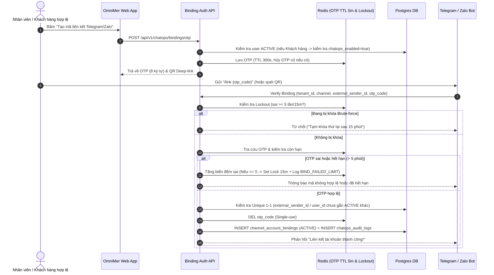

# Feature: Account Binding via Short-Lived OTP / QR (FR-CHN-012)

**Mô tả:** Cho phép nhân viên nội bộ và khách hàng/đối tác đã được Admin cấp quyền thực hiện liên kết (Account Binding) tài khoản Telegram hoặc Zalo OA của mình với tài khoản OmniMer qua mã OTP/QR dùng một lần có thời hạn ngắn, đảm bảo quan hệ ánh xạ 1-1 và chống tấn công dò mã (Brute-force).

**Kiến trúc cốt lõi:** Áp dụng mô hình **Cryptographic Ephemeral Token Binding (Liên kết Mã Tạm Dùng 1 Lần)**:
- **Short-Lived & Single-Use (`TTL = 300s`):** Mã OTP (8 ký tự alphanumeric sinh từ CSPRNG) hoặc QR Deep-link chỉ tồn tại tối đa 5 phút trong Redis và bị hủy ngay lập tức sau lần xác thực thành công đầu tiên.
- **Strict 1-to-1 Binding per Tenant (`BR-CHN-004`):** Một tài khoản kênh ngoài `(tenant_id, channel_type, external_sender_id)` chỉ được gắn vào tối đa một `user_id`. Tránh tình trạng nhiều người dùng chung 1 nick Zalo/Telegram làm lẫn lộn quyền RBAC.
- **Anti-Brute-force Rate Limiting:** Khóa tạm thời `15 phút` đối với `external_sender_id` nếu nhập sai OTP liên tiếp quá `5 lần`, đồng thời ghi cảnh báo vào `chatops_audit_logs`.

## 1. Functional Requirements List

| FR ID | Requirement Description | Input | Output | Associated Business Rule | Priority |
|---|---|---|---|---|---|
| **FR-CHN-012.1** | **Sinh Mã OTP / QR Liên kết trên Web App:** Cho phép người dùng hợp lệ (Nội bộ hoặc Khách hàng đã được bật `chatops_enabled`) tạo mã OTP hoặc QR Deep-link (TTL 5 phút). | `user_id`, `tenant_id`, `channel_type` (`TELEGRAM \| ZALO_OA`) | `otp_code` (8 ký tự), `qr_payload`, `expires_at` (`NOW() + 5m`) | `BL-CHN-012.1` | Must-have |
| **FR-CHN-012.2** | **Xác thực & Tạo Ánh xạ 1-1 trên Bot:** Tiếp nhận lệnh `/link {otp_code}` (hoặc QR `/start {otp_code}`) trên Telegram/Zalo, kiểm tra TTL, single-use, xung đột 1-1 và lưu `channel_account_bindings`. | `tenant_id`, `channel_type`, `external_sender_id`, `otp_code` | Trạng thái liên kết `ACTIVE`, xóa OTP, ghi Audit Log | `BL-CHN-012.2`, `BL-CHN-012.3` (`BR-CHN-004`) | Must-have |
| **FR-CHN-012.3** | **Chống Brute-force & Chặn Truy vấn Chưa Liên kết:** Giới hạn tối đa 5 lần nhập sai OTP trong 15 phút cho mỗi `external_sender_id`; chặn mọi lệnh hỏi AI nếu chưa có binding `ACTIVE`. | `external_sender_id`, `otp_code` hoặc `query_text` | Cooldown 15 phút khi sai >= 5 lần; từ chối truy vấn nếu chưa liên kết | `BL-CHN-012.4`, `BL-CHN-012.5` | Must-have |

## 2. Business Rules

| BR ID | Rule Description | Applies to FR |
|---|---|---|
| **BL-CHN-012.1** | **Pre-authorized Binding Eligibility & Core Role Mapping (`FR-PRJ-000`):** Chỉ tài khoản thuộc Workspace đang `ACTIVE` mới tạo được mã OTP/QR. `INTERNAL_STAFF` tương ứng các role `Workspace Admin / PM / Team Member` (hỗ trợ liên kết `TELEGRAM \| SLACK \| ZALO_OA`). `EXTERNAL_CLIENT` tương ứng role `Guest (Client)` (hỗ trợ `TELEGRAM \| ZALO_OA`), bắt buộc phải được Admin bật `chatops_enabled = true` và có `customer_scope` hợp lệ (`FR-CHN-013`). | FR-CHN-012.1 |
| **BL-CHN-012.2** | **Ephemeral Single-Use OTP Policy:** Mã OTP/QR có `TTL = 300 giây`. Nếu User tạo mã mới khi mã cũ chưa hết hạn → mã cũ lập tức bị vô hiệu hóa. Ngay khi xác thực `/link` thành công → xóa khóa OTP khỏi Redis để không thể dùng lại lần thứ hai. | FR-CHN-012.1, FR-CHN-012.2 |
| **BL-CHN-012.3** | **Strict 1-to-1 Mapping (`BR-CHN-004`):** Một `(tenant_id, channel_type, external_sender_id)` chỉ được gắn với duy nhất 1 `user_id` ở trạng thái `ACTIVE`. Nếu `external_sender_id` này đang gắn cho `User A` mà có yêu cầu gắn sang `User B` → hệ thống từ chối và yêu cầu Admin/User A thu hồi liên kết cũ trước (`HTTP 409`). Nếu `User A` muốn đổi sang nick Telegram/Zalo mới → phải thu hồi nick cũ trước khi liên kết nick mới. | FR-CHN-012.2 |
| **BL-CHN-012.4** | **OTP Brute-Force Lockout:** Đếm số lần nhập sai theo khóa `(tenant_id, channel_type, external_sender_id)` trong cửa sổ trượt 15 phút. Đạt mốc **5 lần sai** → khóa tiếp nhận lệnh `/link` của `external_sender_id` đó trong **15 phút** và ghi `BIND_FAILED_LIMIT` vào `chatops_audit_logs`. | FR-CHN-012.3 |
| **BL-CHN-012.5** | **Unbound Default Deny:** Mọi tin nhắn gửi tới Bot AI mà `(tenant_id, channel_type, external_sender_id)` không có bản ghi `status = ACTIVE` đều bị từ chối ở tầng Auth Gateway (không được gọi tới LLM). | FR-CHN-012.3 |

## 3. Data Structure

### Entity: `binding_otp_tokens` (Lưu Redis)
| Field | Data Type | Required | Constraints |
|---|---|---|---|
| `otp_code` | `VARCHAR(16)` | Yes | Key (`SHA256(tenant_id:otp_code)`), TTL 300s |
| `tenant_id` | `UUID` | Yes | Tenant sở hữu |
| `user_id` | `UUID` | Yes | User tạo mã |
| `channel_type` | `ENUM` | Yes | `TELEGRAM \| ZALO_OA` |
| `created_at` | `TIMESTAMPTZ` | Yes | Thời điểm phát hành |

### Entity: `channel_account_bindings`
| Field | Data Type | Required | Constraints |
|---|---|---|---|
| `id` | `UUID` | Yes | Primary Key |
| `tenant_id` | `UUID` | Yes | FK → `tenants.id`, Indexed |
| `user_id` | `UUID` | Yes | FK → `users.id`, Indexed |
| `user_type` | `ENUM` | Yes | `INTERNAL_STAFF \| EXTERNAL_CLIENT` |
| `channel_type` | `ENUM` | Yes | `TELEGRAM \| ZALO_OA` |
| `external_sender_id` | `VARCHAR(255)` | Yes | Unique Partial Index `(tenant_id, channel_type, external_sender_id) WHERE status = 'ACTIVE'` |
| `status` | `ENUM` | Yes | `ACTIVE \| REVOKED` |
| `bound_at` | `TIMESTAMPTZ` | Yes | Default `NOW()` |
| `revoked_at` | `TIMESTAMPTZ` | No | Thời điểm thu hồi |

## 4. Sequence Diagram: Liên kết Tài khoản OTP/QR & Chống Brute-Force



## 5. Pre/Post-Conditions & Acceptance Criteria

### FR-CHN-012.1, 012.2 & 012.3: Liên kết OTP/QR, Single-Use & Brute-force Lockout
- **Pre-condition:** User hợp lệ trong Tenant; nếu là Khách hàng phải đã được Admin cấp quyền ở `FR-CHN-013`.
- **Post-condition:** Ánh xạ 1-1 `ACTIVE` được lưu DB, OTP bị tiêu hủy ngay sau khi dùng, Audit Log được ghi nhận.
- **Exception / Error case:** OTP quá 5 phút → hết hạn; dùng lại OTP đã xác thực → từ chối; nhập sai 5 lần trong 15 phút → khóa tạm thời 15 phút; tài khoản lạ chưa liên kết nhắn hỏi AI → từ chối ở Auth Gateway.

**Gherkin Scenario:**
```gherkin
Given tôi là Nhân viên hợp lệ của Tenant A và vừa tạo mã OTP liên kết "A9K2M8X1" (TTL 5 phút)
When tôi gửi lệnh "/link A9K2M8X1" tới Bot Telegram của Tenant A trong vòng 2 phút
Then hệ thống xác thực thành công, lưu ánh xạ 1-1 giữa Telegram ID của tôi với tài khoản OmniMer và xóa ngay mã OTP
When một người dùng khác cố tình gửi lại mã "/link A9K2M8X1" hoặc nhập sai OTP 5 lần liên tiếp trong 15 phút
Then hệ thống từ chối mã đã sử dụng, kích hoạt khóa tạm thời 15 phút đối với Telegram ID đó và ghi sự kiện vào chatops_audit_logs
```
