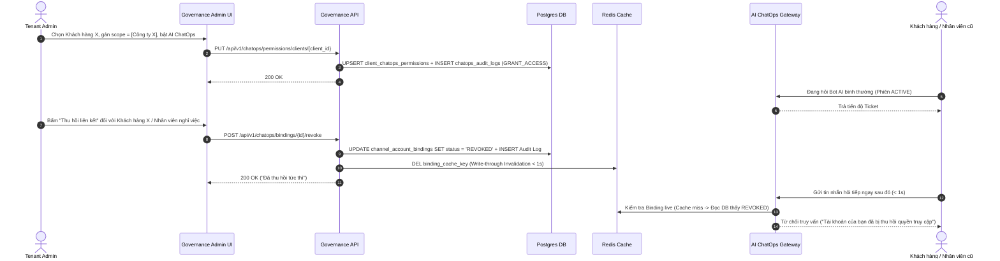

# Feature: Account Binding Governance, Customer Whitelist & Instant Revocation (FR-CHN-013)

**Mô tả:** Cung cấp bảng quản trị cho Admin/PM để phê duyệt danh sách Khách hàng/Đối tác được phép dùng Bot AI (phân quyền theo Công ty hoặc theo từng cá nhân/Project), giám sát các thiết bị/tài khoản Telegram-Zalo đang liên kết và thực hiện **thu hồi quyền có hiệu lực tức thì (`< 1s`, zero-stale-cache)** kèm Audit Log đầy đủ.

**Kiến trúc cốt lõi:** Áp dụng mô hình **Zero-Stale-Cache Revocation + Scoped Whitelist Registry**:
- **Cấp quyền Khách hàng (`customer_scope`):** Khách hàng không tự động được dùng Bot AI dù đã có tài khoản Portal. Admin/PM phải duyệt cấp quyền tường minh và định nghĩa rõ phạm vi (`company_ids[]`, `project_ids[]`) mà khách hàng đó được tra cứu.
- **Thu hồi Tức thì (`< 1 giây`):** Rủi ro lớn khi nhân viên nghỉ việc hoặc mất tài khoản Zalo/Telegram là cache quyền cũ còn hiệu lực (VD: JWT TTL 15 phút). Hệ thống sử dụng **Redis Active-Binding Blacklist / Write-Through Invalidation**: mọi lệnh thu hồi đồng thời cập nhật DB `REVOKED` và xóa/ghi đè key Redis ngay trong 1 transaction logic, buộc Auth Gateway kiểm tra trạng thái live trước mỗi tin nhắn Bot.

## 1. Functional Requirements List

| FR ID | Requirement Description | Input | Output | Associated Business Rule | Priority |
|---|---|---|---|---|---|
| **FR-CHN-013.1** | **Cấp quyền Whitelist cho Khách hàng/Đối tác:** Admin/PM bật quyền truy cập AI ChatOps cho tài khoản Khách hàng và gán phạm vi `customer_scope` (theo Công ty hoặc danh sách Project cụ thể). | `admin_user_id`, `client_user_id`, `scope_type` (`COMPANY \| PROJECT`), `scope_ids[]` | Cập nhật `client_chatops_permissions`, ghi Audit Log `GRANT_ACCESS` | `BL-CHN-013.1` | Must-have |
| **FR-CHN-013.2** | **Xem Danh sách Liên kết Đang Hoạt động:** Hiển thị toàn bộ các tài khoản Nội bộ & Khách hàng đã liên kết Telegram/Zalo, thời điểm liên kết, thời điểm tương tác Bot gần nhất. | `tenant_id`, bộ lọc `user_type`, `status` | Danh sách `channel_account_bindings` | `BL-CHN-013.2` | Must-have |
| **FR-CHN-013.3** | **Thu hồi Liên kết & Quyền Truy cập Tức thì:** Cho phép Admin/PM (hoặc chính User với tài khoản của mình) thu hồi liên kết, có hiệu lực ngay lập tức (`< 1s`) kể cả khi phiên chat đang diễn ra. | `actor_user_id`, `binding_id` hoặc `target_user_id`, `reason` | `status = REVOKED`, invalidate Redis tức thì, ghi Audit Log `REVOKE_ACCESS` | `BL-CHN-013.3` (`BR-CHN-004`) | Must-have |
| **FR-CHN-013.4** | **Tự động Thu hồi Khi Vô hiệu hóa User (Lifecycle Hook):** Khi Admin khóa tài khoản hoặc cho nhân viên nghỉ việc trên hệ thống User Management cốt lõi, tự động thu hồi toàn bộ `channel_account_bindings` của user đó. | Domain Event `USER_DEACTIVATED(user_id)` | Tự động chuyển toàn bộ binding sang `REVOKED` + xóa cache | `BL-CHN-013.4` | Must-have |

## 2. Business Rules

| BR ID | Rule Description | Applies to FR |
|---|---|---|
| **BL-CHN-013.1** | **Explicit Customer Approval & Scope:** Tài khoản Khách hàng/Đối tác (`EXTERNAL_CLIENT`) bắt buộc phải có bản ghi `is_enabled = true` trong `client_chatops_permissions` với ít nhất 1 `company_id` hoặc `project_id` hợp lệ thuộc `tenant_id`. Khi Admin cập nhật thu hẹp `scope_ids[]`, quyền truy vấn của Bot thay đổi ngay theo phạm vi mới. | FR-CHN-013.1 |
| **BL-CHN-013.2** | **Governance Authority:** Chỉ `TENANT_ADMIN` hoặc `PM` (trong phạm vi Project mình quản lý) mới được xem, cấp hoặc thu hồi quyền Khách hàng; thu hồi quyền nhân viên toàn Tenant chỉ dành cho `TENANT_ADMIN`. Nhân viên chỉ được tự hủy liên kết của chính mình. | FR-CHN-013.2, FR-CHN-013.3 |
| **BL-CHN-013.3** | **Zero-Stale-Cache & Context Memory Revocation (`BR-CHN-004`):** Không được cache kết quả xác thực binding với TTL dài mà không có invalidation. Khi thu hồi, hệ thống cập nhật DB `status = REVOKED`, đồng thời xóa ngay lập tức cả key xác thực `binding_cache` LẪN key bộ nhớ hội thoại ngắn hạn `chatops_context_memory` (`FR-CHN-014/015`) trên Redis, đảm bảo độ trễ hiệu lực `< 1 giây`. | FR-CHN-013.3, FR-CHN-013.4 |
| **BL-CHN-013.4** | **Mandatory Governance Audit Log:** Mọi thao tác cấp quyền, sửa phạm vi `customer_scope`, thu hồi thủ công hoặc thu hồi tự động khi user bị khóa đều phải ghi vĩnh viễn vào `chatops_audit_logs` gồm `actor_user_id`, `target_user_id`, `previous_scope`, `new_scope`, `reason`, `created_at`. | FR-CHN-013.1, FR-CHN-013.3, FR-CHN-013.4 |

## 3. Data Structure

### Entity: `client_chatops_permissions`
| Field | Data Type | Required | Constraints |
|---|---|---|---|
| `id` | `UUID` | Yes | Primary Key |
| `tenant_id` | `UUID` | Yes | FK → `tenants.id`, Indexed |
| `client_user_id` | `UUID` | Yes | FK → `users.id`, Unique cùng `tenant_id` |
| `is_enabled` | `BOOLEAN` | Yes | Default `false` |
| `scope_type` | `ENUM` | Yes | `COMPANY \| PROJECT` |
| `allowed_company_ids` | `UUID[]` | No | Danh sách Công ty được phép xem |
| `allowed_project_ids` | `UUID[]` | No | Danh sách Project được phép xem |
| `granted_by` | `UUID` | Yes | FK → `users.id` |
| `updated_at` | `TIMESTAMPTZ` | Yes | Default `NOW()` |

### Entity: `chatops_audit_logs` *(Bảng Audit Log hợp nhất cho toàn phân hệ OmniChannel & ChatOps)*
| Field | Data Type | Required | Constraints |
|---|---|---|---|
| `id` | `UUID` | Yes | Primary Key |
| `tenant_id` | `UUID` | Yes | FK → `tenants.id`, Indexed |
| `actor_user_id` | `UUID` | No | `NULL` nếu do hệ thống tự động (`USER_DEACTIVATED`) |
| `target_user_id` | `UUID` | No | FK → `users.id` |
| `event_type` | `ENUM` | Yes | `CHANNEL_CONNECTED \| CHANNEL_DISCONNECTED \| TOKEN_ROTATED \| GRANT_ACCESS \| UPDATE_SCOPE \| REVOKE_ACCESS \| AUTO_REVOKE_ON_DISABLE \| BIND_SUCCESS \| BIND_FAILED_LIMIT \| BLOCKED_WRITE_INTENT \| RATE_LIMITED \| STORAGE_CONFIG_UPDATED \| UNPRESERVE \| SOFT_DELETE \| PURGE` |
| `metadata` | `JSONB` | No | Lưu `previous_scope`, `new_scope`, `reason`, `channel_type`, `channel_connection_id` |
| `created_at` | `TIMESTAMPTZ` | Yes | Default `NOW()` |

## 4. Sequence Diagram: Cấp quyền Khách hàng & Thu hồi Quyền Tức thì



## 5. Pre/Post-Conditions & Acceptance Criteria

### FR-CHN-013.1 & FR-CHN-013.3: Cấp quyền Whitelist & Thu hồi Tức thì
- **Pre-condition:** Người thực hiện là `TENANT_ADMIN` (hoặc `PM` có quyền quản lý Project đối với phạm vi của mình).
- **Post-condition:** Whitelist lưu đúng phạm vi; khi thu hồi, quyền truy cập Bot chấm dứt trong `< 1 giây` và mọi thao tác đều có Audit Log.
- **Exception / Error case:** Member thường gọi API cấp/thu hồi quyền người khác → trả `HTTP 403`; Khách hàng cố tạo OTP khi `is_enabled = false` → chặn với `HTTP 403`.

**Gherkin Scenario:**
```gherkin
Given Nhân viên A đang liên kết Telegram với OmniMer và vừa tra cứu thành công tiến độ Project P1
When Admin của Tenant bấm "Thu hồi liên kết" đối với Nhân viên A (hoặc vô hiệu hóa tài khoản Nhân viên A)
Then hệ thống cập nhật trạng thái binding thành REVOKED, xóa ngay cache xác thực và ghi bản ghi REVOKE_ACCESS vào chatops_audit_logs
And khi Nhân viên A gửi tin nhắn hỏi tiếp tới Bot Telegram ngay sau 1 giây
Then Bot từ chối ngay lập tức với thông báo "Tài khoản đã bị thu hồi quyền truy cập" và không thực hiện bất kỳ truy vấn dữ liệu nào
```
