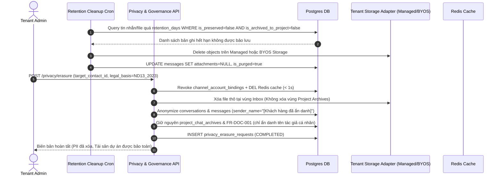

# Feature: Data Retention, Soft-Delete Trash & NĐ 13/2023/NĐ-CP Compliance (FR-CHN-016)

**Mô tả:** Quy định vòng đời lưu trữ (Retention Policy) cho dữ liệu hội thoại thô trên Unified Inbox, cơ chế Thùng rác 30 ngày (Soft-Delete Grace Period) kiểm soát chặt quyền xóa vĩnh viễn, cơ chế miễn trừ cho dữ liệu đã bảo lưu/lưu vào Dự án (`FR-CHN-017`), và quy trình xóa/ẩn danh dữ liệu cá nhân (Right to Erasure) tuân thủ **Nghị định 13/2023/NĐ-CP**.

**Kiến trúc cốt lõi:** Áp dụng mô hình **Policy-Driven Retention + Preservation Exemption + PII-Asset Separation**:
- **Miễn trừ Bảo lưu (Preservation Exemption):** Job dọn dẹp theo `retention_days` chỉ quét các tin nhắn/file thô thông thường trên Inbox. Mọi bản ghi có cờ `is_preserved = true` hoặc đã được Archive vào Dự án (`FR-CHN-017`) đều được **miễn trừ vĩnh viễn** khỏi Job tự động xóa.
- **Thùng rác 30 ngày & Phân quyền Xóa cứng (`BR-CHN-009`):** Chỉ `PM` hoặc `TENANT_ADMIN` mới có quyền gỡ bảo lưu hoặc đưa tài sản vào Thùng rác (`SOFT_DELETED`); dữ liệu nằm trong Thùng rác 30 ngày để phục hồi nếu xóa nhầm trước khi xóa vật lý trên Storage (Managed hoặc BYOS).
- **Tách PII khỏi Tài sản Dự án khi thực thi NĐ 13:** Xóa/ẩn danh thông tin định danh cá nhân (tên, `external_sender_id`, SĐT/Email, tin nhắn thô chứa PII) ở Inbox và `channel_account_bindings`, nhưng **bảo toàn tài sản thiết kế/hợp đồng đã lưu vào Dự án** (`FR-DOC-001`) dưới tác giả đã ẩn danh (`[Khách hàng đã ẩn danh]`).

## 1. Functional Requirements List

| FR ID | Requirement Description | Input | Output | Associated Business Rule | Priority |
|---|---|---|---|---|---|
| **FR-CHN-016.1** | **Cấu hình Thời hạn Lưu trữ (Retention Policy):** Cho phép `TENANT_ADMIN` thiết lập số ngày lưu trữ tin nhắn thô và tệp đính kèm chưa bảo lưu trên Inbox. | `tenant_id`, `message_retention_days`, `attachment_retention_days` | Lưu `tenant_omnichannel_retention_policies` | `BL-CHN-016.1` | Should-have |
| **FR-CHN-016.2** | **Job Dọn dẹp Dữ liệu Quá hạn (Có Miễn trừ Bảo lưu):** Chạy định kỳ hàng ngày để dọn tin nhắn/file quá hạn `retention_days`, bỏ qua toàn bộ bản ghi `is_preserved = true` hoặc `is_archived_to_project = true`. | Scheduled Cron Job (`02:00 UTC+7`) | Chuyển file/tin hết hạn sang dọn dẹp trên Managed/BYOS Storage | `BL-CHN-016.2` | Should-have |
| **FR-CHN-016.3** | **Phân quyền Gỡ Bảo lưu & Thùng rác 30 ngày:** Chỉ cho phép `PM` hoặc `TENANT_ADMIN` gỡ cờ bảo lưu hoặc chuyển bản ghi/tài sản vào Thùng rác (`deleted_at`); khôi phục trong 30 ngày hoặc xóa vĩnh viễn sau 30 ngày. | `actor_user_id`, `target_id`, `action` (`UNPRESERVE \| SOFT_DELETE \| RESTORE \| PURGE`) | Cập nhật trạng thái hoặc `HTTP 403`; Audit Log bắt buộc | `BL-CHN-016.3` (`BR-CHN-009`) | Must-have |
| **FR-CHN-016.4** | **Xóa / Ẩn danh Dữ liệu Cá nhân theo NĐ 13/2023/NĐ-CP:** Thu hồi binding, xóa/ẩn danh PII ở Inbox & snapshots thô, đồng thời bảo toàn các tài sản đã Archive vào Dự án dưới trạng thái ẩn danh tác giả. | `admin_user_id`, `tenant_id`, `target_subject_id`, `legal_basis` | Ẩn danh PII, thu hồi binding tức thì, giữ Project Assets, ghi biên bản | `BL-CHN-016.4`, `BL-CHN-016.5` (`BR-CHN-009`) | Must-have |

## 2. Business Rules

| BR ID | Rule Description | Applies to FR |
|---|---|---|
| **BL-CHN-016.1** | **Retention Bounds:** Thời hạn lưu trữ mặc định của Tenant là `730 ngày` (24 tháng) cho tin nhắn và `365 ngày` cho tệp đính kèm Inbox; giá trị tối thiểu không được nhỏ hơn `30 ngày`. | FR-CHN-016.1 |
| **BL-CHN-016.2** | **Strict Preservation Exemption & Reference-Counted Blob Cleanup:** Câu truy vấn của Retention Cleanup Job bắt buộc có điều kiện `WHERE is_preserved = false AND is_archived_to_project = false AND deleted_at IS NULL`. Đối với tệp vật lý lưu theo khóa chống trùng `{workspace_id}/blobs/{sha256}`, Worker chỉ xóa object vật lý trên Storage (Managed/BYOS) khi `ref_count == 0` (không còn Task Snapshot hay Project Archive nào tham chiếu tới). | FR-CHN-016.2 |
| **BL-CHN-016.3** | **Governance & 30-Day Trash Grace Period (`BR-CHN-009`):** `Team Member` thường không được phép gỡ `is_preserved` hay xóa tài liệu đã lưu vào Dự án (`HTTP 403`). Chỉ `PM` (trong phạm vi Project mình quản lý) hoặc `TENANT_ADMIN` (`Workspace Admin`) được thao tác, mọi thao tác đều ghi Audit Log. Dữ liệu bị xóa mềm nằm trong Thùng rác **30 ngày** trước khi Job tự động xóa vật lý vĩnh viễn. | FR-CHN-016.3 |
| **BL-CHN-016.4** | **PII Erasure vs. Immutable Project Archive (NĐ 13/2023/NĐ-CP):** Khi xử lý yêu cầu xóa dữ liệu cá nhân: (1) Thu hồi tức thì `channel_account_bindings` + xóa Redis context memory; (2) Thay `contact_name`/`sender_name` thành `[Khách hàng đã ẩn danh]` và băm 1 chiều `external_sender_id` trong DB; (3) Xóa nội dung tin nhắn thô và giảm `ref_count` tệp ở Inbox; (4) Với các gói đã bấm *"Lưu vào Dự án"* (`project_chat_archives` / `FR-DOC-001`), **không sửa nội dung file `archive.md` vật lý** (để bảo toàn mã `markdown_sha256`), chỉ ẩn danh thông tin tác giả trong DB hoặc cho phép Admin xóa nguyên gói Archive nếu không còn nghĩa vụ lưu trữ hợp đồng. | FR-CHN-016.4 |
| **BL-CHN-016.5** | **Clean Compliance Audit Trail:** Biên bản `privacy_erasure_requests` chỉ lưu mã hash tham chiếu `target_subject_ref`, người duyệt, lý do pháp lý và số lượng bản ghi đã xử lý — không lưu ngược lại PII vừa xóa. | FR-CHN-016.4 |

## 3. Data Structure

### Entity: `tenant_omnichannel_retention_policies`
| Field | Data Type | Required | Constraints |
|---|---|---|---|
| `tenant_id` | `UUID` | Yes | Primary Key, FK → `tenants.id` |
| `message_retention_days` | `INTEGER` | Yes | Default `730`, Check `>= 30` |
| `attachment_retention_days` | `INTEGER` | Yes | Default `365`, Check `>= 30` |
| `trash_grace_period_days` | `INTEGER` | Yes | Default `30`, Check `>= 7` |
| `updated_by` | `UUID` | Yes | FK → `users.id` |
| `updated_at` | `TIMESTAMPTZ` | Yes | Default `NOW()` |

### Entity: `privacy_erasure_requests`
| Field | Data Type | Required | Constraints |
|---|---|---|---|
| `id` | `UUID` | Yes | Primary Key |
| `tenant_id` | `UUID` | Yes | FK → `tenants.id`, Indexed |
| `target_subject_ref` | `VARCHAR(255)` | Yes | Hash tham chiếu một chiều |
| `requested_by_admin_id` | `UUID` | Yes | FK → `users.id` |
| `legal_basis` | `VARCHAR(255)` | Yes | VD: `ND13_2023_USER_ERASURE_REQUEST` |
| `preserved_assets_retained` | `INTEGER` | Yes | Số Project Assets được giữ lại dưới dạng ẩn danh |
| `affected_records_count` | `INTEGER` | Yes | Tổng số bản ghi PII đã xóa/ẩn danh |
| `status` | `ENUM` | Yes | `PENDING \| COMPLETED \| FAILED` |
| `completed_at` | `TIMESTAMPTZ` | No | Thời điểm hoàn tất |

## 4. Sequence Diagram: Retention Exemption & Xóa PII theo NĐ 13/2023/NĐ-CP



## 5. Pre/Post-Conditions & Acceptance Criteria

### FR-CHN-016.2, 016.3 & 016.4: Miễn trừ Bảo lưu, Thùng rác 30 ngày & Tuân thủ NĐ 13
- **Pre-condition:** Tenant đã cấu hình chính sách Retention; thao tác xóa/gỡ bảo lưu chỉ do `PM`/`TENANT_ADMIN` thực hiện.
- **Post-condition:** Dữ liệu bảo lưu/đã lưu vào Dự án không bị xóa bởi Retention Job; khi xóa PII theo NĐ 13, danh tính cá nhân bị xóa sạch nhưng tài liệu đã Archive vào Dự án vẫn an toàn.
- **Exception / Error case:** Member thường bấm gỡ bảo lưu hoặc xóa vĩnh viễn → trả `HTTP 403 Forbidden`; Lỗi kết nối BYOS Storage khi dọn rác → giữ `FAILED`, không đánh dấu `is_purged = true`.

**Gherkin Scenario:**
```gherkin
Given hội thoại của Khách hàng X có 1 tin nhắn thường đã quá hạn 730 ngày và 1 cụm tin nhắn + file thiết kế đã bấm "Lưu vào Dự án"
When Job dọn dẹp Retention chạy định kỳ hàng ngày
Then tin nhắn thường quá hạn bị dọn dẹp, nhưng cụm tin nhắn và file đã "Lưu vào Dự án" vẫn nguyên vẹn 100%
When Team Member thường bấm nút "Xóa vĩnh viễn" tài liệu đã lưu vào Dự án
Then hệ thống từ chối với mã HTTP 403 Forbidden (chỉ PM hoặc Tenant Admin mới có quyền đưa vào Thùng rác 30 ngày)
When Tenant Admin thực thi yêu cầu xóa dữ liệu cá nhân cho Khách hàng X theo NĐ 13/2023/NĐ-CP
Then tên, external_sender_id và tin nhắn Inbox của Khách hàng X bị ẩn danh/xóa sạch, nhưng file thiết kế trong Knowledge Base Dự án vẫn được giữ lại dưới tác giả "[Khách hàng đã ẩn danh]"
```
