# Software Requirements Specification (SRS) - OmniProject Core Phase 3

> **Name:** `04_SRS_PHASE3_EXECUTION_VIEWS_COLLABORATION`
> **Description:** Đặc tả yêu cầu phần mềm Phase 3 — Execution Views & Collaboration (Kanban, Table, Task Detail, Comment/@mention, Attachment, Activity Log, Personal Space, My Tasks, Notification Center) và Realtime Event Bus v2.
> **Reference Standard:** IEEE Std 830-1998 · INVEST · ISO/IEC 25010 (NFR)
> **Project:** OmniProject Core · **Phase:** 3 · **Prerequisites:** Phase 1 (Foundation/IAM) ✅, Phase 2 (Project & Task Lifecycle) ✅
> **Trạng thái:** `DRAFT v0.9` — chờ BA/PO phê duyệt các quyết định tại §2.6 trước khi chuyển sang `/code`.
> **RTM đi kèm:** [`05_RTM_PHASE3_EXECUTION_VIEWS_COLLABORATION.csv`](./05_RTM_PHASE3_EXECUTION_VIEWS_COLLABORATION.csv)

---

## 1. Introduction

### 1.1 Purpose
Tài liệu là "Design Contract" giữa BA, Backend, Frontend và QA cho Phase 3. Phase 3 biến nền tảng dữ liệu của Phase 1–2 thành **trải nghiệm làm việc hằng ngày** của Dev/Member: kéo thả thẻ trên Kanban, thao tác dạng bảng, trao đổi bình luận, nhận thông báo và quản lý việc cá nhân; đồng thời cung cấp **Realtime Event Bus** dùng chung cho toàn bộ cộng tác.

### 1.2 Product Scope

**In-scope (Phase 3):**

| Module | Sub-feature trong phạm vi | Nguồn |
|---|---|---|
| Multi-View Engine (Part 1) | 001.1 View Switcher (Kanban + Table), 001.3 View State | FR-PRJ-001 |
| Multi-View Engine (derived) | 001.5 Kanban Board, 001.6 Drag & Drop, 001.7 Table View, 001.8 Task Core API, 001.9 Realtime Event Bus v2 | **Derived** (R-01) |
| Task Collaboration | 005.1 Markdown, 005.2 Attachments, 005.3 Comment & @mention, 005.4 Activity Log, + 005.5 Task Detail Modal, 005.6 Comment edit/delete | FR-PRJ-005 (+derived) |
| Personal Space | 015.1 My Space, 015.2 My Tasks, 015.3 Quick-add, 015.4 Private Tasks, 015.5 Quick filters (phần Smart Sort hoãn) | FR-PRJ-015 |
| Notification Center (In-app) | 013.1 Inbox, 013.2 Preferences, 013.5 DND, + 013.6 Immediate Email Delivery, 013.7 Deadline Scanner | FR-PRJ-013 (+derived) |

**Out-of-scope (không được kéo vào Phase 3):**

| Hạng mục | Lý do / Phase đích |
|---|---|
| FR-PRJ-001.2 Realtime Sync xuyên Gantt, 001.4 Admin Radar | Phase 4 (Gantt chưa tồn tại). Phase 3 chỉ cung cấp **hạ tầng bus** + đồng bộ Kanban↔Table. |
| FR-PRJ-013.3 Email Digest, 013.4 Slack/Teams Webhook | Chỉ roadmap mục "In-app". Chuyển backlog (OQ-03). |
| FR-PRJ-015.5 Smart Sort theo Action Score | Phụ thuộc FR-PRJ-007 (Phase 5). Phase 3 chỉ có quick filter. |
| Sprint/Health Score notifications | Producer chưa tồn tại (Phase 4/6) — chỉ reserve enum. |
| Presence / typing indicator, Threaded comment, Reaction, Bulk actions, Saved Views, Full-text Search, Export CSV | Không có trong FR; Could/Phase 6. |
| Mobile native app, Push notification | Chưa có app; DND chỉ áp dụng Email + Toast. |

### 1.3 Definitions & Abbreviations
| Thuật ngữ | Định nghĩa |
|---|---|
| **Event Bus v2** | Lớp phát/nhận sự kiện realtime dùng chung (WebSocket chính, SSE dự phòng) với 3 loại room: project / task / user. |
| **Room** | Kênh logic `ws:project:<id>`, `ws:task:<id>`, `ws:user:<id>` — client chỉ nhận event của room đã được ủy quyền. |
| **Post-commit publish** | Chỉ phát event sau khi DB transaction commit thành công. |
| **Outbox** | Bảng DB lưu lệnh gửi (email) để worker xử lý at-least-once, không mất khi crash. |
| **Visibility Scope** | Hàm/điều kiện truy vấn duy nhất quyết định Task nào người dùng hiện tại được thấy (xử lý Private Task). |
| **Personal Space** | Project đặc biệt `is_personal=true`, mỗi (workspace, member) đúng 1 project. |
| **Private Task** | Task `is_private=true` trong project thường, chỉ chủ sở hữu thấy. |
| **Mention Token** | Chuỗi `@[Tên hiển thị](member:<uuid>)` lưu trong nội dung comment. |
| **DND** | Do Not Disturb — khung giờ yên tĩnh theo timezone người dùng. |
| **OCC** | Optimistic Concurrency Control bằng trường `version` (HTTP 412). |
| **Rank / order_index** | Giá trị số thực xác định thứ tự thẻ trong cột; chèn bằng trung điểm hai thẻ lân cận. |

### 1.4 References
- FR nguồn: [FR-PRJ-005](./FR-PRJ-005_task_collaboration.md) · [FR-PRJ-013](./FR-PRJ-013_notification_center.md) · [FR-PRJ-015](./FR-PRJ-015_personal_space.md) · [FR-PRJ-001](../FR-PRJ-001_multi_view_engine.md) · [FR-ORG-001](../phase_1/FR-ORG-001_workspace_organization_management.md)
- [01_SRS_PHASE1_FOUNDATION.md](../phase_1/01_SRS_PHASE1_FOUNDATION.md) · [02_SRS_PHASE2_OMNIPROJECT_CORE.md](../phase_2/02_SRS_PHASE2_OMNIPROJECT_CORE.md) · [00_DEVELOPMENT_PHASES_ROADMAP.md](../00_DEVELOPMENT_PHASES_ROADMAP.md)
- As-built backend: `backend_otm/project_core` (`prisma/schema.prisma`, `src/core/realtime/*`, `docs/architecture/08_realtime_events_rbac_audit_architecture.md`)
- Frontend stack: `frontend_otm/website_otm` (Next.js 14, `@dnd-kit`, TanStack Query, Zustand, next-intl, Tailwind)

---

## 2. Overall Description

### 2.1 Product Perspective

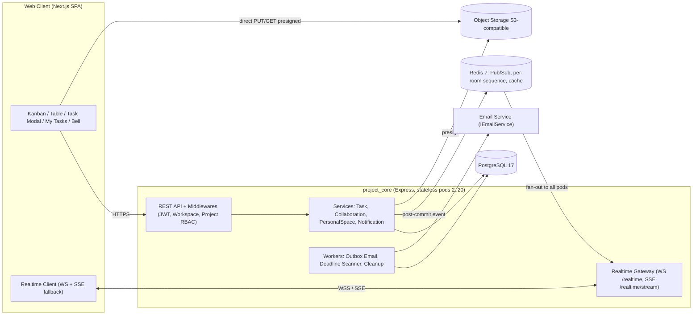

**Hiện trạng kế thừa (as-built) và khoảng trống Phase 3 phải lấp** — đã đối chiếu trực tiếp với mã nguồn:

| Hạng mục | As-built (Phase 1–2) | Khoảng trống → yêu cầu Phase 3 |
|---|---|---|
| WebSocket Gateway | JWT handshake (`?token=` query / header), `SUBSCRIBE` project, heartbeat 25s | Không có room task/user; **JWT nằm trên URL**; không kiểm tra hết hạn token; không giới hạn kết nối/user (đã thiết kế ở tài liệu 08 §6 nhưng chưa code) → **FR-001.9** |
| Broadcaster | In-memory `Map` rooms; `sequence_id` là counter **toàn tiến trình** | Header file khẳng định có Redis Pub/Sub nhưng **code chưa có** → multi-pod (NFR-SCA-002) sẽ mất event; sequence không đơn điệu theo room → **FR-001.9** |
| Task API | Chỉ có `move`, `toggle-block`, subtasks, `tasks/tree` (tải **toàn bộ** root task, không phân trang) | **Không có** create/read/update/delete/list Task; không có cursor pagination → **FR-001.8**, 001.5, 001.7 |
| `task_activities` | Có bảng, actor = `workspace_member_id`; chưa chặn UPDATE/DELETE | Cần bất biến (BL-PRJ-005.4), catalog action, ghi cùng transaction → **FR-005.4** |
| Task model | `description`, `version` (OCC), `order_index` Int, `due_date` DateTime | Thiếu `is_private`, counters, rank thực → §6 |
| WIP | `countTasksInColumn` chỉ đếm **root task** | Private Task phải bị loại khỏi đếm (BL-PRJ-015.4) |
| Quota dự án | `ProjectService` trả 402 khi đủ hạn mức | Personal Space **không** được tính (R-16) |
| Project unique | `@@unique([workspaceId, name])` | Xung đột nhiều "My Space" trong 1 workspace (R-15) |
| Storage / Notification / Username | Chưa có | Mới hoàn toàn (S3 abstraction, 4 bảng notification, mention theo member id — R-05) |
| Email | `IEmailService` (Mock) cho lời mời | Tái sử dụng cho notification email |

### 2.2 Product Functions

1. **Multi-View:** chuyển Kanban/Table trên cùng nguồn dữ liệu; bảo lưu filter/sort qua URL; Kanban phân trang theo cột, kéo thả tối ưu (optimistic + rollback); Table ảo hóa 10.000 dòng, sort/filter phía server, cột Custom Field.
2. **Task Core API:** tạo/đọc/sửa/xóa/liệt kê Task với OCC, idempotency, ghi Activity cùng transaction, phát event sau commit.
3. **Collaboration:** Task Detail Modal; mô tả Markdown; đính kèm presigned; comment + @mention realtime; Activity Log bất biến.
4. **Personal Space:** My Space tự động; My Tasks gom việc đa dự án theo nhóm hạn; Quick-add `Q`; Private Task; quick filter.
5. **Notification:** Inbox 🔔 realtime, đánh dấu đọc/xóa, preference theo loại × kênh, DND, email tức thời qua outbox, quét hạn chót.
6. **Event Bus v2:** WS + SSE, room project/task/user, đảm bảo thứ tự, resync, scale ngang bằng Redis.

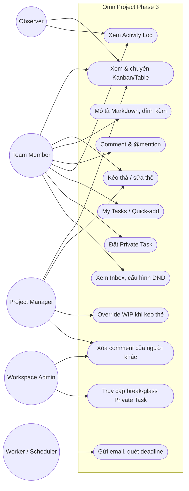

### 2.3 User Classes & Permission Matrix (Phase 3)

Vai trò: Workspace `ADMIN` (bypass dự án — kế thừa `authorizeProject`), Project `PROJECT_MANAGER`, `MEMBER`, `OBSERVER`.

| Thao tác | Admin | PM | Member | Observer |
|---|:-:|:-:|:-:|:-:|
| Xem Board/Table/Task/Comment/Activity/Attachment | ✅ | ✅ | ✅ | ✅ |
| Tạo Task (kể cả Quick-add / inline add) | ✅ | ✅ | ✅ | ❌ |
| Sửa trường Task & mô tả | ✅ | ✅ | ✅ | ❌ |
| Kéo thả / Move (theo WIP, Blocked) | ✅ | ✅ | ✅ | ❌ |
| Xóa Task cấp 1 | ✅ | ✅ | creator, chỉ khi không có subtask | ❌ |
| Đăng comment | ✅ | ✅ | ✅ | ❌ *(OQ-04)* |
| Sửa comment | chỉ tác giả | chỉ tác giả | chỉ tác giả | — |
| Xóa comment | ✅ (audit) | ✅ (audit) | chỉ của mình | ❌ |
| Upload attachment | ✅ | ✅ | ✅ | ❌ |
| Xóa attachment | ✅ | ✅ | chỉ file của mình | ❌ |
| Bật/tắt Private (Task do mình tạo) | creator | creator | creator | ❌ |
| Xem Private Task của người khác | **Break-glass API + audit** (OQ-01) | ❌ | ❌ | ❌ |
| Xem My Space của người khác | ❌ (OQ-01) | ❌ | ❌ | ❌ |
| Inbox / Preferences / DND | chỉ của mình | chỉ của mình | chỉ của mình | chỉ của mình |

> Quy tắc nền: dự án `ARCHIVED` → mọi thao tác ghi bị từ chối `403` (Archived Immutability, Phase 2 §2.4-7) — áp dụng cho comment, attachment, quick-add, kéo thả.

### 2.4 Constraints, Assumptions & Dependencies

**Ràng buộc kế thừa:** Multi-tenant `workspace_id` trên mọi truy vấn (NFR-SEC-003 P2); OCC `version` (HTTP 412); Strict Repository Pattern; Zod `.strict()`; lỗi nghiệp vụ tiếng Việt; Task hierarchy 1 cấp; WIP chỉ tính root task.

**Giả định (cần xác nhận — gắn nhãn `ASM`):**
- ASM-01: Hạ tầng có PostgreSQL 17 + Redis 7 (đã có docker-compose); **không** thêm RabbitMQ — dùng Postgres Outbox (OQ-11).
- ASM-02: Có Object Storage tương thích S3 (AWS S3 prod, MinIO dev).
- ASM-03: Locale mặc định `vi`; chưa có trường locale trên User.
- ASM-04: Một người dùng có thể thuộc nhiều workspace → mọi dữ liệu notification gắn `workspace_id`.

**Phụ thuộc:** Phase 2 API (move, block, subtask, custom field) giữ nguyên hợp đồng, chỉ **mở rộng additive**.

### 2.5 Spec Reconciliation Log (mâu thuẫn trong FR nguồn & cách giải quyết)

Các điểm dưới đây phát hiện khi đối chiếu 4 FR + Phase 1/2 + code. Quyết định ghi ở cột "Giải pháp" là **đề xuất mặc định**; cần BA ký duyệt (mục 2.6).

| ID | Phát hiện | Giải pháp trong SRS |
|---|---|---|
| R-01 | Roadmap ghi Phase 3 = 001.1/001.3 nhưng yêu cầu "Kanban kéo thả, Table, Task API" không có FR nào định nghĩa. | Bổ sung FR dẫn xuất 001.5–001.9 (đánh dấu **Derived**). |
| R-02 | Event bus là đầu ra Phase 3, nhưng 001.2 "Realtime Sync" xếp Phase 4. | Phase 3 giao hạ tầng bus + đồng bộ Kanban↔Table; nghiệm thu 001.2 xuyên Gantt ở Phase 4. |
| R-03 | Roadmap đếm 16 sub-feature, gồm 013.3 (Digest) và 013.4 (Slack/Teams) nhưng tiêu đề lại là "In-app". | Phase 3 = **14** sub-feature nguồn + 9 dẫn xuất; 013.3/013.4 hoãn. Cập nhật roadmap. |
| R-04 | FR-005 dùng `Task_Comment`, `Task_Activity_Log` (actor = user); DB thực tế là `task_activities` (actor = workspace member), chưa có bảng comment. | As-built là chuẩn; thêm `task_comments`; actor luôn là `workspace_member_id`. |
| R-05 | FR-005.3 dùng `@username` nhưng bảng `users` **không có username**. | Mention Token theo `member id`; server không tự phân giải tên (chống nhập nhằng & giả mạo). |
| R-06 | FR-005.2 nói file nằm trong "Asset Governance" (FR-PRJ-008, Phase 4). | Phase 3 tạo `task_attachments` độc lập; tích hợp Asset Governance khi Phase 4. |
| R-07 | BL-PRJ-013.1: *Task Blocked → chỉ In-app*; BL-PRJ-013.3 & sequence: *High → gửi email ngay*; AC của DND lại gửi email Blocked. | Bảng kênh mặc định của BL-013.1 là chuẩn (Blocked: In-app); người dùng có thể bật Email qua Preference. AC được chỉnh tương ứng. |
| R-08 | 013.5 mô tả "chỉ non-urgent bị giữ" nhưng AC/BL-013.5 giữ cả Task Blocked (High). | DND giữ **Email + Toast cho mọi mức khẩn**; ngoại lệ duy nhất: loại bắt buộc do Admin force (BL-013.2). |
| R-09 | `dnd_start/dnd_end` nằm trên từng dòng preference theo `event_type` (DND vốn là toàn cục). | Tách `notification_settings` (DND, timezone, toast) — 1 dòng/member. |
| R-10 | Entity `Notification` thiếu `workspace_id`, `project_id`, `actor`. | Bổ sung để cô lập đa tenant và deep link. |
| R-11 | BL-PRJ-015.2 dùng `owner_id` nhưng không có trong data structure; DB chỉ có `creator_id`; FR-PRJ-007 (Phase 5) mới định nghĩa Owner. | Phase 3: *owner ≡ creator_id*. Xem lại ở Phase 5. |
| R-12 | 015.1 "chỉ mình user thấy" vs 015.4 "Private Task user và Admin" vs `authorizeProject` cho Admin bypass. | My Space ẩn với **mọi người kể cả Admin**; Private Task: Admin chỉ qua **break-glass API có audit**, không xuất hiện trong view thường (OQ-01). |
| R-13 | Nhóm My Tasks (Hôm nay/Tuần này/Sau đó/Không hạn) bỏ sót việc **quá hạn**. | Thêm nhóm **Quá hạn**. |
| R-14 | 015.1 "tạo khi đăng ký" bỏ sót người được mời và người dùng nhiều workspace. | Tạo theo **(workspace, member)** khi: onboarding, nhận lời mời, tạo workspace mới, backfill; có lazy-ensure idempotent. |
| R-15 | `@@unique([workspaceId, name])` làm hỏng khi 2 user cùng có "My Space". | Unique cũ chỉ áp cho project thường; Personal Space unique theo owner. |
| R-16 | BL-PRJ-018.1/Free plan giới hạn 3 Active Project. | Personal Space **không** tính hạn mức, không hiện ở Portfolio/Templates. |
| R-17 | Sequence Quick-add tính Action Score (FR-PRJ-007, Phase 5). `Priority` không khớp `importance` 1–10. | Hoãn Action Score; Priority 4 mức ánh xạ `importance` = 3/5/7/9. |
| R-18 | 015.5 Smart Sort phụ thuộc FR-PRJ-007. | Chỉ giao quick filter; `sort=action_score` tắt bằng feature flag. |
| R-19 | 005.4 Activity Log xếp *Should* nhưng Phase 2 đã ghi `task_activities` và Modal cần tab lịch sử. | Nâng lên **Must**. |
| R-20 | Tab gọi "History" (FR) và "Activity Log" (AC). | Thống nhất tên UI **"Hoạt động"**. |
| R-21 | FR-001 NFR dự phòng "HTTPS Long-Polling". | Dùng **SSE** (có `Last-Event-ID`) làm fallback (OQ-02). |
| R-22 | Ngưỡng latency realtime lệch nhau: ≤80ms (P2), ≤100ms (P1), <200ms E2E (FR-001). | Thống nhất: server-emit ≤100ms P95; E2E (thả chuột → peer render) ≤200ms P95. |
| R-23 | `due_date` kiểu DateTime nhưng nghiệp vụ nói "date". | Giữ kiểu; ranh giới ngày luôn tính theo timezone người dùng (§FR-015.2). |

### 2.6 Decision Log — Câu hỏi mở cần BA/PO xác nhận

| ID | Câu hỏi | Mặc định đề xuất (đang áp dụng trong SRS) | Rủi ro nếu sai |
|---|---|---|---|
| **OQ-01** | Admin có được thấy My Space / Private Task? | My Space ẩn hoàn toàn; Private Task chỉ break-glass + audit | Đổi sang "Admin thấy mọi thứ" làm Visibility Scope phức tạp và event rooms phải tách audience |
| **OQ-02** | Fallback realtime: SSE hay Long-Polling? | SSE | Long-Polling tốn thêm cơ chế replay |
| **OQ-03** | Email có nằm trong Phase 3? | Có Email **tức thời** (outbox); Digest & Slack/Teams hoãn | Nếu cắt Email, AC của FR-005.3 phải sửa |
| **OQ-04** | Observer có được comment? | Không | Khách hàng (client) không phản hồi được ngay trong task |
| **OQ-05** | Giới hạn upload | 25 MB/file, 20 file/task, quota theo gói: Free 1 GB / Pro 50 GB / Enterprise thỏa thuận | Ảnh hưởng chi phí lưu trữ |
| **OQ-06** | Quét virus | ClamAV bất đồng bộ (Should-have) | File độc hại có thể được tải về |
| **OQ-07** | Retention notification | 90 ngày, job dọn hằng đêm | Bảng phình to |
| **OQ-08** | Sửa/xóa comment | Tác giả sửa mọi lúc (hiện "đã chỉnh sửa", không lưu lịch sử); xóa mềm (tombstone) | Yêu cầu compliance có thể cần lịch sử sửa |
| **OQ-09** | Mapping Priority→importance | Thấp/TB/Cao/Khẩn = 3/5/7/9 | Lệch khi FR-PRJ-007 định nghĩa lại |
| **OQ-10** | Dữ liệu My Space khi member bị khóa/xóa | Giữ nguyên, không truy cập được; chính sách xóa vĩnh viễn để sau | Tồn dữ liệu cá nhân (GDPR erasure) |
| **OQ-11** | Hàng đợi tác vụ | Postgres Outbox + worker `FOR UPDATE SKIP LOCKED` (không RabbitMQ) | Throughput email cao cần broker chuyên dụng |
| **OQ-12** | Quyền xóa Task cấp 1 | PM/Admin; Member chỉ khi là creator & không có subtask | Mất việc do xóa nhầm (audit log vẫn còn) |

---

## 3. Functional Requirements

> Quy ước: **Phase 3 Status** — `IN` (đầy đủ), `PARTIAL`, `DEFER`. Priority theo MoSCoW. Nguồn: `Source` hoặc `Derived`.

### 3.1 Module A — Multi-View Engine & Task Core (FR-PRJ-001)

| FR ID | Requirement Description | Input | Output | BR | Priority | Origin |
|---|---|---|---|---|---|---|
| **FR-PRJ-001.1** | **View Switcher.** Thanh công cụ có tab `Kanban`, `Table`. Tab `Gantt`, `Scrum` hiển thị mờ + nhãn "Sắp ra mắt" (view registry để Phase 4 cắm thêm). Đổi view không đổi dữ liệu gốc, dùng cache TanStack Query. URL `?view=kanban\|table`; nhớ view cuối theo dự án (localStorage). | Click tab / URL | Render view tương ứng ≤300ms từ cache | BR-PRJ-001.1 | Must | Source |
| **FR-PRJ-001.3** | **View State Preservation.** Filter & Sort lưu trên URL Query Params và giữ khi đổi view; Visible Columns/độ rộng cột lưu LocalStorage. Tham số chia sẻ được qua link. | Thay đổi filter/sort/cột | URL cập nhật; view mới áp cùng filter | BR-PRJ-001.3 | Should | Source |
| **FR-PRJ-001.5** | **Kanban Board.** Cột = Workflow Status theo `order_index`; header có tên, số task (server count), chỉ báo WIP (xanh/vàng ≥80%/đỏ ≥100%). Thẻ hiển thị: tiêu đề, avatar assignee, chip hạn (quá hạn đỏ, <24h vàng), importance, progress bar (nếu có subtask), 💬 & 📎 counter, huy hiệu Blocked, 🔒 (Private của mình). Mỗi cột tải 50 thẻ đầu + cuộn vô hạn (cursor). Composer "+ Thêm thẻ" cuối cột. Chỉ hiển thị **root task**. Click thẻ → Task Modal (`?task=<id>`). Dự án Archived → read-only + banner. | Mở dự án / filter | Board + counts | BR-PRJ-001.5, 001.8 | Must | Derived |
| **FR-PRJ-001.6** | **Kéo thả (Drag & Drop).** Chuột (dnd-kit), cảm ứng (long-press 300ms), **bàn phím** (Space nhấc, ←↑↓→ di chuyển, Space thả, Esc hủy) và menu "Chuyển đến…" trên thẻ (WCAG 2.5.7). Optimistic ≤16ms; server lỗi → thẻ trượt về ≤200ms + toast tiếng Việt. Kế thừa toàn bộ luật Phase 2 (WIP, Override của PM, Blocked, cha-con, Handoff). API nhận **thẻ lân cận** (`before_task_id`/`after_task_id`) thay vì chỉ số tuyệt đối. | Drop thẻ | Thẻ ở vị trí mới; event `TASK_MOVED` | BR-PRJ-001.2, 001.6, 001.7 | Must | Derived |
| **FR-PRJ-001.7** | **Table View.** Lưới dạng bảng tính: cột mặc định `Title (cây subtask)`, `Status`, `Assignee`, `Due`, `Importance`, `Progress`, `Blocked`, `Updated`; **cột Custom Field** (Phase 2) render theo type; ẩn/hiện, đổi rộng, ghim cột Title; sort đơn (click) / đa khóa (Shift, tối đa 3); filter bar (status, assignee, hạn, blocked, từ khóa tiêu đề, Custom Field); **Virtual Scrolling** + cursor 100 dòng; dòng "+ Thêm công việc" cuối bảng; inline-edit status/assignee/due/title (Should) với OCC; điều hướng phím (Should). | Mở Table / sort / filter | Danh sách phân trang | BR-PRJ-001.8, 001.9 | Must | Derived |
| **FR-PRJ-001.8** | **Task Core API (Enabler).** `create / get detail / patch / delete / list(board, table)`; `expected_version` (OCC 412); `client_request_id` (idempotent); mỗi mutation ghi `task_activities` **trong cùng transaction**, phát event **sau commit**; áp WIP khi tạo vào cột (cùng luật move); Archived → 403; trả cờ quyền (`can_edit`, `can_comment`, …) cho UI. | Payload CRUD | Task + counters + permissions | BL-PRJ-005.8, 005.9, BR-PRJ-001.8 | Must | Derived |
| **FR-PRJ-001.9** | **Realtime Event Bus v2** (xem §4): WS chính + SSE dự phòng; room project/task/user; thứ tự theo room; resync; Redis fan-out; giới hạn kết nối; ticket handshake. | Kết nối / SUBSCRIBE | Event frame | BR-PRJ-001.10, 001.11, 001.12 | Must | Derived |

**Business Rules**

| BR ID | Quy tắc | Áp dụng |
|---|---|---|
| BR-PRJ-001.1 *(source)* | Single Source of Truth: mọi view đọc/ghi cùng bản ghi `tasks` qua REST. | 001.1 |
| BR-PRJ-001.2 *(source)* | Optimistic Update; API lỗi 4xx/5xx → rollback UI + báo lỗi. | 001.6 |
| BR-PRJ-001.3 *(source)* | Filter/Sort ở URL; Visible Columns/độ rộng ở LocalStorage. Tham số không hợp lệ (vd. status đã xóa) bị bỏ qua kèm toast, không gây lỗi. | 001.3 |
| BR-PRJ-001.4 *(source)* | Gantt Unscheduled Backlog — **Phase 4, N/A**. | — |
| **BR-PRJ-001.5** *(derived)* | **Phân trang & đếm cột:** số task mỗi cột lấy từ aggregate phía server (không đếm theo thẻ đã tải), đã loại Private Task của người khác. Cursor `(order_index, id)`. | 001.5 |
| **BR-PRJ-001.6** *(derived)* | **Thứ tự thẻ:** `order_index` là số thực; chèn = trung điểm hai thẻ lân cận (O(1) ghi); khi khoảng cách < 1e-9 server rebalance cột trong 1 transaction. Khi Kanban đang sort ≠ "Thủ công", **tắt reorder trong cột** (vẫn cho đổi cột). | 001.6 |
| **BR-PRJ-001.7** *(derived)* | **Move kế thừa Phase 2:** WIP (BL-PRJ-002.1/2), Blocked (002.5), Task cha còn subtask chưa xong không vào `DONE` (006.3), Observer cấm, Archived cấm. Kiểm tra phía client chỉ mang tính gợi ý; **server là nguồn quyết định**. Xung đột version → `412`, client refetch thẻ. | 001.6 |
| **BR-PRJ-001.8** *(derived)* | **Visibility Scope duy nhất:** mọi truy vấn Task (board, table, count, WIP, event audience, search, My Tasks) bắt buộc đi qua một hàm scope: `NOT is_private OR creator = me`. Cấm viết điều kiện ad-hoc. | 001.5, 001.7, 001.8 |
| **BR-PRJ-001.9** *(derived)* | **Truy vấn Table:** cột sort/filter theo whitelist; tối đa 3 khóa sort; keyset pagination `(sort_keys…, id)` đảm bảo không trùng/thiếu dòng giữa các trang; filter Custom Field dùng cú pháp Phase 2 `filter[field_<id>][op]`. | 001.7 |
| **BR-PRJ-001.10** *(derived)* | **Idempotent client:** client bỏ event trùng `event_id`; chỉ áp event nếu `payload.version > version cục bộ`; phát hiện lỗ hổng `sequence_id` → refetch. | 001.9 |
| **BR-PRJ-001.11** *(derived)* | **Ủy quyền room:** chỉ SUBSCRIBE khi là thành viên dự án (hoặc Admin) **và** thỏa Visibility Scope (room task). Mất quyền → server chủ động rời room. | 001.9 |
| **BR-PRJ-001.12** *(derived)* | **Post-commit publish:** event chỉ phát sau commit, lỗi phát không làm hỏng request. Đảm bảo "eventual consistency": client resync khi (re)connect. | 001.9 |

### 3.2 Module B — Task Collaboration (FR-PRJ-005)

| FR ID | Requirement Description | Input | Output | BR | Priority | Origin |
|---|---|---|---|---|---|---|
| **FR-PRJ-005.1** | **Mô tả Markdown.** Editor toolbar + preview; CommonMark + GFM (heading, list, task-list, table, code block, link, quote); **cấm raw HTML**; tối đa 50.000 ký tự; lưu Markdown thô; `Ctrl/Cmd+Enter` để lưu; bản nháp tự lưu localStorage; sửa đồng thời → OCC `412` + hộp thoại "Tải lại / Giữ bản của tôi". | Text | Lưu thô, render HTML đã sanitize | BL-PRJ-005.1 | Must | Source |
| **FR-PRJ-005.2** | **Đính kèm (Presigned).** Luồng 3 bước: `init` → client `PUT` thẳng lên Storage → `complete`. Kéo-thả nhiều file, progress, hủy. Ảnh có thumbnail, PDF mở inline, loại khác tải xuống. Giới hạn theo OQ-05; allow-list MIME+đuôi+magic bytes. | File | Danh sách file, counter `attachment_count` | BL-PRJ-005.2, 005.6 | Must | Source |
| **FR-PRJ-005.3** | **Comment & @mention.** Composer có autocomplete `@` (thành viên dự án), lưu Mention Token; server xác thực & tạo notification; hiển thị optimistic ("Đang gửi…"), `client_request_id` chống trùng; hiển thị realtime cho người đang mở Task; tối đa 10.000 ký tự, 20 mention/comment. | Nội dung | Comment + Notification | BL-PRJ-005.3, 005.5, 005.7 | Must | Source |
| **FR-PRJ-005.4** | **Activity Log bất biến.** Tab "Hoạt động": timeline append-only, phân trang 50, realtime. Catalog `action_type` ở BL-PRJ-005.9. | Event cập nhật | Dòng log | BL-PRJ-005.4, 005.9 | **Must** *(nâng từ Should — R-19)* | Source |
| **FR-PRJ-005.5** | **Task Detail Modal/Drawer.** Mở từ thẻ/dòng/notification (`?task=<id>&comment=<id>`); Drawer ≥1280px, toàn màn hình <768px; bố cục: tiêu đề, mô tả, subtasks, custom fields, đính kèm; cột phải: meta (status, assignee, due, importance, private, blocked); tab Bình luận / Hoạt động. Focus trap, `Esc` đóng (cảnh báo nháp chưa lưu); Observer/Archived → read-only; Task bị xóa/ẩn → "Không tìm thấy công việc". Mở modal → subscribe room task; đóng → unsubscribe. | Click / deep link | Modal | BL-PRJ-005.9 | Must | Derived |
| **FR-PRJ-005.6** | **Sửa/Xóa comment.** Tác giả sửa (hiện "đã chỉnh sửa"; chỉ mention **mới** được notify); xóa mềm → tombstone "Bình luận đã bị xóa"; PM/Admin xóa của người khác có audit. | Hành động | Comment cập nhật | BL-PRJ-005.7 | Should | Derived |

**Business Rules**

| BR ID | Quy tắc |
|---|---|
| BL-PRJ-005.1 *(source)* | `description` lưu Markdown thô (không HTML) → chống XSS, dễ parse đa nền tảng. Render **luôn qua pipeline sanitize** (không raw HTML, chặn `javascript:`/`data:` URL). |
| BL-PRJ-005.2 *(source)* | Upload trực tiếp Client → Storage bằng Pre-signed URL do backend sinh. |
| BL-PRJ-005.3 *(source)* | Mention → Notification In-app (WebSocket) + Email theo Preference. |
| BL-PRJ-005.4 *(source)* | Activity Log append-only: không API sửa/xóa; DB trigger chặn `UPDATE`. |
| **BL-PRJ-005.5** | **Mention Token:** `@[Tên](member:<uuid>)`. Server (1) parse token, (2) kiểm tra mỗi member thuộc dự án và **thấy được Task** (Visibility Scope), (3) khử trùng, (4) bỏ self-mention, (5) hiển thị tên **lấy từ DB theo member id**, bỏ qua nhãn trong token (chống giả mạo). Member không hợp lệ → `422 MENTION_NOT_ALLOWED`. Private Task chỉ cho phép mention chính chủ → thực tế bị từ chối. |
| **BL-PRJ-005.6** | **Vòng đời Attachment:** `PENDING_UPLOAD → UPLOADED → (SCANNING) → AVAILABLE`; `REJECTED` (sai loại/nhiễm độc), `DELETED`. `PENDING_UPLOAD` quá 1 giờ bị dọn (kèm S3 lifecycle abort). URL tải xuống TTL ≤5 phút, cấp **mỗi lần** sau khi kiểm tra quyền. Khóa object: `ws/<workspaceId>/p/<projectId>/t/<taskId>/<uuid>`. Tên file được làm sạch; SVG/HTML luôn `Content-Disposition: attachment`. |
| **BL-PRJ-005.7** | **Vòng đời Comment:** tác giả sửa mọi lúc (`edited_at`); xóa mềm giữ tombstone; xóa bởi người khác ghi `audit_logs`. Tác giả bị xóa khỏi hệ thống → hiển thị "Người dùng đã bị xóa". |
| **BL-PRJ-005.8** | **Toàn vẹn counter & Activity:** `comment_count`, `attachment_count`, `activity` cập nhật **cùng transaction** với thao tác gốc; event phát sau commit. |
| **BL-PRJ-005.9** | **Catalog `action_type`:** `TASK_CREATED, TITLE_CHANGED, DESCRIPTION_CHANGED (chỉ lưu độ dài cũ/mới, không lưu nội dung), STATUS_CHANGED, ASSIGNEE_CHANGED, DUE_DATE_CHANGED, IMPORTANCE_CHANGED, BLOCKED, UNBLOCKED, SUBTASK_ADDED, SUBTASK_REMOVED, COMMENT_ADDED, COMMENT_DELETED, ATTACHMENT_ADDED, ATTACHMENT_REMOVED, PRIVACY_CHANGED`. Activity **không sao chép nội dung comment** (chỉ `comment_id`) để tránh rò rỉ khi comment bị xóa/ẩn. Dự án Archived: mọi thao tác ghi bị chặn. |

### 3.3 Module C — Personal Space & My Tasks (FR-PRJ-015)

| FR ID | Requirement Description | Input | Output | BR | Priority | Origin |
|---|---|---|---|---|---|---|
| **FR-PRJ-015.1** | **My Space tự động.** Hàm idempotent `ensurePersonalSpace(member)` tạo Project `is_personal=true` (`name="My Space"`, owner = member, `ProjectMember` role `PROJECT_MANAGER`) + 3 status `Inbox`(OPEN) → `In Progress`(IN_PROGRESS) → `Done`(DONE), không WIP. Kích hoạt tại: đăng ký/onboarding, nhận lời mời, tạo workspace, **backfill migration** cho mọi member ACTIVE hiện có, và lazy-ensure khi `GET /me/personal-space`. Không thể xóa/archive/mời thành viên/chuyển thành project thường/lưu template/đổi cấu trúc workflow. | Sự kiện thành viên mới | Project cá nhân | BL-PRJ-015.1, 015.5, 015.6 | Must | Source |
| **FR-PRJ-015.2** | **My Tasks.** Màn hình gom việc đa dự án **trong workspace hiện tại**, nhóm: **Quá hạn · Hôm nay · Tuần này (7 ngày tới) · Sau đó · Không có hạn**; mỗi nhóm có đếm + cursor 25; hàng hiển thị project chip, status, hạn, importance; checkbox hoàn thành nhanh (Should); realtime qua `MY_TASKS_CHANGED`. | Truy cập My Tasks | Danh sách nhóm | BL-PRJ-015.2, 015.7 | Must | Source |
| **FR-PRJ-015.3** | **Quick-add (`Q` / FAB).** Modal: Tiêu đề (bắt buộc ≤255), Hạn (chip Hôm nay/Ngày mai/Tuần sau), Ưu tiên (Thấp/TB/Cao/Khẩn), Dự án (mặc định theo ngữ cảnh). `Enter` lưu & đóng, `Shift+Enter` lưu & thêm tiếp, `Esc` hủy. Mặc định assignee = mình. | `Q` / nút + | Task + toast có link "Mở" | BL-PRJ-015.3, 015.9 | Must | Source |
| **FR-PRJ-015.4** | **Private Task.** Creator bật "Make Private" ở project thường (Personal Space mặc định riêng tư nên ẩn tùy chọn). Điều kiện: assignee ∈ {null, creator}; subtask kế thừa; không mention người khác. Quay về công khai cần xác nhận. | Checkbox | Task ẩn với người khác | BL-PRJ-015.4, 015.8, 015.10 | Should | Source |
| **FR-PRJ-015.5** | **Quick filter của My Tasks:** Hôm nay / Sắp tới / Đã xong / Không có hạn. **Smart Sort theo Action Score: DEFER** (FR-PRJ-007) — chỉ chừa điểm cắm `sort=action_score` sau feature flag. | Filter | Danh sách lọc | BL-PRJ-015.2 | Should | Source (PARTIAL) |

**Business Rules**

| BR ID | Quy tắc |
|---|---|
| BL-PRJ-015.1 *(source)* | Invariants Personal Space: không mời, không xóa, không chuyển; workflow 3 cột; WIP/Sprint/Dependency không áp dụng; `output_contract_type = NONE` (khi FR-PRJ-008 ra đời). Vi phạm → `409 PERSONAL_SPACE_PROTECTED`. |
| BL-PRJ-015.2 *(source)* | Nguồn My Tasks gồm (1) Task trong My Space, (2) Task `assignee = me` ở project mình còn là thành viên ACTIVE, (3) Task `creator = me` (owner — R-11). Nhóm theo hạn. |
| BL-PRJ-015.3 *(source)* | Quick-add: đang trong project cụ thể → tạo trong project đó; ngoài project → My Space. |
| BL-PRJ-015.4 *(source)* | Private Task không xuất hiện ở Kanban/Gantt/Table của người khác, **không tính WIP**; chủ sở hữu vẫn thấy trong My Tasks. |
| **BL-PRJ-015.5** | **Provisioning idempotent:** ràng buộc duy nhất `(workspace_id, owner_member_id) WHERE is_personal`; gọi đồng thời không tạo trùng; lỗi một phần → rollback toàn bộ (project + member + 3 status trong 1 transaction). |
| **BL-PRJ-015.6** | **Hạn mức & liệt kê:** Personal Space **không** tính `projectLimit` (cả create lẫn unarchive-quota check), không xuất hiện trong `GET /projects`, Portfolio, Template, danh sách của Admin; chỉ truy cập qua `/me/personal-space`. `authorizeProject` **không** áp Admin-bypass cho project `is_personal`. |
| **BL-PRJ-015.7** | **My Tasks:** loại project `ARCHIVED`/`is_template`/`is_deleted`, project mình không còn là thành viên, Private Task của người khác; mặc định ẩn `DONE/CANCELED` (hiện qua quick filter "Đã xong", giới hạn 30 ngày gần nhất). Gồm cả subtask được giao (kèm breadcrumb cha). Ranh giới ngày tính theo **timezone người dùng** (`notification_settings.timezone` → fallback workspace timezone → `Asia/Ho_Chi_Minh`). "Tuần này" = trong 7×24h tiếp theo sau hôm nay. Sắp xếp mặc định: hạn ↑, importance ↓, `created_at` ↑. |
| **BL-PRJ-015.8** | **Lan truyền riêng tư:** Private Task bị loại ở **mọi bề mặt**: board/table/count/WIP, room project (không phát event), search, activity, notification của người khác (bị xóa khi bật private), My Tasks của người khác. Bật private → phát `TASK_REMOVED{reason:PRIVATE}` vào project room (chủ sở hữu bỏ qua); tắt private → phát `TASK_CREATED`. Truy cập ngoài quyền trả **404** (không lộ sự tồn tại). |
| **BL-PRJ-015.9** | **Quick-add:** phím `Q` bị bỏ qua khi focus trong `input/textarea/select/contenteditable`, khi đang IME composition, hoặc có phím bổ trợ. Ngữ cảnh không ghi được (Observer, Archived, project đã xóa) → tự rơi về My Space. Tạo vào cột đầy WIP → `403` kèm gợi ý "Thêm vào My Space". Cột mặc định = status đầu tiên thuộc meta `OPEN` hoặc `TODO`. Idempotent bằng `client_request_id`. |
| **BL-PRJ-015.10** | **Break-glass:** Admin truy cập Private Task qua API riêng, bắt buộc nhập lý do, ghi `audit_logs` (`PRIVATE_TASK_ACCESSED`), không hiện trong view thường. |

### 3.4 Module D — Notification Center, In-app (FR-PRJ-013)

| FR ID | Requirement Description | Input | Output | BR | Priority | Origin |
|---|---|---|---|---|---|---|
| **FR-PRJ-013.1** | **Inbox.** Chuông 🔔 + badge chưa đọc ("99+"), popover 10 mục mới nhất + trang `/notifications` (lọc Tất cả/Chưa đọc/Loại). Đánh dấu đã đọc (từng cái khi click / tất cả), xóa (từng cái / "Xóa đã đọc"), realtime `NOTIFICATION_CREATED`, đồng bộ đa tab. Click → mở Task Modal đúng comment. Mục có đích không còn truy cập → hiện "Không còn khả dụng". Gộp (coalesce) COMMENT_ADDED cùng task trong 5 phút. Phạm vi theo workspace đang chọn. | Sự kiện nghiệp vụ | Feed realtime | BL-PRJ-013.1, 013.6, 013.7, 013.8 | Must | Source |
| **FR-PRJ-013.2** | **Preferences.** Ma trận `Loại sự kiện × {In-app, Email}`; tắt hoàn toàn từng loại (không tạo notification); "Khôi phục mặc định". Mặc định theo bảng BL-013.1, tạo lười (không seed). Thay đổi **không** áp ngược notification cũ. Cột Slack/Teams **không tạo** (YAGNI) — thêm cùng 013.4. | Form | Lưu preference | BL-PRJ-013.2 | Must | Source |
| **FR-PRJ-013.5** | **DND.** Bật/tắt, `HH:mm` bắt đầu–kết thúc (có thể qua nửa đêm) theo timezone người dùng. Trong DND: Inbox vẫn ghi & tăng badge, **không toast, không email** (email giữ `HELD_DND` tới hết DND). Hết DND: >3 email bị giữ → gộp thành 1 email tóm tắt, ngược lại gửi từng cái. | Cài đặt | Hành vi gửi | BL-PRJ-013.5, 013.10 | Should | Source |
| **FR-PRJ-013.6** | **Immediate Email Delivery.** Worker Outbox gửi email theo preference & DND, retry 3 lần (30s, 2m, 10m), thất bại → `FAILED` + metric. Nội dung: tiêu đề + trích đoạn ≤140 ký tự + deep link + liên kết "Quản lý thông báo". | Notification có kênh Email | Email | BL-PRJ-013.9 | Must | Derived |
| **FR-PRJ-013.7** | **Deadline Scanner.** Job mỗi giờ tạo `DEADLINE_APPROACHING` cho assignee của Task hạn trong (now, now+24h], chưa Done/Canceled, project không Archived, chưa thông báo cho cùng `(task, due_date)`. Khóa leader bằng Postgres advisory lock. | Cron | Notification High | BL-PRJ-013.1, 013.9 | Should | Derived |

**Business Rules**

| BR ID | Quy tắc |
|---|---|
| BL-PRJ-013.1 *(source)* | Bảng loại/mức khẩn/kênh mặc định (xem dưới) — **chuẩn duy nhất** khi mâu thuẫn (R-07). |
| BL-PRJ-013.2 *(source)* | Preference thắng tuyệt đối; chỉ Admin được force loại bắt buộc (Phase 3 chưa có loại nào). |
| BL-PRJ-013.3, 013.4 *(source)* | Digest & Webhook — **DEFER**. |
| BL-PRJ-013.5 *(source)* | DND chỉ chặn kênh ngoài-app (Email) và Toast; In-app vẫn lưu. |
| **BL-PRJ-013.6** | **Xác định người nhận** (xem bảng dưới). Luôn loại `actor` và loại người không còn thấy Task (Visibility Scope). |
| **BL-PRJ-013.7** | **Coalescing:** cùng `(recipient, dedupe_key)` còn chưa đọc → tăng `group_count`, cập nhật `created_at`/`body`, không tạo dòng mới. `dedupe_key` cho `COMMENT_ADDED` = `comment:<taskId>` trong cửa sổ 5 phút. |
| **BL-PRJ-013.8** | **Retention & thu hồi:** xóa notification đã đọc >90 ngày (job đêm); khi member rời project hoặc Task thành Private với họ → xóa notification liên quan của họ (trong cùng transaction với thay đổi quyền). |
| **BL-PRJ-013.9** | **Outbox:** `notification_deliveries(status: PENDING/HELD_DND/SENT/FAILED/SKIPPED, scheduled_at, attempts)`; ghi **cùng transaction** với notification; worker lấy bằng `FOR UPDATE SKIP LOCKED`; khóa idempotency = `delivery_id`; worker chết giữa chừng → tự nhặt lại sau ≤60s; không mất, không gửi trùng. |
| **BL-PRJ-013.10** | **DND & timezone:** đánh giá tại **thời điểm gửi** theo timezone lưu trong settings; khung qua nửa đêm (22:00–07:00) hợp lệ; DND tắt → gửi ngay. |

**Bảng loại thông báo, mức khẩn & kênh mặc định (BL-PRJ-013.1, giữ nguyên nguồn) và người nhận (BL-PRJ-013.6):**

| Event | Urgency | Mặc định | Người nhận | Producer Phase 3 |
|---|---|---|---|---|
| `MENTION` | High | In-app + Email | Member được mention | ✅ FR-005.3 |
| `TASK_ASSIGNED` | High | In-app + Email | Assignee mới (tạo có assignee / đổi assignee / Handoff Phase 2) | ✅ |
| `DEADLINE_APPROACHING` | High | In-app + Email | Assignee | ✅ FR-013.7 |
| `TASK_BLOCKED` | High | **In-app** | PM của project + assignee + creator | ✅ (Phase 2 `toggle-block`) |
| `COMMENT_ADDED` | Low | In-app (badge) | Assignee + creator (trừ người đã nhận MENTION) | ✅ |
| `SPRINT_STARTED/ENDED` | Medium | In-app + Digest | — | ❌ Reserve enum (Phase 4) |
| `HEALTH_SCORE_CHANGED` | Medium | In-app + Digest | — | ❌ Reserve enum (Phase 6) |

---

## 4. Realtime Event Bus v2 (FR-PRJ-001.9)

### 4.1 Kiến trúc & nguyên tắc

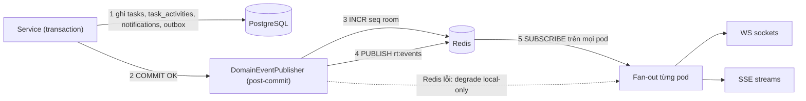

Nguyên tắc: **(1)** Một abstraction `DomainEventPublisher` thay cho gọi Broadcaster trực tiếp (chuẩn hóa các service Phase 2). **(2)** Chỉ phát sau commit; **không** dùng Outbox cho realtime (mất event được bù bằng resync), nhưng **dùng** Outbox cho email vì không được mất. **(3)** Payload gọn: `id`, trường đổi, `version`; nội dung nặng/nhạy cảm lấy lại qua REST.

### 4.2 Transport

| Transport | Endpoint | Vai trò | Xác thực |
|---|---|---|---|
| WebSocket | `GET /api/v1/realtime` | Chính (đã có, mở rộng) | **Ticket một lần**: `POST /api/v1/realtime/tickets` (JWT + `X-Workspace-Id`) → `ticket` TTL 30s dùng ở handshake. **Bỏ `?token=<JWT>`** (JWT lộ trong log/proxy). |
| SSE | `GET /api/v1/realtime/stream?ticket=…&rooms=…` | Dự phòng khi WS bị chặn | Cùng ticket; hỗ trợ `Last-Event-ID` |

Hết hạn access token → server đóng socket `4401`, client refresh token rồi kết nối lại. Thành viên bị khóa/gỡ khỏi project → server đẩy rời room và ngắt trong ≤5s.

### 4.3 Rooms & giới hạn

| Room | Ai được tham gia | Dùng cho |
|---|---|---|
| `ws:project:<projectId>` | Thành viên project / Admin | Board/Table: thẻ tạo/sửa/di chuyển/xóa, counters |
| `ws:task:<taskId>` | Như trên **và** thỏa Visibility Scope | Task Modal: comment, attachment, activity |
| `ws:user:<userId>` | Tự động theo JWT (không cần SUBSCRIBE) | Notification, `MY_TASKS_CHANGED` |

Giới hạn: ≤5 socket đồng thời/user; ≤20 room/socket (≤3 room task); frame vào ≤16 KB; ≤20 frame/giây từ client. Vi phạm → frame `ERROR` rồi đóng `1008`.

### 4.4 Envelope (tương thích ngược — chỉ thêm trường)

```json
{
  "event_id": "uuid-v7",
  "schema_version": 1,
  "event_type": "TASK_UPDATED",
  "room_id": "ws:project:<uuid>",
  "workspace_id": "<uuid>",
  "actor_id": "<user uuid | SYSTEM>",
  "payload": { "taskId": "…", "changed": ["title"], "version": 7 },
  "timestamp": "2026-10-03T08:00:00.000Z",
  "sequence_id": 1042
}
```
`sequence_id` đơn điệu **theo room** (Redis `INCR rt:seq:<room>`; mất Redis → counter cục bộ).

### 4.5 Event Catalog (bổ sung cho 8 event Phase 2)

| Event | Room | Payload chính | Phản ứng client |
|---|---|---|---|
| `TASK_CREATED` | project | thẻ rút gọn + `version` | Thêm thẻ/dòng |
| `TASK_UPDATED` | project | `taskId, changed[], version` | Merge trường đổi |
| `TASK_DELETED` | project | `taskId` | Gỡ thẻ |
| `TASK_REMOVED` | project | `taskId, reason: PRIVATE` | Gỡ thẻ (chủ sở hữu bỏ qua) |
| `TASK_COUNTERS_UPDATED` | project | `taskId, commentCount, attachmentCount, progressPercent` | Cập nhật huy hiệu 💬📎 |
| `COMMENT_CREATED/UPDATED/DELETED` | task | `comment` (đã sanitize) / `commentId` | Chèn/sửa/tombstone realtime |
| `ATTACHMENT_ADDED/REMOVED` | task | `attachment` / `attachmentId` | Cập nhật danh sách file |
| `ACTIVITY_APPENDED` | task | dòng log | Chèn đầu timeline |
| `NOTIFICATION_CREATED` | user | notification (+`group_count`) | Badge+1, toast nếu không DND |
| `NOTIFICATION_READ` / `NOTIFICATIONS_READ_ALL` | user | `ids` / — | Đồng bộ đa tab |
| `MY_TASKS_CHANGED` | user | `taskId` (gợi ý) | Invalidate query My Tasks |
| Phase 2: `TASK_MOVED, WIP_LIMIT_OVERRIDDEN, ASSIGNEE_HANDOFF, PROGRESS_UPDATED, TASK_BLOCKED/UNBLOCKED, SUBTASK_*` | project | giữ nguyên | **Bổ sung** cổng Visibility Scope (Private không phát vào project room) |

### 4.6 Resync & Reconnect

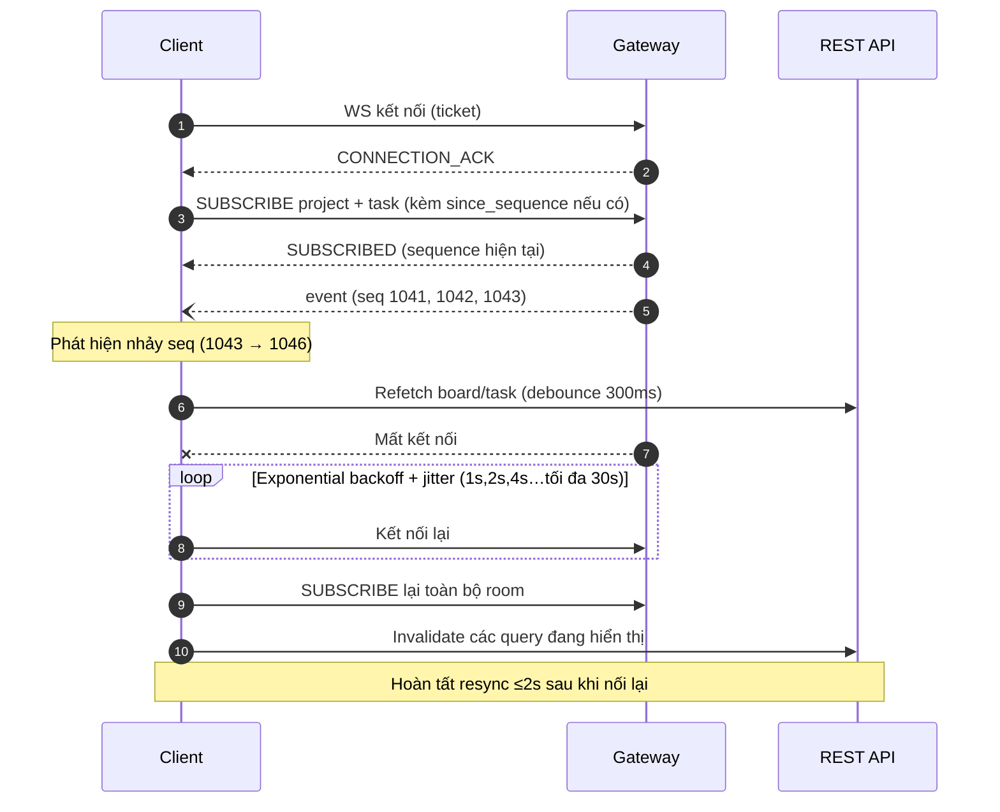

Lưới an toàn: khi đang kết nối nhưng Redis ở chế độ degrade, client revalidate khi focus cửa sổ và mỗi 60s.

---

## 5. Specific Non-Functional Requirements

> Mọi NFR có ngưỡng đo được. Con số mang nhãn **[B]** là *baseline đề xuất* cần xác nhận bằng load test thật (bài học Phase 2: không dùng số liệu mock).

### 5.1 Performance
| ID | Yêu cầu | Ngưỡng |
|---|---|---|
| NFR-P3-PRF-001 | Tải Board (≤1.000 task, 8 cột, 50 thẻ/cột) | API P95 ≤300ms; FCP ≤1.0s |
| NFR-P3-PRF-002 | Table: filter + sort (kể cả Custom Field) trên 10.000 task, trang 100 dòng | P95 ≤350ms |
| NFR-P3-PRF-003 | Kéo thả: phản hồi UI; xử lý server; rollback | ≤16ms; API P95 ≤150ms; ≤200ms |
| NFR-P3-PRF-004 | Virtual scroll 10.000 dòng | ≥50 FPS (laptop tham chiếu M1/i5-8th, Chrome), ≤200 DOM rows |
| NFR-P3-PRF-005 | Realtime: server phát sau commit; E2E thả chuột→peer render | ≤100ms P95; ≤200ms P95 (4G) với 100 subscriber/room |
| NFR-P3-PRF-006 | Đăng comment (API, không tính email); mention → in-app hiển thị | P95 ≤250ms; ≤500ms |
| NFR-P3-PRF-007 | Inbox: trang 30 mục; unread-count | P95 ≤150ms; P95 ≤50ms |
| NFR-P3-PRF-008 | My Tasks: 50 project / 5.000 task được giao | P95 ≤400ms |
| NFR-P3-PRF-009 | Presign / complete attachment | P95 ≤200ms / ≤300ms |
| NFR-P3-PRF-010 | Quick-add: mở modal sau `Q`; API tạo | ≤100ms; P95 ≤200ms |

### 5.2 Scalability & Capacity
| ID | Yêu cầu | Ngưỡng **[B]** |
|---|---|---|
| NFR-P3-SCA-001 | Kết nối realtime đồng thời | ≥5.000 socket/pod; 20 pod |
| NFR-P3-SCA-002 | Fan-out: 500 subscriber/room, 1.000 event/s toàn cụm | Tỷ lệ rớt ≤0,1% |
| NFR-P3-SCA-003 | Quy mô dữ liệu | 500.000 task/workspace (kế thừa), 5 triệu comment, 50 triệu notification (có retention) mà P95 truy vấn không suy giảm >15% |
| NFR-P3-SCA-004 | Backend stateless (kế thừa) | HPA 2→20 pod; không giữ state ngoài Redis/DB |

### 5.3 Reliability & Availability
| ID | Yêu cầu | Ngưỡng |
|---|---|---|
| NFR-P3-AVL-001 | Reconnect Exponential Backoff + jitter, resync | 1s→30s; resync ≤2s |
| NFR-P3-AVL-002 | Email Outbox at-least-once | 0 notification High bị mất khi worker crash; nhặt lại ≤60s; 0 email trùng |
| NFR-P3-AVL-003 | Redis sự cố | API sống 100%; realtime degrade local-only; cảnh báo ≤60s |
| NFR-P3-AVL-004 | Activity trong cùng transaction | 100% mutation có log; 0 log mồ côi khi rollback |
| NFR-P3-AVL-005 | Sửa đồng thời | 0 lost-update; xung đột → `412` |
| NFR-P3-AVL-006 | Uptime (kế thừa) | 99,9%/tháng |

### 5.4 Security
| ID | Yêu cầu | Ngưỡng / Chuẩn |
|---|---|---|
| NFR-P3-SEC-001 | Phân quyền & cô lập tenant mọi endpoint Phase 3 | 100% endpoint kiểm `workspace_id` + RBAC; cross-tenant → 403/404; bộ test BOLA (OWASP API1) |
| NFR-P3-SEC-002 | Chống XSS Markdown | Lưu thô; render qua sanitize; CSP `script-src 'self'`; bộ payload XSS chuẩn → 0 thực thi |
| NFR-P3-SEC-003 | An toàn upload | Allow-list MIME+đuôi+magic bytes; ≤25MB ép tại Storage policy; URL TTL ≤5 phút; bucket private; AV scan trước `AVAILABLE` (Should) |
| NFR-P3-SEC-004 | An toàn Realtime | Ticket 30s một lần; JWT không xuất hiện trong URL/log; hết hạn token → đóng `4401`; kick ≤5s; áp giới hạn §4.3 |
| NFR-P3-SEC-005 | Rate limit | Comment 30/phút/user; presign 20/phút; quick-add 60/phút; read-all 10/phút |
| NFR-P3-SEC-006 | Riêng tư Private Task | Ma trận kiểm thử **vai trò × bề mặt** (board, table, count, WIP, event, notification, search, activity) đạt 100%; truy cập trái phép trả 404 |
| NFR-P3-SEC-007 | Kiểm toán | 100% xóa Task, xóa comment/attachment của người khác, break-glass vào `audit_logs` (kèm IP, UA), giữ ≥365 ngày |
| NFR-P3-SEC-008 | Email | Không chứa nội dung mô tả; trích đoạn ≤140 ký tự; có liên kết quản lý thông báo |

### 5.5 Usability, Accessibility & Compatibility
| ID | Yêu cầu | Ngưỡng |
|---|---|---|
| NFR-P3-USB-001 | Accessibility | WCAG 2.2 AA; DnD có phương án thay thế bàn phím; `aria-live="polite"` cho cập nhật realtime |
| NFR-P3-USB-002 | Phím tắt | `Q`, `Esc`, `?` (trợ giúp); vô hiệu trong ô nhập/IME; có thể khám phá qua tooltip |
| NFR-P3-USB-003 | Thông báo lỗi & i18n | 100% lỗi nghiệp vụ tiếng Việt, chỉ rõ nguyên nhân; chuỗi qua `next-intl` (vi/en) |
| NFR-P3-USB-004 | Toast | Tối đa 3 đồng thời; tự tắt 5s; không toast khi DND |
| NFR-P3-CMP-001 | Trình duyệt & thiết bị (kế thừa) | Chrome ≥90, Edge ≥90, Firefox ≥88, Safari ≥14; ≥1024px đầy đủ; <768px Task Modal toàn màn hình; Touch long-press 300ms |

### 5.6 Maintainability & Observability
| ID | Yêu cầu | Ngưỡng |
|---|---|---|
| NFR-P3-MNT-001 | Test coverage module mới (Task Core, Collaboration, PersonalSpace, Notification, Realtime) | ≥85% |
| NFR-P3-MNT-002 | Hợp đồng event có kiểu | Schema Zod/JSON Schema dùng chung BE–FE, 0 `any` ở payload; OpenAPI 3.1 cho mọi endpoint mới |
| NFR-P3-OBS-001 | Metrics & alert | `ws_connections`, `fanout_latency_ms`, `outbox_lag_s`, `ws_resync_total`; cảnh báo khi `outbox_lag_s>120` hoặc `fanout_latency P95>200ms` |

---

## 6. Data Model

### 6.1 ERD Phase 3 (phần mới + liên kết với Phase 1–2)

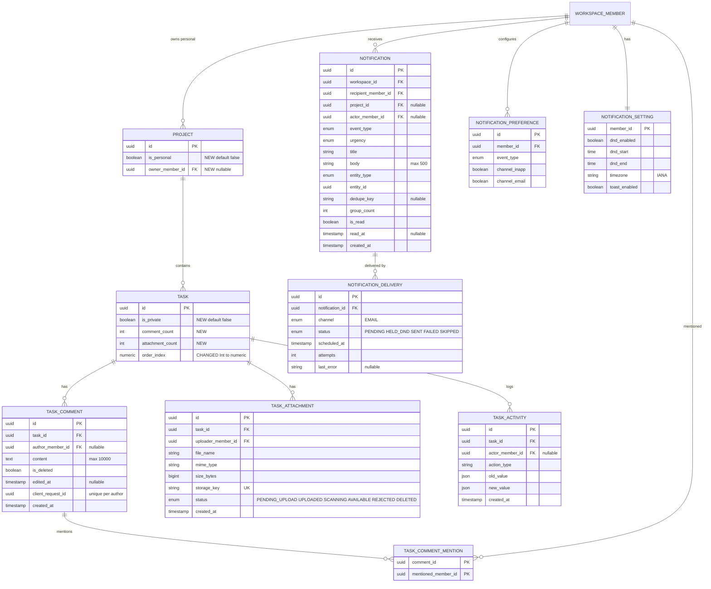

### 6.2 Ràng buộc & Index (delta so với `schema.prisma` as-built)

| Đối tượng | Thay đổi | Lý do |
|---|---|---|
| `projects` | `+is_personal`, `+owner_member_id`; `CHECK (is_personal = (owner_member_id IS NOT NULL))`; `UNIQUE (workspace_id, owner_member_id) WHERE is_personal`; thay `UNIQUE(workspace_id, name)` bằng unique **có điều kiện** `WHERE NOT is_personal` | R-14, R-15, BL-015.5 |
| `tasks` | `+is_private`, `+comment_count`, `+attachment_count`; `order_index` Int→`DOUBLE PRECISION` (additive trong JSON) | BR-001.6, tránh N+1 đếm |
| `tasks` index | `(project_id, due_date)`, `(project_id, updated_at DESC)`, `(project_id, assignee_id)`, `(assignee_id, due_date)`, partial `(creator_id) WHERE is_private` | Table sort/filter, My Tasks |
| `task_activities` | Trigger `BEFORE UPDATE → RAISE EXCEPTION` (xóa chỉ do cascade khi Task bị xóa; audit giữ ở `audit_logs`) | BL-PRJ-005.4 |
| `task_comments` | Index `(task_id, created_at)`; `UNIQUE (author_member_id, client_request_id)` | Phân trang, idempotency |
| `task_attachments` | Index `(task_id, status)`; partial `(created_at) WHERE status='PENDING_UPLOAD'` | Danh sách, job dọn |
| `notifications` | Index `(recipient_member_id, created_at DESC)`; partial `(recipient_member_id) WHERE is_read=false`; unique partial `(recipient_member_id, dedupe_key) WHERE is_read=false AND dedupe_key IS NOT NULL` | Inbox, unread-count index-only, coalescing |
| `notification_preferences` | `UNIQUE (member_id, event_type)` | Tạo lười |
| `notification_deliveries` | Index `(status, scheduled_at)` | Worker polling |
| `audit_logs` (hành động mới) | `TASK_DELETED, COMMENT_DELETED_MODERATION, ATTACHMENT_DELETED_MODERATION, PRIVATE_TASK_ACCESSED` | NFR-P3-SEC-007 |

**Migration:** (1) thêm cột/bảng; (2) backfill Personal Space cho mọi member ACTIVE (idempotent, chạy lại an toàn); (3) cập nhật Phase 2 `ProjectService` (đếm quota loại `is_personal`) và `TaskRepository.countTasksInColumn` (qua Visibility Scope); (4) mở rộng `PATCH /tasks/:id/move` với `before_task_id/after_task_id` (additive, vẫn nhận `orderIndex` cũ trong 1 phiên bản để tương thích).

---

## 7. API Surface (tóm tắt — OpenAPI 3.1 chi tiết ở bước thiết kế API)

> Prefix `/api/v1`; header `X-Workspace-Id`; lỗi theo RFC 7807 (kế thừa).

| Nhóm | Endpoint | Vai trò tối thiểu |
|---|---|---|
| **Task Core** | `GET /projects/:pid/board` (statuses + counts + trang đầu) · `GET /projects/:pid/board/columns/:sid/tasks?cursor` · `GET /projects/:pid/tasks` (Table) · `POST /projects/:pid/tasks` · `GET /tasks/:id` · `PATCH /tasks/:id` · `DELETE /tasks/:id` · `PATCH /tasks/:id/move` *(mở rộng)* · `PATCH /tasks/:id/privacy` | Xem: mọi thành viên · Ghi: PM/Member |
| **Collaboration** | `GET/POST /tasks/:id/comments` · `PATCH/DELETE /comments/:id` · `GET /tasks/:id/activities?cursor` · `GET /projects/:pid/mentionable?q=` | Đọc: mọi thành viên · Ghi: PM/Member |
| **Attachments** | `POST /tasks/:id/attachments` (init, trả presigned PUT) · `POST /attachments/:id/complete` · `GET /attachments/:id/download-url` · `GET /tasks/:id/attachments` · `DELETE /attachments/:id` | PM/Member (đọc: mọi thành viên) |
| **Personal** | `GET /me/personal-space` · `GET /me/tasks?group&filter&cursor` · `POST /admin/private-tasks/:id/access` *(break-glass)* | Chính chủ · Admin |
| **Notifications** | `GET /me/notifications?cursor&unread&type` · `GET /me/notifications/unread-count` · `PATCH /me/notifications/:id/read` · `POST /me/notifications/read-all` · `DELETE /me/notifications/:id` · `DELETE /me/notifications?read=true` · `GET/PUT /me/notification-preferences` · `GET/PUT /me/notification-settings` | Chính chủ |
| **Realtime** | `POST /realtime/tickets` · `WS /realtime` · `GET /realtime/stream` (SSE) | Đã đăng nhập |

**WebSocket client→server frames:** `SUBSCRIBE{room,id,since_sequence?}`, `UNSUBSCRIBE`, `PING`. Server→client: `CONNECTION_ACK`, `SUBSCRIBED`, `UNSUBSCRIBED`, `ERROR{code}`, `PONG`, và event theo §4.5.

---

## 8. User Interface Requirements

> Wireframe bên dưới chỉ căn bố cục luồng (low-fidelity); thiết kế chi tiết dùng Figma/design system `frontend_otm/website_otm/docs/design_system`.

### 8.1 Kanban Board
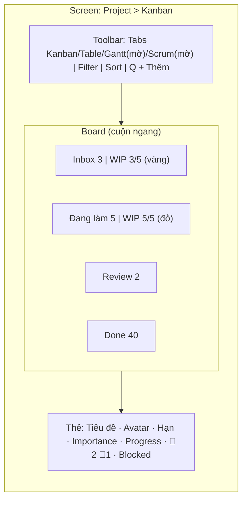

### 8.2 Table View
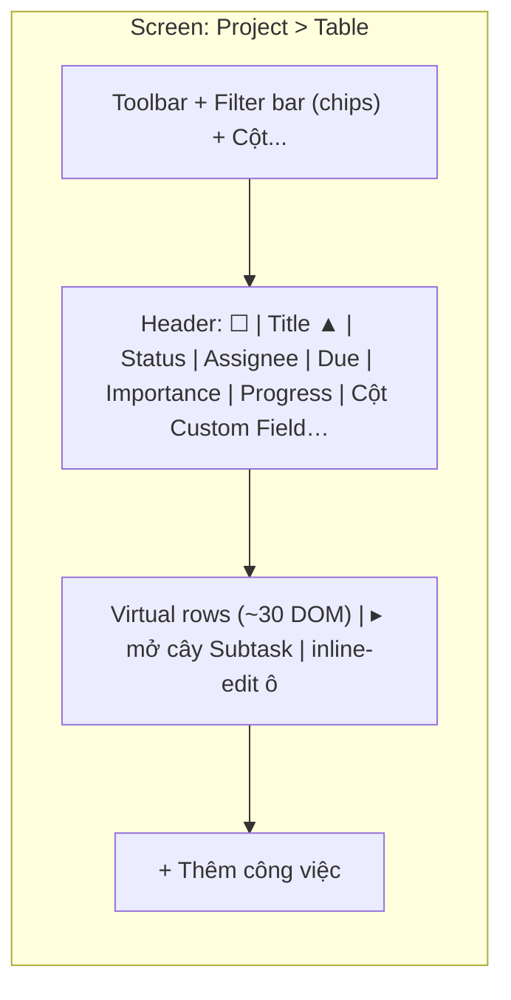

### 8.3 Task Detail Modal (Drawer)
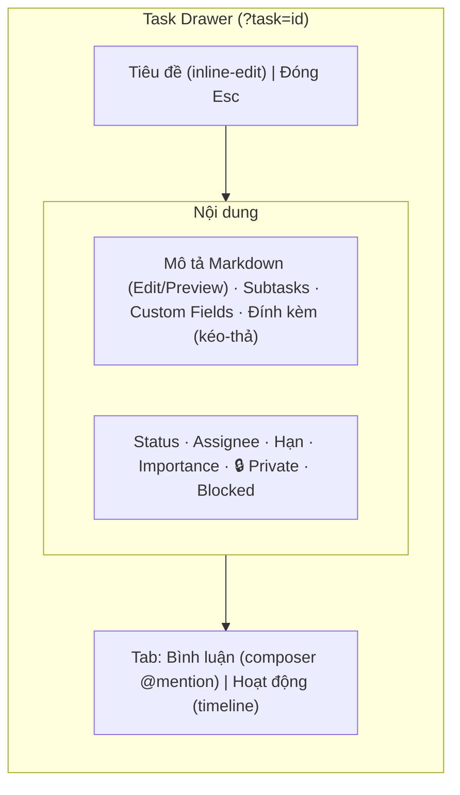

### 8.4 My Tasks & Quick-add
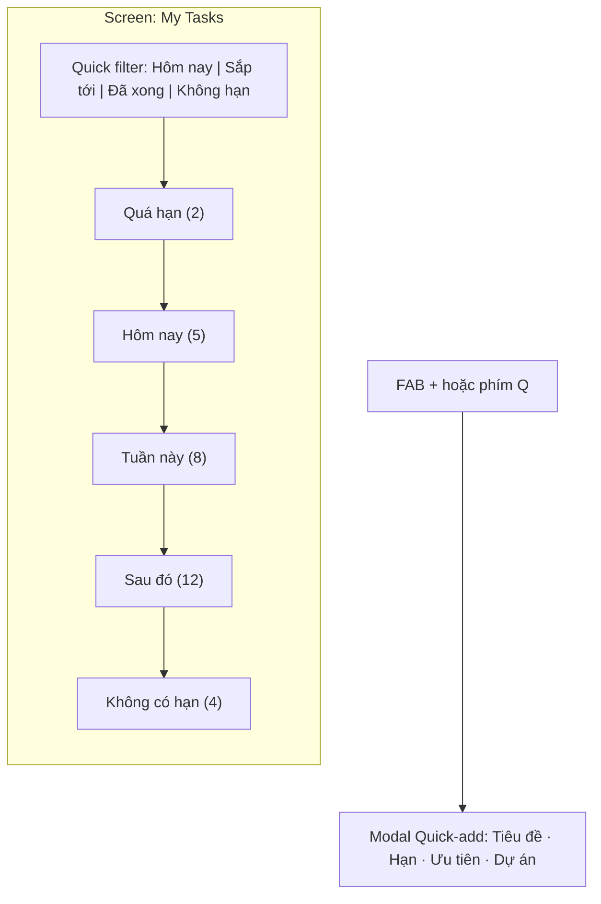

### 8.5 Notification Bell
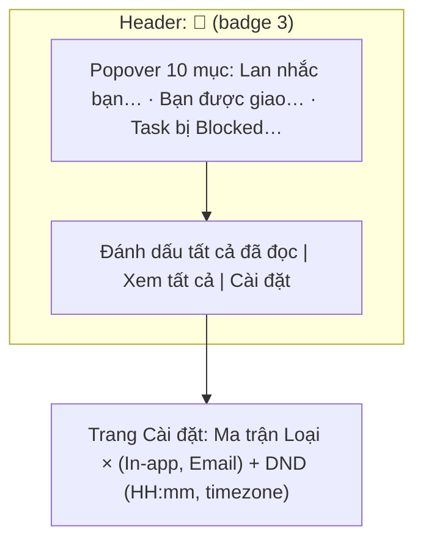

### 8.6 Phím tắt & tương tác
| Phím | Hành vi | Điều kiện |
|---|---|---|
| `Q` | Mở Quick-add | Không focus ô nhập/IME, không phím bổ trợ |
| `Esc` | Đóng modal/hủy kéo | Cảnh báo nếu nháp chưa lưu |
| `Ctrl/Cmd+Enter` | Lưu mô tả / gửi comment | Trong editor |
| `Space/←↑↓→` | Nhấc/di chuyển/thả thẻ | Thẻ đang focus |
| `?` | Bảng phím tắt | — |

---

## 9. Key Sequence Diagrams

### 9.1 Kéo thả thẻ — Optimistic, Rollback & Realtime (FR-PRJ-001.6)
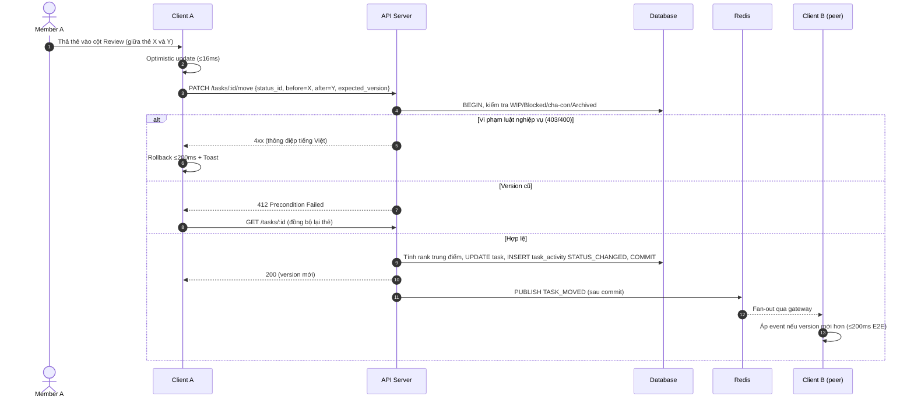

### 9.2 Comment + @mention + Notification (FR-PRJ-005.3 · 013.1 · 013.6)
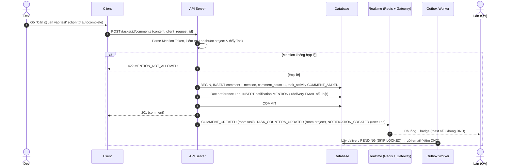

### 9.3 Upload đính kèm bằng Presigned URL (FR-PRJ-005.2)
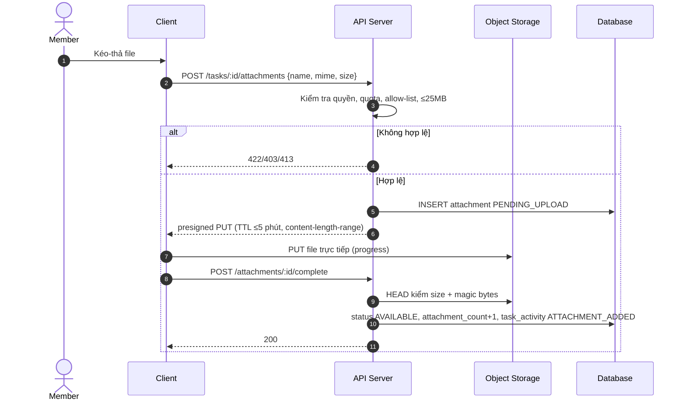

### 9.4 Bật Private Task — Redaction (FR-PRJ-015.4)
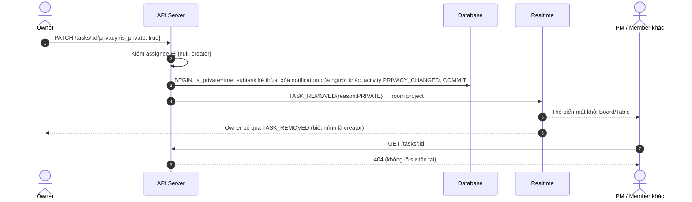

### 9.5 Quick-add — chọn ngữ cảnh (FR-PRJ-015.3)
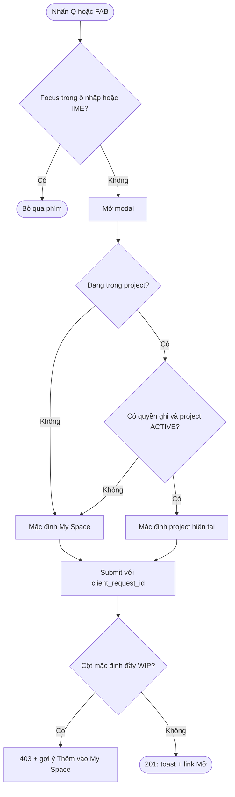

### 9.6 Notification Fan-out với DND (FR-PRJ-013.5)
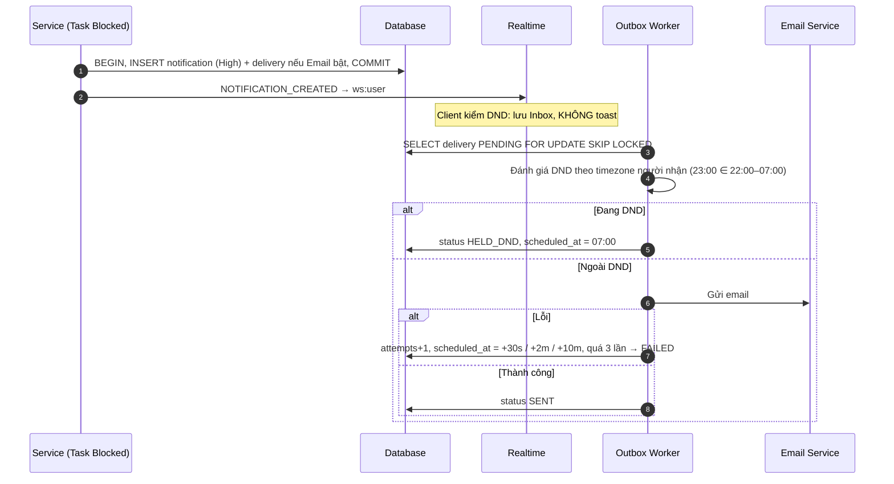

### 9.7 Provisioning My Space (FR-PRJ-015.1)
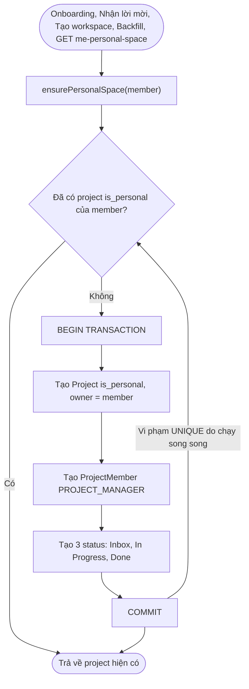

---

## 10. Appendix A — User Stories & Acceptance Criteria

> INVEST · Gherkin. Chi tiết toàn bộ Test Case & truy vết ở [RTM CSV](./05_RTM_PHASE3_EXECUTION_VIEWS_COLLABORATION.csv). Mỗi story có ≥1 AC happy path và ≥1 AC lỗi/biên.

**US-PRJ-001.1 — Chuyển view.** *Là Member, tôi muốn chuyển giữa Kanban và Table của cùng dự án, để chọn cách nhìn phù hợp mà không mất dữ liệu.*
- Given tôi ở Kanban, When tôi chọn tab Table, Then bảng hiển thị trong ≤300ms và URL có `?view=table`.
- Given tôi mở link `?view=gantt`, When trang tải, Then hệ thống rơi về Kanban và tab Gantt hiển thị "Sắp ra mắt".

**US-PRJ-001.3 — Giữ bộ lọc.** *Là Member, tôi muốn filter/sort được giữ khi đổi view và chia sẻ qua link, để đồng đội thấy đúng kết quả tôi thấy.*
- Given tôi lọc assignee = Lan, When tôi chuyển Kanban → Table, Then Table chỉ hiện việc của Lan và URL giữ tham số lọc.
- Given link chứa status đã bị xóa, When mở link, Then tham số bị bỏ qua kèm toast và trang không lỗi.

**US-PRJ-001.5 — Xem Kanban.** *Là Member, tôi muốn thấy bảng Kanban với số lượng và cảnh báo WIP, để nắm tình hình dòng việc.*
- Given cột có 120 task, When tôi mở Board, Then cột hiển thị "120", tải 50 thẻ đầu và tải thêm khi cuộn.
- Given dự án đã Archived, When tôi mở Board, Then không có thao tác kéo/thêm và hiện banner "Chỉ đọc".

**US-PRJ-001.6 — Kéo thả.** *Là Member, tôi muốn kéo thả thẻ mượt mà (kể cả bằng bàn phím), để cập nhật tiến độ nhanh.*
- Given tôi kéo thẻ sang cột khác, When thả, Then thẻ đổi cột ngay (≤16ms) và đồng đội thấy trong ≤200ms.
- Given cột đích đã đạt WIP và tôi là Member, When thả, Then thẻ trượt về chỗ cũ ≤200ms kèm toast "Cột … đã đạt giới hạn WIP".

**US-PRJ-001.7 — Table.** *Là Member, tôi muốn thao tác dạng bảng tính (sort, filter, cột Custom Field), để rà soát khối lượng lớn.*
- Given dự án 10.000 task, When tôi cuộn và sort theo Due, Then giao diện ≥50 FPS và trang kế tiếp không trùng/thiếu dòng.
- Given tôi sửa ô Status inline trong khi người khác vừa sửa, When lưu, Then hiện thông báo xung đột (412) và dữ liệu mới nhất.

**US-PRJ-001.8 — CRUD Task nhất quán.** *Là Member, tôi muốn tạo/sửa/xóa công việc ở mọi view, để dữ liệu luôn thống nhất.*
- Given tôi gửi tạo task hai lần cùng `client_request_id`, When server xử lý, Then chỉ một task được tạo.
- Given tôi là Observer, When tôi gọi tạo/sửa task, Then nhận `403`.

**US-PRJ-001.9 — Realtime.** *Là Member, tôi muốn thấy thay đổi của đồng đội ngay mà không F5, để tránh làm việc trên dữ liệu cũ.*
- Given tôi đang mở Board, When đồng đội kéo thẻ, Then thẻ di chuyển trên màn hình tôi ≤200ms.
- Given mạng rớt rồi có lại, When client kết nối lại, Then dữ liệu được đồng bộ trong ≤2s và không có event trùng.

**US-PRJ-005.1 — Mô tả Markdown.** *Là Member, tôi muốn viết mô tả bằng Markdown, để trình bày yêu cầu rõ ràng.*
- Given tôi nhập `**đậm**` và lưu, When mở lại, Then thấy chữ đậm và DB lưu chuỗi thô.
- Given mô tả chứa `<script>` hoặc `javascript:`, When render, Then không thực thi mã.

**US-PRJ-005.2 — Đính kèm.** *Là Member, tôi muốn đính kèm file thiết kế vào task, để tài liệu nằm cùng ngữ cảnh.*
- Given tôi kéo file PDF 5MB, When upload xong, Then file xuất hiện, counter +1.
- Given tôi tải file `.exe` hoặc >25MB, When init, Then bị từ chối với thông báo rõ ràng.

**US-PRJ-005.3 — Comment & @mention.** *Là Member, tôi muốn bình luận và @mention đồng nghiệp, để gọi đúng người vào việc.*
- Given tôi mention Lan (thành viên project), When gửi, Then Lan nhận thông báo In-app ≤500ms và Email theo preference.
- Given tôi mention người ngoài project, When gửi, Then nhận `422` và không có comment nào được tạo.

**US-PRJ-005.4 — Activity Log.** *Là Member, tôi muốn xem lịch sử thay đổi, để biết ai đổi gì khi nào.*
- Given ai đó đổi trạng thái Dev → Test, When tôi mở tab Hoạt động, Then thấy dòng "X đã chuyển trạng thái sang Test" kèm thời gian, hiện realtime.
- Given bất kỳ client nào, When gọi sửa/xóa log, Then không có endpoint và DB từ chối UPDATE.

**US-PRJ-005.5 — Task Modal.** *Là Member, tôi muốn mở chi tiết task nhanh từ thẻ, dòng bảng hoặc thông báo, để làm việc không rời ngữ cảnh.*
- Given tôi click thông báo mention, When modal mở, Then cuộn tới đúng comment.
- Given task đã bị xóa hoặc là Private của người khác, When mở link, Then thấy "Không tìm thấy công việc" (không phân biệt hai trường hợp).

**US-PRJ-005.6 — Sửa/Xóa comment.** *Là Member, tôi muốn sửa/xóa bình luận của mình, để đính chính nhầm lẫn.*
- Given tôi sửa comment và thêm @Minh, When lưu, Then chỉ Minh nhận thông báo mới, comment hiện "đã chỉnh sửa".
- Given tôi là Member, When tôi xóa comment của người khác, Then nhận `403`.

**US-PRJ-015.1 — My Space.** *Là người dùng mới, tôi muốn có sẵn không gian cá nhân, để dùng như to-do app ngay.*
- Given tôi vừa đăng ký hoặc nhận lời mời, When đăng nhập, Then thấy "My Space" với 3 cột Inbox/In Progress/Done.
- Given tôi thử xóa/mời người vào My Space, When gọi API, Then nhận `409 PERSONAL_SPACE_PROTECTED`.

**US-PRJ-015.2 — My Tasks.** *Là Member, tôi muốn một màn hình gom mọi việc của tôi theo hạn, để biết hôm nay làm gì.*
- Given tôi có việc ở 3 dự án và My Space, When mở My Tasks, Then thấy đủ, không trùng, nhóm Quá hạn/Hôm nay/Tuần này/Sau đó/Không hạn đúng theo timezone của tôi.
- Given project đã Archived hoặc tôi bị gỡ khỏi project, When mở My Tasks, Then các task đó không hiển thị.

**US-PRJ-015.3 — Quick-add.** *Là Member, tôi muốn thêm việc nhanh bằng phím Q, để không bị gián đoạn dòng suy nghĩ.*
- Given tôi ở Dashboard, When nhấn Q, nhập tiêu đề, Enter, Then task vào My Space và toast có link "Mở".
- Given tôi đang gõ trong ô comment, When nhấn Q, Then ký tự `q` được nhập và modal không mở.

**US-PRJ-015.4 — Private Task.** *Là Member, tôi muốn đánh dấu việc riêng tư trong project, để ghi chú cá nhân không lộ cho đội.*
- Given tôi bật Private, When PM mở Board/Table, Then PM không thấy task, WIP không tính, và gọi trực tiếp trả `404`.
- Given task đang giao cho người khác, When tôi bật Private, Then nhận lỗi giải thích điều kiện.

**US-PRJ-015.5 — Quick filter.** *Là Member, tôi muốn lọc nhanh My Tasks, để tập trung vào việc cần làm.*
- Given tôi chọn "Hôm nay", When danh sách tải, Then chỉ còn việc đến hạn hôm nay.
- Given sort `action_score` chưa bật, When gọi, Then trả `400` (feature flag tắt).

**US-PRJ-013.1 — Inbox.** *Là Member, tôi muốn hộp thư thông báo realtime, để không bỏ lỡ việc liên quan đến tôi.*
- Given có người giao task cho tôi, When sự kiện xảy ra, Then chuông tăng badge ngay không cần tải lại.
- Given tôi bị gỡ khỏi project, When mở Inbox, Then thông báo của project đó đã bị xóa.

**US-PRJ-013.2 — Preferences.** *Là Member, tôi muốn chọn kênh nhận thông báo theo loại, để không bị spam.*
- Given tôi tắt Email cho "Comment mới" và bật cho "Task được giao", When có comment không mention tôi, Then chỉ có thông báo In-app, không email; When được giao task, Then nhận email ngay.
- Given tôi tắt hoàn toàn một loại, When sự kiện xảy ra, Then không có bản ghi notification.

**US-PRJ-013.5 — DND.** *Là Member, tôi muốn đặt giờ yên tĩnh, để không bị làm phiền ngoài giờ làm việc.*
- Given DND 22:00–07:00 và Email "Task Blocked" bật, When task bị Blocked lúc 23:00, Then Inbox có thông báo, không toast, email được gửi lúc 07:00.
- Given có >3 email bị giữ, When hết DND, Then nhận 1 email tóm tắt.

**US-PRJ-013.6 — Email tức thời.** *Là Member, tôi muốn nhận email khi được mention/giao việc, để biết kịp khi không mở app.*
- Given mention với Email bật, When gửi comment, Then email đến trong ≤60s và không gửi cho người tự mention.
- Given dịch vụ email lỗi, When worker thử, Then retry 30s/2m/10m rồi đánh dấu FAILED, không mất bản ghi.

**US-PRJ-013.7 — Cảnh báo hạn.** *Là Assignee, tôi muốn được nhắc khi việc sắp hết hạn, để không trễ.*
- Given task giao cho tôi hạn trong 12 giờ, When job quét chạy, Then tôi nhận 1 thông báo và không nhận trùng ở lần quét sau.
- Given task đã Done hoặc project Archived, When job chạy, Then không có thông báo.

---

## 11. Delivery Slices & Dependencies

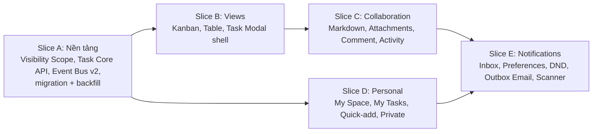

**Definition of Done Phase 3:** (1) toàn bộ AC Gherkin ở RTM pass; (2) ma trận kiểm thử Private **vai trò × bề mặt** đạt 100%; (3) load test thực (PostgreSQL + Redis thật) đạt các NFR con số, báo cáo không dùng mock; (4) rà soát a11y WCAG 2.2 AA; (5) OpenAPI 3.1 + tài liệu bàn giao FE; (6) coverage ≥85%; (7) cập nhật Roadmap, ERD, C4 Phase 3, và ghi memory.

---

## 12. Risk & Edge-Case Register

| ID | Rủi ro / Biên | Tác động | Giảm thiểu |
|---|---|---|---|
| RSK-01 | Private Task rò rỉ qua kênh phụ (count, WIP, event, notification, activity, search) | Vi phạm riêng tư | BR-PRJ-001.8 scope duy nhất + NFR-P3-SEC-006 ma trận test |
| RSK-02 | Mất/đảo thứ tự event; ghi DB xong nhưng publish lỗi | UI cũ | Post-commit + `sequence_id` theo room + resync + revalidate 60s |
| RSK-03 | Redis fan-out chưa có trong code, scale >1 pod mất event | Đồng bộ sai | FR-001.9 triển khai Redis adapter + test 2 pod |
| RSK-04 | JWT trên URL WebSocket, token hết hạn vẫn sống | Lộ token, truy cập quá hạn | Ticket 30s, đóng `4401`, kick ≤5s |
| RSK-05 | `order_index` Int: dồn chỗ tốn ghi hàng loạt, xung đột kéo thả | Chậm, lệch thứ tự | Rank thực + rebalance + API theo thẻ lân cận |
| RSK-06 | Table 10k + Custom Field EAV join chậm | Vượt 350ms | Keyset, index bổ sung, giới hạn 3 khóa sort, đo thật |
| RSK-07 | Backfill My Space cho dữ liệu hiện có; quota Free bị chiếm | Chặn tạo dự án | Idempotent migration; loại `is_personal` khỏi quota (R-16) |
| RSK-08 | Bão notification (nhiều comment, thao tác hàng loạt, hết DND) | Spam, quá tải | Coalescing 5 phút, rate limit, email tóm tắt >3 |
| RSK-09 | Nhiều pod cùng xử lý Outbox/Scanner | Email/thông báo trùng | `SKIP LOCKED` + `delivery_id` idempotent + advisory lock |
| RSK-10 | Upload độc hại, file mồ côi, URL bị lộ | Bảo mật, chi phí | Allow-list + magic bytes + AV + TTL 5 phút + job dọn 1 giờ |
| RSK-11 | Giả mạo mention (nhãn khác tên thật), XSS qua Markdown | Lừa đảo nội bộ | Hiển thị tên từ DB theo member id; sanitize + CSP |
| RSK-12 | Ranh giới ngày/DND sai theo timezone/DST | Sai nhóm, gửi sai giờ | Tính theo IANA timezone; test UTC-8, UTC+7, DST |
| RSK-13 | Đổi hợp đồng `move` (Phase 2) làm vỡ client cũ | Hồi quy | Mở rộng additive, giữ `orderIndex` một phiên bản chuyển tiếp |
| RSK-14 | FR dẫn xuất (R-01) chưa được BA ký | Scope creep/lệch kỳ vọng | Khóa qua §2.6 trước khi `/code` |
| RSK-15 | Tác giả/assignee đã bị xóa; Task bị xóa khi notification còn tham chiếu | Link chết | "Người dùng đã bị xóa"; "Không còn khả dụng"; xóa notification liên quan |
| RSK-16 | Xóa Task cascade xóa `task_activities` (đụng tính bất biến) | Mất vết | Ghi `audit_logs` `TASK_DELETED`; DB trigger chỉ chặn UPDATE |
| RSK-17 | Phím `Q` xung đột IME/screen-reader | Mất ký tự, khó truy cập | Guard `isComposing`, focus editable, cho phép tắt phím tắt |
| RSK-18 | WIP check có race (đếm rồi ghi) — kế thừa Phase 2, nay thêm điểm tạo thẻ | Vượt trần WIP | Kiểm trong transaction với khóa theo status; ghi nhận vào test song song |

---

## 13. Self-Review theo IEEE 830 (validation_checklist)

| Thuộc tính | Kết quả | Ghi chú |
|---|---|---|
| Correct | ⚠️ Chờ xác nhận | 9 FR dẫn xuất + 12 OQ cần BA ký (§2.5–2.6) |
| Unambiguous | ✅ | Mâu thuẫn FR nguồn đã liệt kê và chốt (R-01…R-23) |
| Complete | ✅ | Mỗi FR có input/output/BR/priority; có luồng lỗi/biên cho mọi story |
| Consistent | ✅ | Một bảng kênh mặc định duy nhất; một ngưỡng latency duy nhất |
| Verifiable | ✅ | NFR đều có số; con số **[B]** cần load test thật |
| Ranked | ✅ | MoSCoW toàn bộ; 1 mục nâng hạng có lý do (R-19) |
| Traceable | ✅ | RTM CSV: BR → FR → US → TC (+ NFR → TC) |
| Modifiable | ✅ | TC chi tiết chỉ nằm ở RTM; SRS giữ story + AC đại diện |

**Điểm cần lưu ý trung thực:** (1) số NFR [B] chưa kiểm chứng; (2) các giải pháp OQ-01/02/03/11 là mặc định đề xuất; (3) SRS không chứa OpenAPI/Prisma chi tiết — thuộc bước thiết kế kế tiếp.

---

## 14. Requirements Traceability Reference
Ma trận Business Rule → FR → User Story → Test Case (và NFR → Test Case) nằm tại [`05_RTM_PHASE3_EXECUTION_VIEWS_COLLABORATION.csv`](./05_RTM_PHASE3_EXECUTION_VIEWS_COLLABORATION.csv). Mọi thay đổi tài liệu này **bắt buộc** cập nhật đồng bộ RTM.
