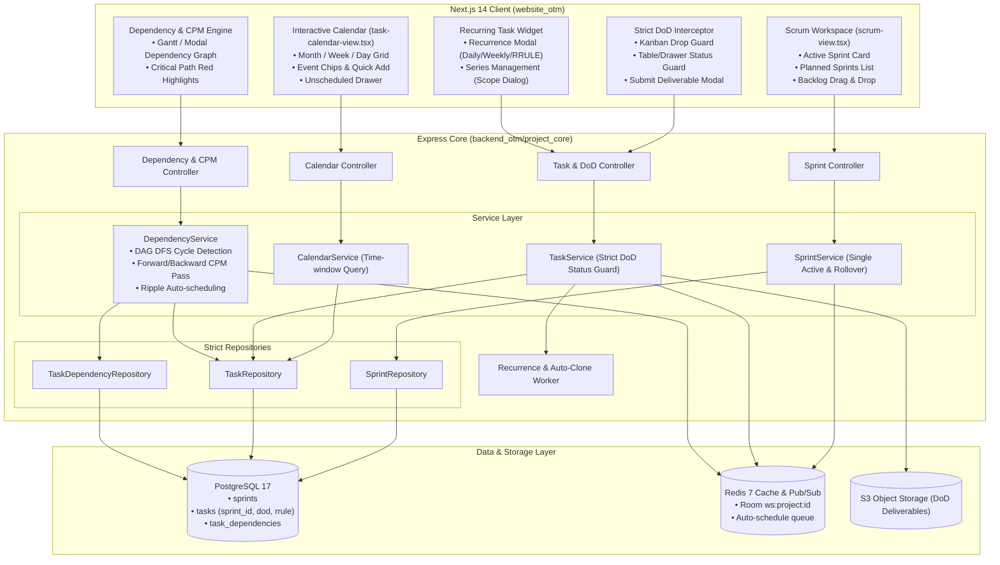
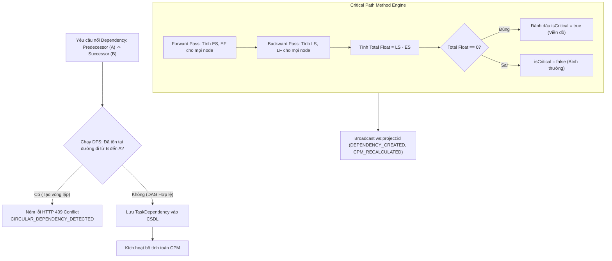

<!--
  name: 06_SRS_PHASE4A_CORE_AGILE_SCHEDULING_ENGINE.md
  description: Software Requirements Specification (SRS) for Phase 4 - Scheduling, Timeline & Agile Engine (Scrum/Sprint Planning, Interactive Calendar View, Strict Definition of Done Gate, Task Dependencies & CPM, Recurring Tasks).
-->

# Software Requirements Specification (SRS) - OmniProject Core Phase 4: Scheduling, Timeline & Agile Engine

> **Document Name:** `06_SRS_PHASE4_SCHEDULING_TIMELINE_AGILE_ENGINE` (Phase 4 Master Specification)  
> **Description:** Đặc tả yêu cầu phần mềm toàn diện Phase 4 — Scheduling, Timeline & Agile Engine: Quản lý chu trình Scrum/Sprint Planning & Backlog Rollover (FR-PRJ-009), Lịch biểu dự án tương tác đa chế độ Month/Week/Day (FR-PRJ-016), Cổng khóa chặn nghiệm thu nghiêm ngặt chống Vibe coding (FR-PRJ-008), Phân hệ phụ thuộc Task, Chống vòng lặp DAG & Thuật toán đường găng CPM (FR-PRJ-003), và Công cụ tự động sinh nhiệm vụ lặp lại định kỳ theo chuẩn iCalendar RRULE (FR-PRJ-017).  
> **Reference Standards:** IEEE Std 830-1998 · INVEST · ISO/IEC 25010 (NFR) · RFC 7807 (Problem Details) · RFC 5545 (iCalendar RRULE)  
> **Project:** OmniProject Core (`omnimer_team`) · **Phase:** 4 (Phase 4A & Phase 4B Unified)  
> **Prerequisites:** Phase 1 (Foundation & Multi-Tenancy IAM) ✅, Phase 2 (Task Lifecycle & EAV Fields) ✅, Phase 3 (Execution Views & Collaboration) ✅  
> **RTM Companion:** [`07_RTM_PHASE4A_CORE_AGILE_SCHEDULING_ENGINE.csv`](./07_RTM_PHASE4A_CORE_AGILE_SCHEDULING_ENGINE.csv)  
> **Trạng thái:** `COMPREHENSIVE APPROVED SPECIFICATION` (Bao trùm toàn bộ 5/5 phân hệ FR của Phase 4)  

---

## 1. Giới Thiệu & Bản Đồ Phân Hệ (Introduction & Module Scope)

### 1.1 Mục Đích (Purpose)
Tài liệu này là "Bản Hợp Đồng Thiết Kế Kỹ Thuật Duy Nhất" (Single Unified Engineering Design Contract) ràng buộc giữa Bộ phận Phân tích Nghiệp vụ (BA/PO), Kỹ sư Backend (`backend_otm/project_core`), Kỹ sư Frontend (`frontend_otm/website_otm`) và Đội ngũ Kiểm thử Chất lượng (QA/QC).  
Phase 4 nâng cấp hệ thống OmniMer từ một nền tảng quản lý luồng công việc liên tục (Continuous Flow Kanban) thành một **Enterprise Agile & Scheduling Platform thực thụ**:
1. Thiết lập chu trình lặp Scrum có kiểm soát (Sprint Planning, Active Sprint execution, Closed Sprint freeze, Backlog rollover tự động).
2. Mở góc nhìn thứ 5 (Interactive Calendar View) trực quan hóa theo Tháng/Tuần/Ngày, kéo thả cập nhật hạn chót và gom việc chưa xếp lịch.
3. Kích hoạt cổng kiểm soát chất lượng bàn giao nghiêm ngặt (Strict Definition of Done - DoD Gate), ngăn chặn triệt để tình trạng "Done ảo" / "Vibe coding".
4. Phân hệ quan hệ phụ thuộc liên nhiệm vụ (Dependencies FS/SS/FF/SF), thuật toán dò chu trình đồ thị có hướng không chu trình (DAG Cycle Detection qua DFS), lan truyền tiến độ tự động (Auto-scheduling Ripple Effect), và thuật toán tính đường găng (Critical Path Method - CPM).
5. Cơ chế nhiệm vụ lặp lại định kỳ (Recurring Tasks) theo chuẩn quốc tế RFC 5545 (iCalendar RRULE), tự sinh instance mới khi task chuyển sang `DONE` và quản lý chuỗi lặp (Series Scope).

### 1.2 Bảng Đối Soát 5 Phân Hệ FR Thuộc Phase 4 (Traceability Matrix)

| Phân Hệ | Mã FR | Tài Liệu Nguồn | Trọng Tâm Kiến Trúc & Nghiệp Vụ Cốt Lõi |
| :--- | :--- | :--- | :--- |
| **Scrum & Sprint Engine** | `FR-PRJ-009` | [`FR-PRJ-009_scrum_sprint_management.md`](./FR-PRJ-009_scrum_sprint_management.md) | Bảng `sprints`, quan hệ `tasks.sprint_id`, Khóa duy nhất 1 Active Sprint (`BL-PRJ-009.1`), Rollover việc dở dang nguyên tử (`BL-PRJ-009.4`), Sprint Planning Workspace 3 phân vùng kéo thả. |
| **Interactive Calendar View** | `FR-PRJ-016` | [`FR-PRJ-016_calendar_view.md`](./FR-PRJ-016_calendar_view.md) | Góc nhìn thứ 5 trên View Switcher: Chế độ Month/Week/Day, Kéo thả event chip cập nhật `due_date`, Quick-add task khi click ô trống, Cột phụ Unscheduled Tasks, Time-window query. |
| **Strict Definition of Done** | `FR-PRJ-008` | [`FR-PRJ-008_strict_dod_output.md`](./FR-PRJ-008_strict_dod_output.md) | Cổng khóa chuyển trạng thái sang `DONE`: Bắt buộc nộp File/Figma/PR khi `output_contract_type != NONE`, ném lỗi `HTTP 403 Forbidden` (`BL-PRJ-008.2`). Ngoại lệ tự động cho Personal Space (`BL-PRJ-008.4`). |
| **Dependency & Critical Path (CPM)** | `FR-PRJ-003` | [`FR-PRJ-003_dependency_critical_path.md`](./FR-PRJ-003_dependency_critical_path.md) | Bảng `task_dependencies`, 4 kiểu nối (FS/SS/FF/SF), Cycle Detection ngăn chặn vòng lặp $A \to B \to C \to A$ (`EC-02`), Auto-scheduling lan truyền tiến độ (`BL-PRJ-003.1`), Thuật toán CPM tính Forward/Backward pass xác định `Total Float = 0` (`BL-PRJ-003.2`). |
| **Recurring Tasks Engine** | `FR-PRJ-017` | [`FR-PRJ-017_recurring_tasks.md`](./FR-PRJ-017_recurring_tasks.md) | Cấu hình lặp RFC 5545 iCalendar (`recurrence_rule`), Tự động nhân bản instance tiếp theo khi Done (`BL-PRJ-017.2`), Quản lý chuỗi Series Scope (`BL-PRJ-017.3`), Biểu tượng nhận diện 🔄 trên mọi view. |

---

## 2. Kiến Trúc Dữ Liệu & Mô Hình Tổng Thể (System Architecture & Data Model)

### 2.1 Sơ Đồ Kiến Trúc Hệ Thống Toàn Diện Phase 4 (System Topology)



### 2.2 Prisma Schema Mở Rộng Toàn Diện Cho Phase 4 (`schema.prisma`)

```prisma
// Enum trạng thái vòng đời Sprint (FR-PRJ-009)
enum SprintStatus {
  PLANNED
  ACTIVE
  CLOSED
}

// Enum chuẩn khế ước nghiệm thu đầu ra (FR-PRJ-008)
enum OutputContractType {
  NONE
  URL_LINK
  FILE_UPLOAD
  MERGE_REQUEST
}

// Enum loại liên kết phụ thuộc giữa 2 nhiệm vụ (FR-PRJ-003)
enum DependencyType {
  FS // Finish-to-Start (Mặc định)
  SS // Start-to-Start
  FF // Finish-to-Finish
  SF // Start-to-Finish
}

// Model Sprint mới (FR-PRJ-009)
model Sprint {
  id          String       @id @default(dbgenerated("gen_random_uuid()")) @db.Uuid
  projectId   String       @map("project_id") @db.Uuid
  name        String       @db.VarChar(255)
  goal        String?      @db.Text
  startDate   DateTime     @map("start_date")
  endDate     DateTime     @map("end_date")
  status      SprintStatus @default(PLANNED)
  version     Int          @default(1)
  createdAt   DateTime     @default(now()) @map("created_at")
  updatedAt   DateTime     @updatedAt @map("updated_at")

  project     Project      @relation(fields: [projectId], references: [id], onDelete: Cascade)
  tasks       Task[]

  @@index([projectId, status])
  @@index([projectId, startDate])
  @@map("sprints")
}

// Model Liên kết phụ thuộc giữa các Task (FR-PRJ-003)
model TaskDependency {
  id             String         @id @default(dbgenerated("gen_random_uuid()")) @db.Uuid
  projectId      String         @map("project_id") @db.Uuid
  predecessorId  String         @map("predecessor_id") @db.Uuid
  successorId    String         @map("successor_id") @db.Uuid
  type           DependencyType @default(FS)
  lagDays        Int            @default(0) @map("lag_days")
  createdAt      DateTime       @default(now()) @map("created_at")
  updatedAt      DateTime       @updatedAt @map("updated_at")

  project        Project        @relation(fields: [projectId], references: [id], onDelete: Cascade)
  predecessor    Task           @relation("PredecessorTasks", fields: [predecessorId], references: [id], onDelete: Cascade)
  successor      Task           @relation("SuccessorTasks", fields: [successorId], references: [id], onDelete: Cascade)

  @@unique([predecessorId, successorId])
  @@index([projectId])
  @@index([predecessorId])
  @@index([successorId])
  @@map("task_dependencies")
}

// Mở rộng Model Task hiện có với toàn bộ 5 phân hệ Phase 4
model Task {
  // ... các trường hiện tại giữ nguyên ...
  
  // 1. Phân hệ Scrum / Sprint (FR-PRJ-009)
  sprintId              String?            @map("sprint_id") @db.Uuid
  sprint                Sprint?            @relation(fields: [sprintId], references: [id], onDelete: SetNull)

  // 2. Phân hệ Strict Definition of Done (FR-PRJ-008)
  outputContractType    OutputContractType @default(NONE) @map("output_contract_type")
  outputDeliverable     Json?              @map("output_deliverable")

  // 3. Phân hệ Recurring Tasks (FR-PRJ-017)
  recurrenceRule        String?            @map("recurrence_rule") @db.VarChar(500)
  recurrenceSeriesId    String?            @map("recurrence_series_id") @db.Uuid
  occurrenceIndex       Int?               @default(1) @map("occurrence_index")
  nextDueDate           DateTime?          @map("next_due_date")

  // 4. Phân hệ Task Dependencies (FR-PRJ-003)
  predecessors          TaskDependency[]   @relation("SuccessorTasks")
  successors            TaskDependency[]   @relation("PredecessorTasks")

  // Chỉ mục composite hỗ trợ truy vấn Calendar & Dependencies cực nhanh
  @@index([projectId, dueDate])
  @@index([projectId, startDate, endDate])
  @@index([sprintId])
  @@index([recurrenceSeriesId])
}
```

---

## 3. Đặc Tả Chi Tiết 5 Phân Hệ Chức Năng (Detailed Functional Requirements)

---

### Phân Hệ 1: `FR-PRJ-009` — Quản Lý Chu Trình Scrum, Sprint Planning & Backlog Rollover

#### Các Quy Tắc Nghiệp Vụ:
* **`BL-PRJ-009.1` (Ràng Buộc Duy Nhất 1 Active Sprint):** Tại một thời điểm trong một dự án, chỉ được phép có **tối đa duy nhất 1 Sprint** ở trạng thái `ACTIVE`. Nếu PM bấm "Bắt đầu Sprint" khi đang có Sprint khác đang hoạt động $\rightarrow$ API ném mã lỗi `HTTP 409 Conflict` kèm mã lỗi `ACTIVE_SPRINT_EXISTS`.
* **`BL-PRJ-009.2` (Quan Hệ Độc Quyền Task - Sprint):** Một nhiệm vụ chỉ thuộc về tối đa 1 Sprint (`sprint_id`), hoặc nằm trong Product Backlog (`sprint_id IS NULL`). Kéo thả task cập nhật `sprint_id` kèm kiểm soát xung đột OCC (`version`).
* **`BL-PRJ-009.3` (Tính Bất Biến Của Sprint Đã Đóng):** Khi Sprint chuyển sang trạng thái `CLOSED`, toàn bộ metadata và task của Sprint bị đóng băng (Frozen). Cấm kéo task mới vào Sprint đã đóng.
* **`BL-PRJ-009.4` (Cơ Chế Rollover Xử Lý Việc Dở Dang):** Khi PM hoàn thành Sprint (`POST /sprints/:id/complete`), API tự động quét tất cả các task thuộc Sprint có trạng thái khác `DONE`:
  - `BACKLOG`: Cập nhật `sprint_id = NULL` để quay về Product Backlog.
  - `SPRINT`: Chuyển sang một Planned Sprint mục tiêu (`sprint_id = targetSprintId`).
* **`BL-PRJ-009.5` (Tính Điểm Ước Lượng Story Points):** Hệ thống tự động tính tổng số Story Points của từng Sprint dựa trên `difficulty` (1-5) hoặc Custom Field `Story Points`.

---

### Phân Hệ 2: `FR-PRJ-016` — Lịch Biểu Dự Án Tương Tác (Interactive Calendar View)

#### Các Quy Tắc Nghiệp Vụ:
* **`BL-PRJ-016.1` (Ánh Xạ Dữ Liệu Lịch - Calendar Mapping):**
  - **Single Day Task:** Task có `dueDate` (và không có `startDate`) hiển thị là Event Chip trên ô ngày tương ứng.
  - **Multi-Day Task:** Task có cả `startDate` và `endDate`/`dueDate` hiển thị là thanh dải Span Bar kéo dài.
  - **Unscheduled Tasks:** Task có `dueDate IS NULL` gom vào cột phụ Unscheduled Tasks bên phải.
* **`BL-PRJ-016.2` (Kéo Thả Đổi Lịch Trình):** Kéo thả Event Chip sang ngày khác tự động gọi API `PATCH /tasks/:taskId/reschedule` cập nhật `dueDate`.
* **`BL-PRJ-016.3` (Tạo Nhanh Việc Từ Ô Ngày Trống):** Nhấp chuột vào ô ngày trống mở `QuickAddTaskModal` với trường `dueDate` điền sẵn ngày đó.
* **`BL-PRJ-016.4` (Mã Màu Trạng Thái):** Màu Event chip tương ứng danh mục trạng thái (`TODO` = xám, `IN_PROGRESS` = xanh dương, `DONE` = xanh lá, `BLOCKED` = đỏ). Màn hình My Tasks hiển thị theo màu dự án.
* **`BL-PRJ-016.5` (Lọc Theo Khoảng Thời Gian Time-window):** `GET /projects/:id/calendar?start=YYYY-MM-DD&end=YYYY-MM-DD`.

---

### Phân Hệ 3: `FR-PRJ-008` — Cổng Tiêu Chuẩn Nghiệm Thu Nghiêm Ngặt (Strict DoD Gate)

#### Các Quy Tắc Nghiệp Vụ:
* **`BL-PRJ-008.1` (Thiết Lập Khế Ước Đầu Ra):** Gán `outputContractType` (`NONE`, `URL_LINK`, `FILE_UPLOAD`, `MERGE_REQUEST`).
* **`BL-PRJ-008.2` (Khóa Chuyển Trạng Thái Done Blocker):** Khi chuyển task sang bất kỳ trạng thái nào có `category = DONE`:
  - Nếu `outputContractType != NONE` VÀ `outputDeliverable == null`:
    $\rightarrow$ Backend từ chối và ném lỗi `HTTP 403 Forbidden` (`DOD_DELIVERABLE_REQUIRED`).
    $\rightarrow$ Frontend chặn thao tác kéo thả, nảy thẻ về cột cũ và bật Modal **"Nộp hiện vật bàn giao (Definition of Done)"**.
* **`BL-PRJ-008.3` (Đồng Bộ Kho Tri Thức):** Phát sự kiện `TASK_DOD_COMPLETED` qua Redis Pub/Sub để phục vụ lưu trữ tài liệu dài hạn.
* **`BL-PRJ-008.4` (Ngoại Lệ Không Gian Cá Nhân):** Task thuộc Personal Space (`is_personal = true`) luôn có `outputContractType = NONE` và tự động bỏ qua kiểm tra DoD.

---

### Phân Hệ 4: `FR-PRJ-003` — Phân Hệ Phụ Thuộc (Dependencies) & Thuật Toán Đường Găng (CPM)

#### Các Quy Tắc Nghiệp Vụ & Thuật Toán Cốt Lõi:
* **`BL-PRJ-003.1` (4 Kiểu Liên Kết Phụ Thuộc):**
  - `FS` (Finish-to-Start): Task B chỉ có thể bắt đầu sau khi Task A kết thúc ($Start_B \ge Finish_A + Lag$).
  - `SS` (Start-to-Start): Task B chỉ có thể bắt đầu sau khi Task A bắt đầu ($Start_B \ge Start_A + Lag$).
  - `FF` (Finish-to-Finish): Task B chỉ có thể kết thúc sau khi Task A kết thúc ($Finish_B \ge Finish_A + Lag$).
  - `SF` (Start-to-Finish): Task B chỉ có thể kết thúc sau khi Task A bắt đầu ($Finish_B \ge Start_A + Lag$).
* **`EC-02` (Dò Vòng Lặp Phụ Thuộc - DAG Cycle Detection qua DFS):**
  - Trước khi tạo một liên kết mới $A \to B$, hệ thống sử dụng thuật toán duyệt đồ thị theo chiều sâu (**Depth-First Search - DFS**) để kiểm tra xem đã tồn tại đường đi từ $B \to A$ hay chưa.
  - Nếu phát hiện chu trình (vòng lặp $A \to B \to C \to A$), backend lập tức từ chối và ném lỗi `HTTP 409 Conflict` kèm mã lỗi `CIRCULAR_DEPENDENCY_DETECTED`.
* **`BL-PRJ-003.2` (Thuật Toán Tính Đường Găng Critical Path Method - CPM):**
  - Hệ thống tính toán mạng lưới công việc qua 2 lượt:
    1. **Forward Pass (Lượt tiến):** Tính thời điểm bắt đầu sớm nhất ($ES$) và kết thúc sớm nhất ($EF$).
       $$EF = ES + \text{Duration} - 1$$
       $$ES_B = \max (EF_A + \text{Lag})$$
    2. **Backward Pass (Lượt lùi):** Tính thời điểm kết thúc muộn nhất ($LF$) và bắt đầu muộn nhất ($LS$).
       $$LS = LF - \text{Duration} + 1$$
       $$LF_A = \min (LS_B - \text{Lag})$$
    3. **Độ Trữ Toàn Phần (Total Float):**
       $$\text{Total Float} = LS - ES = LF - EF$$
    4. **Điều Kiện Đường Găng:** Mọi Task có $\text{Total Float} = 0$ là các nhiệm vụ găng (**Critical Tasks**). Bất kỳ sự chậm trễ nào của task găng đều làm chậm tiến độ toàn dự án. Trên giao diện, chuỗi task này được làm sáng viền đỏ rực rỡ.
* **`EC-03` (Lan Truyền Tiến Độ Tự Động - Auto-Scheduling Ripple Effect):**
  - Khi Task tiền nhiệm thay đổi ngày kết thúc $Finish_A \to Finish_A + X$, hệ thống tự động dịch chuyển ngày bắt đầu của các Task hậu nhiệm liên quan.
  - Nếu số task bị ảnh hưởng $\le 50$: Xử lý đồng bộ trong 1 Transaction CSDL và trả về `200 OK`.
  - Nếu số task bị ảnh hưởng $> 50$: Xử lý bất đồng bộ qua Redis Background Queue, trả về `202 Accepted` và broadcast qua WebSocket khi hoàn thành.

#### Sơ Đồ Thuật Toán Chống Vòng Lặp & Tính Đường Găng:



---

### Phân Hệ 5: `FR-PRJ-017` — Công Cụ Nhiệm Vụ Lặp Lại Định Kỳ (Recurring Tasks Engine)

#### Các Quy Tắc Nghiệp Vụ:
* **`BL-PRJ-017.1` (Cấu Hình Lịch Lặp Theo Chuẩn RFC 5545 iCalendar):**
  - Sử dụng chuỗi định dạng iCalendar RRULE tiêu chuẩn:
    - Hằng ngày: `RRULE:FREQ=DAILY`
    - Hằng tuần vào Thứ Hai & Thứ Tư: `RRULE:FREQ=WEEKLY;BYDAY=MO,WE`
    - Hằng tháng vào ngày 1: `RRULE:FREQ=MONTHLY;BYMONTHDAY=1`
    - Lặp 10 lần rồi dừng: `RRULE:FREQ=WEEKLY;COUNT=10`
    - Kết thúc vào ngày cụ thể: `RRULE:FREQ=DAILY;UNTIL=20261231T235959Z`
* **`BL-PRJ-017.2` (Tự Động Sinh Instance Tiếp Theo Khi Hoàn Thành - Next Occurrence Generation):**
  - **Trigger:** Khi trạng thái task chuyển sang danh mục `category = DONE`.
  - **Xử lý:** Backend sử dụng thư viện phân tích RRULE chuẩn (`rrule`) để tính toán `next_due_date` tiếp theo dựa trên ngày hiện tại và cấu hình lặp.
  - **Nhân bản thông minh (Cloning Policy):**
    - **Được sao chép sang task mới:** `title`, `assigneeId`, `ownerId`, `projectId`, `sprintId` (nếu Sprint đang `ACTIVE`), `customFields`, `outputContractType`, `recurrenceRule`, `recurrenceSeriesId`, tăng `occurrenceIndex = occurrenceIndex + 1`.
    - **Reset về rỗng (KHÔNG sao chép):** `description`, `attachments`, `comments`, `subtasks`, `actualHours`, `outputDeliverable`.
  - **Điều kiện dừng:** Nếu chuỗi lặp đã chạm `COUNT` tối đa hoặc vượt qua ngày `UNTIL`, hệ thống không tạo task mới và thông báo chuỗi đã hoàn tất.
* **`BL-PRJ-017.3` (Quản Lý Phạm Vi Chỉnh Sửa Chuỗi - Series Edit Scope):**
  - Khi người dùng chỉnh sửa một task trong chuỗi lặp, hệ thống cung cấp 3 lựa chọn phạm vi:
    1. `ONLY_THIS_INSTANCE`: Chỉ sửa instance hiện tại, tách task này ra khỏi chuỗi (`recurrenceRule = null`).
    2. `THIS_AND_FOLLOWING`: Cập nhật cấu hình lặp cho instance hiện tại và tất cả các lần lặp kế tiếp (tách series ID mới).
    3. `ALL_INSTANCES`: Cập nhật cấu hình lặp gốc cho toàn bộ chuỗi.
* **`BL-PRJ-017.4` (Dấu Hiệu Nhận Diện UI):**
  - Mọi task thuộc chuỗi lặp đều hiển thị biểu tượng 🔄 kèm tooltip mô tả chu kỳ lặp trên Kanban Board, Table View, và Calendar View.

---

## 4. Đặc Tả Giao Diện Lập Trình Toàn Diện (REST API Contracts Cho Cả 5 Phân Hệ)

### 4.1 Bảng Tổng Hợp 12 Endpoints Thuộc Phase 4

| Phân Hệ | Method | Endpoint Path | Quyền Hạn | Mô Tả Tóm Tắt |
| :--- | :---: | :--- | :---: | :--- |
| **Scrum** | `POST` | `/api/v1/projects/:projectId/sprints` | PM, Admin | Tạo Sprint mới ở trạng thái `PLANNED` |
| **Scrum** | `GET` | `/api/v1/projects/:projectId/sprints` | Mọi vai trò | Lấy Sprint Workspace (Active, Planned, Backlog) |
| **Scrum** | `POST` | `/api/v1/sprints/:sprintId/start` | PM, Admin | Bắt đầu Sprint (Chặn nếu đã có Active Sprint) |
| **Scrum** | `POST` | `/api/v1/sprints/:sprintId/complete` | PM, Admin | Hoàn thành Sprint & Rollover task dở dang |
| **Scrum** | `PATCH` | `/api/v1/tasks/:taskId/assign-sprint` | Member, PM | Kéo thả gán task vào Sprint hoặc Backlog |
| **Calendar**| `GET` | `/api/v1/projects/:projectId/calendar` | Mọi vai trò | Lấy danh sách task theo khoảng ngày (Time-window) |
| **Calendar**| `PATCH` | `/api/v1/tasks/:taskId/reschedule` | Member, PM | Kéo dời `dueDate` / `startDate` trên lưới lịch |
| **DoD** | `POST` | `/api/v1/tasks/:taskId/deliverables` | Member, PM | Nộp hiện vật bàn giao (Link Figma, Git PR, File) |
| **Dependency**| `POST` | `/api/v1/projects/:projectId/dependencies` | Member, PM | Thiết lập liên kết FS/SS/FF/SF kèm Cycle Check |
| **Dependency**| `GET` | `/api/v1/projects/:projectId/dependencies` | Mọi vai trò | Lấy danh sách liên kết & chuỗi găng Critical Path |
| **Dependency**| `DELETE`| `/api/v1/projects/:projectId/dependencies/:id`| Member, PM | Xóa liên kết phụ thuộc |
| **Recurrence**| `POST` | `/api/v1/tasks/:taskId/recurrence` | Member, PM | Cấu hình lịch lặp RRULE cho task |

### 4.2 Chi Tiết Các Payload & Zod Schemas Bổ Sung (Dependencies & Recurrence)

#### 1. Thiết Lập Liên Kết Phụ Thuộc (Tạo Dependency & Dò Chu Trình)
* **Method & Path:** `POST /api/v1/projects/:projectId/dependencies`
* **Request Body:**
  ```json
  {
    "predecessorId": "uuid-task-a",
    "successorId": "uuid-task-b",
    "type": "FS",
    "lagDays": 2
  }
  ```
* **Response `201 Created`:**
  ```json
  {
    "success": true,
    "data": {
      "id": "dep-uuid-1",
      "predecessorId": "uuid-task-a",
      "successorId": "uuid-task-b",
      "type": "FS",
      "lagDays": 2,
      "isCritical": false
    }
  }
  ```
* **Lỗi Phát Hiện Vòng Lặp `HTTP 409 Conflict`:**
  ```json
  {
    "type": "https://errors.omnimer.com/conflict",
    "title": "Conflict",
    "status": 409,
    "code": "CIRCULAR_DEPENDENCY_DETECTED",
    "detail": "Không thể tạo liên kết vì sẽ hình thành vòng lặp phụ thuộc (Task B -> Task C -> Task A)."
  }
  ```

#### 2. Lấy Danh Sách Liên Kết & Tính Đường Găng (Get Dependencies & Critical Path)
* **Method & Path:** `GET /api/v1/projects/:projectId/dependencies`
* **Response `200 OK`:**
  ```json
  {
    "success": true,
    "data": {
      "dependencies": [
        { "id": "dep-1", "predecessorId": "t-1", "successorId": "t-2", "type": "FS", "lagDays": 0 }
      ],
      "criticalPath": {
        "criticalTaskIds": ["t-1", "t-2", "t-5"],
        "totalProjectDurationDays": 42
      }
    }
  }
  ```

#### 3. Cấu Hình Lịch Lặp Nhiệm Vụ (Set Recurrence Rule)
* **Method & Path:** `POST /api/v1/tasks/:taskId/recurrence`
* **Request Body:**
  ```json
  {
    "recurrenceRule": "RRULE:FREQ=WEEKLY;BYDAY=MO,FR;COUNT=12",
    "scope": "ALL_INSTANCES"
  }
  ```
* **Response `200 OK`:**
  ```json
  {
    "success": true,
    "data": {
      "taskId": "uuid-task-1",
      "recurrenceRule": "RRULE:FREQ=WEEKLY;BYDAY=MO,FR;COUNT=12",
      "recurrenceSeriesId": "series-uuid-99",
      "occurrenceIndex": 1,
      "nextDueDate": "2026-11-13T09:00:00.000Z"
    }
  }
  ```

---

## 5. Yêu Cầu Phi Chức Năng Bổ Sung Cho Toàn Phase 4 (Expanded NFRs)

* **`NFR-PERF-04` (CPM Computation Speed):** Thuật toán tính toán đường găng CPM cho mạng lưới 500 tasks và 1,000 dependencies phải hoàn tất tính toán dưới **50ms** trên môi trường Node.js.
* **`NFR-PERF-05` (Cycle Detection DFS Latency):** Thao tác kiểm tra chu trình DAG bằng DFS trước khi tạo liên kết phụ thuộc phải phản hồi dưới **10ms**.
* **`NFR-REL-01` (Auto-Clone Fail-Safe):** Khi task Done sinh instance lặp lại mới (`BL-PRJ-017.2`), toàn bộ hành vi cập nhật trạng thái Task cũ và tạo Task mới phải nằm trọn vẹn trong một CSDL Transaction duy nhất để tránh tình trạng task Done nhưng mất instance kế tiếp.

---

## 6. Tiêu Chí Chấp Nhận & Kịch Bản Gherkin Bổ Sung

### Kịch Bản 6: Chống Tạo Vòng Lặp Phụ Thuộc (EC-02)
```gherkin
Given Task B phụ thuộc vào Task A (A -> B)
And Task C phụ thuộc vào Task B (B -> C)
When Người dùng cố gắng tạo liên kết từ Task C sang Task A (C -> A)
Then Hệ thống từ chối hành động và trả về HTTP 409 Conflict ("CIRCULAR_DEPENDENCY_DETECTED")
And Giao diện hiển thị cảnh báo: "Phát hiện vòng lặp phụ thuộc không hợp lệ"
```

### Kịch Bản 7: Tự Động Làm Nổi Bật Đường Găng (BL-PRJ-003.2)
```gherkin
Given Dự án có chuỗi nhiệm vụ: A (5 ngày) -> B (10 ngày) -> C (15 ngày) với Total Float = 0
And Nhánh phụ: D (2 ngày) với Total Float = 28 ngày
When Người dùng bật công tắc "Xem Đường Găng (Critical Path)"
Then Các thẻ Task A, Task B, Task C tự động hiển thị viền đỏ rực rỡ và nhãn "Găng"
And Thẻ Task D hiển thị bình thường không có viền đỏ
```

### Kịch Bản 8: Tự Động Tạo Task Mới Khi Hoàn Thành Nhiệm Vụ Lặp (BL-PRJ-017.2)
```gherkin
Given Task "Daily Standup" có recurrenceRule là "RRULE:FREQ=DAILY" và dueDate là 2026-11-10
When Thành viên chuyển trạng thái task này sang "Done"
Then Trạng thái task hiện tại chuyển sang "Done" thành công
And Hệ thống tự động tạo một task mới "Daily Standup" với dueDate là 2026-11-11
And Task mới xuất hiện với icon 🔄 và cùng người phụ trách với task cũ
```
