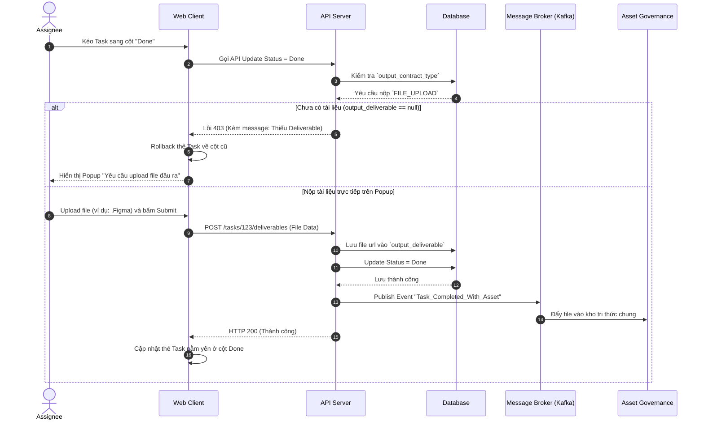

# Feature: Strict Definition of Done (DoD) & Output Contract (FR-PRJ-008)

**Mô tả:** Cơ chế chống "Vibe Code" (làm bừa, không có tài liệu bàn giao). Yêu cầu Task phải nộp đúng định dạng tài liệu đầu ra (Deliverable) trước khi được phép chuyển sang trạng thái "Done".
**Priority:** P1 (High)
**Kế thừa & Liên kết Đặc tả:**
- **Core RBAC & AuthN:** [`FR-PRJ-000`](../phase_1/FR-PRJ-000_core_technical_architecture.md)
- **Phase 4 Master Specs:** [`06_SRS_PHASE4A_CORE_AGILE_SCHEDULING_ENGINE.md`](./06_SRS_PHASE4A_CORE_AGILE_SCHEDULING_ENGINE.md) · [`07_RTM_PHASE4A_CORE_AGILE_SCHEDULING_ENGINE.csv`](./07_RTM_PHASE4A_CORE_AGILE_SCHEDULING_ENGINE.csv)
- **Asset Governance SRS & RTM:** [`01_SRS_ASSET_GOVERNANCE_AND_PLANNING_HANDOVER.md`](../../asset_governance/01_SRS_ASSET_GOVERNANCE_AND_PLANNING_HANDOVER.md) · [`02_RTM_ASSET_GOVERNANCE_AND_PLANNING_HANDOVER.csv`](../../asset_governance/02_RTM_ASSET_GOVERNANCE_AND_PLANNING_HANDOVER.csv)

## 1. Functional Requirements List

| FR ID | Requirement Description | Input | Output | Associated Business Rule | Priority |
|---|---|---|---|---|---|
| **FR-PRJ-008.1** | **Thiết lập Output Contract & Planning Blueprint:** Khi tạo/sửa Task, Project Manager hoặc Reporter có thể chọn định dạng đầu ra bắt buộc (Link URL, File đính kèm, Merge Request, hoặc **Structured Plan** thuộc 7 mẫu chuẩn của `FR-DOC-001` dưới dạng **Excel Workbook `.xlsx`/`.csv` và/hoặc Markdown `.md`** như Test Plan, Pentest Plan, Release Plan...) đồng thời cấu hình danh sách Người nghiệm thu linh hoạt (`designated_reviewer_ids[]`) và cơ chế duyệt ngay trên Task. | Chọn `output_contract_type`, `required_plan_type`, `designated_reviewer_ids[]`, `handover_approval_policy` | Lưu cấu hình Output Contract & Handover Reviewer vào Task | BL-PRJ-008.1, BL-PRJ-008.5 | Must-have |
| **FR-PRJ-008.2** | **Chặn hoàn thành (Done Blocker):** Ngăn chặn người dùng chuyển trạng thái Task sang `Done` nếu chưa cung cấp tài liệu đầu ra đúng định dạng đã yêu cầu (hoặc chưa vượt qua cổng nghiệm thu bàn giao nếu có cấu hình Designated Reviewers). | Kéo Task vào cột Done | UI bật Popup yêu cầu nộp tài liệu / Chặn Kéo | BL-PRJ-008.2, BL-PRJ-008.5 | Must-have |
| **FR-PRJ-008.3** | **Tự động lưu trữ (Asset Sync):** Khi Task nộp đầu ra hợp lệ hoặc hoàn thành, tài liệu đầu ra được đồng bộ (Event-driven) sang hệ thống Asset Governance (`FR-DOC-001`) để chuẩn hóa phiên bản, ký nghiệm thu và bảo lưu dài hạn trên Tenant Storage. | Event Task_Done / Handover_Submit | File Excel/Markdown Plan được đưa vào Kho Tri Thức (`FR-DOC-001`) | BL-PRJ-008.3 | Should-have |

## 2. Business Logic & Rules

* **BL-PRJ-008.1 (Output Definition):** Khi thiết lập `output_contract_type != "NONE"`, hệ thống kích hoạt cơ chế "Khóa Trạng thái" (Status Lock) cho các cột có category là `DONE`.
* **BL-PRJ-008.2 (Done Blocker Validation):** Nếu `assignee_id` cố gắng chuyển Task sang cột `Done`, hệ thống kiểm tra trường `output_deliverable`. 
  * Nếu trống: Ném lỗi `HTTP 403` và hiển thị Popup "Submit Deliverables" trên UI.
  * Nếu là `URL_LINK`: Validate regex URL.
  * Nếu là `STRUCTURED_PLAN`: Hỗ trợ nộp bằng **Excel Workbook (`.xlsx`/`.csv`)**, **Markdown (`.md`)**, hoặc **Hybrid (`.md` + `.xlsx`)**; hệ thống chạy `ExcelParser` / `PlanSchemaValidator` theo `required_plan_type` (`FR-DOC-001.2`), nếu thiếu Sheet/Cột Excel hoặc trường bắt buộc ném `HTTP 422`.
* **BL-PRJ-008.3 (Knowledge Base Sync):** Ngay sau khi Task nộp tài liệu hoặc được lưu trạng thái `Done` thành công, Message Broker / Event Bus sẽ bắt sự kiện và đẩy tài liệu sang phân hệ Asset Governance (`FR-DOC-001`).
* **BL-PRJ-008.4 (Personal Space Exception — Tính năng liên quan: FR-PRJ-015):** Task thuộc **Personal Space** (`is_personal = true`) luôn có `output_contract_type = NONE` cố định và không thể thay đổi. Cơ chế Done Blocker bị vô hiệu hóa hoàn toàn cho Personal Space — người dùng cá nhân được phép chuyển Task sang Done mà không cần nộp deliverable. Điều này đảm bảo OmniProject không trở thành rào cản với người dùng cá nhân/to-do cơ bản.
* **BL-PRJ-008.5 (Structured Plan & Flexible Reviewer Handover Gate — Liên kết `FR-DOC-001`):**
  * Khi `output_contract_type = STRUCTURED_PLAN` hoặc khi Task có cấu hình `designated_reviewer_ids[]` (không rỗng) kèm `handover_approval_policy IN ('ANY_ONE', 'ALL_REQUIRED')`:
    * Khi Assignee nộp Deliverable/Plan hợp lệ, hệ thống **chưa** cho phép Task nhảy thẳng vào cột `DONE`, mà tự động chuyển Task sang trạng thái thuộc Meta-Status `IN_REVIEW` (Pending Handover Sign-off) và sinh các phiếu duyệt `asset_handover_reviews` tương ứng trong `FR-DOC-001`.
    * Task chỉ được mở khóa chuyển vào cột `DONE` sau khi tài liệu đầu ra đạt trạng thái `APPROVED_BASELINE` theo đúng chính sách duyệt (`ALL_REQUIRED` hoặc `ANY_ONE`). Mọi nỗ lực ép kéo Task sang `DONE` trước khi đủ chữ ký nghiệm thu đều bị chặn với `HTTP 403 Forbidden (HANDOVER_SIGNOFF_REQUIRED)`.

## 2.1. Ma Trận Phân Quyền Cổng DoD & Nghiệm Thu Bàn Giao (DoD & Handover RBAC Matrix — Kế thừa `FR-PRJ-000`)

Kế thừa phân quyền 4 cấp của [`FR-PRJ-000`](../phase_1/FR-PRJ-000_core_technical_architecture.md) và mở rộng với vai trò ngữ cảnh trên Task (`Assignee`, `Designated Reviewer`):

| Thao Tác trên Cổng DoD (`FR-PRJ-008`) | Admin | PM / Task Owner | Task Assignee (Author) | Designated Reviewer *(gán trên Task)* | Other Member | Guest / Client |
| :--- | :---: | :---: | :---: | :---: | :---: | :---: |
| Cấu hình / Thay đổi `output_contract_type` & `required_plan_type` | ✅ | ✅ | ❌ | ❌ | ❌ | ❌ |
| Chỉ định / Sửa `designated_reviewer_ids[]` & `handover_approval_policy` | ✅ | ✅ | ❌ | ❌ | ❌ | ❌ |
| Nộp Deliverable (`URL_LINK`, `FILE_UPLOAD`, `MERGE_REQUEST`, `STRUCTURED_PLAN`) | ✅ | ✅ | ✅ *(Task được giao)* | ❌ | ❌ | ❌ |
| Ký Nghiệm thu (`APPROVE` / `CHANGES_REQUESTED`) cho Deliverable/Plan | 🟡 *(Nếu trong Reviewer List)* | 🟡 *(Nếu trong Reviewer List)* | ❌ **CẤM TỰ DUYỆT** | ✅ | ❌ | ❌ |
| Chuyển Task từ `IN_REVIEW` sang `DONE` sau khi đủ `APPROVED_BASELINE` | ✅ | ✅ | ✅ | ❌ | ❌ | ❌ |

> **Chống tự duyệt (`BL-DOC-001.5`):** Nếu một User vừa là `PM`/`Admin` vừa là `Assignee` nộp Plan cho Task, User đó bị chặn tự gọi API ký duyệt (`403 SELF_APPROVAL_PROHIBITED`) nếu Workspace còn thành viên khác hợp lệ.

## 3. Data Structure (Bổ sung cho Entity Task)

| Field | Data Type | Required | Constraints |
|---|---|---|---|
| `output_contract_type`| Enum | Yes | `NONE`, `URL_LINK`, `FILE_UPLOAD`, `MERGE_REQUEST`, `STRUCTURED_PLAN` *(Mở rộng cho `FR-DOC-001` v2.0)*. Mặc định `NONE` |
| `required_plan_type` | Enum | No | Bắt buộc nếu `output_contract_type = STRUCTURED_PLAN`: `TEST_PLAN \| PENTEST_PLAN \| ARCH_TECHNICAL_PLAN \| RELEASE_HANDOVER_PLAN \| SPRINT_ITERATION_PLAN \| MIGRATION_PLAN \| INCIDENT_RESPONSE_PLAN` |
| `designated_reviewer_ids` | UUID[] | No | Danh sách người nghiệm thu bàn giao được cấu hình linh hoạt ngay trên Task (VD: `[SecLead_ID, PM_ID]`) |
| `handover_approval_policy` | Enum | Yes | `NONE \| ANY_ONE \| ALL_REQUIRED`. Mặc định `NONE` (tự động set `ALL_REQUIRED` hoặc `ANY_ONE` khi có `designated_reviewer_ids`) |
| `output_deliverable` | String/JSON| No | Chứa URL thực tế hoặc danh sách `asset_id` / `version_number` (Nếu upload file hoặc Structured Plan). Null nếu chưa nộp. |

## 4. Sequence Diagram: Submit Deliverable & Mark as Done



## 5. Tiêu chí Chấp nhận (Acceptance Criteria)

**Là** Project Manager,
**Tôi muốn** buộc nhân viên phải đính kèm link thiết kế / link PR code khi hoàn thành Task,
**Để** chống lại việc nhân viên click "Done" bừa bãi mà không lưu lại tài liệu bàn giao, gây khó khăn cho việc đào tạo nhân sự sau này.

**Acceptance Criteria (Gherkin):**
```gherkin
Given Task "Thiết kế Banner" có yêu cầu đầu ra là "FILE_UPLOAD"
When Nhân viên cố gắng kéo Task đó sang cột "Done" trên bảng Kanban
Then Hệ thống giữ Task ở lại vị trí cũ và hiển thị Popup "Yêu cầu nộp tài liệu đầu ra"

Given Popup "Yêu cầu nộp tài liệu đầu ra" đang hiển thị
When Nhân viên tải lên file .Figma thành công và nhấn Lưu
Then Hệ thống tự động chuyển Task sang cột "Done"
And File thiết kế được chuyển vào Kho Tri Thức (Asset Governance) của dự án
```
