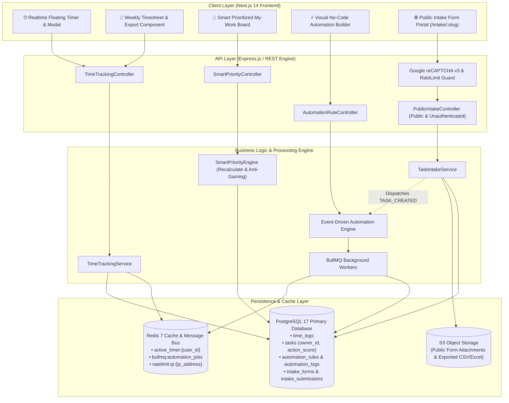
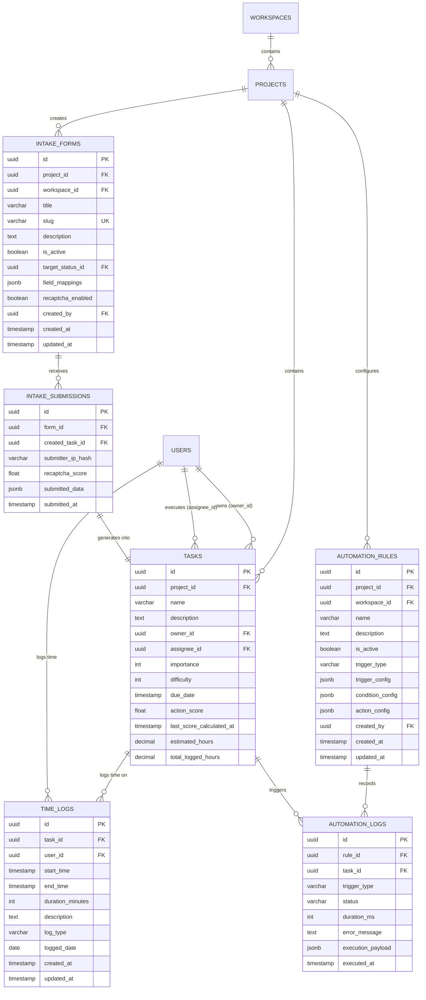
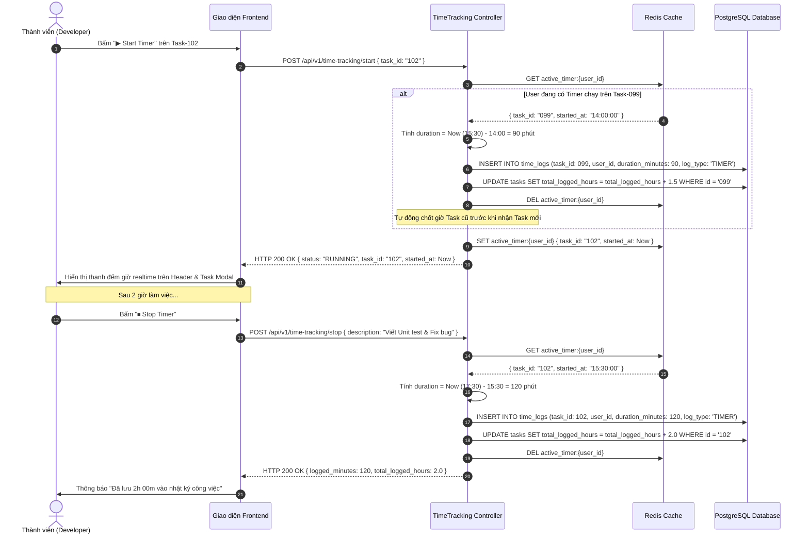
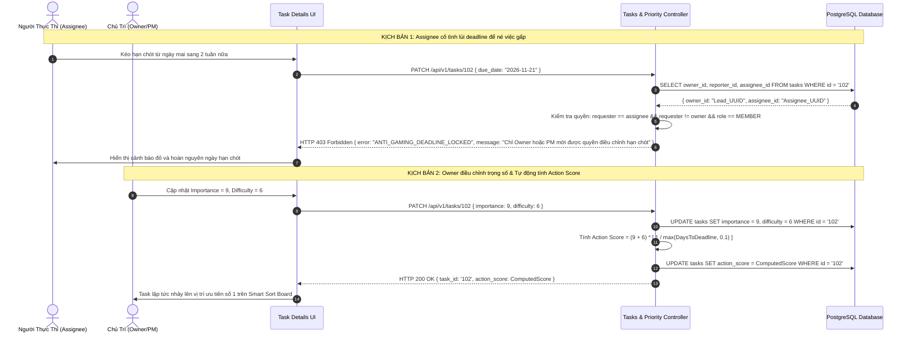
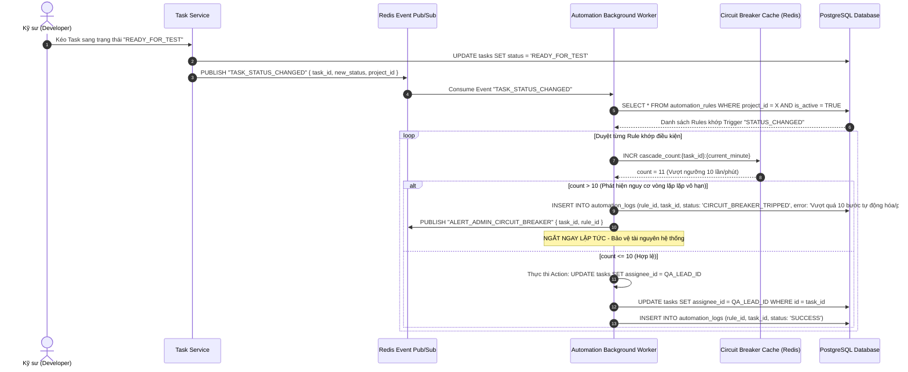
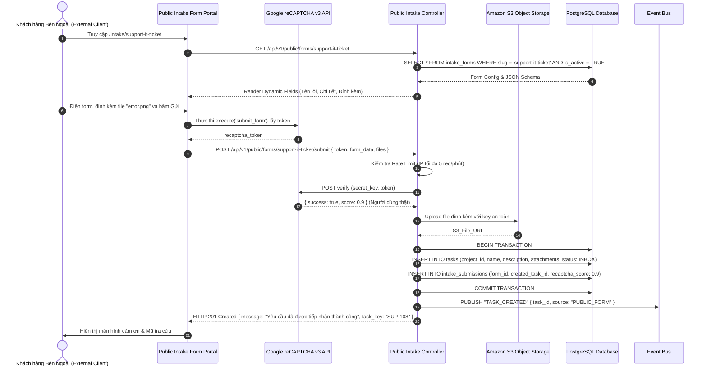

<!--
  name: 08_SRS_PHASE5_PRODUCTIVITY_TIME_AUTOMATIONS.md
  description: Software Requirements Specification (SRS) for Phase 5 - Productivity, Time & Automations (Realtime & Manual Time Tracking, Timesheet Aggregation, Smart Prioritization & Action Score Engine, Anti-Gaming Deadline Lock, No-Code Event Rule Engine with Infinite Loop Circuit Breaker, Public Forms & Task Intake with reCAPTCHA v3).
-->

# Software Requirements Specification (SRS) - OmniProject Core Phase 5: Productivity, Time & Automations

> **Document Name:** `08_SRS_PHASE5_PRODUCTIVITY_TIME_AUTOMATIONS` (Phase 5 Master Specification)  
> **Description:** Đặc tả yêu cầu phần mềm toàn diện Phase 5 — Năng suất, Quản lý Thời gian & Tự động hóa: Hệ thống bấm giờ thời gian thực (Realtime Timer) và nhập nhật ký thủ công (Manual Time Log), Bảng chấm công tuần (Weekly Timesheet) & Báo cáo thời gian (FR-PRJ-014); Mô hình giao việc phân cấp Owner vs Assignee, Thuật toán tự động xếp hạng ưu tiên (Smart Action Score) & Cơ chế chống gian lận hạn chót Anti-gaming (FR-PRJ-007); Bộ máy tự động hóa hướng sự kiện không cần mã (Event-Driven No-Code Rule Engine) kèm cơ chế cầu dao chống vòng lặp vô hạn Circuit Breaker (FR-PRJ-020); và Cổng tiếp nhận yêu cầu biểu mẫu công khai (Public Forms & Task Intake) bảo vệ bởi Google reCAPTCHA v3 & Rate Limiting (FR-PRJ-021).  
> **Reference Standards:** IEEE Std 830-1998 · INVEST · ISO/IEC 25010 (NFR) · RFC 7807 (Problem Details) · RFC 6585 (Additional HTTP Status Codes)  
> **Project:** OmniProject Core (`omnimer_team`) · **Phase:** 5 (Productivity, Time & Automations)  
> **Prerequisites:** Phase 1 (Foundation & IAM) ✅, Phase 2 (Task Lifecycle & Custom Fields) ✅, Phase 3 (Views & Collaboration) ✅, Phase 4 (Scheduling & Agile Engine) ✅  
> **RTM Companion:** [`09_RTM_PHASE5_PRODUCTIVITY_TIME_AUTOMATIONS.csv`](./09_RTM_PHASE5_PRODUCTIVITY_TIME_AUTOMATIONS.csv)  
> **Trạng thái:** `COMPREHENSIVE APPROVED SPECIFICATION` (Bao trùm toàn bộ 4/4 phân hệ FR của Phase 5)  

---

## 1. Giới Thiệu & Bản Đồ Phân Hệ (Introduction & Module Scope)

### 1.1 Mục Đích (Purpose)
Tài liệu này xác lập "Hợp Đồng Thiết Kế Kỹ Thuật Duy Nhất" (Single Unified Engineering Design Contract) giữa Bộ phận Phân tích Nghiệp vụ (BA/PO), Đội ngũ Backend (`backend_otm/project_core`), Đội ngũ Frontend (`frontend_otm/website_otm`) và Đội ngũ Kiểm thử Chất lượng (QA/QC).  
Phase 5 chuyển đổi OmniProject từ một công cụ điều phối công việc thành một **Hệ Thống Năng Suất Tối Ưu & Tự Động Hóa Thông Minh (Intelligent Productivity & Automation Engine)**:
1. **Minh bạch hóa nỗ lực thực tế (Time Tracking & Timesheet):** Đo lường chính xác thời gian thực hiện qua công cụ bấm giờ (Timer) một chạm chạy nền trên Redis và nhật ký thủ công, cung cấp góc nhìn so sánh Estimate vs Actual, tổng hợp Timesheet tuần và xuất báo cáo tài chính/lương.
2. **Sắp xếp thứ tự hành động thông minh (Smart Prioritization & Delegation):** Tách bạch rõ trách nhiệm giải trình giữa `Owner` (Chủ trì) và `Assignee` (Người làm), tự động tính toán điểm ưu tiên động `Action Score` dựa trên ma trận Eisenhower mở rộng kết hợp thời gian còn lại (Days to Deadline), đồng thời khóa chặt hạn chót ngăn chặn hành vi gian lận (Anti-gaming).
3. **Giải phóng sức lao động qua bộ luật If-This-Then-That (No-Code Automations):** Tự động hóa các thao tác lặp lại thông qua bộ máy Rule Engine hướng sự kiện (Event-Driven Background Worker), trang bị cầu dao ngắt mạch (Circuit Breaker) chống thảm họa vòng lặp vô hạn (Infinite Cascade Loop).
4. **Mở rộng biên giới tiếp nhận công việc (Public Forms & Task Intake):** Biến dự án thành cổng tiếp nhận Service Desk/Helpdesk công khai không cần cấp tài khoản người dùng, tích hợp reCAPTCHA v3 vô hình và hạn chế tần suất (Rate Limiting) để chống thư rác và tấn công DDoS.

### 1.2 Bảng Đối Soát 4 Phân Hệ FR Thuộc Phase 5 (Traceability Matrix)

| Phân Hệ | Mã FR | Tài Liệu Nguồn | Trọng Tâm Kiến Trúc & Nghiệp Vụ Cốt Lõi |
| :--- | :--- | :--- | :--- |
| **Time Tracking & Timesheet** | `FR-PRJ-014` | [`FR-PRJ-014_time_tracking.md`](./FR-PRJ-014_time_tracking.md) | Timer thời gian thực (Redis Ephemeral state), Ràng buộc tối đa 1 Timer đồng thời (`BL-PRJ-014.1`), Nhật ký thủ công giới hạn 24h/ngày và quá khứ 30 ngày (`BL-PRJ-014.2`), Đo lường Estimate vs Actual (`BL-PRJ-014.3`), Timesheet tuần phân quyền đa cấp (`BL-PRJ-014.4`), Xuất báo cáo CSV/Excel. |
| **Smart Prioritization & Delegation** | `FR-PRJ-007` | [`FR-PRJ-007_smart_prioritization.md`](./FR-PRJ-007_smart_prioritization.md) | Phân quyền 2 vai trò `owner_id` vs `assignee_id` (`BL-PRJ-007.1`), Công thức toán học tính `Action Score` tự động đẩy việc gấp lên đầu (`BL-PRJ-007.2`), Bộ lọc Smart Sort trên Personal Space, Cơ chế Anti-Gaming khóa quyền sửa Due Date của Assignee (`BL-PRJ-007.3`). |
| **No-Code Automations Engine** | `FR-PRJ-020` | [`FR-PRJ-020_nocode_automations.md`](./FR-PRJ-020_nocode_automations.md) | Trình thiết kế luật trực quan (Trigger - Condition - Action), Hàng đợi xử lý bất đồng bộ (BullMQ / Redis Worker), Cầu dao Circuit Breaker chặn vòng lặp >10 lần/phút (`BL-PRJ-020.1`), Phân quyền thực thi cấp System với phạm vi Project (`BL-PRJ-020.2`), Nhật ký Audit Log. |
| **Public Forms & Task Intake** | `FR-PRJ-021` | [`FR-PRJ-021_public_forms_intake.md`](./FR-PRJ-021_public_forms_intake.md) | Form Builder kéo thả layout JSON, Sinh Public Slug & iframe embed (`BL-PRJ-021.1`), Tự động chuyển Form Submission thành Task mới tại cột Inbox/Backlog, Bảo vệ chống bot qua Google reCAPTCHA v3 & Rate Limit 5 req/IP/min (`BL-PRJ-021.2`), Đính kèm tệp S3 tối đa 20MB. |

---

## 2. Kiến Trúc Hệ Thống & Mô Hình Dữ Liệu (System Architecture & Data Model)

### 2.1 Sơ Đồ Kiến Trúc Hệ Thống Toàn Diện Phase 5 (System Topology)



---

### 2.2 Sơ Đồ Quan Hệ Thực Thể Thực Tế (Entity Relationship Diagram - ERD)



---

### 2.3 Sơ Đồ Tuần Tự (Sequence Diagrams)

#### Sơ Đồ 1: Vòng Đời Bấm Giờ Thời Gian Thực & Cơ Chế Đơn Timer Đồng Thời (`FR-PRJ-014`)



---

#### Sơ Đồ 2: Tính Điểm Action Score & Khóa Chặn Gian Lận Hạn Chót Anti-Gaming (`FR-PRJ-007`)



---

#### Sơ Đồ 3: Bộ Máy No-Code Automation Hướng Sự Kiện & Cầu Dao Vòng Lặp Vô Hạn (`FR-PRJ-020`)



---

#### Sơ Đồ 4: Cổng Biểu Mẫu Công Khai & Tiếp Nhận Yêu Cầu An Toàn (`FR-PRJ-021`)



---

## 3. Đặc Tả Chi Tiết 4 Phân Hệ Chức Năng (Detailed Functional Requirements)

### 3.1 Phân Hệ 1: Quản Lý Thời Gian & Bảng Chấm Công (FR-PRJ-014 - Time Tracking)

#### 3.1.1 Yêu Cầu Chức Năng Chi Tiết (Functional Breakdown)
* **FR-PRJ-014.1 (Realtime Active Timer):**
  * Nút "Start Timer" hiển thị tại Task Modal và Quick Bar góc màn hình.
  * Khi bấm Start: ghi nhận trạng thái vào Redis `active_timer:{user_id}` với `task_id` và `started_at`.
  * Khi bấm Stop: tính chênh lệch thời gian, ghi dòng mới vào PostgreSQL `time_logs`, cộng dồn vào `tasks.total_logged_hours`, xóa cache Redis.
  * Hỗ trợ Pause/Resume hoặc Discard Timer (hủy phiên bấm giờ không lưu).
* **FR-PRJ-014.2 (Manual Time Logging):**
  * Cho phép người dùng nhập tay: Ngày thực hiện (`logged_date`), Số giờ/phút (`duration_minutes`), và Ghi chú nội dung công việc (`description`).
  * Kiểm soát thời gian trong quá khứ: Cho phép log lùi tối đa 30 ngày so với ngày hiện tại (`current_date - 30 days`). Cấm hoàn toàn log cho ngày tương lai (`logged_date > current_date`).
* **FR-PRJ-014.3 (Estimate vs Actual Variance Display):**
  * Thanh tiến độ trực quan: $\text{Variance Percentage} = (\text{Total Logged Hours} / \text{Estimated Hours}) \times 100$.
  * Quy tắc màu sắc:
    * $\le 100\%$: Xanh lá cây (Tiến độ nằm trong dự toán).
    * $> 100\% \text{ và } \le 120\%$: Vàng cảnh báo (Vượt nhẹ dự toán).
    * $> 120\%$: Đỏ báo động (Vượt dự toán nghiêm trọng - Cần giải trình).
* **FR-PRJ-014.4 (Weekly Timesheet Grid):**
  * Hiển thị ma trận 7 cột (Thứ 2 đến Chủ nhật) theo tuần chọn.
  * Nhóm theo Project $\to$ Task $\to$ Tổng số giờ mỗi ngày $\to$ Tổng giờ trong tuần.
  * Khả năng chỉnh sửa trực tiếp (Inline Edit) các ô giờ thủ công nếu chưa bị khóa kỳ kế toán.
* **FR-PRJ-014.5 (Time Report Export):**
  * Bộ lọc báo cáo: Khoảng thời gian (`from_date`, `to_date`), Danh sách User, Danh sách Project, Nhãn Tag.
  * Định dạng xuất file: CSV chuẩn UTF-8 kèm BOM (mở không lỗi font tiếng Việt trên Excel) và Excel `.xlsx` có sẵn công thức SUM cột.

#### 3.1.2 Quy Tắc Nghiệp Vụ Nghiêm Ngặt (Business Logic & Constraints)
* **BL-PRJ-014.1 (Ràng buộc Duy nhất 1 Timer Đồng Thời):** Một tài khoản chỉ được phép sở hữu duy nhất 1 Active Timer trên toàn bộ hệ thống. Bất kỳ thao tác Start Timer trên Task mới nào khi đang có Timer chạy dở đều kích hoạt cơ chế: **Tự động Stop Timer cũ $\to$ Ghi nhận bản ghi log cho Task cũ $\to$ Khởi động Timer Task mới**.
* **BL-PRJ-014.2 (Giới hạn Nhật Ký Công Việc 24h/Ngày):** Tổng thời gian làm việc (cả Timer và Manual) của 1 user trong một ngày dương lịch (`logged_date`) không được vượt quá 1440 phút (24 giờ). Nếu vượt, API từ chối với lỗi `HTTP 422 Unprocessable Entity` (`ERR_DAILY_TIME_EXCEEDED`).
* **BL-PRJ-014.3 (Phân Quyền Xem Bảng Chấm Công - Timesheet Visibility):**
  * `MEMBER`: Chỉ xem và chỉnh sửa Timesheet của chính mình.
  * `PROJECT_MANAGER`: Xem được toàn bộ Timesheet của mọi thành viên tham gia trong các dự án mình quản lý.
  * `WORKSPACE_ADMIN`: Xem được toàn bộ Timesheet xuyên dự án (Cross-Project) của toàn công ty.

---

### 3.2 Phân Hệ 2: Sắp Xếp Ưu Tiên & Ủy Quyền Trách Nhiệm (FR-PRJ-007 - Smart Prioritization)

#### 3.2.1 Yêu Cầu Chức Năng Chi Tiết (Functional Breakdown)
* **FR-PRJ-007.1 (Mô hình Ủy quyền Delegation: Owner vs Assignee):**
  * Mỗi Task có 2 trường định danh người dùng riêng biệt:
    * `owner_id`: Người chịu trách nhiệm kết quả cuối cùng (Accountable Leader/PM).
    * `assignee_id`: Kỹ sư trực tiếp thao tác thực hiện (Direct Executor).
  * Task có thể có `owner_id` mà chưa có `assignee_id` (Task đang chờ giao việc).
* **FR-PRJ-007.2 (Thuật toán Tính Điểm Action Score Tự Động):**
  * Công thức xác định:
    $$\text{Action Score} = (\text{Importance} + \text{Difficulty}) \times \left( \frac{1}{\max(\text{Days to Deadline}, 0.1)} \right)$$
  * Trong đó:
    * `Importance` (Độ quan trọng): Thang điểm nguyên từ 1 đến 10 (Mặc định: 5).
    * `Difficulty` (Độ phức tạp): Thang điểm nguyên từ 1 đến 10 (Mặc định: 3).
    * $\text{Days to Deadline} = \frac{\text{due\_date} - \text{current\_timestamp}}{86400\text{ giây}}$.
    * Nếu Task không có `due_date`: Mặc định gán $\text{Days to Deadline} = 30$ (Hệ số nhân = $0.033$).
    * Nếu Task đã quá hạn ($\text{Days to Deadline} \le 0$): Giá trị $\max$ trả về $0.1$, dẫn đến hệ số nhân cực đại là $\mathbf{10.0}$, đẩy điểm ưu tiên lên đột biến để cảnh báo khẩn cấp.
* **FR-PRJ-007.3 (Smart Sort View):**
  * Tích hợp chế độ sắp xếp "Smart Priority" trên Kanban (cột To Do), Virtual Table View, và màn hình Personal Space "My Work".
  * Các task có `action_score` cao nhất luôn được xếp nổi lên trên cùng.
* **FR-PRJ-007.4 (Khóa Chống Gian Lận Hạn Chót Anti-Gaming Guard):**
  * Chặn triệt để hành vi `assignee` tự ý kéo dài `due_date` để giảm điểm áp lực công việc.
  * Chỉ `owner_id`, `reporter_id` hoặc người có quyền `PROJECT_MANAGER` / `WORKSPACE_ADMIN` mới được phép cập nhật trường `due_date`.

#### 3.2.2 Quy Tắc Nghiệp Vụ Nghiêm Ngặt (Business Logic & Constraints)
* **BL-PRJ-007.1 (Trách nhiệm giải trình kép):** Khi một Task bị đánh dấu `OVERDUE`, chỉ số KPI Penalty được ghi nhận cho cả Owner và Assignee. Tuy nhiên, quyền ký duyệt gia hạn (Extension Request) thuộc về Owner.
* **BL-PRJ-007.2 (Tần suất Tái tính toán Điểm số):**
  * *Event-based:* Tái tính tức thời khi có thao tác cập nhật `importance`, `difficulty` hoặc `due_date`.
  * *Schedule-based:* Cronjob chạy ngầm vào lúc **00:00:00 (Nửa đêm)** mỗi ngày để tái tính điểm cho toàn bộ các Task đang mở (Status $\neq$ `DONE`) do biến số $\text{Days to Deadline}$ giảm đi 1 ngày.
* **BL-PRJ-007.3 (Bảo vệ Deadline Anti-Gaming):** Bất kỳ request `PATCH` cập nhật `due_date` gửi từ `assignee_id` (khi không đồng thời là Owner/PM) phải bị ngắt ngay tại tầng Guard với mã `HTTP 403 Forbidden` (`ERR_ANTI_GAMING_DEADLINE_LOCKED`).

---

### 3.3 Phân Hệ 3: Bộ Máy Tự Động Hóa Không Cần Mã (FR-PRJ-020 - No-Code Automations)

#### 3.3.1 Yêu Cầu Chức Năng Chi Tiết (Functional Breakdown)
* **FR-PRJ-020.1 (Visual Automation Rule Builder):**
  * Giao diện đồ họa cấu hình luật theo khối: **KHI (Trigger) $\to$ NẾU (Conditions) $\to$ THÌ (Actions)**.
  * Hỗ trợ bật/tắt (Toggle active) và nhân bản (Duplicate) luật nhanh.
* **FR-PRJ-020.2 (Hệ Thống Triggers Hỗ Trợ):**
  * `TASK_CREATED`: Khi task mới được tạo.
  * `STATUS_CHANGED`: Khi task đổi từ trạng thái A sang B.
  * `DUE_DATE_APPROACHING`: Khi thời gian tới hạn chót còn lại X giờ/ngày (Xử lý qua Cron Worker quét mỗi giờ).
  * `ASSIGNEE_CHANGED`: Khi task được gán hoặc đổi người làm.
  * `CUSTOM_FIELD_UPDATED`: Khi một trường dữ liệu tùy biến thay đổi giá trị.
* **FR-PRJ-020.3 (Hệ Thống Điều Kiện Conditions):**
  * Toán tử logic: `EQUALS`, `NOT_EQUALS`, `CONTAINS`, `GREATER_THAN`, `LESS_THAN`, `IS_EMPTY`, `IS_NOT_EMPTY`.
  * Kết hợp đa điều kiện qua toán tử `AND` hoặc `OR`.
* **FR-PRJ-020.4 (Hệ Thống Hành Động Actions):**
  * `CHANGE_STATUS`: Tự động chuyển task sang trạng thái đích.
  * `SET_ASSIGNEE`: Gán task cho user cụ thể hoặc Lead của bộ phận.
  * `SET_DUE_DATE_OFFSET`: Tự động cộng thêm N ngày kể từ thời điểm kích hoạt.
  * `POST_COMMENT`: Tự động bình luận hướng dẫn hoặc thông báo chuẩn hóa.
  * `SEND_WEBHOOK`: Bắn payload JSON tới Slack Incoming Webhook hoặc Microsoft Teams Connector.
* **FR-PRJ-020.5 (Automation Execution History & Auditing):**
  * Bảng lịch sử ghi vết: Thời điểm chạy, Tên Rule, Task liên quan, Trạng thái (`SUCCESS`, `FAILED`, `CIRCUIT_BREAKER_TRIPPED`), Thời gian thực thi (`duration_ms`), và Chi tiết lỗi.

#### 3.3.2 Quy Tắc Nghiệp Vụ Nghiêm Ngặt (Business Logic & Constraints)
* **BL-PRJ-020.1 (Bảo Vệ Ngắt Mạch Cầu Dao - Infinite Loop Circuit Breaker):**
  * Nhằm ngăn chặn các kịch bản vòng lặp dây chuyền vô hạn (Ví dụ: Rule 1 đổi Status sang X $\to$ Kích hoạt Rule 2 đổi sang Y $\to$ Kích hoạt lại Rule 1), hệ thống áp dụng bộ đếm trên Redis:
  * Khóa đếm: `ratelimit:automation:cascade:{task_id}:{epoch_minute}`.
  * Nếu một Task phát sinh **vượt quá 10 hành động tự động hóa trong vòng 60 giây**, Cầu dao lập tức ngắt toàn bộ chuỗi tiếp theo, đổi trạng thái log sang `CIRCUIT_BREAKER_TRIPPED`, và gửi cảnh báo khẩn cấp cho Project Manager.
* **BL-PRJ-020.2 (Quyền Hạn Thực Thi Dưới Danh Nghĩa Hệ Thống):**
  * Bot Automation thực thi với định danh `system_automation_bot`.
  * Các hành động đổi status qua Automation vẫn phải thỏa mãn các ràng buộc cốt lõi (như không được vi phạm Strict DoD của Phase 4 nếu Action cố tình chuyển sang `DONE` mà thiếu Output Deliverable).

---

### 3.4 Phân Hệ 4: Biểu Mẫu Công Khai & Tiếp Nhận Yêu Cầu (FR-PRJ-021 - Public Forms & Task Intake)

#### 3.4.1 Yêu Cầu Chức Năng Chi Tiết (Functional Breakdown)
* **FR-PRJ-021.1 (Trình Thiết Kế Biểu Mẫu Form Builder):**
  * Giao diện trực quan cho phép PM kéo thả các trường cần thu thập: Họ tên, Email, Tiêu đề yêu cầu, Mô tả chi tiết, Độ khẩn cấp, Đính kèm ảnh/tài liệu, và các Custom Fields đã định nghĩa trong Project.
  * Cho phép đặt trường Bắt buộc (Required) hoặc Tùy chọn (Optional).
* **FR-PRJ-021.2 (Chia Sẻ & Nhúng Biểu Mẫu Công Khai):**
  * Sinh đường link ngẫu nhiên an toàn hoặc tùy biến: `https://app.omnimer.com/intake/:slug`.
  * Cung cấp đoạn mã nhúng `<iframe>` để tích hợp trực tiếp vào Website công ty hoặc Cổng thông tin nội bộ.
  * Nút gạt bật/tắt (Active/Inactive): Khi tắt, người ngoài truy cập nhận thông báo "Biểu mẫu tạm thời ngừng tiếp nhận phản hồi".
* **FR-PRJ-021.3 (Tự Động Sinh Nhiệm Vụ - Task Auto-Creation):**
  * Mỗi lượt submit hợp lệ tự động khởi tạo 1 Task mới trong Project đích.
  * Task được đặt mặc định tại Trạng thái tiếp nhận đầu vào (Ví dụ: Cột `INBOX` hoặc `BACKLOG`).
  * Ghi chú nguồn gốc: `origin: PUBLIC_FORM`, lưu vết email submitter và IP hash.
* **FR-PRJ-021.4 (Bảo Vệ Chống Bot & Thư Rác - reCAPTCHA v3 & Rate Limiting):**
  * Tích hợp Google reCAPTCHA v3 vô hình (Invisible), không làm phiền người dùng bằng câu đố hình ảnh.
  * Ngưỡng chấp thuận: `score >= 0.5`. Nếu dưới 0.5, từ chối với lỗi `HTTP 400 Bad Request` (`ERR_BOT_SUBMISSION_REJECTED`).
  * Áp dụng Rate Limit tại API Gateway: Tối đa **5 lượt gửi / 1 địa chỉ IP / 1 phút**.
* **FR-PRJ-021.5 (Tải Lên Tệp Tin An Toàn Lên Đến 20MB):**
  * Cho phép đính kèm tối đa 5 file, mỗi file không quá 20MB.
  * Quy trình tải lên qua S3 Presigned URL, kiểm tra MIME Type hợp lệ (Chặn file thực thi `.exe`, `.sh`, `.bat`, `.js`).

#### 3.4.2 Quy Tắc Nghiệp Vụ Nghiêm Ngặt (Business Logic & Constraints)
* **BL-PRJ-021.1 (Kiểm Soát Vòng Đời Biểu Mẫu):** Biểu mẫu thuộc quyền sở hữu của Project. Nếu Project bị lưu trữ (`ARCHIVED`) hoặc Form bị tắt `is_active = FALSE`, API ném lỗi `HTTP 410 Gone`.
* **BL-PRJ-021.2 (Bảo Vệ Tính Toàn Vẹn Không Gian Dữ Liệu):** Dữ liệu gửi từ Public Form là dữ liệu không tin cậy (Untrusted Input). Hệ thống bắt buộc chạy qua bộ khử khuẩn HTML (HTML Sanitizer) để triệt tiêu nguy cơ XSS trước khi lưu vào Database và render lên Kanban board của team.

---

## 4. Đặc Tả Giao Diện Lập Trình Toàn Diện (REST API Contracts Cho Cả 4 Phân Hệ)

### 4.1 Phân Hệ Time Tracking & Timesheet (`/api/v1/time-tracking`)

#### 4.1.1 Bắt Đầu Bấm Giờ (Start Timer)
* **Endpoint:** `POST /api/v1/time-tracking/start`
* **Quyền hạn:** `MEMBER`, `PROJECT_MANAGER`, `WORKSPACE_ADMIN`
* **Request Body:**
  ```json
  {
    "task_id": "b3e21820-c8f2-4a92-938b-90f7a75c1234"
  }
  ```
* **Response `200 OK` (Bắt đầu thành công):**
  ```json
  {
    "status": "RUNNING",
    "task_id": "b3e21820-c8f2-4a92-938b-90f7a75c1234",
    "started_at": "2026-11-08T08:30:00.000Z",
    "auto_stopped_previous_task_id": "a1d10920-f1a2-4b81-817a-80e6b64b5678"
  }
  ```
* **Error Response `404 Not Found`:** Khi `task_id` không tồn tại hoặc đã bị xóa.

#### 4.1.2 Dừng Bấm Giờ (Stop Timer)
* **Endpoint:** `POST /api/v1/time-tracking/stop`
* **Request Body:**
  ```json
  {
    "description": "Thực hiện refactor module xác thực và viết unit test"
  }
  ```
* **Response `200 OK`:**
  ```json
  {
    "log_id": "f5c22810-d8e1-4c91-928a-71e6c64b9999",
    "task_id": "b3e21820-c8f2-4a92-938b-90f7a75c1234",
    "duration_minutes": 135,
    "logged_hours": 2.25,
    "total_task_logged_hours": 8.5,
    "stopped_at": "2026-11-08T10:45:00.000Z"
  }
  ```
* **Error Response `409 Conflict`:** Khi user không có Timer nào đang chạy.

#### 4.1.3 Lấy Trạng Thái Timer Đang Chạy Của Bản Thân
* **Endpoint:** `GET /api/v1/time-tracking/active`
* **Response `200 OK` (Có timer đang chạy):**
  ```json
  {
    "is_active": true,
    "task_id": "b3e21820-c8f2-4a92-938b-90f7a75c1234",
    "task_name": "Implement Anti-Gaming Check in Due Date API",
    "project_id": "c1f23820-e9a3-4b92-817a-90e6b64b1111",
    "started_at": "2026-11-08T08:30:00.000Z",
    "elapsed_seconds": 4500
  }
  ```
* **Response `200 OK` (Không có timer):**
  ```json
  {
    "is_active": false
  }
  ```

#### 4.1.4 Nhập Nhật Ký Thủ Công (Manual Time Log)
* **Endpoint:** `POST /api/v1/time-tracking/manual`
* **Request Body:**
  ```json
  {
    "task_id": "b3e21820-c8f2-4a92-938b-90f7a75c1234",
    "logged_date": "2026-11-07",
    "duration_minutes": 180,
    "description": "Họp trao đổi giải pháp kiến trúc với khách hàng"
  }
  ```
* **Response `201 Created`:** Trả về đối tượng `Time_Log` vừa lưu.
* **Error Response `422 Unprocessable Entity`:** Khi tổng thời gian trong ngày vượt 24h hoặc ngày log lùi quá 30 ngày.

#### 4.1.5 Xem Tổng Hợp Bảng Chấm Công Tuần (Weekly Timesheet)
* **Endpoint:** `GET /api/v1/timesheet?start_date=2026-11-02&end_date=2026-11-08&user_id=UUID`
* **Response `200 OK`:** Ma trận tổng hợp số phút/giờ theo từng task và từng ngày trong tuần.

---

### 4.2 Phân Hệ Smart Prioritization & Delegation (`/api/v1/tasks`)

#### 4.2.1 Ủy Quyền & Thiết Lập Trọng Số Ưu Tiên
* **Endpoint:** `PATCH /api/v1/tasks/:id/prioritization`
* **Quyền hạn:** `owner_id`, `reporter_id`, `PROJECT_MANAGER`, `WORKSPACE_ADMIN`
* **Request Body:**
  ```json
  {
    "owner_id": "8a1e2020-f1a2-4b81-817a-80e6b64b1111",
    "assignee_id": "9b2f3030-e2b3-4c92-928b-91f7c75c2222",
    "importance": 8,
    "difficulty": 5
  }
  ```
* **Response `200 OK`:** Trả về Task kèm `action_score` mới được tự động tính toán.

#### 4.2.2 Cập Nhật Hạn Chót (Có Bộ Lọc Anti-Gaming)
* **Endpoint:** `PATCH /api/v1/tasks/:id/due-date`
* **Request Body:**
  ```json
  {
    "due_date": "2026-11-15T17:00:00.000Z"
  }
  ```
* **Response `200 OK`:** Khi người gọi là Owner, Reporter hoặc PM/Admin.
* **Error Response `403 Forbidden` (Anti-gaming Lock):**
  ```json
  {
    "type": "https://api.omnimer.com/errors/anti-gaming-deadline-lock",
    "title": "Forbidden Deadline Modification",
    "status": 403,
    "detail": "Người thực thi (Assignee) không được phép tự ý thay đổi hạn chót. Vui lòng liên hệ Owner hoặc PM.",
    "instance": "/api/v1/tasks/b3e21820-c8f2-4a92-938b-90f7a75c1234/due-date"
  }
  ```

#### 4.2.3 Kích Hoạt Tái Tính Toán Action Score Toàn Dự Án
* **Endpoint:** `POST /api/v1/projects/:id/tasks/recalculate-scores`
* **Quyền hạn:** `PROJECT_MANAGER`, `WORKSPACE_ADMIN` hoặc Internal Cronjob
* **Response `200 OK`:**
  ```json
  {
    "project_id": "c1f23820-e9a3-4b92-817a-90e6b64b1111",
    "tasks_processed": 142,
    "execution_time_ms": 38
  }
  ```

---

### 4.3 Phân Hệ No-Code Automations (`/api/v1/automations`)

#### 4.3.1 Khởi Tạo Luật Tự Động Hóa (Create Rule)
* **Endpoint:** `POST /api/v1/projects/:id/automations`
* **Request Body:**
  ```json
  {
    "name": "Auto Assign to QA Lead when Status is Ready for Test",
    "trigger_type": "STATUS_CHANGED",
    "trigger_config": {
      "to_status": "READY_FOR_TEST"
    },
    "condition_config": {
      "operator": "AND",
      "rules": [
        {
          "field": "importance",
          "operator": "GREATER_THAN_OR_EQUAL",
          "value": 5
        }
      ]
    },
    "action_config": [
      {
        "type": "SET_ASSIGNEE",
        "params": {
          "user_id": "7a0d1010-e1a1-4a71-806a-70d5a53a0000"
        }
      },
      {
        "type": "POST_COMMENT",
        "params": {
          "message": "Nhiệm vụ đã được tự động chuyển cho QA Lead do có độ quan trọng >= 5."
        }
      }
    ]
  }
  ```
* **Response `201 Created`:** Trả về đối tượng `Automation_Rule` vừa tạo kèm `is_active: true`.

#### 4.3.2 Xem Lịch Sử Chạy Của Luật (Execution Logs)
* **Endpoint:** `GET /api/v1/automations/:id/logs?limit=50`
* **Response `200 OK`:** Danh sách log gồm `status`, `task_id`, `duration_ms`, `error_message`, `executed_at`.

---

### 4.4 Phân Hệ Public Forms & Intake (`/api/v1/public/forms` & `/api/v1/intake-forms`)

#### 4.4.1 Cấu Hình Biểu Mẫu (Dành Cho PM)
* **Endpoint:** `POST /api/v1/projects/:id/intake-forms`
* **Request Body:**
  ```json
  {
    "title": "Cổng Báo Lỗi Phần Mềm IT Support",
    "slug": "it-support-ticket",
    "description": "Vui lòng mô tả lỗi và đính kèm ảnh chụp màn hình",
    "target_status_id": "status-inbox-uuid",
    "recaptcha_enabled": true,
    "field_mappings": [
      { "field_key": "name", "label": "Tóm tắt sự cố", "type": "TEXT", "required": true },
      { "field_key": "description", "label": "Chi tiết các bước bị lỗi", "type": "RICH_TEXT", "required": true },
      { "field_key": "custom_urgency", "label": "Mức độ ảnh hưởng", "type": "SELECT", "options": ["Thấp", "Trung bình", "Khẩn cấp"], "required": false }
    ]
  }
  ```
* **Response `201 Created`:** Trả về cấu hình form kèm `public_url: "https://app.omnimer.com/intake/it-support-ticket"`.

#### 4.4.2 Lấy Cấu Hình Form Công Khai (Không Cần Đăng Nhập)
* **Endpoint:** `GET /api/v1/public/forms/:slug`
* **Authentication:** Không yêu cầu (Public Access)
* **Response `200 OK`:** Trả về tiêu đề, hướng dẫn và JSON layout các trường cần render.
* **Error Response `410 Gone`:** Khi biểu mẫu đã bị tắt `is_active = false`.

#### 4.4.3 Tiếp Nhận Lượt Điền Biểu Mẫu (Public Submission)
* **Endpoint:** `POST /api/v1/public/forms/:slug/submit`
* **Authentication:** Không yêu cầu (Bảo vệ qua reCAPTCHA v3 & Rate Limit)
* **Request Headers:**
  * `X-Forwarded-For`: IP của người gửi (dùng để Rate Limit 5 req/phút)
* **Request Body:**
  ```json
  {
    "recaptcha_token": "03AFcWeA...",
    "data": {
      "name": "Không thể đăng nhập vào cổng VPN",
      "description": "Nhập đúng OTP nhưng báo lỗi timeout 504",
      "custom_urgency": "Khẩn cấp"
    },
    "attachment_urls": [
      "https://s3.ap-southeast-1.amazonaws.com/omnimer-intake/screenshots/error-screen.png"
    ]
  }
  ```
* **Response `201 Created`:**
  ```json
  {
    "success": true,
    "message": "Yêu cầu của bạn đã được ghi nhận vào hệ thống.",
    "ticket_reference": "PRJ-TASK-182"
  }
  ```
* **Error Response `429 Too Many Requests`:** Khi IP vượt quá 5 lượt submit / phút.
* **Error Response `400 Bad Request`:** Khi token reCAPTCHA không hợp lệ hoặc điểm số bot < 0.5.

---

## 5. Yêu Cầu Phi Chức Năng (Non-Functional Requirements - NFRs)

Tuân thủ nghiêm ngặt bộ tiêu chuẩn **ISO/IEC 25010**:

| Mã NFR | Danh Mục Chuẩn | Tiêu Chuẩn Kỹ Thuật & Ngưỡng Định Lượng |
| :--- | :--- | :--- |
| **NFR-P5-PERF-01** | **Performance (Độ trễ API)** | Thời gian phản hồi API Timer Start/Stop $\le 50\text{ms}$ (sử dụng Redis). API tính Action Score hàng loạt cho 1.000 tasks $\le 300\text{ms}$. |
| **NFR-P5-PERF-02** | **Throughput & Queue** | Background Worker của No-Code Automations xử lý tối thiểu $200\text{ jobs/giây}$ với độ trễ hàng đợi $\le 500\text{ms}$. |
| **NFR-P5-SEC-01** | **Anti-Gaming Integrity** | Khóa chặt trường `due_date` ở cả tầng Middleware API và Database Trigger, không cho phép bypass qua bất kỳ phương thức HTTP nào. |
| **NFR-P5-SEC-02** | **Bot & Abuse Protection** | 100% lượt gửi Public Form phải đi qua xác minh reCAPTCHA v3 và Rate Limiter tại bộ đệm Redis. |
| **NFR-P5-SEC-03** | **Data Sanitization** | Toàn bộ dữ liệu nhập từ Public Form phải được khử khuẩn qua thư viện `DOMPurify` / `sanitize-html` để ngăn chặn hoàn toàn tấn công Stored XSS. |
| **NFR-P5-REL-01** | **Circuit Breaker Safety** | Tự động cô lập và ngắt chuỗi Automation nếu vượt ngưỡng 10 lần kích hoạt/task/phút, đảm bảo CPU server không bao giờ chạm mức 100% do lặp vô hạn. |
| **NFR-P5-CMP-01** | **Export Compatibility** | File CSV xuất từ Timesheet phải mã hóa UTF-8 kèm Byte Order Mark (BOM) để tương thích hoàn hảo với Microsoft Excel trên cả Windows và macOS. |

---

## 6. Tiêu Chí Chấp Nhận & Kịch Bản Gherkin Bổ Sung (Acceptance Scenarios)

### Kịch Bản 1: Bấm Giờ Realtime Tự Động Dừng Timer Cũ
```gherkin
Feature: Realtime Time Tracking & Single Active Timer Constraint
  Scenario: Thành viên bấm giờ cho Task B trong khi Task A đang chạy
    Given Tôi đang có một Timer đang chạy trên "Task A" từ lúc 09:00:00
    And Thời điểm hiện tại của hệ thống là 10:30:00
    When Tôi truy cập vào "Task B" và bấm "Start Timer"
    Then Hệ thống tự động ghi nhận một bản ghi Time Log cho "Task A" với thời lượng là 90 phút
    And Bộ đệm Timer của "Task A" bị hủy bỏ
    And Một Timer mới được bắt đầu cho "Task B" với mốc thời gian là 10:30:00
    And Trên giao diện hiển thị biểu tượng đồng hồ đang đếm cho "Task B"
```

### Kịch Bản 2: Ngăn Chặn Gian Lận Hạn Chót (Anti-Gaming)
```gherkin
Feature: Anti-Gaming Deadline Protection
  Scenario: Assignee cố tình lùi deadline để né việc bị đưa lên đầu danh sách ưu tiên
    Given Tôi là thành viên được gán làm việc (Assignee) trên "Task 501"
    And Tôi không phải là Người chịu trách nhiệm (Owner) và không phải Project Manager
    When Tôi gửi yêu cầu PATCH thay đổi due_date của "Task 501" sang tuần sau
    Then Hệ thống từ chối yêu cầu và phản hồi mã lỗi HTTP 403 Forbidden
    And Thông báo lỗi nêu rõ: "Chỉ Owner hoặc PM mới được quyền điều chỉnh hạn chót"
    And Giá trị due_date và action_score của "Task 501" được giữ nguyên không thay đổi
```

### Kịch Bản 3: Cầu Dao Ngắt Mạch Tự Động Hóa (Circuit Breaker)
```gherkin
Feature: No-Code Automation Infinite Loop Circuit Breaker
  Scenario: Hai luật tự động hóa vô tình tạo ra chuỗi kích hoạt lặp chéo liên tục
    Given Có Rule 1 chuyển status sang IN_REVIEW khi có comment
    And Có Rule 2 tự động thêm comment khi status chuyển sang IN_REVIEW
    When Kỹ sư bắt đầu kích hoạt chuỗi bằng việc thêm một comment
    Then Hệ thống thực thi chuỗi tự động lặp lại tối đa 10 lần trong 1 phút
    And Đến lần kích hoạt thứ 11, bộ ngắt mạch Circuit Breaker lập tức can thiệp và dừng chuỗi
    And Bản ghi nhật ký Automation Log ghi nhận trạng thái "CIRCUIT_BREAKER_TRIPPED"
    And Một thông báo cảnh báo đỏ được gửi đến Project Manager về nguy cơ vòng lặp vô hạn
```

### Kịch Bản 4: Tiếp Nhận Yêu Cầu Từ Biểu Mẫu Công Khai & Lọc Thư Rác
```gherkin
Feature: Public Intake Form & Spam Protection
  Scenario: Người dùng bên ngoài gửi yêu cầu hợp lệ qua Public Form
    Given Biểu mẫu tiếp nhận "Hỗ trợ khách hàng" đang ở trạng thái kích hoạt (Active)
    When Người dùng bên ngoài truy cập đường link "/intake/support-ticket"
    And Điền đầy đủ tiêu đề "Lỗi thanh toán MoMo", mô tả chi tiết và gửi kèm ảnh chụp
    And Điểm số reCAPTCHA v3 của phiên gửi đạt 0.95
    Then Hệ thống tiếp nhận thành công và phản hồi thông điệp "Cảm ơn bạn đã gửi yêu cầu"
    And Một Task mới tự động được tạo ra tại cột "Inbox" của dự án Hỗ trợ Khách hàng
    And File ảnh chụp được gắn an toàn vào mục Attachments của Task
```
