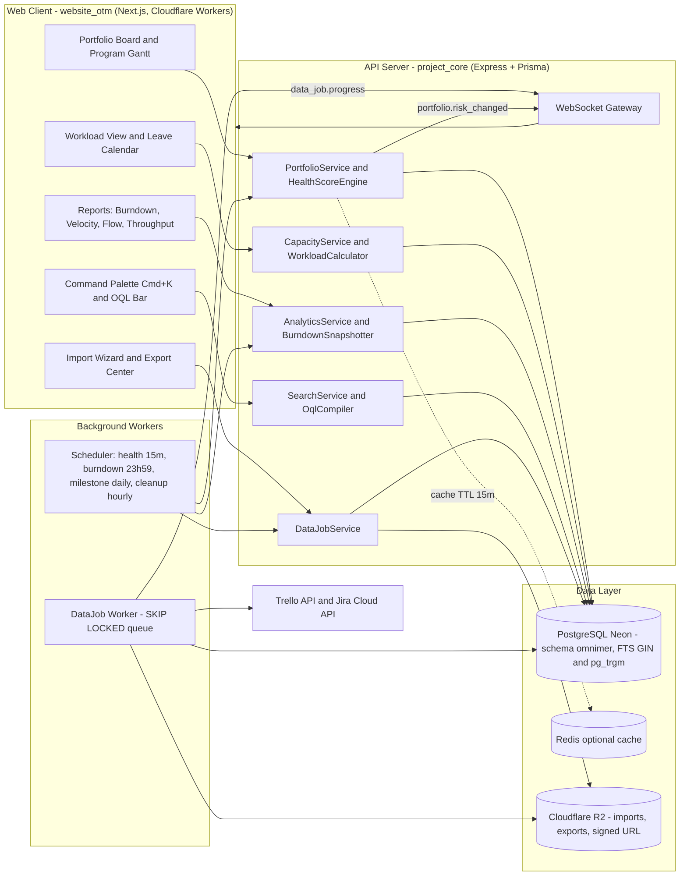
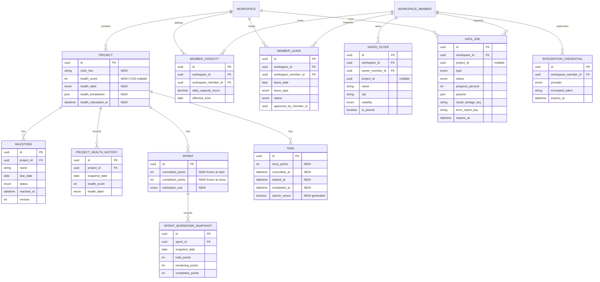
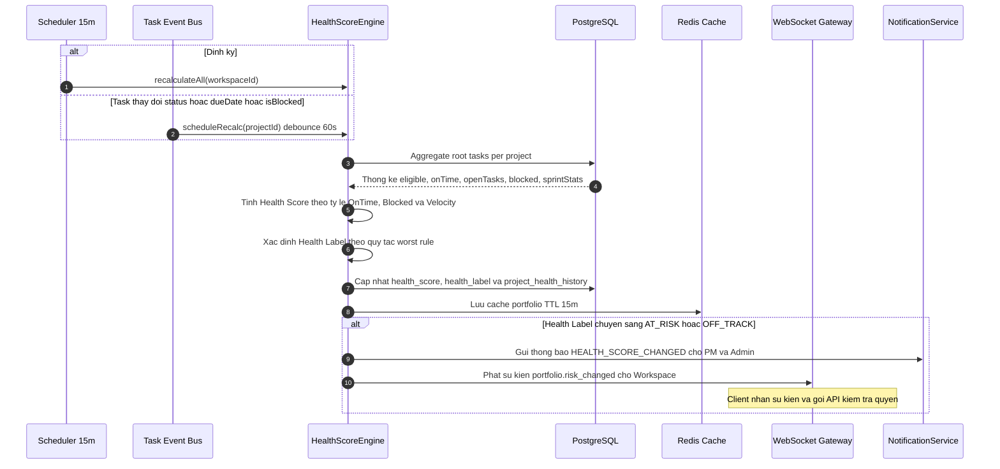
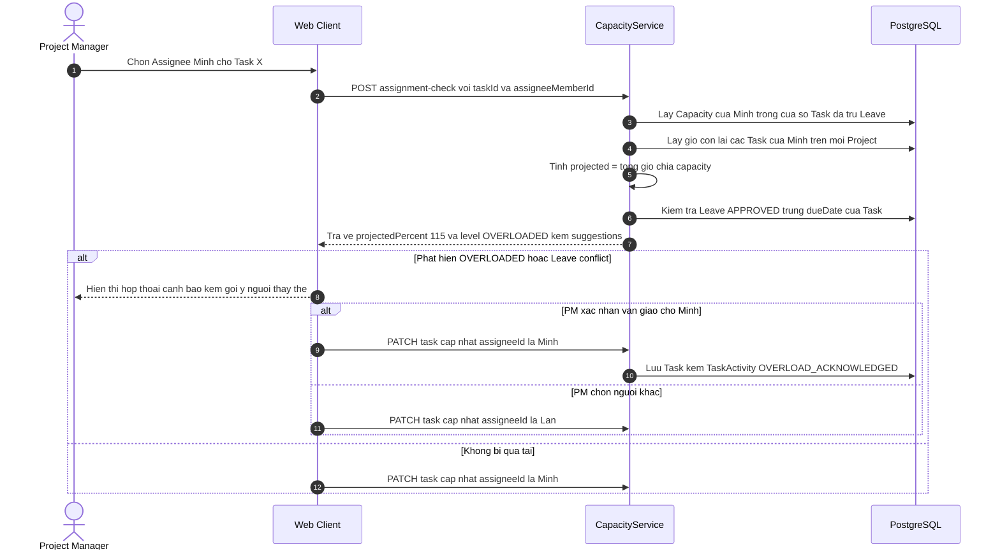
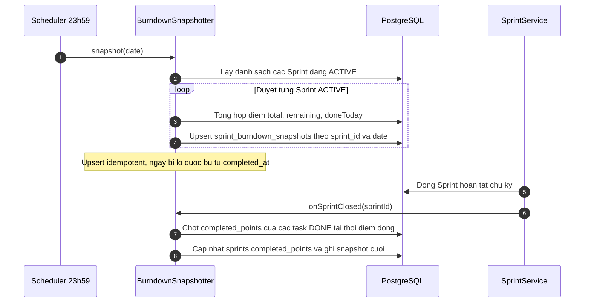
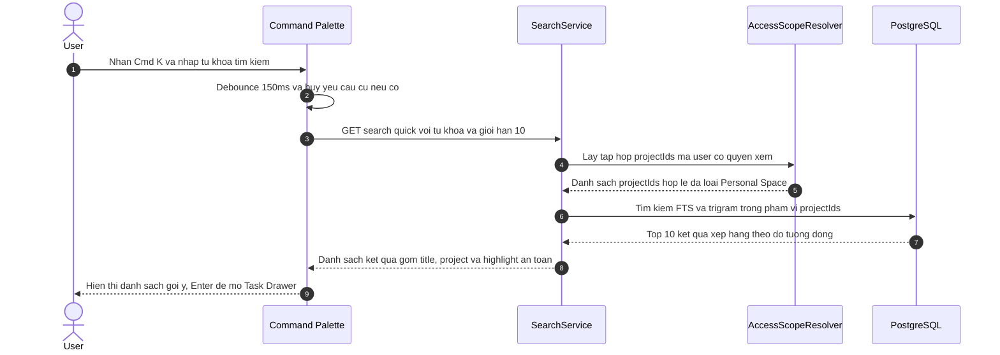
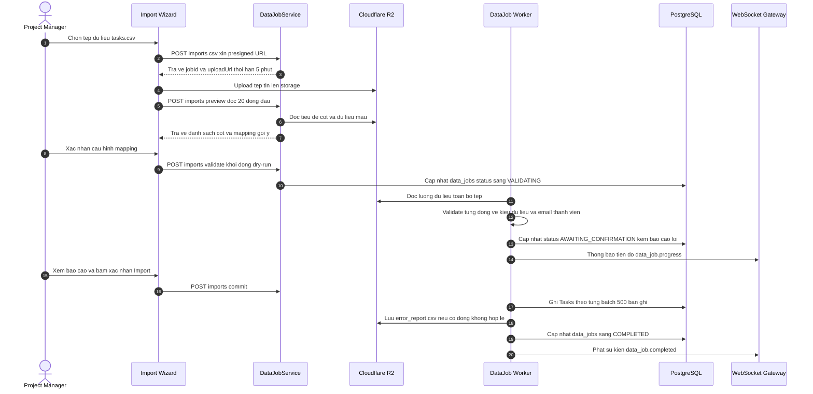

<!--
  name: 10_SRS_PHASE6_PORTFOLIO_ANALYTICS_INTEGRATIONS.md
  description: Software Requirements Specification (SRS) for Phase 6 - Cross-Project, Analytics & Integrations (Portfolio Dashboard & Health Score, Milestones, Resource Capacity & Leave, Burndown/Velocity/Flow Metrics & Report Export, Global Search & OQL & Saved Filters, Data Import/Export & Migration Pipeline).
-->

# Software Requirements Specification (SRS) - OmniProject Core Phase 6: Cross-Project, Analytics & Integrations

> **Document Name:** `10_SRS_PHASE6_PORTFOLIO_ANALYTICS_INTEGRATIONS` (Phase 6 Master Specification)  
> **Description:** Đặc tả yêu cầu phần mềm toàn diện Phase 6 — Quản trị Danh mục, Phân tích & Tích hợp: Portfolio Board, Program Gantt, Risk Radar tổng hợp, Project Health Score & Milestone (FR-PRJ-010); Workload View, Availability Calendar, Overload Warning, Cross-Project Workload & Gợi ý Re-assign (FR-PRJ-011); Burndown, Velocity, Lead/Cycle Time, Throughput & Export báo cáo bất đồng bộ (FR-PRJ-012); Quick Search `Cmd+K`, Full-text Search, Omni Query Language (OQL) & Saved Filters (FR-PRJ-019); Import CSV/Excel, Trello/Jira Importer & Full Project Export ZIP (FR-PRJ-022).  
> **Reference Standards:** IEEE Std 830-1998 · INVEST · ISO/IEC 25010 (NFR) · RFC 7807 (Problem Details) · RFC 4180 (CSV) · OWASP CSV Injection · OAuth 2.0 (RFC 6749)  
> **Project:** OmniProject Core (`omnimer_team`) · **Phase:** 6 (Cross-Project, Analytics & Integrations)  
> **Prerequisites:** Phase 1 ✅ · Phase 2 ✅ · Phase 3 ✅ · Phase 4 (Sprint, Dependencies, Calendar) ✅ · Phase 5 (Time Tracking, Action Score, Automations, Intake) ✅  
> **RTM Companion:** [`11_RTM_PHASE6_PORTFOLIO_ANALYTICS_INTEGRATIONS.csv`](./11_RTM_PHASE6_PORTFOLIO_ANALYTICS_INTEGRATIONS.csv)  
> **Trạng thái:** `DRAFT FOR REVIEW` (Bao trùm 5/5 phân hệ FR — 24 sub-features; các quyết định giả định được đánh dấu `[ASSUMPTION]` cần PO xác nhận)

---

## 1. Giới Thiệu & Bản Đồ Phân Hệ (Introduction & Module Scope)

### 1.1 Mục Đích (Purpose)
Tài liệu là hợp đồng thiết kế duy nhất giữa BA/PO, Backend (`backend_otm/project_core`), Frontend (`frontend_otm/website_otm`) và QA/QC cho Phase 6. Phase 6 nâng OmniProject từ công cụ thực thi cấp dự án lên **tầng quản trị cấp tổ chức (Organization-level PMIS)**:
1. **Nhìn toàn cảnh danh mục (Portfolio):** PMO/C-level theo dõi sức khỏe nhiều dự án trên một màn hình, phát hiện rủi ro xuyên dự án mà không cần mở từng dự án.
2. **Cân bằng nguồn lực (Capacity):** PM thấy tải thực của từng người **xuyên mọi dự án trong Workspace**, tránh giao việc cho người quá tải hoặc đang nghỉ phép.
3. **Ra quyết định dựa trên dữ liệu (Analytics):** Burndown, Velocity, Lead/Cycle Time, Throughput chuẩn Agile/Lean, xuất báo cáo CSV/PDF.
4. **Định vị thông tin tức thì (Search & OQL):** `Cmd+K` ở mọi màn hình, tìm full-text trong mô tả/bình luận/tên tệp, ngôn ngữ truy vấn OQL và bộ lọc lưu sẵn — luôn tuân thủ RBAC.
5. **Giảm rào cản chuyển đổi (Migration):** Nhập dữ liệu từ CSV/Excel, Trello, Jira và xuất toàn bộ dự án (data portability).

### 1.2 Bảng Đối Soát 5 Phân Hệ FR Thuộc Phase 6

| Phân Hệ | Mã FR | Tài Liệu Nguồn | Trọng Tâm Kiến Trúc & Nghiệp Vụ | Ưu tiên Phase 6 |
| :--- | :--- | :--- | :--- | :--- |
| **Portfolio & Multi-Project Dashboard** | `FR-PRJ-010` | [`FR-PRJ-010_portfolio_multi_project.md`](./FR-PRJ-010_portfolio_multi_project.md) | Read-model tổng hợp + cache, Health Score 0–100 (`BL-PRJ-010.3`), phân loại On Track/At Risk/Off Track (`BL-PRJ-010.1`), Program Gantt cấp Project/Sprint/Milestone (`BL-PRJ-010.2`), phạm vi quyền (`BL-PRJ-010.4`) | Must |
| **Resource & Capacity Management** | `FR-PRJ-011` | [`FR-PRJ-011_resource_capacity.md`](./FR-PRJ-011_resource_capacity.md) | Công thức Workload % (`BL-PRJ-011.1`), Leave immutability (`BL-PRJ-011.2`), tổng hợp cross-project (`BL-PRJ-011.3`), cảnh báo mềm (không chặn giao việc) | Must |
| **Reporting & Analytics** | `FR-PRJ-012` | [`FR-PRJ-012_reporting_analytics.md`](./FR-PRJ-012_reporting_analytics.md) | Snapshot burndown append-only (`BL-PRJ-012.1`), Velocity chốt tại thời điểm đóng Sprint (`BL-PRJ-012.2`), mốc thời gian vòng đời Task (`BL-PRJ-012.3`), Export async + signed URL 24h (`BL-PRJ-012.4`) | Must |
| **Global Search & Advanced Filtering** | `FR-PRJ-019` | [`FR-PRJ-019_global_search_filtering.md`](./FR-PRJ-019_global_search_filtering.md) | PostgreSQL Full-Text Search + `pg_trgm`, lọc RBAC/Private tại tầng truy vấn (`BL-PRJ-019.1`), OQL parser → Prisma `where` an toàn (`BL-PRJ-019.2`), Saved Filters chia sẻ | Must (019.1–019.2), Should (019.3–019.4) |
| **Data Import, Export & Migration** | `FR-PRJ-022` | [`FR-PRJ-022_data_import_export.md`](./FR-PRJ-022_data_import_export.md) | Data Job pipeline bất đồng bộ, dry-run thẩm định toàn vẹn dữ liệu, Member mapping fallback, OAuth token mã hóa, ZIP streaming | Must (022.1, 022.4), Should (022.2), Could (022.3) |

### 1.3 Định Nghĩa & Thuật Ngữ (Definitions)

| Thuật ngữ | Định nghĩa |
| :--- | :--- |
| **Portfolio** | Tập hợp các Project không phải template, không bị xóa, không phải Personal Space trong một Workspace. |
| **Root Task** | Task có `parentTaskId = null`. Mọi chỉ số Health/Velocity/Throughput chỉ tính Root Task (nhất quán với WIP rule Phase 2). |
| **Health Score** | Điểm 0–100 phản ánh sức khỏe dự án (`BL-PRJ-010.3`). |
| **Health Label** | `ON_TRACK` / `AT_RISK` / `OFF_TRACK` / `NO_DATA` theo luật phân loại (`BL-PRJ-010.1`). |
| **Capacity** | Số giờ làm việc khả dụng của một thành viên trong một kỳ, đã trừ ngày nghỉ được duyệt. |
| **Workload %** | Tỷ lệ giờ việc còn lại được giao / Capacity trong kỳ. |
| **Story Point (SP)** | Đơn vị ước lượng effort theo dãy Fibonacci (1, 2, 3, 5, 8, 13). |
| **System Lead Time / Delivery Lead Time / Cycle Time** | Khoảng thời gian từ tạo / cam kết (TODO) / bắt đầu (IN_PROGRESS) đến DONE. |
| **OQL** | Omni Query Language — ngôn ngữ truy vấn dạng text để lọc Task. |
| **Data Job** | Tiến trình nền cho Import/Export/Report có trạng thái, tiến độ và kết quả. |

### 1.4 Quyết Định Thiết Kế & Giả Định (Design Decisions & Assumptions)

> [!IMPORTANT]
> Các mục dưới đây là quyết định của BA/SA nhằm lấp khoảng trống hoặc giải quyết mâu thuẫn trong tài liệu FR gốc. PO cần xác nhận trước khi chuyển sang `APPROVED`.

| ID | Quyết định | Lý do (Scalability · Efficiency · Maintainability) |
| :--- | :--- | :--- |
| **DD-P6-01** | Full-text Search dùng **PostgreSQL FTS (`tsvector` + GIN) + `pg_trgm`** thay vì ElasticSearch/Meilisearch như FR-PRJ-019 §3 gợi ý. | Không thêm hạ tầng/đồng bộ CDC; đáp ứng tốt ≤ 1 triệu Task/Workspace (10x tải hiện tại); RBAC áp dụng trực tiếp trong cùng câu truy vấn nên không có nguy cơ lệch quyền giữa 2 kho. Có thể nâng cấp sang search engine riêng sau qua interface `SearchProvider`. |
| **DD-P6-02** | Hàng đợi Import/Export/Report dùng **bảng `data_jobs` trong PostgreSQL + worker `SELECT … FOR UPDATE SKIP LOCKED`** thay vì RabbitMQ như FR-PRJ-022 §2. | Hạ tầng hiện tại cho phép chạy không cần Redis (`ALLOW_REDIS_FALLBACK`); job có trạng thái bền vững, truy vết được, retry an toàn; không thêm broker mới. |
| **DD-P6-03** | Cảnh báo Overload là **cảnh báo mềm, không chặn**. Bỏ endpoint `POST /tasks/{id}/confirm-overload` ở FR-PRJ-011 §4; thay bằng **preflight** `POST /workload/assignment-check` trước khi gán. | Sequence gốc vừa trả 200 (đã lưu) vừa yêu cầu "xác nhận" — mâu thuẫn. Preflight không thay đổi dữ liệu, giữ PATCH Task idempotent. |
| **DD-P6-04** | `Health Label` được xác định bởi luật `BL-PRJ-010.1` (worst-rule-wins); `Health Score` hiển thị dạng số và màu theo ngưỡng `BL-PRJ-010.3`. Hai chỉ số được trả về độc lập. | Ngưỡng gốc của Label (80/60) và Score (80/50) khác nhau; tách riêng tránh hiển thị mâu thuẫn. `[ASSUMPTION]` |
| **DD-P6-05** | `Velocity_Factor` = `min(1, avg(completed_points / committed_points))` của tối đa 3 Sprint CLOSED gần nhất; nếu dự án không dùng Sprint: `min(1, done_14d / max(1, created_14d))`. | FR gốc không định nghĩa `Velocity_Factor`. `[ASSUMPTION]` |
| **DD-P6-06** | Workload dùng **giờ còn lại** = `max(estimatedHours − totalLoggedHours, 0)`; Task không có ước lượng = **4h** (`BL-PRJ-011.1`). Giờ được **chia đều** cho các ngày làm việc trong cửa sổ `[startDate ?? dueDate, dueDate]`. Task không có `dueDate` được thống kê riêng ở "Unscheduled". | Phản ánh tải thực tế thay vì tải gốc; tận dụng `totalLoggedHours` của Phase 5. `[ASSUMPTION]` |
| **DD-P6-07** | Task thuộc **Personal Space** của thành viên được tính vào workload nhưng PM chỉ thấy **tổng giờ**, không thấy tiêu đề/chi tiết. | Phản ánh tải thật mà vẫn bảo vệ quyền riêng tư (`BL-PRJ-008.4`, Private Task Phase 3). |
| **DD-P6-08** | Ngày làm việc = Thứ 2–Thứ 6 theo múi giờ Workspace. Lịch nghỉ lễ quốc gia **ngoài phạm vi** Phase 6 (dùng Leave để thay thế). | Giảm phạm vi; "business hours" của `BL-PRJ-012.3` được tính bằng thời gian trôi qua loại trừ Thứ 7/CN. `[ASSUMPTION]` |
| **DD-P6-09** | FR-PRJ-022 ghi "Phase 2 (Backlog)" nhưng Roadmap đặt ở Phase 6. Phạm vi Phase 6: **CSV Import + Full Export = Must**, **Trello = Should**, **Jira = Could** (có thể dời Phase 7). | Kiểm soát scope creep đúng tinh thần ghi chú gốc. |
| **DD-P6-10** | Schema hiện tại **chưa có** `Task.key` (VD `TRI-1`). Quick Search theo "ID" hỗ trợ UUID đầy đủ/tiền tố ≥ 8 ký tự; hỗ trợ Task Key khi tính năng này được bổ sung. | Tránh đặc tả dựa trên trường không tồn tại. Xem Open Issue OI-03. |

### 1.5 Ngoài Phạm Vi (Out of Scope)
- Portfolio phân cấp nhiều tầng (Program → Sub-program); Phase 6 chỉ có 1 tầng Workspace → Projects.
- Dự báo (forecast) Monte Carlo ngày hoàn thành dự án.
- Đồng bộ hai chiều liên tục với Trello/Jira (chỉ import một lần).
- Import tệp đính kèm từ Trello/Jira (chỉ import link URL gốc vào mô tả).
- Lịch nghỉ lễ quốc gia, chấm công tính lương.

---

## 2. Kiến Trúc Hệ Thống & Mô Hình Dữ Liệu

### 2.1 Sơ Đồ Kiến Trúc Tổng Thể Phase 6 (System Topology)



**Nguyên tắc kiến trúc:**
- **Read-model, không ghi đè nguồn:** Portfolio/Analytics chỉ đọc dữ liệu Task/Sprint; các giá trị tính toán (health, snapshot, velocity) được lưu vào cột/bảng riêng để truy vấn O(1) khi hiển thị.
- **Cache là tối ưu, không phải phụ thuộc:** Mọi endpoint trả đúng kết quả khi Redis không khả dụng (fallback đọc cột đã lưu trong PostgreSQL).
- **RBAC tại tầng truy vấn:** Mọi truy vấn Portfolio/Search/Workload đều được giới hạn bởi tập `accessibleProjectIds` tính một lần mỗi request.
- **Không có tác vụ nặng trên luồng API:** Import/Export/Report PDF luôn chạy qua Data Job; API trả `202 Accepted`.

### 2.2 Sơ Đồ Quan Hệ Thực Thể (ERD) — Thực Thể Mới & Bổ Sung



### 2.3 Từ Điển Dữ Liệu (Data Dictionary)

#### 2.3.1 `projects` (bổ sung)
| Field | Type | Null | Constraint / Mô tả |
| :--- | :--- | :--- | :--- |
| `color_hex` | VARCHAR(9) | Yes | Regex `^#[0-9A-Fa-f]{6}([0-9A-Fa-f]{2})?$`; fallback màu sinh từ hash `id`. Dùng cho Program Gantt & Calendar (`BL-PRJ-016.4`). |
| `health_score` | SMALLINT | Yes | 0–100; `NULL` khi `NO_DATA`. |
| `health_label` | ENUM `HealthLabel` | Yes | `ON_TRACK`, `AT_RISK`, `OFF_TRACK`, `NO_DATA`. |
| `health_breakdown` | JSONB | Yes | `{onTimeRatio, blockedRatio, velocityFactor, eligibleTasks, blockedOver72h, overdueProject, reasons[]}` để giải thích điểm (explainability). |
| `health_calculated_at` | TIMESTAMPTZ | Yes | Lần tính gần nhất. |
| Index | | | `idx_projects_ws_health (workspace_id, health_label)` |

#### 2.3.2 `milestones` (mới)
| Field | Type | Null | Constraint |
| :--- | :--- | :--- | :--- |
| `id` | UUID | No | PK |
| `project_id` | UUID | No | FK → `projects.id` ON DELETE CASCADE |
| `name` | VARCHAR(120) | No | Không rỗng sau trim; unique `(project_id, name)` |
| `description` | TEXT | Yes | ≤ 2.000 ký tự |
| `due_date` | DATE | No | |
| `status` | ENUM `MilestoneStatus` | No | `UPCOMING` (mặc định), `REACHED`, `MISSED` |
| `reached_at` | TIMESTAMPTZ | Yes | Bắt buộc khi `status = REACHED` |
| `version` | INT | No | OCC (FR-PRJ-001.8) |
| Index | | | `(project_id, due_date)` |

#### 2.3.3 `project_health_history` (mới, append-only)
| Field | Type | Null | Constraint |
| :--- | :--- | :--- | :--- |
| `id` | UUID | No | PK |
| `project_id` | UUID | No | FK CASCADE |
| `snapshot_date` | DATE | No | Unique `(project_id, snapshot_date)` — 1 bản ghi/ngày (upsert bản cuối ngày) |
| `health_score` | SMALLINT | Yes | |
| `health_label` | ENUM | No | |

#### 2.3.4 `sprints` (bổ sung) & `sprint_burndown_snapshots` (mới)
| Bảng.Field | Type | Null | Constraint |
| :--- | :--- | :--- | :--- |
| `sprints.estimation_unit` | ENUM `EstimationUnit` | No | `STORY_POINTS` \| `TASK_COUNT`; chốt khi Start Sprint: nếu ≥ 1 Root Task trong Sprint có `story_points` → `STORY_POINTS`. |
| `sprints.committed_points` | INT | Yes | Chốt khi Start Sprint. |
| `sprints.completed_points` | INT | Yes | Chốt khi Complete Sprint (`BL-PRJ-012.2`). |
| `sprint_burndown_snapshots.id` | UUID | No | PK |
| `…sprint_id` | UUID | No | FK CASCADE |
| `…snapshot_date` | DATE | No | Unique `(sprint_id, snapshot_date)` (idempotent upsert) |
| `…total_points` | INT | No | Tổng scope tại thời điểm snapshot (phát hiện scope creep) |
| `…remaining_points` | INT | No | ≥ 0 |
| `…completed_points` | INT | No | SP hoàn thành **trong ngày** |

#### 2.3.5 `tasks` (bổ sung)
| Field | Type | Null | Constraint / Quy tắc ghi |
| :--- | :--- | :--- | :--- |
| `story_points` | SMALLINT | Yes | ∈ {1, 2, 3, 5, 8, 13}; ngoài tập → `422 INVALID_STORY_POINTS` |
| `committed_at` | TIMESTAMPTZ | Yes | Set **lần đầu** Task vào status có `metaCategory = TODO`; không ghi đè. |
| `started_at` | TIMESTAMPTZ | Yes | Set **lần đầu** vào `IN_PROGRESS`; không ghi đè. |
| `completed_at` | TIMESTAMPTZ | Yes | Set mỗi lần vào `DONE`; **reset `NULL`** khi Task bị mở lại (rời DONE). |
| `search_vector` | TSVECTOR | — | Generated stored: `setweight(to_tsvector('simple', unaccent(title)),'A') \|\| setweight(to_tsvector('simple', unaccent(coalesce(description,''))),'B')` |
| Index | | | GIN `search_vector`; GIN trigram `title gin_trgm_ops`; `(project_id, completed_at)`; `(assignee_id, due_date)` |

> [!NOTE]
> Backfill migration: `committed_at`, `started_at`, `completed_at` của Task cũ được suy ra từ `task_activities` (`action_type = STATUS_CHANGED`) theo thứ tự thời gian; Task không có lịch sử dùng `created_at`/`updated_at` và được đánh dấu `analytics_backfilled = true` trong `health_breakdown` của project để báo cáo minh bạch.

`task_comments.search_vector` (GIN, `to_tsvector('simple', unaccent(content))`, bỏ qua `is_deleted = true`) và `task_attachments` (GIN trigram trên `file_name`, chỉ `status = AVAILABLE`) cũng được bổ sung.

#### 2.3.6 `member_capacities` & `member_leaves` (mới)
| Bảng.Field | Type | Null | Constraint |
| :--- | :--- | :--- | :--- |
| `member_capacities.workspace_member_id` | UUID | No | FK → `workspace_members` CASCADE |
| `…daily_capacity_hours` | DECIMAL(4,2) | No | 0 < x ≤ 24; mặc định **8.0** khi không có bản ghi |
| `…effective_from` | DATE | No | Unique `(workspace_member_id, effective_from)`; bản có `effective_from ≤ ngày` lớn nhất được áp dụng (lịch sử thay đổi capacity) |
| `member_leaves.leave_date` | DATE | No | Unique `(workspace_member_id, leave_date)` |
| `…leave_type` | ENUM | No | `FULL_DAY` (trừ 100% capacity ngày) \| `HALF_DAY` (trừ 50%) |
| `…status` | ENUM | No | `PENDING` → `APPROVED` \| `REJECTED` \| `CANCELED` |
| `…approved_by_member_id` | UUID | Yes | Bắt buộc khi `APPROVED`/`REJECTED` |
| `…reason` | VARCHAR(500) | Yes | Chỉ người nghỉ, PM, Admin xem được |

#### 2.3.7 `saved_filters` (mới)
| Field | Type | Null | Constraint |
| :--- | :--- | :--- | :--- |
| `name` | VARCHAR(80) | No | Unique `(owner_member_id, name)` |
| `oql` | VARCHAR(512) | No | Phải parse hợp lệ tại thời điểm lưu |
| `project_id` | UUID | Yes | `NULL` = phạm vi Workspace |
| `visibility` | ENUM | No | `PRIVATE` (mặc định), `PROJECT` (thành viên dự án), `WORKSPACE` |
| `is_pinned` | BOOLEAN | No | Hiển thị làm Quick Tab; tối đa 10 pinned/user |
| `order_index` | FLOAT | No | Sắp xếp Quick Tabs |
| Giới hạn | | | Tối đa 50 filter/user |

#### 2.3.8 `data_jobs` & `integration_credentials` (mới)
| Bảng.Field | Type | Null | Constraint |
| :--- | :--- | :--- | :--- |
| `data_jobs.type` | ENUM | No | `CSV_IMPORT`, `TRELLO_IMPORT`, `JIRA_IMPORT`, `PROJECT_EXPORT`, `REPORT_EXPORT` |
| `…status` | ENUM | No | `PENDING`, `VALIDATING`, `AWAITING_CONFIRMATION`, `RUNNING`, `COMPLETED`, `COMPLETED_WITH_ERRORS`, `FAILED`, `CANCELED`, `EXPIRED` |
| `…requested_by_member_id` | UUID | No | FK |
| `…idempotency_key` | VARCHAR(64) | Yes | Unique `(workspace_id, idempotency_key)` |
| `…params` | JSONB | No | Mapping, khoảng thời gian, định dạng… (không chứa token) |
| `…total_items / processed_items / failed_items` | INT | No | Tiến độ |
| `…progress_percent` | SMALLINT | No | 0–100 |
| `…attempts` | SMALLINT | No | Tối đa 3 (exponential backoff 30s/2m/10m) |
| `…locked_at / locked_by` | TIMESTAMPTZ / VARCHAR | Yes | Lease 5 phút; job bị treo được thu hồi |
| `…result_storage_key / error_report_key` | VARCHAR(500) | Yes | Khóa R2 |
| `…expires_at` | TIMESTAMPTZ | Yes | = `finished_at + 24h` cho tệp export (`BL-PRJ-012.4`) |
| Index | | | `(status, created_at)` cho worker; `(workspace_id, requested_by_member_id, created_at DESC)` |
| `integration_credentials.provider` | ENUM | No | `TRELLO`, `JIRA` |
| `…encrypted_token` | TEXT | No | AES-256-GCM, khóa từ secret manager; **không bao giờ** trả về client/log |
| `…expires_at` | TIMESTAMPTZ | No | Tối đa 1 giờ; xóa ngay khi job import kết thúc |

### 2.4 Sơ Đồ Tuần Tự (Sequence Diagrams)

#### Sơ Đồ 1: Tính Health Score & Phát Sự Kiện Risk Radar (`FR-PRJ-010.3`, `FR-PRJ-010.4`)



#### Sơ Đồ 2: Preflight Kiểm Tra Workload Khi Giao Việc (`FR-PRJ-011.3`, `FR-PRJ-011.5`)



#### Sơ Đồ 3: Burndown Snapshot Hằng Ngày & Chốt Velocity (`FR-PRJ-012.1`, `FR-PRJ-012.2`)



#### Sơ Đồ 4: Tìm Kiếm Toàn Cục Tuân Thủ RBAC (`FR-PRJ-019.1`, `FR-PRJ-019.2`, `BL-PRJ-019.1`)



#### Sơ Đồ 5: Pipeline Import CSV Có Dry-run (`FR-PRJ-022.1`)



---


## 3. Đặc Tả Chi Tiết 5 Phân Hệ Chức Năng (Detailed Functional Requirements)

### 3.1 Phân Hệ 1: Quản Trị Danh Mục Đa Dự Án (`FR-PRJ-010` — Portfolio & Multi-Project Dashboard)

#### 3.1.1 Yêu Cầu Chức Năng Chi Tiết (Functional Breakdown)

| FR ID | Tên Tính Năng | Mô Tả Chi Tiết | Đầu Vào (Input) | Đầu Ra (Output) | Rule | Priority |
| :--- | :--- | :--- | :--- | :--- | :--- | :--- |
| **FR-PRJ-010.1** | **Portfolio Board** | Hiển thị danh sách toàn bộ Project trong Workspace mà user có quyền xem dưới dạng Card Grid hoặc List Table; hiển thị `healthLabel` (`ON_TRACK` / `AT_RISK` / `OFF_TRACK` / `NO_DATA`), `healthScore` (0–100), `% hoàn thành` (`doneRootTasks / totalRootTasks`), số lượng Task bị Blocked, và `targetEndDate` / Milestone kế tiếp. Hỗ trợ lọc theo `status`, `healthLabel`, tìm theo tên và sắp xếp theo `healthScore`, `targetEndDate`. | `workspaceId`, `viewMode`, `filters`, `sortBy` | Danh sách `PortfolioProjectSummary[]` có phân trang | `BL-PRJ-010.1`, `BL-PRJ-010.4` | Must-have |
| **FR-PRJ-010.2** | **Program Gantt (Cross-Project Timeline)** | Hiển thị Gantt Chart cấp Portfolio theo trục thời gian (Week/Month/Quarter). Mỗi Project là 1 Group Row (màu lấy từ `projects.color_hex`); bên trong chỉ render các thanh **Sprint** (`PLANNED`, `ACTIVE`, `CLOSED`) và điểm **Milestone** (hình thoi ◇) — tuyệt đối không render Task con để bảo đảm hiệu năng. Hỗ trợ zoom thời gian và lọc Project. | `workspaceId`, `from`, `to`, `zoomLevel` | Danh sách Project + `sprints[]` + `milestones[]` trong khung thời gian | `BL-PRJ-010.2`, `BL-PRJ-010.4` | Must-have |
| **FR-PRJ-010.3** | **Risk Radar Tổng Hợp** | Bảng tin cảnh báo rủi ro xuyên dự án trong Portfolio, tổng hợp 3 nhóm rủi ro: (1) Project `OFF_TRACK` hoặc trễ `targetEndDate`, (2) Root Task `isBlocked = true` ≥ 48h/72h, (3) Root Task quá hạn hoặc còn < 48h tới `dueDate` mà chưa `DONE`. Cập nhật realtime qua WebSocket `portfolio.risk_changed`. | `workspaceId`, `severity`, `limit`, `cursor` | Danh sách `RiskItem[]` kèm deep-link tới Project/Task | `BL-PRJ-010.1`, `BL-PRJ-010.4` | Must-have |
| **FR-PRJ-010.4** | **Project Health Score & History** | Tự động tính `healthScore` (0–100) và `healthLabel` định kỳ mỗi 15 phút (và debounce 60s khi Task thay đổi). Lưu `health_breakdown` giải thích tỷ lệ đóng góp từng thành phần và ghi lịch sử theo ngày vào `project_health_history` để vẽ sparkline xu hướng 30 ngày. | Batch Task/Sprint stats theo `projectId` | `healthScore`, `healthLabel`, `healthBreakdown`, `trend30d[]` | `BL-PRJ-010.1`, `BL-PRJ-010.3` | Should-have |
| **FR-PRJ-010.5** | **Milestone Tracking** | Cho phép PM hoặc Workspace Admin tạo, cập nhật, đánh dấu đạt (`REACHED`), hoặc xóa Milestone gắn với Project. Cronjob hằng ngày tự động chuyển các Milestone `UPCOMING` có `dueDate < today` sang `MISSED`. Milestone hiển thị trên Program Gantt, Portfolio Card và Project Calendar (`FR-PRJ-016`). | `projectId`, `name`, `dueDate`, `description`, `status` | Bản ghi `Milestone` với OCC `version` | `BL-PRJ-010.5` | Should-have |

#### 3.1.2 Quy Tắc Nghiệp Vụ Nghiêm Ngặt (`BL-PRJ-010`)
- **`BL-PRJ-010.1` (Health Status Classification — Worst-Rule-Wins):**
  - Nếu dự án có `0` Root Task hoặc tất cả Root Task không có `dueDate` và không có `isBlocked`: `healthLabel = NO_DATA`, `healthScore = null`.
  - `OFF_TRACK`: `< 60%` Root Task có `dueDate` hoàn thành đúng hạn (`completed_at <= dueDate` hoặc chưa quá hạn) **HOẶC** có ≥ 1 Root Task `isBlocked = true` với `blocked_at <= now - 72h` **HOẶC** `targetEndDate < today` và Project chưa hoàn thành.
  - `AT_RISK`: Không rơi vào `OFF_TRACK`, nhưng tỷ lệ đúng hạn nằm trong `[60%, 80%)` **HOẶC** có ≥ 1 Root Task `isBlocked = true` với thời gian bị khóa `< 72h`.
  - `ON_TRACK`: Tỷ lệ đúng hạn `>= 80%`, `0` Task `isBlocked` và Project chưa quá `targetEndDate`.
- **`BL-PRJ-010.2` (Program Gantt Aggregation):** Tối đa 100 Project trên một khung Program Gantt (có phân trang/lọc). Mỗi Group Row chỉ trả Sprint và Milestone trong khoảng `[from, to]`.
- **`BL-PRJ-010.3` (Health Score Formula):**
  $$\text{HealthScore} = \text{round}\big((\text{OnTimeRatio} \times 60) + ((1 - \text{BlockedRatio}) \times 20) + (\text{VelocityFactor} \times 20)\big)$$
  Trong đó:
  - `OnTimeRatio`: `onTimeEligibleTasks / totalEligibleTasks` (mặc định `1.0` nếu không có task có hạn).
  - `BlockedRatio`: `min(1, blockedOpenTasks / max(1, totalOpenTasks))`.
  - `VelocityFactor`: theo `DD-P6-05` (trung bình `completed_points / committed_points` tối đa 3 Sprint `CLOSED` gần nhất, giới hạn `[0, 1]`; fallback `min(1, done_14d / max(1, created_14d))`).
  - Ngưỡng hiển thị màu điểm: `>= 80` Xanh, `50–79` Vàng, `< 50` Đỏ.
- **`BL-PRJ-010.4` (Permission Scope):** `WORKSPACE_ADMIN` thấy toàn bộ Project (trừ Personal Space của người khác trừ khi được share). `MEMBER` / `PROJECT_MANAGER` / `OBSERVER` chỉ thấy các Project họ có bản ghi trong `project_members`. Portfolio loại trừ `isTemplate = true`, `isDeleted = true`, `isPersonal = true`.
- **`BL-PRJ-010.5` (Milestone Integrity):** Tên Milestone phải duy nhất trong phạm vi Project (`409 CONFLICT` nếu trùng). Chỉ `PROJECT_MANAGER` hoặc `WORKSPACE_ADMIN` được CRUD Milestone.

---

### 3.2 Phân Hệ 2: Quản Trị Nguồn Lực & Năng Lực (`FR-PRJ-011` — Resource & Capacity Management)

#### 3.2.1 Yêu Cầu Chức Năng Chi Tiết (Functional Breakdown)

| FR ID | Tên Tính Năng | Mô Tả Chi Tiết | Đầu Vào (Input) | Đầu Ra (Output) | Rule | Priority |
| :--- | :--- | :--- | :--- | :--- | :--- | :--- |
| **FR-PRJ-011.1** | **Workload View (Heatmap)** | Hiển thị ma trận tải công việc theo từng thành viên × từng tuần (hoặc Sprint/ngày) trong khoảng thời gian chọn. Mỗi ô hiển thị `assignedHours / capacityHours` và `workloadPercent` kèm thanh màu trực quan (Xanh/Vàng/Đỏ). Cho phép mở rộng xem chi tiết danh sách Task đóng góp vào tải của thành viên đó (trừ chi tiết Personal Space theo `DD-P6-07`). | `workspaceId`, `from`, `to`, `granularity` (`WEEK` \| `DAY`), `groupId?`, `projectId?` | Danh sách `MemberWorkloadRow[]` + danh sách `unscheduledSummary` | `BL-PRJ-011.1`, `BL-PRJ-011.3` | Must-have |
| **FR-PRJ-011.2** | **Availability Calendar & Leave** | Thành viên đăng ký lịch nghỉ phép (`FULL_DAY` hoặc `HALF_DAY`) và PM/Admin duyệt (`APPROVED` / `REJECTED`). Thành viên có thể hủy đơn khi đang `PENDING` hoặc trước ngày nghỉ. PM/Admin cấu hình `daily_capacity_hours` hiệu lực từ ngày `effective_from` cho thành viên (mặc định 8.0h/ngày). | `workspaceMemberId`, `leaveDate`, `leaveType`, `reason?` | Bản ghi `MemberLeave` / `MemberCapacity` | `BL-PRJ-011.2` | Must-have |
| **FR-PRJ-011.3** | **Cảnh Báo Overload (Preflight)** | Trước khi giao hoặc đổi `assigneeId` / `dueDate` / `estimatedHours` của Task, Client gọi preflight `POST /workload/assignment-check`. Nếu tuần chứa `dueDate` vượt `100%` capacity hoặc trùng ngày `Leave APPROVED`, hiển thị dialog cảnh báo mềm kèm tỷ lệ mới và danh sách gợi ý chuyển việc. | `taskId?`, `projectId`, `assigneeMemberId`, `startDate?`, `dueDate?`, `estimatedHours?` | `{projectedPercent, level, leaveConflict, conflictDates[], suggestions[]}` | `BL-PRJ-011.1`, `BL-PRJ-011.2`, `DD-P6-03` | Must-have |
| **FR-PRJ-011.4** | **Cross-Project Workload** | Mọi phép tính tải của thành viên luôn tổng hợp **toàn bộ Task chưa DONE** trên tất cả Project (kể cả Personal Space của thành viên đó) trong cùng Workspace. Khi xem ở cấp 1 Project, hệ thống tách rõ `thisProjectHours` và `otherProjectsHours` để PM thấy phần tải bị chiếm bởi dự án khác. | `workspaceId`, `memberIds[]`, `from`, `to` | Breakdown `{thisProjectHours, otherProjectsHours, personalHiddenHours}` | `BL-PRJ-011.3`, `DD-P6-07` | Should-have |
| **FR-PRJ-011.5** | **Gợi Ý Re-assign Thông Minh** | Khi thành viên bị `OVERLOADED` hoặc nghỉ phép vào ngày giao việc, hệ thống trả về top 5 thành viên trong cùng Project có `projectedWorkload <= 80%` (hoặc thấp nhất), không có `Leave APPROVED` vào `dueDate`, sắp xếp theo % tải tăng dần. | `projectId`, `windowStart`, `windowEnd`, `requiredHours` | `AssigneeSuggestion[]` (`memberId`, `name`, `availableHours`, `currentPercent`) | `BL-PRJ-011.1`, `BL-PRJ-011.2` | Should-have |

#### 3.2.2 Quy Tắc Nghiệp Vụ Nghiêm Ngặt (`BL-PRJ-011`)
- **`BL-PRJ-011.1` (Capacity & Workload Calculation):**
  - `RemainingHours(task)`: Nếu `estimatedHours != null`, dùng `max(estimatedHours - totalLoggedHours, 0)`. Nếu `estimatedHours == null`, dùng `4.0` giờ (1 story point mặc định) trừ `totalLoggedHours` (không âm).
  - Phân bổ đều `RemainingHours` vào các ngày làm việc (Thứ 2–Thứ 6) trong đoạn `[startDate ?? dueDate, dueDate]`. Task chưa có `dueDate` được gom vào mục `Unscheduled` (không làm méo heatmap tuần).
  - `DailyCapacity(member, date)`: Lấy `daily_capacity_hours` mới nhất có `effective_from <= date` (mặc định `8.0`); nhân `0` nếu `date` có `Leave APPROVED (FULL_DAY)`, nhân `0.5` nếu `HALF_DAY`, nhân `0` nếu là Thứ 7/CN.
  - `Workload(%) = (AssignedHoursInPeriod / MaxCapacityHoursInPeriod) * 100`. Nếu `MaxCapacity = 0` và `AssignedHours > 0`, trả về `999%` (`OVERLOADED`).
  - Ngưỡng màu: `<= 80%` (`OK` - Xanh), `80.01%–100%` (`NEAR_FULL` - Vàng), `> 100%` (`OVERLOADED` - Đỏ).
- **`BL-PRJ-011.2` (Leave Immutability):** Ngày nghỉ đã `APPROVED` không bị ghi đè bởi việc giao Task. Thành viên không thể tự sửa đơn sau khi đã `APPROVED` (chỉ được hủy trước ngày nghỉ hoặc nhờ Admin thu hồi). Không cho tạo trùng `leave_date` cho cùng `workspace_member_id` (`409 DUPLICATE_LEAVE_DATE`).
- **`BL-PRJ-011.3` (Cross-Project Scope):** Tổng tải tính trên toàn Workspace, nhưng danh sách chi tiết Task chỉ trả về các Task thuộc Project mà người đang xem có quyền truy cập (che tiêu đề Task ở Project khác nếu người xem không phải thành viên, gom thành dòng "Other projects" / "Personal Space").

---

### 3.3 Phân Hệ 3: Báo Cáo & Phân Tích Agile/Lean (`FR-PRJ-012` — Reporting & Analytics)

#### 3.3.1 Yêu Cầu Chức Năng Chi Tiết (Functional Breakdown)

| FR ID | Tên Tính Năng | Mô Tả Chi Tiết | Đầu Vào (Input) | Đầu Ra (Output) | Rule | Priority |
| :--- | :--- | :--- | :--- | :--- | :--- | :--- |
| **FR-PRJ-012.1** | **Burndown Chart** | Hiển thị biểu đồ đường cho 1 Sprint (`ACTIVE` hoặc `CLOSED`) gồm 2 chuỗi dữ liệu theo ngày: **Ideal Line** (giảm tuyến tính từ `committedPoints` về `0` qua các ngày làm việc của Sprint) và **Actual Line** (từ `sprint_burndown_snapshots`). Hỗ trợ chuyển đổi đơn vị hiển thị (`STORY_POINTS` / `TASK_COUNT`) nếu cần. | `sprintId`, `unit?` | `{sprintMeta, idealSeries[], actualSeries[], scopeChanges[]}` | `BL-PRJ-012.1` | Must-have |
| **FR-PRJ-012.2** | **Velocity Chart** | Hiển thị biểu đồ cột các Sprint `CLOSED` (tối đa `limit` Sprint gần nhất, mặc định 6, tối đa 12): mỗi cột gồm `committedPoints` và `completedPoints`, kèm đường **Rolling Average** tính trung bình cộng `completedPoints` của 3 Sprint `CLOSED` gần nhất. | `projectId`, `limit?` | `{sprints[], rollingAverage3}` | `BL-PRJ-012.2` | Must-have |
| **FR-PRJ-012.3** | **Lead & Cycle Time Distribution** | Biểu đồ phân phối (Histogram + Scatter Plot) cho 3 chỉ số Lean của các Root Task đã `DONE` trong khoảng thời gian chọn: **System Lead Time**, **Delivery Lead Time**, **Cycle Time** (tính theo giờ làm việc, loại Thứ 7/CN). Trả kèm các phân vị `p50`, `p75`, `p95` và danh sách outlier. | `projectId`, `from`, `to`, `metric?` | `{summary: {p50, p75, p95, avg}, buckets[], points[]}` | `BL-PRJ-012.3` | Should-have |
| **FR-PRJ-012.4** | **Throughput Chart** | Biểu đồ cột/đường số lượng Root Task chuyển `DONE` (`completed_at`) theo từng ngày hoặc từng tuần trong khoảng `[from, to]`, kèm đường trung bình động. | `projectId`, `from`, `to`, `groupBy` (`DAY` \| `WEEK`) | `ThroughputPoint[]` (`periodStart`, `completedCount`, `storyPoints`) | `BL-PRJ-012.3` | Should-have |
| **FR-PRJ-012.5** | **Export Báo Cáo (CSV / PDF)** | Tạo tiến trình nền (`DataJob` loại `REPORT_EXPORT`) để xuất báo cáo Task Log, Time Log, Burndown hoặc Analytics Summary ra tệp **CSV** (UTF-8 BOM, chống CSV Injection) hoặc **PDF**. Khi hoàn tất, gửi thông báo kèm đường dẫn tải xuống có hiệu lực 24 giờ. | `projectId`, `reportType`, `format` (`CSV` \| `PDF`), `from`, `to` | `202 Accepted` `{jobId}` → `signedUrl` (TTL 24h) | `BL-PRJ-012.4` | Should-have |

#### 3.3.2 Quy Tắc Nghiệp Vụ Nghiêm Ngặt (`BL-PRJ-012`)
- **`BL-PRJ-012.1` (Burndown Data Points):** Cronjob chạy lúc `23:59` hằng ngày theo múi giờ Workspace. Mỗi ngày trong `[sprint.startDate, sprint.endDate]` ghi 1 snapshot cho từng Sprint `ACTIVE`. Nếu một ngày bị lỡ do bảo trì, lần chạy kế tiếp bù snapshot dựa theo mốc `completed_at` của Task. Đường Ideal chia đều theo số ngày làm việc của Sprint.
- **`BL-PRJ-012.2` (Velocity Freeze):** Khi `SprintService.completeSprint()` chạy, hệ thống chốt `completed_points = SUM(story_points)` của các Root Task thuộc Sprint đang có status `DONE` tại thời điểm đóng. Các thay đổi sau khi Sprint đóng không làm sai lệch biểu đồ Velocity lịch sử. `Rolling Average = AVG(completed_points của tối đa 3 Sprint CLOSED gần nhất)`.
- **`BL-PRJ-012.3` (Lead & Cycle Time):**
  - `System Lead Time = businessHours(created_at → completed_at)`
  - `Delivery Lead Time = businessHours(committed_at ?? created_at → completed_at)`
  - `Cycle Time = businessHours(started_at ?? committed_at ?? created_at → completed_at)`
  - Chỉ tính các Task có `completed_at` trong `[from, to]`. `businessHours` chỉ đếm khung thời gian rơi vào Thứ 2–Thứ 6 (loại trừ Thứ 7, CN).
- **`BL-PRJ-012.4` (Export Retention & Security):** Tệp export lưu trên R2 với tiền tố `exports/{workspaceId}/{jobId}/`, đặt `expires_at = finished_at + 24h`. Cronjob dọn dẹp hằng giờ xóa object trên R2 và chuyển `data_jobs.status = EXPIRED`. CSV phải prefix dấu nháy đơn `'` cho ô bắt đầu bằng `=`, `+`, `-`, `@`, `\t`, `\r` (OWASP CSV Injection).

---

### 3.4 Phân Hệ 4: Tìm Kiếm Toàn Cục & Bộ Lọc OQL (`FR-PRJ-019` — Global Search & Advanced Filtering)

#### 3.4.1 Yêu Cầu Chức Năng Chi Tiết (Functional Breakdown)

| FR ID | Tên Tính Năng | Mô Tả Chi Tiết | Đầu Vào (Input) | Đầu Ra (Output) | Rule | Priority |
| :--- | :--- | :--- | :--- | :--- | :--- | :--- |
| **FR-PRJ-019.1** | **Quick Search (`Cmd+K` / `Ctrl+K`)** | Command Palette bật từ mọi màn hình trong Workspace. Khi user gõ (debounce 150ms, tối thiểu 2 ký tự), trả về tối đa 10 kết quả gồm Tasks và Projects khớp tiêu đề hoặc tiền tố UUID (≥ 8 ký tự), ưu tiên kết quả gần đây / Project đang mở. Hỗ trợ điều hướng bàn phím `↑/↓/Enter`. | `workspaceId`, `q`, `limit` | `{tasks[], projects[]}` với `<mark>` highlight đã escape HTML | `BL-PRJ-019.1` | Must-have |
| **FR-PRJ-019.2** | **Full-Text Search** | Trang kết quả tìm kiếm chi tiết tìm xuyên `task.title`, `task.description`, `task_comments.content` (chưa xóa) và `task_attachments.file_name` (`AVAILABLE`). Trả về đoạn trích ngữ cảnh (snippet) có từ khóa khớp, bộ lọc thu hẹp theo `projectId`, `entityType` (`TASK` \| `COMMENT` \| `ATTACHMENT`), `statusCategory`, `assigneeId` và phân trang. | `workspaceId`, `q`, `filters`, `page`, `limit` | Danh sách `SearchHit[]` kèm `matchedIn` (`TITLE`, `DESCRIPTION`, `COMMENT`, `ATTACHMENT`) và `snippet` | `BL-PRJ-019.1` | Must-have |
| **FR-PRJ-019.3** | **Omni Query Language (OQL)** | Thanh nhập truy vấn OQL cho phép lọc Task ở Kanban, Table, Calendar và Search. Hỗ trợ toán tử logic `AND`, `OR`, nhóm ngoặc `(...)`, phủ định `!` hoặc `-`, toán tử so sánh `:`, `:<`, `:>` và các trường chuẩn hóa. Biên dịch qua bộ parser AST đệ quy xuống Prisma `where` an toàn (không nội suy SQL thô). | `oql`, `projectId?`, `workspaceId` | AST hợp lệ → danh sách Task khớp; hoặc lỗi cú pháp có vị trí `line/column` | `BL-PRJ-019.2`, `BL-PRJ-019.1` | Should-have |
| **FR-PRJ-019.4** | **Saved Filters** | Lưu biểu thức OQL thành bộ lọc đặt tên, chọn phạm vi hiển thị (`PRIVATE` / `PROJECT` / `WORKSPACE`) và ghim (`is_pinned`) thành Quick Tabs trên thanh công cụ Project/My Tasks. | `name`, `oql`, `projectId?`, `visibility`, `isPinned` | Bản ghi `SavedFilter` | `BL-PRJ-019.2`, `BL-PRJ-019.3` | Should-have |

#### 3.4.2 Ngữ Pháp OQL & Quy Tắc Nghiệp Vụ (`BL-PRJ-019`)
- **Đặc tả từ khóa OQL hỗ trợ:**
  - `assignee`: `me` | `<email>` | `<memberId>` | `unassigned`
  - `owner`: `me` | `<email>` | `<memberId>`
  - `status`: `<statusName>` | `open` | `todo` | `in_progress` | `in_review` | `done` | `canceled` (khớp theo `metaCategory` hoặc tên cột)
  - `due_date`: `today` | `tomorrow` | `overdue` | `none` | `YYYY-MM-DD`, hỗ trợ `:<`, `:<=`, `:>`, `:>=`
  - `importance`: `1..10`, hỗ trợ `:>`, `:<`, `:>=`, `:<=`
  - `difficulty`: `1..5`, hỗ trợ `:>`, `:<`
  - `is`: `blocked` | `overdue` | `critical` | `recurring` | `private`
  - `project`: `<projectId>` | `"Project Name"`
  - `sprint`: `active` | `backlog` | `<sprintId>`
  - Chuỗi tự do ngoài từ khóa được xem là từ khóa tìm text trên `title`/`description`.
  - Giới hạn an toàn (`BL-PRJ-019.2`): tối đa 512 ký tự, tối đa 15 điều kiện, độ sâu ngoặc tối đa 5. Lỗi cú pháp trả `400 OQL_SYNTAX_ERROR` kèm `position` và `hint` để UI bôi đỏ đúng vị trí.
- **`BL-PRJ-019.1` (Search Access Control — Không rò rỉ dữ liệu):**
  - Kết quả tìm kiếm luôn lọc theo `project_id IN accessibleProjectIds(currentUser)`.
  - Private Task (`is_private = true`) chỉ hiển thị nếu `currentUser` là `assigneeId`, `ownerId`, hoặc `creatorId` (nhất quán với `security.private-task-matrix` Phase 3).
  - Tên tệp đính kèm chỉ tìm ở `status = AVAILABLE`.
- **`BL-PRJ-019.3` (Saved Filter Ownership):** Mọi thành viên đều tạo được `PRIVATE` filter. Chỉ `PROJECT_MANAGER` / `WORKSPACE_ADMIN` được chia sẻ `PROJECT`; chỉ `WORKSPACE_ADMIN` được chia sẻ `WORKSPACE`.

---

### 3.5 Phân Hệ 5: Nhập Xuất & Chuyển Đổi Dữ Liệu (`FR-PRJ-022` — Data Import, Export & Migration)

#### 3.5.1 Yêu Cầu Chức Năng Chi Tiết (Functional Breakdown)

| FR ID | Tên Tính Năng | Mô Tả Chi Tiết | Đầu Vào (Input) | Đầu Ra (Output) | Rule | Priority |
| :--- | :--- | :--- | :--- | :--- | :--- | :--- |
| **FR-PRJ-022.1** | **CSV / Excel (`.xlsx`) Import** | Quy trình 4 bước: (1) Xin presigned upload URL R2 (tệp ≤ 25MB, tối đa 5.000 dòng), (2) Preview 20 dòng đầu + tự động gợi ý mapping cột, (3) Dry-run validate toàn bộ tệp (kiểm tra trường bắt buộc, định dạng ngày ISO/VN, đối chiếu Status & Assignee email), (4) Commit tạo Task theo batch 500 dòng, xuất `error_report.csv` cho dòng lỗi (nếu có). | File `.csv` / `.xlsx`, `mappingJson`, `defaultStatusId` | `DataJob` tiến độ realtime + báo cáo kết quả | `BL-PRJ-022.1`, `BL-PRJ-022.2` | Must-have |
| **FR-PRJ-022.2** | **Trello Importer** | Kết nối OAuth Trello (hoặc token tạm mã hóa AES-256), liệt kê các Board của user, cho phép chọn 1 Board để nhập thành **Project mới** (hoặc vào Project chỉ định): ánh xạ Lists → `WorkflowStatuses`, Cards → `Tasks`, Checklists → `Subtasks`, Labels → Custom Field `Tags` hoặc nhãn mô tả, Members khớp theo email. | `integrationCredentialId`, `trelloBoardId`, `targetProjectName` | `202 Accepted` `{jobId}` → Project mới + báo cáo | `BL-PRJ-022.1`, `BL-PRJ-022.2`, `BL-PRJ-022.3` | Should-have |
| **FR-PRJ-022.3** | **Jira Cloud Importer** | Kết nối OAuth 2.0 (3LO) Atlassian Jira Cloud, liệt kê Jira Projects, ánh xạ Issue Types (`Epic`/`Story`/`Task`/`Bug` → Root Task, `Sub-task` → Subtask gắn `parentTaskId`), Status Category (`To Do`/`In Progress`/`Done` → cột Workflow), Sprint & Story Points. | `integrationCredentialId`, `jiraCloudId`, `jiraProjectKey` | `202 Accepted` `{jobId}` → Project mới + báo cáo | `BL-PRJ-022.1`, `BL-PRJ-022.2`, `BL-PRJ-022.3` | Could-have |
| **FR-PRJ-022.4** | **Full Project Export (CSV / JSON / ZIP)** | Xuất toàn bộ dữ liệu một Project theo lựa chọn định dạng: `CSV` (danh sách Task + Custom Fields phẳng), `JSON` (cấu trúc đầy đủ Project, Statuses, Tasks, Subtasks, Comments, Activities, TimeLogs), hoặc `ZIP` (chứa `project.json`, `tasks.csv`, và thư mục `attachments/` tải từ R2 bằng streaming). | `projectId`, `format` (`CSV` \| `JSON` \| `ZIP`), `includeAttachments?` | `202 Accepted` `{jobId}` → `signedUrl` tải xuống (TTL 24h) | `BL-PRJ-022.1`, `BL-PRJ-012.4` | Must-have |

#### 3.5.2 Quy Tắc Nghiệp Vụ Nghiêm Ngặt (`BL-PRJ-022`)
- **`BL-PRJ-022.1` (Async Processing & Quota):** Mọi thao tác Import/Export phải qua `data_jobs` (không chạy đồng bộ trên API thread). Mỗi Workspace có tối đa **2 job `RUNNING` đồng thời** để bảo vệ Neon connection pool (`429 TOO_MANY_CONCURRENT_JOBS`). Job quá 15 phút được lease recovery đánh dấu `FAILED` kèm thông báo.
- **`BL-PRJ-022.2` (Member Mapping Fallback):** Khi email người dùng từ nguồn Import (CSV/Trello/Jira) không khớp thành viên `ACTIVE` nào trong Workspace, hệ thống đặt `assigneeId = null` (Unassigned) và nối dòng ghi chú `[Imported] Originally assigned to: <Tên/Email cũ>` vào cuối `description`. Tuyệt đối không tự động gửi email mời hay tạo user trái phép.
- **`BL-PRJ-022.3` (Security & Sanitation):**
  - Token OAuth bên thứ 3 mã hóa AES-256-GCM trong `integration_credentials`, hết hạn sau 1 giờ và tự hủy ngay khi job kết thúc.
  - Mọi dữ liệu text/HTML từ Trello/Jira phải được sanitize (strip `<script>`, event handlers) trước khi lưu.
  - Tệp import quá 25MB hoặc sai MIME/magic bytes bị từ chối ở bước validate (`422 INVALID_IMPORT_FILE`).
  - Chỉ `PROJECT_MANAGER` hoặc `WORKSPACE_ADMIN` được phép Import/Export Project.

---

## 4. Đặc Tả Giao Diện Lập Trình Toàn Diện (REST API Contracts)

> Mọi endpoint đều yêu cầu `Authorization: Bearer <JWT>`, kiểm tra tenant isolation theo `workspaceId`, trả lỗi chuẩn **RFC 7807** (`type`, `title`, `status`, `code`, `detail`, `instance`), và tuân thủ OCC `version` (HTTP `412`) khi cập nhật thực thể có versioning.

### 4.1 Phân Hệ Portfolio & Milestones (`/api/v1`)

#### 4.1.1 Lấy Bảng Tổng Quan Portfolio
- **Endpoint:** `GET /api/v1/workspaces/:workspaceId/portfolio`
- **Query Params:** `status?` (`ACTIVE,PAUSED,COMPLETED`), `healthLabel?` (`ON_TRACK,AT_RISK,OFF_TRACK,NO_DATA`), `search?`, `sortBy?` (`healthScore|targetEndDate|name`), `sortOrder?` (`asc|desc`), `page?` (1), `limit?` (20, max 100)
- **Response `200 OK`:**
  ```json
  {
    "summary": { "totalProjects": 8, "onTrack": 4, "atRisk": 2, "offTrack": 1, "noData": 1 },
    "items": [
      {
        "projectId": "uuid",
        "name": "OmniProject Core",
        "status": "ACTIVE",
        "colorHex": "#2563EB",
        "healthScore": 84,
        "healthLabel": "ON_TRACK",
        "healthBreakdown": {
          "onTimeRatio": 0.9,
          "blockedRatio": 0.0,
          "velocityFactor": 0.85,
          "reasons": []
        },
        "progressPercent": 72,
        "totalRootTasks": 50,
        "doneRootTasks": 36,
        "blockedTasks": 0,
        "targetEndDate": "2026-12-15",
        "nextMilestone": { "id": "uuid", "name": "Beta Release", "dueDate": "2026-11-30", "status": "UPCOMING" },
        "trend30d": [78, 80, 82, 84]
      }
    ],
    "pagination": { "page": 1, "limit": 20, "total": 8 }
  }
  ```

#### 4.1.2 Lấy Dữ Liệu Program Gantt
- **Endpoint:** `GET /api/v1/workspaces/:workspaceId/portfolio/timeline`
- **Query Params:** `from` (YYYY-MM-DD, required), `to` (YYYY-MM-DD, required), `projectIds?` (comma-separated)
- **Response `200 OK`:** Trả mảng `projects[]`, mỗi phần tử gồm `{ projectId, name, colorHex, startDate, targetEndDate, sprints: [{id, name, startDate, endDate, status}], milestones: [{id, name, dueDate, status}] }`.

#### 4.1.3 Lấy Risk Radar Tổng Hợp
- **Endpoint:** `GET /api/v1/workspaces/:workspaceId/portfolio/risk-radar`
- **Query Params:** `severity?` (`CRITICAL|HIGH|MEDIUM`), `projectId?`, `cursor?`, `limit?` (20, max 50)
- **Response `200 OK`:** Trả `{ items: [{ riskType: "BLOCKED_OVER_72H"|"OVERDUE"|"DUE_SOON"|"PROJECT_OFF_TRACK", severity, projectId, projectName, taskId?, taskTitle?, ageHours?, dueDate? }], nextCursor }`.

#### 4.1.4 CRUD Milestones của Project
- **Endpoints:**
  - `GET /api/v1/projects/:projectId/milestones`
  - `POST /api/v1/projects/:projectId/milestones` — Body: `{ "name": "MVP Launch", "dueDate": "2026-12-01", "description": "..." }` → `201 Created`
  - `PATCH /api/v1/milestones/:milestoneId` — Body: `{ "name?", "dueDate?", "status?" ("UPCOMING"|"REACHED"|"MISSED"), "version": 1 }` → `200 OK` (hoặc `412 PRECONDITION_FAILED`, `409 DUPLICATE_MILESTONE_NAME`)
  - `DELETE /api/v1/milestones/:milestoneId` → `204 No Content`

---

### 4.2 Phân Hệ Resource & Capacity (`/api/v1`)

#### 4.2.1 Lấy Ma Trận Workload Cross-Project
- **Endpoint:** `GET /api/v1/workspaces/:workspaceId/workload`
- **Query Params:** `from` (YYYY-MM-DD, required), `to` (YYYY-MM-DD, required — max span 90 ngày), `granularity` (`WEEK` | `DAY`, default `WEEK`), `projectId?`, `groupId?`, `memberIds?`
- **Response `200 OK`:**
  ```json
  {
    "periods": [{ "start": "2026-11-16", "end": "2026-11-22", "label": "W47" }],
    "members": [
      {
        "workspaceMemberId": "uuid",
        "fullName": "Nguyen Van Minh",
        "avatarUrl": "https://...",
        "periods": [
          {
            "start": "2026-11-16",
            "capacityHours": 36.0,
            "leaveHours": 4.0,
            "assignedHours": 42.0,
            "thisProjectHours": 26.0,
            "otherProjectsHours": 16.0,
            "workloadPercent": 117,
            "level": "OVERLOADED",
            "tasks": [{ "taskId": "uuid", "title": "...", "projectId": "uuid", "remainingHours": 8.0, "isRedacted": false }]
          }
        ],
        "unscheduledTaskCount": 2,
        "unscheduledHours": 8.0
      }
    ]
  }
  ```

#### 4.2.2 Preflight Kiểm Tra Quá Tải & Gợi Ý Re-assign
- **Endpoint:** `POST /api/v1/workspaces/:workspaceId/workload/assignment-check`
- **Request Body:** `{ "projectId": "uuid", "taskId": "uuid?", "assigneeMemberId": "uuid", "startDate": "2026-11-16?", "dueDate": "2026-11-20?", "estimatedHours": 8 }`
- **Response `200 OK`:**
  ```json
  {
    "projectedPercent": 115,
    "level": "OVERLOADED",
    "leaveConflict": false,
    "conflictDates": [],
    "suggestions": [
      { "workspaceMemberId": "uuid", "fullName": "Tran Thi Lan", "currentPercent": 45, "projectedPercent": 65, "availableHours": 22.0 }
    ]
  }
  ```

#### 4.2.3 Quản Lý Daily Capacity & Leave
- `PUT /api/v1/workspaces/:workspaceId/members/:memberId/capacity` — Body: `{ "dailyCapacityHours": 6.0, "effectiveFrom": "2026-12-01" }` (chỉ `WORKSPACE_ADMIN` / `PROJECT_MANAGER`)
- `GET /api/v1/workspaces/:workspaceId/leaves` — Query: `from`, `to`, `memberId?`, `status?`
- `POST /api/v1/workspaces/:workspaceId/leaves` — Body: `{ "leaveDate": "2026-11-25", "leaveType": "FULL_DAY"|"HALF_DAY", "reason": "..." }` → `201 Created` (`409 DUPLICATE_LEAVE_DATE` nếu trùng ngày)
- `PATCH /api/v1/leaves/:leaveId/decision` — Body: `{ "decision": "APPROVED"|"REJECTED"|"CANCELED" }` (`403` nếu member tự duyệt đơn của mình)

---

### 4.3 Phân Hệ Reporting & Analytics (`/api/v1`)

#### 4.3.1 Burndown Chart của Sprint
- **Endpoint:** `GET /api/v1/sprints/:sprintId/burndown`
- **Query Params:** `unit?` (`STORY_POINTS` | `TASK_COUNT`)
- **Response `200 OK`:**
  ```json
  {
    "sprintId": "uuid",
    "name": "Sprint 12",
    "unit": "STORY_POINTS",
    "committedPoints": 80,
    "idealSeries": [{ "date": "2026-11-02", "points": 80 }, { "date": "2026-11-13", "points": 0 }],
    "actualSeries": [{ "date": "2026-11-02", "totalPoints": 80, "remainingPoints": 80, "completedPoints": 0 }]
  }
  ```

#### 4.3.2 Velocity Chart của Project
- **Endpoint:** `GET /api/v1/projects/:projectId/analytics/velocity`
- **Query Params:** `limit?` (default 6, max 12)
- **Response `200 OK`:** `{ "estimationUnit": "STORY_POINTS", "rollingAverage3": 45.0, "sprints": [{ "sprintId": "uuid", "name": "Sprint 10", "startDate": "...", "endDate": "...", "committedPoints": 50, "completedPoints": 45 }] }`

#### 4.3.3 Lead & Cycle Time Distribution
- **Endpoint:** `GET /api/v1/projects/:projectId/analytics/flow-metrics`
- **Query Params:** `from` (YYYY-MM-DD), `to` (YYYY-MM-DD), `metric` (`CYCLE_TIME` | `DELIVERY_LEAD_TIME` | `SYSTEM_LEAD_TIME`, default `CYCLE_TIME`)
- **Response `200 OK`:** `{ "metric": "CYCLE_TIME", "unit": "BUSINESS_HOURS", "sampleSize": 42, "summary": { "p50": 18.5, "p75": 32.0, "p95": 64.0, "avg": 24.1 }, "buckets": [{ "rangeLabel": "0-8h", "count": 10 }], "outliers": [{ "taskId": "uuid", "title": "...", "hours": 88.0 }] }`

#### 4.3.4 Throughput Chart
- **Endpoint:** `GET /api/v1/projects/:projectId/analytics/throughput`
- **Query Params:** `from`, `to`, `groupBy` (`DAY` | `WEEK`, default `WEEK`)
- **Response `200 OK`:** `{ "points": [{ "periodStart": "2026-11-02", "completedCount": 14, "storyPoints": 34 }] }`

#### 4.3.5 Export Báo Cáo Bất Đồng Bộ
- **Endpoint:** `POST /api/v1/projects/:projectId/analytics/export`
- **Request Body:** `{ "reportType": "TASK_LOG"|"TIME_LOG"|"BURNDOWN"|"ANALYTICS_SUMMARY", "format": "CSV"|"PDF", "from": "2026-11-01", "to": "2026-11-30" }`
- **Response `202 Accepted`:** `{ "jobId": "uuid", "status": "PENDING" }`

---

### 4.4 Phân Hệ Global Search, OQL & Saved Filters (`/api/v1`)

#### 4.4.1 Quick Search (`Cmd+K`)
- **Endpoint:** `GET /api/v1/workspaces/:workspaceId/search/quick`
- **Query Params:** `q` (min 2 chars, max 100), `limit?` (10, max 20)
- **Response `200 OK`:**
  ```json
  {
    "tasks": [{ "id": "uuid", "title": "Fix bug login", "highlightedTitle": "Fix <mark>bug</mark> login", "projectId": "uuid", "projectName": "Core", "statusName": "In Progress", "statusColor": "#3B82F6" }],
    "projects": [{ "id": "uuid", "name": "Core", "highlightedName": "Core", "healthLabel": "ON_TRACK" }]
  }
  ```

#### 4.4.2 Full-Text Search Chi Tiết
- **Endpoint:** `GET /api/v1/workspaces/:workspaceId/search`
- **Query Params:** `q`, `projectId?`, `entityType?` (`ALL|TASK|COMMENT|ATTACHMENT`), `statusCategory?`, `assigneeId?`, `page?`, `limit?` (20)
- **Response `200 OK`:** `{ "items": [{ "entityType": "COMMENT", "taskId": "uuid", "taskTitle": "...", "projectId": "uuid", "projectName": "...", "snippet": "...<mark>token</mark>...", "updatedAt": "..." }], "pagination": { "page": 1, "limit": 20, "total": 35 } }`

#### 4.4.3 Kiểm Tra & Thực Thi OQL
- **Endpoint:** `POST /api/v1/workspaces/:workspaceId/search/oql/validate` — Body: `{ "oql": "assignee:me AND status:!done" }`
  - `200 OK`: `{ "valid": true, "normalizedOql": "...", "astSummary": "..." }`
  - `400 Bad Request` (`OQL_SYNTAX_ERROR`): `{ "code": "OQL_SYNTAX_ERROR", "detail": "Expected ')' at position 28", "position": 28, "hint": "Close the opened parenthesis" }`
- **Tích hợp lọc:** `GET /api/v1/projects/:projectId/tasks?oql=...` và `GET /api/v1/workspaces/:workspaceId/tasks?oql=...`

#### 4.4.4 CRUD Saved Filters
- `GET /api/v1/workspaces/:workspaceId/saved-filters?projectId=`
- `POST /api/v1/workspaces/:workspaceId/saved-filters` — Body: `{ "name": "My Overdue", "oql": "assignee:me AND due_date:overdue", "projectId": "uuid?", "visibility": "PRIVATE", "isPinned": true }` → `201 Created`
- `PATCH /api/v1/saved-filters/:filterId` → `200 OK`
- `DELETE /api/v1/saved-filters/:filterId` → `204 No Content`

---

### 4.5 Phân Hệ Data Import, Export & Data Jobs (`/api/v1`)

#### 4.5.1 CSV / Excel Import Pipeline
- `POST /api/v1/projects/:projectId/imports/csv` — Body: `{ "fileName": "tasks.csv", "sizeBytes": 124500, "mimeType": "text/csv" }` → `201 Created` `{ "jobId": "uuid", "uploadUrl": "https://...", "expiresInSeconds": 300 }`
- `POST /api/v1/imports/:jobId/preview` → `200 OK` `{ "encoding": "UTF-8", "headers": ["Title", "Assignee", "Due"], "sampleRows": [...], "suggestedMapping": { "Title": "title", "Assignee": "assigneeEmail", "Due": "dueDate" } }`
- `POST /api/v1/imports/:jobId/validate` — Body: `{ "mapping": {...}, "defaultStatusId": "uuid" }` → `202 Accepted` `{ "jobId": "uuid", "status": "VALIDATING" }`
- `POST /api/v1/imports/:jobId/commit` — Body: `{ "skipInvalidRows": true }` → `202 Accepted` `{ "jobId": "uuid", "status": "RUNNING" }`

#### 4.5.2 Trello / Jira OAuth Importer
- `GET /api/v1/integrations/:provider/oauth/authorize?workspaceId=` (`provider`: `trello` | `jira`) → Trả URL redirect OAuth kèm `state` ký HMAC.
- `GET /api/v1/integrations/:provider/oauth/callback` → Lưu `IntegrationCredential` mã hóa AES-256-GCM, trả `credentialId`.
- `GET /api/v1/integrations/:provider/boards?credentialId=` → Liệt kê Board/Project nguồn.
- `POST /api/v1/workspaces/:workspaceId/imports/:provider` — Body: `{ "credentialId": "uuid", "sourceBoardId": "...", "targetProjectName": "Marketing 2026" }` → `202 Accepted` `{ "jobId": "uuid" }`.

#### 4.5.3 Full Project Export & Theo Dõi Data Job
- `POST /api/v1/projects/:projectId/export` — Body: `{ "format": "CSV"|"JSON"|"ZIP", "includeAttachments": true }` → `202 Accepted` `{ "jobId": "uuid" }`
- `GET /api/v1/workspaces/:workspaceId/data-jobs/:jobId` → `200 OK` `{ "id": "uuid", "type": "...", "status": "COMPLETED_WITH_ERRORS", "progressPercent": 100, "totalItems": 500, "processedItems": 495, "failedItems": 5, "downloadUrl": "https://...signed...", "errorReportUrl": "https://...signed...", "expiresAt": "..." }`
- `POST /api/v1/workspaces/:workspaceId/data-jobs/:jobId/cancel` → `200 OK` (chỉ hủy được khi `PENDING`/`VALIDATING`/`AWAITING_CONFIRMATION`/`RUNNING`).

---

## 5. Yêu Cầu Phi Chức Năng (Non-Functional Requirements — ISO/IEC 25010)

| NFR ID | Nhóm | Chỉ Tiêu Đo Lường (Quantified Target) | Biện Pháp Kỹ Thuật |
| :--- | :--- | :--- | :--- |
| **NFR-P6-01** | **Performance (Latency)** | `Quick Search (Cmd+K)` p95 **≤ 200ms** (với 100.000 Tasks/Workspace). | PostgreSQL GIN index trên `search_vector` và `pg_trgm`; giới hạn 10 dòng; AbortController phía client. |
| **NFR-P6-02** | **Performance (Latency)** | `Portfolio Board` & `Program Gantt` p95 **≤ 300ms**; `Workload Heatmap` (50 members × 12 tuần) p95 **≤ 500ms**. | Read-model `health_*` lưu sẵn trên `projects`; cache Redis 15 phút; 1–2 batch SQL query (không N+1). |
| **NFR-P6-03** | **Throughput & Scalability** | Import CSV **5.000 dòng** hoàn thành trong **≤ 30 giây**; Worker chạy ngoài luồng HTTP API. | Batch insert 500 dòng/transaction; `data_jobs` với `SKIP LOCKED`; giới hạn 2 job `RUNNING`/Workspace. |
| **NFR-P6-04** | **Security (RBAC & Anti-IDOR)** | **0%** rò rỉ Private Task hoặc Project không có quyền qua Search, OQL, Workload hay Export. | `AccessScopeResolver` lọc ở mọi truy vấn DB; lỗi quyền trả `404` cho resource đơn lẻ; payload WS chỉ chứa ID. |
| **NFR-P6-05** | **Security (Injection & Crypto)** | Ngăn chặn **100%** SQL Injection từ OQL, CSV Formula Injection và rò rỉ OAuth token. | OQL parser biên dịch thành AST → Prisma `where` tham số hóa; CSV escape ký tự đầu `= + - @`; token AES-256-GCM TTL ≤ 1h. |
| **NFR-P6-06** | **Reliability & Idempotency** | Cronjob Burndown/Health chạy lại nhiều lần không sinh bản ghi trùng; Export file tự dọn đúng hạn 24h. | `UNIQUE (sprint_id, snapshot_date)` + upsert; `idempotency_key` trên `data_jobs`; lease timeout 5 phút + retry tối đa 3 lần. |
| **NFR-P6-07** | **Usability (UX)** | Phím tắt `Cmd+K`/`Ctrl+K` hoạt động ở mọi route (trừ khi focus input/modal xung đột); lỗi OQL chỉ rõ vị trí ký tự. | Global keyboard listener chuẩn hóa; parser trả `position` & `hint`. |

---

## 6. Tiêu Chí Chấp Nhận & Kịch Bản Gherkin Bổ Sung (Acceptance Scenarios)

### Kịch Bản 1: Portfolio Health Score & Phân Loại Off Track (`FR-PRJ-010`)
```gherkin
Feature: Portfolio Health Monitoring
  Scenario: Project chuyển Off Track khi có task Blocked quá 72 giờ
    Given Project "Marketing Q4" có 10 Root Tasks, trong đó 3 Task đã trễ hạn và 1 Task bị Blocked 75 giờ
    When HealthScoreEngine tính lại sức khỏe cho Project "Marketing Q4"
    Then healthLabel của Project là "OFF_TRACK"
    And healthScore nằm trong khoảng 0 đến 100 kèm reasons giải thích "1 task blocked >= 72h"
    And PMO mở Portfolio Dashboard sẽ thấy badge đỏ "Off Track" và mục tương ứng trên Risk Radar
```

### Kịch Bản 2: Preflight Cảnh Báo Overload & Giờ Nghỉ Phép (`FR-PRJ-011`)
```gherkin
Feature: Cross-Project Workload & Leave Protection
  Scenario: Cảnh báo PM khi giao việc vượt 100% capacity và gợi ý người rảnh
    Given thành viên "Minh" có capacity 40h/tuần và đang giữ 38h việc còn lại ở Project A và B
    And thành viên "Lan" có capacity 40h/tuần và mới có 16h việc trong tuần đó
    When PM chọn giao Task mới 8h thuộc Project C cho "Minh"
    Then hệ thống gọi assignment-check và trả về projectedPercent = 115%, level = "OVERLOADED"
    And giao diện hiển thị cảnh báo mềm kèm gợi ý "Lan (40% -> 60%, còn 24h trống)"
    And nếu PM vẫn xác nhận giao cho Minh thì hệ thống cho phép lưu và ghi TaskActivity OVERLOAD_ACKNOWLEDGED
```

### Kịch Bản 3: Burndown & Chốt Velocity Tại Thời Điểm Đóng Sprint (`FR-PRJ-012`)
```gherkin
Feature: Agile Reporting & Velocity Freeze
  Scenario: Velocity không bị sai lệch sau khi Sprint đã đóng
    Given Sprint 3 có 50 SP cam kết và hoàn thành 45 SP tại thời điểm PM bấm Complete Sprint
    And Sprint 1 và Sprint 2 trước đó đã chốt lần lượt 40 SP và 50 SP
    When PM mở Velocity Chart
    Then hệ thống hiển thị Sprint 1 (40), Sprint 2 (50), Sprint 3 (45) và đường Rolling Average = 45.0 SP
```

### Kịch Bản 4: Quick Search & Bảo Mật RBAC (`FR-PRJ-019`)
```gherkin
Feature: RBAC-Enforced Global Search & OQL
  Scenario: Không hiển thị kết quả từ Project hoặc Private Task không có quyền
    Given Project "Secret Ops" chứa Task "Fix bug login" mà user "An" không phải thành viên
    And user "Bình" có Private Task "Fix bug login" trong Personal Space của Bình
    When user "An" bấm Cmd+K và gõ "Fix bug login" trong vòng 200ms
    Then kết quả trả về không chứa Task từ "Secret Ops" và không chứa Private Task của Bình
```

### Kịch Bản 5: CSV Import Dry-Run & Member Fallback (`FR-PRJ-022`)
```gherkin
Feature: Safe CSV Import with Member Fallback
  Scenario: Nhập tệp CSV có người được giao chưa có tài khoản trong Workspace
    Given PM tải lên tệp CSV hợp lệ gồm 100 dòng, trong đó dòng 12 có assigneeEmail "unknown@partner.com"
    When PM thực hiện Validate (dry-run) và bấm Commit Import
    Then 100 Task được tạo thành công qua DataJob nền
    And Task ở dòng 12 có assigneeId = null và description chứa "[Imported] Originally assigned to: unknown@partner.com"
```

---

## 7. Danh Sách Vấn Đề Cần PO Xác Nhận (Open Issues)

| ID | Vấn đề | Đề xuất hiện tại | Cần PO chốt |
| :--- | :--- | :--- | :--- |
| **OI-01** | `FR-PRJ-010`: Công thức `Velocity_Factor` và việc tách `Health Label` vs `Health Score`. | Áp dụng `DD-P6-04` và `DD-P6-05`. | Đồng ý hay muốn đồng bộ lại ngưỡng Label = Score? |
| **OI-02** | `FR-PRJ-022.3`: Jira Cloud Importer. | Đặt ưu tiên `Could-have` (triển khai sau CSV + Export + Trello). | Giữ trong Phase 6 hay dời hẳn sang Phase 7? |
| **OI-03** | `FR-PRJ-019.1`: Tìm theo mã ngắn kiểu `TRI-1`. | Hiện schema chưa có `Task.key` (`DD-P6-10`), tạm dùng tiền tố UUID ≥ 8 ký tự. | Có bổ sung sinh `Task.key` tự tăng theo Project ở Phase 6 không? |
