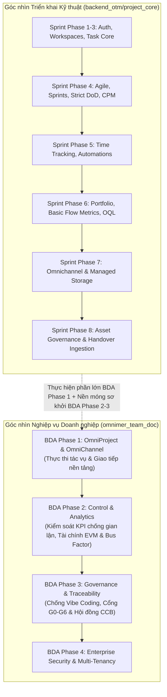

Analyzed PHASE2_CONTROL_ANALYTICS_MERGED.md:L1-100
Analyzed PHASE3_GOVERNANCE_MERGED.md:L1-100
Ran list omnimer_team_doc bda contents
Analyzed README.md:L1-67

Sự xuất hiện của **Phase 2 (`Control & Analytics`)** và **Phase 3 (`Governance & Traceability`)** trong `omnimer_team_doc` xuất phát từ sự khác biệt giữa hai góc nhìn: **Góc nhìn Lập trình Kỹ thuật (Engineering Sprints)** và **Góc nhìn Kiến trúc Nghiệp vụ Sản phẩm (Business Architecture Roadmap)**.

---

### 1. Sự khác biệt giữa 2 hệ thống "Phase"

* **Trong `project_core` (Backend Codebase):**  
  Các thuật ngữ "Phase 1 → Phase 8" thực chất là **các đợt Sprint lập trình (Engineering Releases)** của repository backend nhằm dựng khung hạ tầng kỹ thuật (Auth, Task, Board, Time, Agile Sprints, Omnichannel, Ingestion Asset).
* **Trong `omnimer_team_doc` (Business & System Requirements - BDA):**  
  Đây là **Lộ trình Tiến hóa Sản phẩm Doanh nghiệp (Macro Product Roadmap)** theo từng nấc thang trưởng thành của hệ thống quản trị dự án (PMIS).

---

### 2. "Core" đã có những gì và tại sao cần thêm Phase 2 & Phase 3?

Hiện tại, `project_core` mới hoàn thành trọn vẹn tầng **Thực thi tác vụ (Execution)** của **BDA Phase 1** và một số chỉ số kỹ thuật cơ bản. Các tính năng chuyên sâu của **Phase 2** và **Phase 3** mang bản chất quản trị doanh nghiệp cấp cao mà hệ thống Core cơ bản chưa có:

#### A. BDA Phase 2: Control & Analytics (Kiểm soát Đo lường & Tài chính)
Trong Core hiện tại chỉ mới có *Timesheet, Burndown và Throughput kỹ thuật*. Phase 2 mở rộng thành công cụ kiểm soát cho **HRM và Giám đốc Tài chính (CFO)**:
1. **Thuật toán chấm điểm KPI tự động chống gian lận (`FR-KPI-001`):**
   * Tính điểm tự động: $S_{task} = W_{size} \times (0.6 \times C_{ontime} + 0.4 \times C_{quality})$.
   * **Bất biến (Immutable Log):** Điểm chốt cuối tháng được hash SHA-256 đẩy sang phần mềm tính lương HRM/Payroll; Admin không thể dùng CRUD để sửa điểm cảm tính (phải tạo bản ghi bù trừ `Adjustment_Request`).
2. **Quản trị Tài chính Dự án EVM chuyên sâu (`FR-FIN-001`):**
   * Tính toán dựa trên **Lương thực tế của nhân sự $\times$ Giờ log** để ra $AC$ (Actual Cost) thực tế.
   * Tính toán $SPI$ (tiến độ), $CPI$ (hiệu quả chi phí) và $EAC$ (dự báo tổng ngân sách khi kết thúc dự án).
3. **Cảnh báo Điểm nghẽn nguồn lực (`FR-RES-001`):**
   * Đo lường **Bus Factor = 1**: Cảnh báo đỏ nếu một kỹ năng trọng yếu trong dự án (ví dụ DevOps/Security) chỉ duy nhất 1 người nắm giữ.
   * Cảnh báo quá tải khi tổng Story Points vượt quá $110\%$ Velocity trung bình 3 sprint gần nhất.
4. **Leadership RAG Heatmap (`FR-ANA-001`):**
   * Bảng điều khiển màu (Red-Amber-Green) cho Ban Lãnh đạo dựa trên điểm rủi ro tổng hợp (Composite Risk Score - CRS) theo nguyên tắc **Quản lý theo ngoại lệ (Management by Exception)**.

---

#### B. BDA Phase 3: Governance & Traceability (Quản trị Chuẩn mực & Chống Vibe Coding)
Trong Core hiện tại mới chỉ có *Subtasks, Deliverables của Task và Ingestion kế hoạch*. Phase 3 thiết lập cơ chế pháp chế doanh nghiệp chặt chẽ:
1. **End-to-End Traceability Engine (`FR-TRC-001` - Chống "Vibe Coding"):**
   * **Quy tắc chặn Task mồ côi (Anti-Orphan Task Rule):** Cấm lập trình viên hoặc PM tạo Task tự do nếu Task đó không link ngược về `User Story` $\rightarrow$ `Functional Requirement (FR)` $\rightarrow$ `Business Requirement (BR)` $\rightarrow$ `Mục tiêu Chiến lược (Objective)`.
   * Cây phả hệ truy vết (Traceability Tree) từ Mục tiêu công ty xuống từng dòng Git Commit Hash.
2. **Cổng nghiệm thu bắt buộc toàn dự án - Handover Gates (`FR-GOV-001`):**
   * Quản lý vòng đời dự án qua các cổng từ **G0 (Khởi tạo) $\rightarrow$ G6 (Đóng dự án)**.
   * Chặn không cho dự án chuyển sang giai đoạn đóng gói nếu thiếu tài liệu bắt buộc (ví dụ: ERD, System Architecture phải được Architect duyệt, PM không có quyền tự tick).
3. **Hội đồng Kiểm soát Thay đổi - CCB (`FR-GOV-002` - Chống Scope Creep):**
   * Xử lý các Change Request (CR) làm thay đổi ngân sách hoặc tiến độ.
   * Ma trận leo thang phê duyệt tự động 4 cấp (**E1 $\rightarrow$ E4**): Thay đổi ngân sách $> 20\%$ bắt buộc phải lên tận Portfolio Board / Nhà tài trợ phê duyệt.
   * Đóng băng Baseline cũ (Baseline Freeze) và tự động tính lại toàn bộ SPI/CPI khi có Re-Baselining.

---

### Tóm lại
* **8 Phase trong `project_core`** là các bước **lập trình khung động cơ (Engine Framework)**.
* **Phase 2 & Phase 3 trong `omnimer_team_doc`** là bộ **Quy chuẩn Nghiệp vụ Quản trị Cấp Cao** (Tài chính, KPI nhân sự, Chống Vibe coding, Cổng Gate dự án & Hội đồng kiểm soát thay đổi) được thiết kế để vận hành trên nền động cơ `project_core` đó.