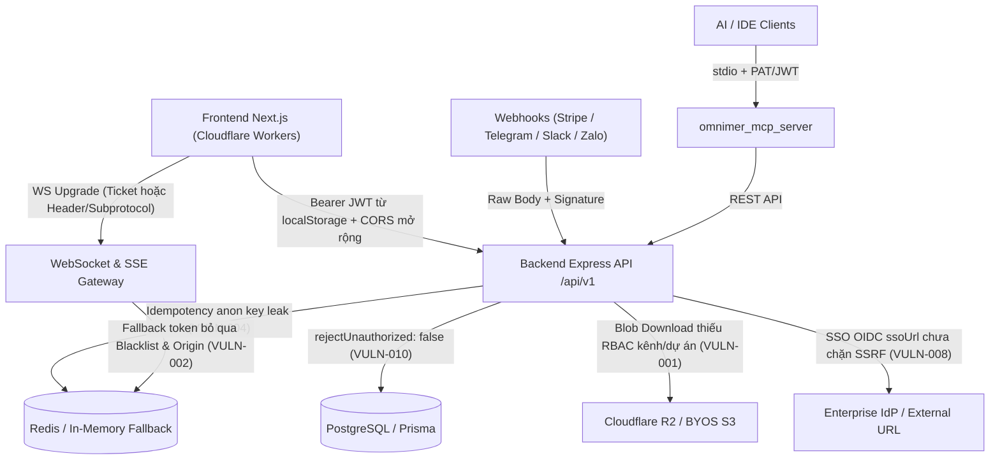

# Báo Cáo Đánh Giá & Kiểm Thử Xâm Nhập (Pentest Report) — OmniMer Team

**Tên dự án:** OmniMer Team Ecosystem (`project_core`, `website_otm`, `omnimer_mcp_server`)  
**Phiên bản báo cáo:** `1.1 (Cập nhật sau vá 5 lỗi Critical)`  
**Ngày thực thi:** `21-11-2026`  
**Ngày xác minh vá lỗi (Remediation Verification):** `21-11-2026`  
**Tài liệu đối chiếu:** [checklist_pentest_01.md](./checklist_pentest_01.md) (48 hạng mục `PT-*` / 9 nhóm)  
**Phương pháp kiểm thử:** Whitebox Code Audit + Graybox In-Process PoC (`supertest`, `ws`) + Automated Security Suites (`Jest`, `node --test`) + SAST/SCA/Gitignore Hygiene (`general_security_scanner.py`, `gitignore_checker.py`, `npm audit`, `omnimer_defect_scanner.py`)  
**Phân loại tài liệu:** `Internal / Confidential`

> **Giới hạn phạm vi an toàn:** Toàn bộ hoạt động kiểm thử động và PoC được thực thi cục bộ (in-process) trên môi trường tách biệt; **không** gửi traffic tấn công tới các hệ thống Staging/Production đang vận hành (`onrender.com`, `workers.dev`, `omnimer.io.vn`).

---

## 1. Tóm tắt Điều hành (Executive Summary)

Đợt thực thi kiểm thử xâm nhập theo [checklist_pentest_01.md](./checklist_pentest_01.md) đã rà soát toàn bộ **48 hạng mục** trải dài trên Backend Express/TypeScript (`backend_otm/project_core`), Frontend Next.js (`frontend_otm/website_otm`), MCP Server (`backend_otm/omnimer_mcp_server`), và cấu hình triển khai (`render.yaml`, `docker-compose.yml`).

- **Điểm mạnh đã ghi nhận:** Kiến trúc bảo mật cốt lõi của hệ thống đạt mức tốt ở nhiều phân hệ nhạy cảm: phân tách Workspace/Project RBAC và Private Task trên hầu hết REST routes (`76/76` test `attack_plan` & `omnichannel.redteam` PASS), cơ chế phòng thủ Prompt Injection 3 tầng & Outbound Hard Gate trên AI ChatOps hoạt động chặt chẽ, `OqlCompiler` không ghép chuỗi SQL thô, `ProjectExporter` chống Zip-Slip, `PublicIntakeService` xác thực reCAPTCHA replay + Magic Bytes, và `omnimer_mcp_server` đạt `8/8` bài test bảo mật.
- **Điểm yếu phát hiện & Trạng thái xử lý:** Đợt kiểm thử ban đầu phát hiện **14 lỗ hổng/khiếm khuyết bảo mật** (**5 Critical, 5 High, 3 Medium, 1 Low**). Đến `21-11-2026`, **toàn bộ 5/5 lỗ hổng Critical (`VULN-001`..`VULN-005`) đã được khắc phục triệt để và xác minh lại bằng regression test tự động + `npm audit --omit=dev` (0 lỗ hổng trên cả 3 sub-projects)**. Hiện còn **9 phát hiện đang mở** (**5 High, 3 Medium, 1 Low**).
- **Đánh giá tư thế bảo mật tổng thể (Overall Security Posture):** **Medium-High Risk — Đã đóng toàn bộ 5/5 lỗi Critical; cần tiếp tục xử lý 5 lỗi High (`VULN-006`..`VULN-010`) trước kỳ Release tiếp theo**.

### Thống kê Kết quả Checklist (48 Hạng mục — Sau Đợt Vá `VULN-001..005`)

| Trạng thái | Số lượng | Tỷ lệ | Diễn giải |
| :--- | :---: | :---: | :--- |
| ✅ **PASS** | `33` | `68.8%` | Đã kiểm chứng đạt qua bộ test tự động, PoC hoặc rà soát mã nguồn (tăng `+7` sau khi vá `VULN-001..005`) |
| ❌ **FAIL** | `6` | `12.5%` | Còn 6 hạng mục mở liên quan tới 5 lỗi High (`VULN-006`..`VULN-010`) & `VULN-012` |
| ⚠️ **PARTIAL** | `8` | `16.7%` | Kiểm soát đạt một phần hoặc phụ thuộc cấu hình/vệ sinh hạ tầng (`VULN-006`, `VULN-011`..`VULN-014`) |
| 📋 **N/A (Backlog)** | `1` | `2.1%` | Tính năng chưa triển khai endpoint (`PT-AUTHN-08`: Forgot Password / User MFA) |

### Thống kê Lỗ hổng Phát hiện (Findings)

| Mức độ | Tổng phát hiện | Đã vá (`21-11-2026`) | Còn mở | Yêu cầu xử lý | Mã lỗ hổng |
| :--- | :---: | :---: | :---: | :--- | :--- |
| 🔴 **Critical** | `5` | `5` | `0` | Đã vá & kiểm chứng Pass 100% | `VULN-001` .. `VULN-005` (`Resolved`) |
| 🟠 **High** | `5` | `0` | `5` | Khắc phục trước kỳ Release kế tiếp | `VULN-006` .. `VULN-010` |
| 🟡 **Medium** | `3` | `0` | `3` | Xử lý trong Sprint/Quý hiện tại | `VULN-011` .. `VULN-013` |
| 🔵 **Low / Info** | `1` | `0` | `1` | Xác minh cấu hình môi trường & đưa vào backlog hardening | `VULN-014` |

---

## 2. Kết quả Chạy Công cụ Tự động & Bộ Test An Ninh

### 2.1. Bộ Kiểm Thử An Ninh Tự Động (Jest & Node Test Runner)

| Thành phần | Bộ kiểm thử đã chạy | Kết quả Suites | Kết quả Test Cases | Ghi chú |
| :--- | :--- | :---: | :---: | :--- |
| `backend_otm/project_core` | `pentest-critical-remediation` (mới), `wave1.authz-matrix`, `wave1.ws-authz`, `wave2.intake-automations-files`, `wave3.race-abuse-time`, `wave5.triple-box-chaos`, `omnichannel.redteam` | **7 / 7 PASS** | **83 / 83 PASS** | Sau vá `VULN-001..004`: chạy in-process với mock harness/cache fallback (`wave1.authz-matrix` chạy `--runInBand` tránh timeout Argon2id do CPU load) |
| `backend_otm/project_core` | `omnichannel-phase3-conversion-archival.api`, `sso-auth.service`, `auth.bruteforce`, `rbac.guard`, `occ.race-condition`, `billing.webhook` | **6 / 6 PASS** | **PASS** | Chạy regression sau khi vá `VULN-001..005` |
| `backend_otm/omnimer_mcp_server` | `mcp-attack-plan.test.js`, `mcp-contract.test.js` | **PASS** | **8 / 8 PASS** | Sau nâng cấp `@modelcontextprotocol/sdk@^1.32.2` + `zod@^4.6.7` + `axios@^1.20.0` |
| `frontend_otm/website_otm` | `tsc --noEmit`, `next build` (`Next.js 15.5.29`), Playwright audit | Build & Types **PASS** | Code audit | Đã build thành công trên `Next.js 15.5.29` + `@opennextjs/cloudflare`; E2E Playwright `attack-wave4-5.spec.ts` chưa chạy trực tiếp do config trỏ tới `workers.dev` |

### 2.2. Kết quả Quét Tĩnh (SAST), Phụ Thuộc (SCA), Gitignore & Defect Guardian

| Công cụ | Đối tượng quét | Tổng cảnh báo thô | Phân tích kết quả thực tế |
| :--- | :--- | :--- | :--- |
| `general_security_scanner.py` (`--severity medium`) | `backend_otm/project_core/src` | `63` (39 Critical, 1 High, 23 Medium) | **1 True Positive** (`core/db/prisma.ts:16` `rejectUnauthorized: false` → `VULN-010`); **62 False Positives** (`RegExp.prototype.exec()`, `RedisCacheService.eval()` Lua script nội bộ, XML schema URLs, test fixtures). |
| `general_security_scanner.py` (`--severity medium`) | `backend_otm/omnimer_mcp_server/src` | `0` | Không phát hiện cảnh báo nào. |
| `general_security_scanner.py` (`--severity medium`) | `frontend_otm/website_otm/src` | `7` (7 Critical) | **0 True Positives** (7/7 đều là `RegExp.prototype.exec()`). |
| `npm audit --omit=dev` (SCA) | `project_core` / `mcp_server` / `website_otm` | `0` / `0` / `0` (sau vá) | **Trước vá (`VULN-005`):** BE `8`, MCP `1`, FE `8` (3 Critical `next@14.2.35`/`seroval`). **Sau vá (`21-11-2026`):** Cả 3 dự án đều đạt **`found 0 vulnerabilities`** (`zod@^4.6.7`, `effect@^3.22.5`, `@modelcontextprotocol/sdk@^1.32.2`, `next@15.5.29`, `next-intl@^4.15.3`, `@opennextjs/cloudflare@^1.20.18`, `postcss@^8.5.23`, chuyển devtools sang `devDependencies`). |
| `gitignore_checker.py` | `project_core` / `website_otm` / `omnimer_team_doc` | Thiếu 24 / 34 / 43 pattern | **0 secret thật** bị track; báo động giả `.env.example` & `phase3.keyset-pagination.test.ts`; `omnimer_team_doc` chưa có `.gitignore`; tồn tại `.bundle` backup → `VULN-013`. |
| `omnimer_defect_scanner.py --strict` | `backend` / `frontend` | `0` active errors | **PASS** (0 lỗi mới; nợ kỹ thuật cũ: 150 BE, 8 FE). |

---

## 3. Kiến trúc Hiện trạng & Khoảng Trống Kiểm Soát (Current Architecture As-Is)



### Bảng Khoảng Trống Kiểm Soát Bảo Mật (Security Control Gaps)

| Thành phần | Kiểm soát kỳ vọng | Trạng thái hiện tại (Sau vá `VULN-001..005`) | Khoảng trống còn lại |
| :--- | :--- | :--- | :--- |
| Blob / Archive Download | Kiểm tra `channel_access_members` (`BR-CHN-006`) & `project_members` | Đã vá `requireRole`, `hasProjectMemberAccess` & `assertConversationAccess` (`VULN-001` Resolved) | ✅ Đã đóng |
| WebSocket Fallback Auth | Kiểm tra `Origin`, `bl:<token>`, `bl:member:*`, `user.isActive` | Đã kiểm tra `isOriginAllowed`, `bl:<token>`, `bl:member:*`, `userRepository` & từ chối refresh token (`VULN-002` Resolved) | ✅ Đã đóng |
| Token Refresh (`/auth/refresh`) | Phân tách `refreshToken`, check `user.isActive` & `bl:member:*` | Đã tách `tokenType: 'refresh'`, verify DB/blacklist/membership trong `AuthService.refreshSession` (`VULN-003` Resolved) | ✅ Đã đóng |
| Global `Idempotency-Key` | Chỉ áp dụng sau Auth hoặc cô lập theo session/fingerprint | Đã bỏ qua `/auth/*` & unauth; khóa theo `decoded.userId` + kiểm tra `bodyHash` + `setNx` (`VULN-004` Resolved) | ✅ Đã đóng |
| Frontend Token & CSP | HttpOnly cookie hoặc strict CSP nonce + `connect-src` hẹp | JWT 7d ở `localStorage`, CSP có `'unsafe-inline'` & `http:/https:` | ⚠️ Tăng bán kính nổ khi có XSS (`VULN-006`) |
| CORS & Reverse Proxy | Chặn `localhost` ở Prod, bật `trust proxy` | `localhost` đã bị chặn ở Prod qua `originWhitelist.ts`, nhưng còn `*.omnimer.io.vn` + `render.yaml` `CORS_ORIGIN: "*"`; thiếu `trust proxy` | ⚠️ Còn `*.omnimer.io.vn`, `render.yaml` & `trust proxy` (`VULN-007`, `VULN-011`) |

---

## 4. Ma trận Kết quả Thực thi Đầy đủ 48 Hạng mục Checklist

| Mã | Ưu tiên | Kết quả | Mã lỗi liên quan | Bằng chứng / Ghi chú thực thi |
| :--- | :--- | :--- | :--- | :--- |
| `PT-AUTHZ-01` | `P0` | ✅ **PASS** | — | `wave1.authz-matrix.test.ts` (`SEC-01`, `AUTHZ-XWS-FALLBACK`) & `workspaceContext.ts` chặn cross-tenant + non-UUID fallback. |
| `PT-AUTHZ-02` | `P0` | ✅ **PASS** | — | `wave1.authz-matrix.test.ts` (`AUTHZ-OBJ-01..03`) chặn BOLA dự án riêng tư và path-confusion entity lồng nhau (`404`/`403`). |
| `PT-AUTHZ-03` | `P0` | ✅ **PASS** | — | `wave1.authz-matrix.test.ts` quét ma trận 150+ endpoints + `rbac.guard.test.ts` xác nhận chặn `GUEST`/`OBSERVER`/`MEMBER`. |
| `PT-AUTHZ-04` | `P0` | ✅ **PASS** | — | `wave1.authz-matrix.test.ts` (`SEC-04`) + `TaskPrivacyService.ts` trả `404` anti-IDOR, chặn Break-Glass My Space (`409`) và ghi Audit Log. |
| `PT-AUTHZ-05` | `P0` | ✅ **PASS** | — *(VULN-001 Resolved)* | `pentest-critical-remediation.test.ts` + `omnichannel.redteam.test.ts`: `downloadBlobOrArchive` kiểm tra `hasProjectMemberAccess` & `assertConversationAccess`, chặn `GUEST`/`MEMBER` ngoài quyền (`403 INSUFFICIENT_PERMISSIONS`). |
| `PT-AUTHZ-06` | `P1` | ✅ **PASS** | — | `wave1` (`SEC-02`, `SEC-03`), `omnichannel-compliance.routes.ts`, `billing.routes.ts`, `workspace.routes.ts` enforce đúng role cao cấp. |
| `PT-AUTHZ-07` | `P1` | ✅ **PASS** | — *(VULN-001 Resolved)* | `ProjectExporter` Zip-Slip, `IStorageAdapter.normalizeStoragePrefix`, `DataJobService`, và `downloadBlobOrArchive` RBAC (fail-closed `403` cho unreferenced blob) đều đạt. |
| `PT-AUTHN-01` | `P0` | ⚠️ **PARTIAL** | `VULN-011` | `auth.bruteforce.test.ts` & `wave1` (`AUTHN-05/05b`) PASS lockout `423`; tuy nhiên thiếu `trust proxy` (`VULN-011`) và thông báo lỗi phân biệt user không tồn tại (`401`) vs bị khóa/SSO (`403`). |
| `PT-AUTHN-02` | `P0` | ❌ **FAIL** | `VULN-006` *(VULN-002 Resolved)* | REST `jwt.ts` HS256, `/auth/logout` `bl:<token>` & WS fallback `bl:<token>` đạt (`pentest-critical-remediation.test.ts`); còn rủi ro FE lưu JWT 7 ngày tại `localStorage` (`VULN-006`). |
| `PT-AUTHN-03` | `P0` | ✅ **PASS** | — *(VULN-003 Resolved)* | `jwt.ts` tách `tokenType` (`'access'`/`'refresh'`), `AuthService.refreshSession` từ chối Access JWT (`401 INVALID_REFRESH_TOKEN`), khóa replay bằng `setNx`, và chặn dùng `refreshToken` làm Bearer API. |
| `PT-AUTHN-04` | `P0` | ✅ **PASS** | — *(VULN-002, VULN-003 Resolved)* | REST middleware, `AuthService.refreshSession`, và `WebSocketGateway` fallback đều kiểm tra `bl:member:*`, `user.isActive`, `lockedUntil` & trạng thái member `ACTIVE`. |
| `PT-AUTHN-05` | `P1` | ✅ **PASS** | — | `wave1` (`AUTHN-04`) + `InviteService.ts` khóa chặt `payload.email`, `status === 'PENDING'`, và hạn `48h`. |
| `PT-AUTHN-06` | `P0` | ❌ **FAIL** | `VULN-008` | Anti-replay `state`/assertion pass (`AUTHN-06`), nhưng `ssoUrl` thiếu SSRF guard & cho phép `http://` (`PoC-5`), SAML regex thiếu XMLDSig canonicalization, thiếu check `isActive` trong `issueWorkspaceTokens`. |
| `PT-AUTHN-07` | `P1` | ✅ **PASS** | — | `omnichannel.redteam.test.ts` Scenario 3 xác nhận purge `omni:bind:*` & `omni:chatops_ctx:*` trong `< 100ms` và chặn lệnh nối tiếp. |
| `PT-AUTHN-08` | `P2` | 📋 **BACKLOG** | — | Endpoint Forgot Password và User MFA/TOTP chưa tồn tại trong `auth.routes.ts`. |
| `PT-INP-01` | `P0` | ⚠️ **PARTIAL** | `VULN-006` | `sanitizeMarkdown`, `embedSnippet` escaping (`PUB-04b`), `FormattedContentRenderer` (0 `dangerouslySetInnerHTML`) đạt; nhưng CSP Prod còn `'unsafe-inline'` & `connect-src http: https:` (`VULN-006`). |
| `PT-INP-02` | `P0` | ✅ **PASS** | — | `OqlParser` giới hạn depth `<= 5`, predicates `<= 15`; `OqlCompiler` chuẩn hóa `NFC` & compile 100% sang Prisma `WhereInput`; `SearchRepository` parameter hóa `$queryRaw`; `CHAOS-04` ReDoS `<= 100ms`. |
| `PT-INP-03` | `P0` | ✅ **PASS** | — | `wave1` (`MASS-01a`, `MASS-01b`) xác minh 100% DTO áp dụng `.strict()`, chặn trường dư với `HTTP 400`; mọi `$queryRaw` đều dùng tagged template `Prisma.sql`. |
| `PT-INP-04` | `P1` | ❌ **FAIL** | `VULN-009` | `CsvImporter` chống XLSX Zip Bomb / XXE / CSV `> 5000` dòng đạt (`FILE-03a`), nhưng `toCsv()` xuất `timesheet.csv` bị CSV Formula Injection (`PoC-7`). |
| `PT-INP-05` | `P2` | ⚠️ **PARTIAL** | `VULN-013` | `EmailContentSanitizer` chuẩn hóa `\s+` (loại `\r\n`) và strip HTML; nhưng hệ thống đang dùng `MockEmailService` (chưa có provider SMTP/SES thật để kiểm thử header thực địa). |
| `PT-RES-01` | `P1` | ⚠️ **PARTIAL** | `VULN-011`, `VULN-014` | `rateLimiter.ts`, `publicRateLimiter`, reCAPTCHA replay guard đạt (`PUB-01a/02`); nhưng thiếu `trust proxy` (`VULN-011`) và `RECAPTCHA_SECRET` có default rỗng (`VULN-014`). |
| `PT-RES-02` | `P1` | ✅ **PASS** | — | `wave3` (`ABUSE-01/02`), `wave5` (`CHAOS-03/04`), `wave2` (`AUTO-02`), `time-tracking.rules.ts` chặn dải ngày > 31 ngày / 130 năm và clamp pagination. |
| `PT-RES-03` | `P0` | ✅ **PASS** | — | `wave2` (`PUB-04a/04c`, `FILE-01a/01c/02`), `wave5` (`BVA-02`, `GRAY-02`) xác minh biên `25MB`/`20MB`, 64-byte Magic Bytes, TTL `<= 300s`, ẩn `PENDING_UPLOAD`. |
| `PT-RES-04` | `P0` | ⚠️ **PARTIAL** | `VULN-013`, `VULN-014` | Không có secret thật trong Git, nhưng tồn tại `.bundle` backup trong `backend_otm/`, thiếu pattern `.gitignore` (`VULN-013`), và default mock secrets trong `env.config.ts` (`VULN-014`). |
| `PT-RES-05` | `P1` | ❌ **FAIL** | `VULN-006`, `VULN-007` | Backend CORS Production chấp nhận `http://localhost:*` & `*.omnimer.io.vn` kèm `credentials: true` (`PoC-4`), `render.yaml` có `CORS_ORIGIN: "*"` (`VULN-007`), FE CSP còn `'unsafe-inline'` (`VULN-006`). |
| `PT-BUS-01` | `P0` | ✅ **PASS** | — | `TaskService` + `dod.validator` chặn DONE thiếu deliverable; `workspaceContext` kiểm tra subscription writable; `DataJobService` khóa chặt state machine import. |
| `PT-BUS-02` | `P1` | ✅ **PASS** | — | `TaskService.updateTask:920-930` & `antiGamingGuard` đều gọi `assertDueDateChangeAllowed`; Fibonacci `{1,2,3,5,8,13}` & Time Tracking lookback 30d/24h/DST đạt (`TIME-01`). |
| `PT-BUS-03` | `P1` | ✅ **PASS** | — | `wave2` (`AUTO-01a/01b/03`) & `AutomationEngine` xác nhận dừng loop ở `depth > 3`, `PERMISSION_REVOKED` khi hạ quyền creator, `assertWriter` trên update/delete. |
| `PT-BUS-04` | `P1` | ✅ **PASS** | — | `wave3` (`RC-01`, `RC-02`, `RC-08`) & `occ.race-condition.test.ts` xác nhận OCC `412`, chặn move thiếu version, update-vs-delete trả `404`. |
| `PT-BUS-05` | `P1` | ✅ **PASS** | — | `wave3` (`RC-03`, `RC-04`, `RC-05`, `RC-07`, `RC-11`) & PostgreSQL `pg_advisory_xact_lock` / unique partial index chống race condition. |
| `PT-BUS-06` | `P1` | ✅ **PASS** | — *(VULN-004 Resolved)* | `app.ts` bỏ qua `/auth/*` & unauthenticated requests, gắn khóa theo `decoded.userId` + `bodyHash` (`422` khi lệch payload) + `setNx` (`RC-12` & `pentest-critical-remediation.test.ts` PASS). |
| `PT-INT-01` | `P0` | ❌ **FAIL** | `VULN-008`, `VULN-012` | `automation/ssrf.ts` chặn IP/CIDR/redirect (`FILE-04b`), nhưng còn cửa sổ DNS Rebinding TOCTOU (`VULN-012`) và `SsoAuthService` `ssoUrl` thiếu hoàn toàn SSRF filter (`PoC-5`). |
| `PT-INT-02` | `P0` | ✅ **PASS** | — | `SafeEndpointValidator` + `ByosS3StorageAdapter` (`redirect: 'manual'`) kiểm soát chặt URL & DNS (cần xác nhận thêm env `OMNI_BYOS_ALLOW_PRIVATE_NETWORK=false` trên Prod). |
| `PT-INT-03` | `P0` | ⚠️ **PARTIAL** | `VULN-014` | `BillingService.handleWebhook` dùng `stripe.webhooks.constructEvent` + `P2002` idempotency (`billing.webhook.test.ts` PASS); cần xác nhận Prod đã thay `whsec_mock_secret`. |
| `PT-INT-04` | `P0` | ✅ **PASS** | — | `ChannelCryptoService` xác thực constant-time chữ ký Telegram/Slack/Zalo OA + replay window 300s; `replayDeadLetter` chỉ cấp cho `ADMIN`. |
| `PT-INT-05` | `P1` | ⚠️ **PARTIAL** | `VULN-012` | `wave2` (`FILE-04c`) pass trong 1 instance; nhưng `consumedOAuthNonces` trong `crypto.util.ts` chỉ là `Map` in-memory nên có thể replay state khi scale đa pod (`VULN-012`). |
| `PT-RT-01` | `P0` | ✅ **PASS** | — *(VULN-002 Resolved)* | Single-use ticket, SSE `consumeTicket`, WS `Origin` whitelist (`403` CSWSH guard) và WS fallback blacklist/status parity đều đạt (`pentest-critical-remediation.test.ts`). |
| `PT-RT-02` | `P0` | ✅ **PASS** | — | `wave1.ws-authz.test.ts` (`WS-AUTH-01`) & `SseGateway.ts:57-62` kiểm tra `verifyRoomAccess` (workspace, project, private task). |
| `PT-RT-03` | `P1` | ✅ **PASS** | — *(VULN-002 Resolved)* | `WS-AUTH-02/03`, max 5 sockets/user, 20 frames/s, `maxPayload: 16384` và chặn kết nối mới qua fallback khi user bị thu hồi/vô hiệu hóa đều đạt. |
| `PT-AI-01` | `P0` | ✅ **PASS** | — | `omnichannel.redteam.test.ts` Scenario 1 chặn 15/15 biến thể jailbreak (`0` LLM calls) và `ReadOnlyIntentGate` chặn mọi intent ghi. |
| `PT-AI-02` | `P0` | ✅ **PASS** | — | `omnichannel.redteam.test.ts` Scenario 2 & `ClientPromptInjectionGuard` Tier 2/3 khóa chặt 5 trường public & lọc output rò rỉ. |
| `PT-AI-03` | `P0` | ✅ **PASS** | — | `omnichannel.redteam.test.ts` Scenario 4 chặn `INTERNAL_NOTE`/`PROJECT_DISCUSSION` (`403 CRITICAL_SECURITY_GATE`) và mention nội bộ (`400`). |
| `PT-AI-04` | `P1` | ✅ **PASS** | — | `mcp-attack-plan.test.ts` & `mcp-contract.test.ts` pass `8/8` (401 clean error, 403 RBAC equivalence, URI path traversal guard, `<untrusted_data>` framing). |
| `PT-AI-05` | `P2` | ✅ **PASS** | — | `env.config.ts` & ChatOps/OPAgent services cấu hình `CHATOPS_DAILY_TOKEN_LIMIT=500000`, timeout `3500ms`/`5000ms` kèm `AbortController` fail-safe. |
| `PT-DAT-01` | `P0` | ✅ **PASS** | — | `wave5` (`GRAY-03`), `ChannelConnectionService.toPublicView`, `TenantStorageService.toSafeView`, `errorHandler.ts` không rò rỉ cột bí mật hoặc stack trace. |
| `PT-DAT-02` | `P1` | ❌ **FAIL** | `VULN-010` | `ChannelCryptoService` AES-256-GCM đạt; nhưng `prisma.ts:16` đặt `rejectUnauthorized: false` cho PostgreSQL SSL và `DATA_ENCRYPTION_KEY` là `optional()` fallback về `JWT_SECRET` (`PoC-8`). |
| `PT-DAT-03` | `P1` | ✅ **PASS** | — | `RetentionAndPrivacyService.executeSubjectPrivacyErasure` ẩn danh hóa PII, GC blob tham chiếu bằng 0, xóa cache `omni:bind:*`/`omni:chatops_ctx:*` và xuất biên lai không chứa PII thô. |
| `PT-DAT-04` | `P1` | ⚠️ **PARTIAL** | `VULN-013` *(VULN-005 Resolved)* | `npm audit --omit=dev` trên BE, MCP và FE đều đạt `0 vulnerabilities` (`VULN-005` Resolved); còn tồn tại file `.bundle` backup & thiếu pattern `.gitignore` (`VULN-013`). |

---

## 5. Chi tiết Các Lỗ Hổng Phát Hiện (Findings)

### Finding #1: BOLA/IDOR Tải Tệp Blob & Hồ sơ Lưu trữ OmniChannel (`archive.md`)

| Trường | Giá trị |
| :--- | :--- |
| **ID** | `VULN-001` |
| **Severity** | 🔴 Critical |
| **Category** | Broken Object Level Authorization (BOLA / IDOR) |
| **OWASP / CWE** | `API1:2023 BOLA`, `WSTG-ATHZ-04`, `CWE-639` |
| **Component / File** | `backend_otm/project_core/src/api/routes/v1/omnichannel-task-archive.routes.ts:90-94`, `omnichannel-task-archive.controller.ts:186-207`, `ProjectArchivalService.ts:369-423` |
| **Discovered By** | Manual Whitebox Review + In-Process PoC (`PoC-1_BlobDownload_RBAC`) |

**Mô tả chi tiết:**  
Route `GET /api/v1/workspaces/:workspaceId/omnichannel/blobs/:blobId/download` chỉ gắn `authenticateJwt`, `requireWorkspaceContext`, và `validate(downloadBlobRequestSchema)` (ngoài ra vô tình chịu `requireRole(['ADMIN', 'PM', 'MEMBER'])` từ `portfolioWorkspaceRouter` gắn trước đó trên `/workspaces`). Controller và `ProjectArchivalService.downloadBlobOrArchive` tìm thẳng `blobId` hoặc `archiveId` theo `workspaceId` mà **không kiểm tra** người dùng có quyền trên hội thoại gốc (`channel_access_members` theo `BR-CHN-006`) hay là thành viên của dự án sở hữu `ProjectChatArchive` (`project_members`) hay không.

**Bằng chứng / PoC:**  
Chạy PoC in-process `PoC-1_BlobDownload_RBAC` với token của tài khoản `MEMBER` không thuộc kênh VIP / không thuộc dự án:
```json
{
  "guestStatus": 403,
  "memberWithoutChannelOrProjectAccessStatus": 200,
  "memberDownloadedBody": "VIP SECRET ARCHIVE CONTENT"
}
```

**Kịch bản tấn công:**  
Một nhân viên bất kỳ có vai trò `MEMBER` trong Workspace lấy hoặc đoán UUID `blobId`/`archiveId` (hoặc lấy ID từ các liên kết metadata) rồi gọi trực tiếp `GET /api/v1/workspaces/:wsId/omnichannel/blobs/:blobId/download` để tải toàn bộ tệp đính kèm của khách hàng VIP hoặc file `archive.md` chứa lịch sử trao đổi của dự án mật.

**Khắc phục (Remediation):**  
Bắt buộc kiểm tra quyền truy cập ở tầng Service trước khi đọc từ `tenantStorageService`: nếu `blobId` là `ProjectChatArchive` thì kiểm tra `hasProjectMemberAccess(workspaceId, archive.projectId, userId)` (trừ `ADMIN`/`OWNER`); nếu là `StorageBlobRef` thì truy ngược các `Message` / `Conversation` hoặc `Task` tham chiếu tới blob/sha256 và xác minh `assertConversationAccess` hoặc quyền dự án tương ứng.

**Trạng thái xử lý:** ✅ **Resolved (`21-11-2026`)** — Đã bổ sung `requireRole(['OWNER', 'ADMIN', 'PM', 'MEMBER'])` trên route download, truyền `actor` xuống `ProjectArchivalService.downloadBlobOrArchive`, triển khai `StorageBlobRepository.findBlobAccessScopeInWorkspace` và ép fail-closed `403 INSUFFICIENT_PERMISSIONS` cho cả `ProjectChatArchive` lẫn `StorageBlobRef` (đã xác minh qua `pentest-critical-remediation.test.ts` & `omnichannel-phase3-conversion-archival.api.test.ts`).

---

### Finding #2: WebSocket Fallback Auth Bỏ Qua Blacklist, Thu Hồi Thành Viên & Thiếu Kiểm Tra `Origin`

| Trường | Giá trị |
| :--- | :--- |
| **ID** | `VULN-002` |
| **Severity** | 🔴 Critical |
| **Category** | Broken Authentication & Cross-Site WebSocket Hijacking Surface |
| **OWASP / CWE** | `WSTG-SESS-06`, `WSTG-CLNT-10`, `CWE-613`, `CWE-346` |
| **Component / File** | `backend_otm/project_core/src/core/realtime/WebSocketGateway.ts:77-135` |
| **Discovered By** | Manual Whitebox Review + In-Process PoC (`PoC-2_WS_BlacklistedToken_EvilOrigin`) |

**Mô tả chi tiết:**  
Trong `WebSocketGateway.initialize`, khi kết nối WebSocket không truyền `?ticket=` mà đi theo nhánh fallback (`Authorization: Bearer <token>` hoặc `Sec-WebSocket-Protocol: <token>`), gateway chỉ gọi `verifyToken(token)` (kiểm tra chữ ký & `exp`) mà hoàn toàn **bỏ qua**: (1) blacklist token đã logout `bl:<token>`, (2) marker thu hồi thành viên `bl:member:${workspaceId}:${userId}`, (3) trạng thái `user.isActive` và `user.lockedUntil` trong DB, và (4) không kiểm tra header `Origin` trên handshake `upgrade`.

**Bằng chứng / PoC:**  
PoC in-process đặt token vào `bl:<token>` (mô phỏng user đã gọi `/auth/logout`) và nâng cấp WS kèm `Origin: https://evil-attacker.example`:
```json
{
  "connected": true,
  "ackUserId": "22222222-2222-4222-8222-222222222222"
}
```

**Kịch bản tấn công:**  
Người dùng đã bấm Đăng xuất (hoặc bị Admin vô hiệu hóa tài khoản) vẫn có thể dùng lại JWT cũ (còn hạn tới 7 ngày) truyền qua header `Authorization` hoặc `Sec-WebSocket-Protocol` để thiết lập kết nối WebSocket mới và tiếp tục nhận sự kiện realtime.

**Khắc phục (Remediation):**  
1. Loại bỏ nhánh fallback JWT thô trên Production (bắt buộc qua single-use ticket từ `POST /api/v1/realtime/tickets`), hoặc bắt buộc nhánh fallback phải kiểm tra đầy đủ `bl:<token>`, `bl:member:*`, `user.isActive`, và `user.lockedUntil` giống `authenticateJwt`.  
2. Kiểm tra whitelist `request.headers.origin` trong sự kiện `upgrade` của `WebSocketGateway` tương đồng với chính sách CORS chặt chẽ.

**Trạng thái xử lý:** ✅ **Resolved (`21-11-2026`)** — Đã tách `isOriginAllowed()` vào `src/core/utils/originWhitelist.ts` để kiểm tra `Origin` trên `upgrade` (trả `HTTP 403` cho origin lạ, đồng thời tắt wildcard `localhost` trên Production), và cập nhật nhánh fallback của `WebSocketGateway.ts` kiểm tra `bl:<token>`, từ chối `tokenType === 'refresh'`, kiểm tra `bl:member:*` và `userRepository.findUnique` (`isActive` & `!lockedUntil`). Đã xác minh chặn `PoC-2` (`403`/`401`) qua `pentest-critical-remediation.test.ts` & `verify_pentest_pocs.ts`.

---

### Finding #3: `POST /api/v1/auth/refresh` Chấp Nhận Access JWT Thường & Vượt Rào Thu Hồi Thành Viên

| Trường | Giá trị |
| :--- | :--- |
| **ID** | `VULN-003` |
| **Severity** | 🔴 Critical |
| **Category** | Broken Authentication / Session Revocation Bypass |
| **OWASP / CWE** | `API2:2023`, `WSTG-ATHN-06`, `CWE-613`, `CWE-384` |
| **Component / File** | `backend_otm/project_core/src/api/controllers/auth.controller.ts:189-235` |
| **Discovered By** | Manual Whitebox Review + In-Process PoC (`PoC-3_AuthRefresh_Bypass`) |

**Mô tả chi tiết:**  
`AuthController.refresh` chỉ gọi `verifyToken(refreshToken)` và kiểm tra `bl:refresh:${refreshToken}`. Do JWT do `generateToken()` sinh ra không có claim phân loại (`tokenType: 'refresh'`), bất kỳ Access Token nào (kể cả token đã logout nằm trong `bl:<token>`) đều có thể gửi lên `/api/v1/auth/refresh`. Hơn nữa hàm này không kiểm tra DB (`user.isActive`, `user.lockedUntil`) và không kiểm tra `bl:member:${workspaceId}:${userId}` trước khi ký ra token mới với `iat` mới.

**Bằng chứng / PoC:**  
PoC `PoC-3_AuthRefresh_Bypass` đặt `bl:member:${wsId}:${guestUserId}` và gửi Access Token lên `/api/v1/auth/refresh`:
```json
{
  "status": 200,
  "mintedFreshToken": true,
  "oldIat": 1795249500,
  "newIat": 1795249501
}
```

**Kịch bản tấn công:**  
Ngay cả khi quản trị viên đã thu hồi quyền thành viên trong workspace (`bl:member:*` chặn token cũ có `iat <= revokedTimestamp`) hoặc người dùng đã logout (`bl:<token>`), kẻ nắm giữ token cũ có thể gọi `POST /api/v1/auth/refresh` để đổi lấy cặp `token`/`refreshToken` mới hoàn toàn với `iat` mới hơn thời điểm thu hồi.

**Khắc phục (Remediation):**  
1. Tách biệt `tokenType: 'access'` và `tokenType: 'refresh'` trong JWT claims (từ chối `access` token tại `/auth/refresh`), đồng thời kiểm tra `bl:<token>` trước khi xoay vòng.  
2. Trong `AuthController.refresh`, bắt buộc truy vấn DB xác nhận `user.isActive === true`, `lockedUntil` không hiệu lực, thành viên vẫn `ACTIVE`, và từ chối nếu tồn tại `bl:member:${workspaceId}:${userId}` với `decoded.iat <= revokedTimestamp`.

**Trạng thái xử lý:** ✅ **Resolved (`21-11-2026`)** — Đã bổ sung `generateRefreshToken`/`verifyRefreshToken` (`tokenType: 'refresh'`, `jti`), chặn `refresh` token tại `verifyToken`, tách logic sang `AuthService.refreshSession` kiểm tra `bl:refresh:*` (qua `cacheService.setNx`), `bl:*`, `bl:member:*`, `userRepository.findUnique`, `memberRepository.findByWorkspaceAndUser`, và cập nhật `SsoAuthService` + `AuthService.loginWithEmail`. Đã xác minh chặn `PoC-3` (`401`) qua `pentest-critical-remediation.test.ts` & `verify_pentest_pocs.ts`.

---

### Finding #4: Global `Idempotency-Key` Middleware Dùng Chung Khóa `'anon'` Cho Request Không Auth

| Trường | Giá trị |
| :--- | :--- |
| **ID** | `VULN-004` |
| **Severity** | 🔴 Critical |
| **Category** | Cross-User Cache Poisoning / Session Token Leakage |
| **OWASP / CWE** | `WSTG-BUSL`, `API4:2023`, `CWE-524`, `CWE-362` |
| **Component / File** | `backend_otm/project_core/src/app.ts:99-145` |
| **Discovered By** | Manual Whitebox Review + In-Process PoC (`PoC-6_Idempotency_Anon_Cache_Leak`) |

**Mô tả chi tiết:**  
Middleware chống trùng lặp `POST` tại `app.ts:99-145` xây dựng khóa cache là:  
`http:idem:${req.headers.authorization || 'anon'}:${req.originalUrl}:${rawKey.trim()}` (TTL 120 giây).  
Trên các endpoint `POST` công khai không gửi `Authorization` (như `/api/v1/auth/login`, `/api/v1/auth/refresh`, `/api/v1/auth/register`, `/api/v1/public/forms/:slug/submit`), mọi người dùng đều dùng chung namespace `'anon'`, và middleware **không** kiểm tra sự khớp của request body. Đồng thời `inFlightIdempotency` chỉ là `Map` trong bộ nhớ của 1 process.

**Bằng chứng / PoC:**  
PoC `PoC-6_Idempotency_Anon_Cache_Leak`: Caller 1 gọi `POST /api/v1/auth/refresh` kèm `Idempotency-Key: idem-shared-attack-key-123`; Caller 2 gửi **body rỗng `{}`** với cùng header `Idempotency-Key`:
```json
{
  "caller1Status": 200,
  "caller2EmptyBodyStatus": 200,
  "caller2GotCaller1Jwt": true
}
```

**Kịch bản tấn công:**  
Nếu ứng dụng/proxy hoặc kẻ tấn công gắn trước cùng một giá trị `Idempotency-Key` (hoặc brute-force khóa ngắn hay dùng) vào các request `POST /api/v1/auth/login` hoặc `/auth/refresh` trong cửa sổ 120 giây, người gọi sau có thể nhận thẳng response `200 OK` chứa JWT phiên đăng nhập của nạn nhân.

**Khắc phục (Remediation):**  
1. Không áp dụng middleware cache `Idempotency-Key` toàn cục lên các route `/api/v1/auth/*` và route công khai không có `Authorization`; chỉ áp dụng cho các endpoint đã qua `authenticateJwt` và sử dụng `req.user.id` làm namespace thay vì chuỗi raw `req.headers.authorization`.  
2. Lưu hash SHA-256 của request body kèm trong bản ghi idempotency (trả `422`/`409` nếu cùng key nhưng khác body), và chuyển khóa `inFlight` sang Redis lock cho môi trường đa pod.

**Trạng thái xử lý:** ✅ **Resolved (`21-11-2026`)** — Middleware trong `app.ts` đã bỏ qua `/auth/*` và request không có JWT hợp lệ, khóa cache theo `decoded.userId` thay vì `'anon'` hoặc raw token, kiểm tra SHA-256 `bodyHash` (`422 IDEMPOTENCY_KEY_PAYLOAD_MISMATCH`), và đồng bộ khóa đa pod qua `cacheService.setNx`. Đã xác minh chặn `PoC-6` qua `pentest-critical-remediation.test.ts`, `RC-12`, và `verify_pentest_pocs.ts`.

---

### Finding #5: Các Lỗ Hổng Nghiêm Trọng Trong Thư Viện Production (SCA) — Nổi Bật `next@14.2.35` & `seroval`

| Trường | Giá trị |
| :--- | :--- |
| **ID** | `VULN-005` |
| **Severity** | 🔴 Critical |
| **Category** | Vulnerable and Outdated Components (Supply Chain) |
| **OWASP / CWE** | `A06:2021`, `CWE-1104` |
| **Component / File** | `frontend_otm/website_otm/package.json`, `backend_otm/project_core/package.json`, `backend_otm/omnimer_mcp_server/package.json` |
| **Discovered By** | `npm audit --omit=dev` |

**Mô tả chi tiết:**  
Kết quả kiểm tra dependency production cho thấy nhiều CVE mức Critical và High chưa được vá:
- **Frontend (`website_otm`):** `8` lỗ hổng (**3 Critical, 4 High, 1 Moderate**), gồm `next@14.2.35` (`<= 16.3.0-preview.10` với hàng loạt advisory Critical/High về HTTP Request Smuggling `GHSA-ggv3-7p47-pfv8`, SSRF/DoS Image Optimizer & Server Actions, Cache Poisoning, Middleware/i18n bypass, XSS với CSP nonce/beforeInteractive), `seroval <= 1.6.9` (Critical deserialization/DoS), `follow-redirects`, `postcss`, `next-intl <= 4.9.1` (Open Redirect `GHSA-8f24-v5vv-gm5j`, Prototype Pollution), `source-map-js`, `zod < 4.6.6`.
- **Backend (`project_core`):** `8` lỗ hổng (**5 High, 3 Moderate**), gồm `body-parser` (DoS `GHSA-27r3-jxmh-p828`), `zod < 4.6.6` (Memory exhaustion `GHSA-mrhx-c7xc-m3w5`), `effect <= 3.22.0` (ReDoS qua `@prisma/config`), `fast-uri` (URI scheme spoofing), `ip-address` (quadratic time), `qs`.
- **MCP Server (`omnimer_mcp_server`):** `1` lỗ hổng High (`zod < 4.6.6`).

**Khắc phục (Remediation):**  
Nâng cấp `next` (lên nhánh vá lỗi mới nhất tương thích `@cloudflare/next-on-pages` hoặc OpenNext Cloudflare), `zod >= 4.6.6`, chạy `npm audit fix` cho các gói không breaking (`body-parser`, `fast-uri`, `ip-address`, `qs`, `follow-redirects`, `seroval`, `source-map-js`) và hồi quy toàn bộ bộ test trước khi deploy.

**Trạng thái xử lý:** ✅ **Resolved (`21-11-2026`)** — Đã vá và đạt **`npm audit --omit=dev` = `0 vulnerabilities`** trên cả 3 sub-projects: Backend (`zod@^4.6.7`, `overrides.effect@^3.22.5`, `npm audit fix`, `tsc` + 11/11 Jest suites PASS), MCP Server (`@modelcontextprotocol/sdk@^1.32.2`, `axios@^1.20.0`, `zod@^4.6.7`, `tsc` + 8/8 tests PASS), Frontend (`next@15.5.29`, `next-intl@^4.15.3`, `@opennextjs/cloudflare@^1.20.18` thay `@cloudflare/next-on-pages`, `@hookform/resolvers@^5.2.2`, `zod@^4.6.7`, `overrides.postcss`, chuyển `@tanstack/react-query-devtools` sang `devDependencies`, migrate `params`/`edge` runtime, `tsc --noEmit` & `next build` PASS).

---

### Finding #6: JWT Lưu Trong `localStorage`, CSP Còn `'unsafe-inline'` & Test `FE-SEC-04` Kiểm Tra Sai Key

| Trường | Giá trị |
| :--- | :--- |
| **ID** | `VULN-006` |
| **Severity** | 🟠 High |
| **Category** | Insecure Client Token Storage & Weak Content-Security-Policy |
| **OWASP / CWE** | `WSTG-CLNT-12`, `WSTG-CONF-12`, `CWE-922`, `CWE-79` |
| **Component / File** | `frontend_otm/website_otm/src/stores/auth-store.ts:152-163`, `frontend_otm/website_otm/next.config.mjs:15-27`, `frontend_otm/website_otm/tests/e2e/attack-wave4-5.spec.ts:307` |
| **Discovered By** | Manual Whitebox Review |

**Mô tả chi tiết:**  
1. `useAuthStore` lưu trực tiếp `token` (JWT có hạn `7d`) vào `localStorage` dưới key `omnimer_auth_session`.  
2. `next.config.mjs` cấu hình header bảo mật cho Production với `script-src 'self' 'unsafe-inline'` và `connect-src 'self' http: https: ws: wss:`.  
3. Bài kiểm thử E2E `FE-SEC-04` (`attack-wave4-5.spec.ts:307`) chỉ kiểm tra `window.localStorage.getItem('access_token')` (key cũ đã bị gỡ bỏ), nên không phát hiện được JWT đang nằm công khai tại `localStorage.getItem('omnimer_auth_session')`.

**Kịch bản tấn công:**  
Nếu có bất kỳ lỗ hổng XSS nào (trực tiếp hoặc qua thư viện bên thứ ba), script độc hại có thể thực thi nhờ `'unsafe-inline'`, đọc `JSON.parse(localStorage.getItem('omnimer_auth_session')).state.token` và gửi về máy chủ attacker qua `connect-src https:`, chiếm quyền phiên làm việc lên tới 7 ngày.

**Khắc phục (Remediation):**  
1. Chuyển lưu trữ phiên đăng nhập sang `HttpOnly; Secure; SameSite=Lax` cookie do Backend cấp (hoặc giữ Access Token ngắn hạn ≤ 15 phút chỉ trong RAM + Refresh Token trong HttpOnly Cookie).  
2. Siết chặt CSP: bỏ `'unsafe-inline'` trong `script-src` (dùng nonce/hash) và giới hạn `connect-src` chỉ tới `'self'` và domain API/WebSocket chính thức (`omnimer-project-core.onrender.com`, `api.omnimer.io.vn`).  
3. Cập nhật test `FE-SEC-04` quét toàn bộ khóa `localStorage`/`sessionStorage` tìm mẫu JWT (`eyJ...`).

---

### Finding #7: CORS Production Cho Phép `localhost` / `127.0.0.1` & Wildcard Subdomain Kèm `credentials: true`

| Trường | Giá trị |
| :--- | :--- |
| **ID** | `VULN-007` |
| **Severity** | 🟠 High |
| **Category** | Permissive Cross-Origin Resource Sharing (CORS) |
| **OWASP / CWE** | `WSTG-CLNT-07`, `API8:2023`, `CWE-942` |
| **Component / File** | `backend_otm/project_core/src/app.ts:43-65`, `render.yaml:28-29` |
| **Discovered By** | Manual Whitebox Review + In-Process PoC (`PoC-4_Prod_CORS`) |

**Mô tả chi tiết:**  
Middleware CORS trong `app.ts:49-56` cho phép cứng `origin.startsWith('http://localhost:')`, `origin.startsWith('http://127.0.0.1:')`, và mọi `origin.endsWith('.omnimer.io.vn')` cùng `credentials: true` bất kể `NODE_ENV`. Ngoài ra `render.yaml` khai báo `CORS_ORIGIN: "*"`.

**Bằng chứng / PoC:**  
Chạy PoC `PoC-4_Prod_CORS` với `NODE_ENV=production`:
```json
{
  "nodeEnv": "production",
  "localhost9999_ACAO": "http://localhost:9999",
  "localhost9999_ACAC": "true",
  "wildcardSubdomain_ACAO": "https://untrusted-sub.omnimer.io.vn"
}
```

**Khắc phục (Remediation):**  
Chỉ cho phép `localhost`/`127.0.0.1` khi `env.NODE_ENV !== 'production'`; thay kiểm tra `endsWith('.omnimer.io.vn')` bằng danh sách domain chính xác trong `env.ALLOWED_ORIGINS`; và xóa `CORS_ORIGIN: "*"` khỏi `render.yaml`.

---

### Finding #8: SSRF Qua Cấu Hình SSO (`ssoUrl`), Xác Thực SAML Non-Canonical & Thiếu Check `isActive` Khi Cấp Token SSO

| Trường | Giá trị |
| :--- | :--- |
| **ID** | `VULN-008` |
| **Severity** | 🟠 High |
| **Category** | Server-Side Request Forgery (SSRF) & Weak SAML Assertion Verification |
| **OWASP / CWE** | `API7:2023 SSRF`, `WSTG-ATHN`, `CWE-918`, `CWE-347` |
| **Component / File** | `backend_otm/project_core/src/api/dtos/sso.dto.ts:13`, `WorkspaceService.ts:264-266`, `SsoAuthService.ts:71-81, 286-304, 367-372, 428-444` |
| **Discovered By** | Manual Whitebox Review + In-Process PoC (`PoC-5_SSO_Admin_SSRF`) |

**Mô tả chi tiết:**  
1. `upsertSsoSchema` chỉ kiểm tra `ssoUrl` là `z.string().url()`, cho phép địa chỉ nội bộ hoặc `http://` không mã hóa. Trong `verifyOidcCallback`, server gọi `this.httpFetch(config.ssoUrl, { method: 'POST', body: formBody })` (mang theo `client_secret`) trực tiếp tới URL này mà không qua bộ lọc SSRF.  
2. `verifySamlCallback` tự trích xuất `Issuer`, `NameID`, `SignatureValue` bằng regex lấy phần tử đầu tiên và xóa `<Signature>` đầu tiên bằng `.replace(...)` (không phải XMLDSig Canonicalization C14N + kiểm tra `Reference URI` theo chuẩn W3C).  
3. `issueWorkspaceTokens` không kiểm tra `user.isActive` và `user.lockedUntil` trước khi tạo JWT (dù `authenticateJwt` sẽ chặn ở các request kế tiếp).

**Bằng chứng / PoC:**  
PoC `PoC-5_SSO_Admin_SSRF`: `upsertSsoSchema.safeParse` chấp nhận `http://169.254.169.254/latest/meta-data/iam/security-credentials/` (`dtoAcceptedMetadataUrl: true`), và `verifyOidcCallback` gửi request tới `http://169.254.169.254/latest/meta-data/`.

**Khắc phục (Remediation):**  
Áp dụng trình kiểm tra SSRF (`https://` bắt buộc, chặn RFC1918/loopback/link-local/metadata) cho `ssoUrl` cả lúc `upsertSso` lẫn trước khi `httpFetch` trong `verifyOidcCallback`; sử dụng thư viện chuẩn XMLDSig/SAML (`@node-saml/node-saml` hoặc `xml-crypto`) để xác thực chữ ký SAML; bổ sung kiểm tra `user.isActive` & `lockedUntil` trong `issueWorkspaceTokens`.

---

### Finding #9: CSV Formula Injection Khi Xuất Báo Cáo Chấm Công (`timesheet.csv`)

| Trường | Giá trị |
| :--- | :--- |
| **ID** | `VULN-009` |
| **Severity** | 🟠 High |
| **Category** | CSV / Spreadsheet Formula Injection |
| **OWASP / CWE** | `WSTG-INPVAL`, `CWE-1236` |
| **Component / File** | `backend_otm/project_core/src/core/services/time-tracking.rules.ts:240-247`, `TimeTrackingService.ts:271-275` |
| **Discovered By** | Manual Whitebox Review + In-Process PoC (`PoC-7_TimeTracking_CSV_Formula_Injection`) |

**Mô tả chi tiết:**  
Trong khi `CsvImporter` và `ProjectExporter` sử dụng `sanitizeCsvCell`, hàm `toCsv` phục vụ `POST /api/v1/time-tracking/export` dùng hàm `csvCell` tự viết chỉ bọc dấu ngoặc kép cho `[",\n\r]`, không chèn dấu nháy đơn `'` trước các ký tự kích hoạt công thức (`=`, `+`, `-`, `@`, `\t`, `\r`).

**Bằng chứng / PoC:**  
```csv
Dự án,Công việc,Phút
Proj A,"=CMD|"" /C calc""!A0",60
Proj A,+1+1,30
Proj A,@SUM(1+1),15
```

**Khắc phục (Remediation):**  
Thay `csvCell` trong `time-tracking.rules.ts` bằng hàm `sanitizeCsvCell` dùng chung từ `core/utils/business-hours.util.ts`.

---

### Finding #10: Vô Hiệu Hóa Xác Thực Chứng Chỉ TLS PostgreSQL & `DATA_ENCRYPTION_KEY` Fallback Về `JWT_SECRET`

| Trường | Giá trị |
| :--- | :--- |
| **ID** | `VULN-010` |
| **Severity** | 🟠 High |
| **Category** | Cryptographic & Transport Layer Weakness |
| **OWASP / CWE** | `WSTG-CRYP-01`, `A02:2021`, `CWE-295`, `CWE-321` |
| **Component / File** | `backend_otm/project_core/src/core/db/prisma.ts:16`, `backend_otm/project_core/src/config/env.config.ts:55`, `backend_otm/project_core/src/core/utils/crypto.util.ts:30-47` |
| **Discovered By** | `general_security_scanner.py` (`CFG-003`) + Manual Review + PoC (`PoC-8`) |

**Mô tả chi tiết:**  
1. `prisma.ts:16` đặt `ssl: env.DATABASE_URL.includes('sslmode=require') ? { rejectUnauthorized: false } : undefined`, vô hiệu hóa xác minh chứng chỉ CA của PostgreSQL (cho phép tấn công MITM nếu đường truyền tới DB bị can thiệp).  
2. `env.config.ts:55` khai báo `DATA_ENCRYPTION_KEY: z.string().optional()` ngay cả trong môi trường `production`. Khi biến này không được set, `resolveAes256Key()` dẫn xuất khóa AES-256-GCM từ `JWT_SECRET` (làm lộ toàn bộ Vault OmniChannel/BYOS/OAuth nếu `JWT_SECRET` bị lộ hoặc khi xoay khóa JWT sẽ làm hỏng dữ liệu đã mã hóa).

**Khắc phục (Remediation):**  
Bắt buộc `DATA_ENCRYPTION_KEY` trong `envSchema` khi `NODE_ENV === 'production'` (fail-fast nếu thiếu); trên PostgreSQL Production, dùng chứng chỉ CA hợp lệ (`rejectUnauthorized: true` với CA bundle hoặc `sslmode=verify-full`).

---

### Finding #11: Thiếu Cấu Hình `app.set('trust proxy', ...)` Cho Reverse Proxy (Render)

| Trường | Giá trị |
| :--- | :--- |
| **ID** | `VULN-011` |
| **Severity** | 🟡 Medium |
| **Category** | Rate Limiting & IP Lockout Inaccuracy Behind Reverse Proxy |
| **OWASP / CWE** | `API4:2023`, `WSTG-ATHN-03`, `CWE-770` |
| **Component / File** | `backend_otm/project_core/src/app.ts`, `rateLimiter.ts`, `public-rate-limit.middleware.ts`, `AuthService.ts:130` |
| **Discovered By** | Manual Whitebox Review (`grep "trust proxy"` = 0 kết quả) |

**Mô tả chi tiết:**  
Ứng dụng Express không gọi `app.set('trust proxy', 1)` (hoặc cấu hình số hop proxy của Render). Khi đặt sau reverse proxy, `req.ip` trả về địa chỉ IP nội bộ của proxy thay vì IP client thật, khiến tất cả người dùng bị gộp chung quota `globalRateLimiter`, `authRateLimiter`, `publicRateLimiter` và khóa IP `failed_login_ip:*` (chỉ cần 1 kẻ tấn công nhập sai 5 lần có thể vô tình khóa IP proxy dùng chung cho người dùng khác).

**Khắc phục (Remediation):**  
Cấu hình `app.set('trust proxy', 1)` trên Production (khớp với 1 lớp reverse proxy của Render) và kiểm chứng bằng log thực tế trên Staging rằng `req.ip` lấy đúng IP client cuối từ proxy tin cậy mà không cho client giả mạo header `X-Forwarded-For`.

---

### Finding #12: SSRF DNS Rebinding TOCTOU Trên Automation Webhook & OAuth Nonce Chỉ Lưu In-Memory

| Trường | Giá trị |
| :--- | :--- |
| **ID** | `VULN-012` |
| **Severity** | 🟡 Medium |
| **Category** | Time-of-Check to Time-of-Use (TOCTOU) & Multi-Pod Replay |
| **OWASP / CWE** | `API7:2023`, `CWE-367`, `CWE-294` |
| **Component / File** | `backend_otm/project_core/src/core/services/automation/ssrf.ts:51-84`, `backend_otm/project_core/src/core/utils/crypto.util.ts:168, 268-279` |
| **Discovered By** | Manual Whitebox Review |

**Mô tả chi tiết:**  
1. `postWebhook` gọi `assertSafeWebhookUrl(rawUrl)` (thực hiện `dns.lookup`), sau đó gọi `fetchImpl(url.toString())` vốn thực hiện phân giải DNS lần thứ hai — cho phép tấn công DNS Rebinding (TTL=0, lần đầu trả IP public, lần 2 trả `127.0.0.1`).  
2. `verifyOAuthState` lưu `consumedOAuthNonces` trong `Map` RAM nội bộ của từng process. Nếu hệ thống chạy >= 2 pods/instances, kẻ tấn công có thể tái sử dụng `state` của Trello/Jira OAuth trên pod còn lại.

**Khắc phục (Remediation):**  
1. Sử dụng custom DNS lookup / pinned IP agent khi gửi webhook sau khi đã xác thực IP public.  
2. Chuyển kiểm tra single-use nonce của `verifyOAuthState` sang `cacheService.setNx` trên Redis giống cơ chế `SsoAuthService` đang dùng.

---

### Finding #13: Vệ Sinh Kho Mã, Tệp Backup `.bundle` & `MockEmailService` Log Invite JWT Ra Console

| Trường | Giá trị |
| :--- | :--- |
| **ID** | `VULN-013` |
| **Severity** | 🟡 Medium |
| **Category** | Repository Hygiene & Sensitive Token Logging |
| **OWASP / CWE** | `WSTG-CONF-05`, `CWE-532`, `CWE-200` |
| **Component / File** | `backend_otm/project_core_git_backup_20261120_211316.bundle`, `omnimer_team_doc` (thiếu `.gitignore`), `frontend_otm/website_otm/.gitignore`, `MockEmailService.ts:6-10` |
| **Discovered By** | `gitignore_checker.py` + Manual Review |

**Mô tả chi tiết:**  
1. Tồn tại file backup toàn bộ Git history `backend_otm/project_core_git_backup_20261120_211316.bundle` ngay trong thư mục dự án.  
2. `omnimer_team_doc` chưa có file `.gitignore`; `frontend_otm/website_otm/.gitignore` thiếu `*.key`, `*.p12`, `*.pfx`, `secrets.*`, `credentials.*`, `*.log`.  
3. `AuthService`, `InviteService` và `NotificationOutboxWorker` hiện vẫn đang gắn `MockEmailService` mặc định — ghi `Invite URL` (chứa JWT mời 48h có quyền tham gia workspace) thẳng ra stdout/console logs.

**Khắc phục (Remediation):**  
Di chuyển/xóa tệp `.bundle` khỏi thư mục repo làm việc; bổ sung `.gitignore` chuẩn cho `omnimer_team_doc` và cập nhật các pattern secret cho `website_otm`/`project_core`; thay thế `MockEmailService` bằng adapter AWS SES/SMTP thật trên Staging/Production và tuyệt đối không log full token/URL mời.

---

### Finding #14: Default Mock Secrets Trong `env.config.ts` Cho Production (`STRIPE_WEBHOOK_SECRET`, `RECAPTCHA_SECRET`)

| Trường | Giá trị |
| :--- | :--- |
| **ID** | `VULN-014` |
| **Severity** | 🔵 Low / Info |
| **Category** | Security Misconfiguration / Fail-Open Defaults Risk |
| **OWASP / CWE** | `WSTG-CONF`, `CWE-1188` |
| **Component / File** | `backend_otm/project_core/src/config/env.config.ts:44-54` |
| **Discovered By** | Manual Whitebox Review |

**Mô tả chi tiết:**  
`env.config.ts` đặt giá trị mặc định cho `STRIPE_SECRET_KEY` (`'sk_test_mock_key'`), `STRIPE_WEBHOOK_SECRET` (`'whsec_mock_secret'`), và `RECAPTCHA_SECRET` (`''`) ngay cả khi `NODE_ENV === 'production'`. Nếu triển khai mới quên thiết lập `STRIPE_WEBHOOK_SECRET` trong Render Dashboard, kẻ tấn công có thể dùng khóa công khai `'whsec_mock_secret'` để tự ký giả mạo webhook Stripe nâng cấp gói miễn phí.

**Khắc phục (Remediation):**  
Ép `STRIPE_WEBHOOK_SECRET`, `STRIPE_SECRET_KEY`, `DATA_ENCRYPTION_KEY`, và `RECAPTCHA_SECRET` là bắt buộc (non-empty, không chứa chuỗi `mock`) trong `envSchema` khi `NODE_ENV === 'production'`.

---

## 6. Bảng Tổng hợp Findings Register & Lộ trình Khắc phục

### 6.1. Findings Register

| ID | Tiêu đề | Mức độ | Phân loại | Thành phần chính | Trạng thái |
| :--- | :--- | :--- | :--- | :--- | :--- |
| `VULN-001` | BOLA tải Blob & Archive OmniChannel | 🔴 Critical | Access Control | `omnichannel-task-archive.routes.ts`, `ProjectArchivalService.ts` | ✅ Resolved (`21-11-2026`) |
| `VULN-002` | WS Fallback bỏ qua Blacklist/Revocation & `Origin` | 🔴 Critical | AuthN / WS | `WebSocketGateway.ts`, `originWhitelist.ts` | ✅ Resolved (`21-11-2026`) |
| `VULN-003` | `/auth/refresh` nhận Access JWT & vượt `bl:member:*` | 🔴 Critical | AuthN / Session | `jwt.ts`, `AuthService.ts`, `SsoAuthService.ts`, `auth.controller.ts` | ✅ Resolved (`21-11-2026`) |
| `VULN-004` | Global `Idempotency-Key` dùng chung khóa `'anon'` | 🔴 Critical | Session / Cache | `app.ts` | ✅ Resolved (`21-11-2026`) |
| `VULN-005` | CVE Critical/High trong `next@14.2.35`, `seroval`, `zod`, `body-parser` | 🔴 Critical | Supply Chain (SCA) | `package.json` (FE, BE, MCP) | ✅ Resolved (`21-11-2026`) |
| `VULN-006` | JWT ở `localStorage` + CSP `'unsafe-inline'` + `FE-SEC-04` sai key | 🟠 High | Client Security | `auth-store.ts`, `next.config.mjs`, `attack-wave4-5.spec.ts` | ⬜ Open |
| `VULN-007` | CORS Prod cho phép `localhost:*` / `*.omnimer.io.vn` + `CORS_ORIGIN: "*"` | 🟠 High | Misconfiguration | `app.ts`, `render.yaml` | ⬜ Open |
| `VULN-008` | SSO Admin SSRF (`ssoUrl`), SAML non-canonical & thiếu check `isActive` | 🟠 High | SSRF / SSO | `sso.dto.ts`, `SsoAuthService.ts` | ⬜ Open |
| `VULN-009` | CSV Formula Injection tại xuất `timesheet.csv` | 🟠 High | Injection | `time-tracking.rules.ts` | ⬜ Open |
| `VULN-010` | Postgres SSL `rejectUnauthorized: false` & thiếu `DATA_ENCRYPTION_KEY` | 🟠 High | Cryptography | `prisma.ts`, `env.config.ts`, `crypto.util.ts` | ⬜ Open |
| `VULN-011` | Thiếu `app.set('trust proxy', ...)` sau Reverse Proxy | 🟡 Medium | Rate Limiting | `app.ts`, `rateLimiter.ts` | ⬜ Open |
| `VULN-012` | Automation SSRF DNS Rebinding & OAuth Nonce In-Memory | 🟡 Medium | SSRF / Replay | `ssrf.ts`, `crypto.util.ts` | ⬜ Open |
| `VULN-013` | Tệp `.bundle` backup, thiếu `.gitignore`, `MockEmailService` log invite JWT | 🟡 Medium | Hygiene / Logging | `backend_otm/`, `.gitignore`, `MockEmailService.ts` | ⬜ Open |
| `VULN-014` | Default mock secrets cho Prod trong `env.config.ts` | 🔵 Low | Configuration | `env.config.ts` | ⬜ Open |

### 6.2. Lộ trình Khắc phục & Nghiệm thu Bổ sung trên Staging/Production

1. **Ưu tiên P0 (Xử lý ngay trong 48h):** Vá `VULN-001`..`VULN-004` ở tầng Express/Gateway và nâng cấp các dependency Critical (`VULN-005`).
2. **Ưu tiên P1 (Trước đợt Release kế tiếp):** Vá `VULN-006`..`VULN-010` (chuyển token FE sang HttpOnly Cookie hoặc siết CSP, siết CORS Prod, chặn SSRF trên `ssoUrl`, dùng `sanitizeCsvCell` cho `toCsv`, bật `rejectUnauthorized: true` + bắt buộc `DATA_ENCRYPTION_KEY`).
3. **Ưu tiên P2 (Trong Sprint hiện tại):** Vá `VULN-011`..`VULN-014` (`trust proxy`, Redis DNS/nonce pinning, dọn `.bundle` & `.gitignore`, thay `MockEmailService`, fail-fast env Production).
4. **Hạng mục cần nghiệm thu hộp đen bổ sung trên môi trường Staging có hạ tầng thật:**
   - Xác minh kết nối PostgreSQL & Redis thực tế không mở port public (`5432`, `6379`) và `ALLOW_REDIS_FALLBACK=false` hoạt động đúng trên đa pod.
   - Xác minh biến môi trường Render Dashboard (`STRIPE_WEBHOOK_SECRET`, `RECAPTCHA_SECRET`, `DATA_ENCRYPTION_KEY`, `OMNI_BYOS_ALLOW_PRIVATE_NETWORK=false`) không dùng giá trị mock.
   - Kiểm thử end-to-end với IdP SAML/OIDC thật, Stripe test CLI, BYOS MinIO/S3 thật, và Playwright `attack-wave4-5.spec.ts` trên Staging.
